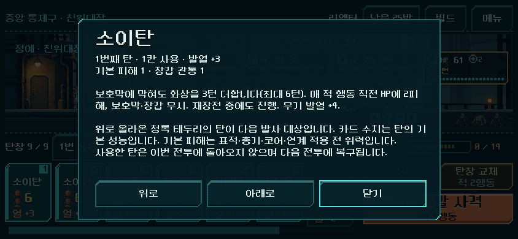
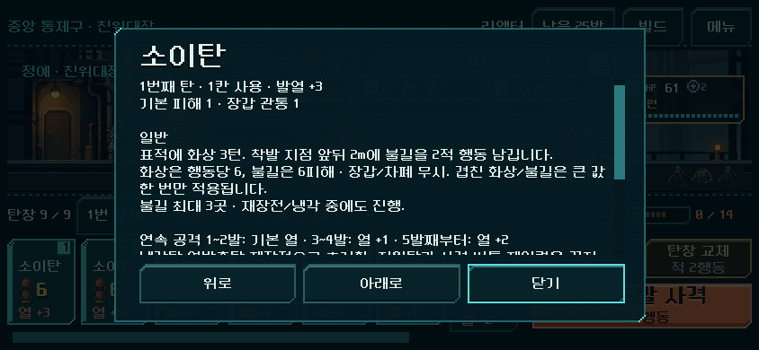
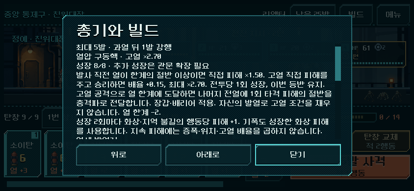
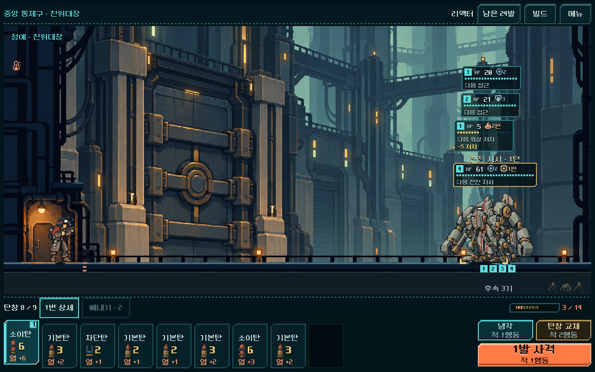

# 2026-11-03 후반 소이·리액터 균형 보정

사용자 “진행해 줘”에 따라 다음 우선순위 중 **1번: 후반 전투 길이·탄약 부담**을 조사하고 본편 새 등반에 반영했다. [현행 규칙](../../direction/combat-roles-growth.md). Godot 4.7 / core-redesign / 격리 저장 `qa_runtime/late_balance_20261103/`. 기존 사용자 저장, APK, 외부 게시, 커밋은 변경하지 않았다.

## 원인과 적용 판단

- 이전 소이 리액터 등반509턴 중251턴이 과열 강제 냉각이었다. 열방출 주력은428턴 중95턴. 이 서로 다른 덱의 차이를 소이탄 하나의 결함으로 단정하지 않고, 같은 획득 상태의 통제 비교로 분리했다.
- 이전 검사는 최대 발사 경로가 성공하면 짧은 범위 선택을 더 탐색하지 않았다. 첫 승리 경로는 최소 행동 턴을 보장하지 않는다. 같은 후반 5전투에서 명시적 범위 선택을 포함한 동일 폭 탐색으로 다시 비교했다. 따라서509턴을 사람의 자연스러운 플레이 길이라고 해석하지 않는다.
- 소이 검사의 장착 정책도 직접 피해 중심이며 후반 코일을 빼는 경우가 있었다. 이번에는 장착·획득 정책까지 동시에 고쳐 효과를 섞지 않았다. 코어·파츠 선택 개선은 다음 단계다.
- 실제 규칙의 문제: 소이의 압축은 화상 기간을 늘리지만 최대6행동이고, 열압 코어의 성장도 직접 피해에만 적용됐다. 기본 직접 피해가 작은 소이의 지속 피해는 후반에도2에 머물렀다.
- 채택: v2 새 등반의 **열압 구동핵 성장2회마다 화상/불길 행동당 피해+1**. 기폭은 그 성장한 남은 화상을 계산한다. 기존 고열 직접 피해 성장 조건과 큰 직접 피해 조합, 과열·교체 비용과 적 접근은 유지한다. 기존 v1 이어하기는 원래 계산이다.

## 같은 조건의 비교

기준 시드731042의 실제 획득 진입 상태를 그대로 복제했다. 덱/열/파츠/적/RNG를 유지하고 역할 버전만1→2로 바꿨다.

| 비교 | v1 | v2 | 해석 |
|---|---:|---:|---|
| 소이28전투, 기존 명령 그대로 재생 |509턴 / 보급4회|465턴 / 보급2회|새 규칙에서 이미 끝난 뒤의 불필요한 명령은 실행하지 않음. 정책 재탐색과 분리.|
| 소이 후반5전투, 같은 범위 탐색 |121턴 / 보급2회|77턴 / 보급0회|양쪽 모두5전투 완료. 탐색 폭40, 최대64단계, 빼내기 미포함. 최적값 보장 아님.|
| 열방출 주력28전투, 기존 명령 재생 |428턴 / 보급3회|428턴 / 보급3회|소이 없는 직접 피해 구성의 결과 보존.|

열방출 후반5전투는 좁은 범위 탐색에서 양쪽 모두 해를 찾지 못했다. 기존 빼내기를 포함한 합법 경로는28전투 모두 재생됐다. 해를 못 찾은 것을 실제 불가능으로 취급하지 않는다.

## 실제 획득 전체 등반

모든 쌍은 리액터/운반용 외투/소이 주력이며 같은 지도·획득·장착·관문 정책과 같은 탐색기를 썼다. **방문 전투 노드, 최종 덱의 순서, 최종 파츠, 관문 투자가 쌍마다 동일**함을 대조했다. 전투 승리·돈·파츠·후반 성장치를 주입하지 않았다. 사격 경로는 각 규칙에서 다시 탐색하므로 완전히 같은 입력 실험은 위 표와 구별한다.

| 시드 | 전투 수(각 버전) | v1 행동 턴 → v2 | 긴급 보급 v1 → v2 | 완료 |
|---|---:|---:|---:|---|
|731042|28|509 → 424|4 → 0|양쪽 완료|
|17|30|579 → 475|2 → 0|양쪽 완료|
|931104|29|465 → 377|3 → 0|양쪽 완료|

이번에 새로 계산한 전체 등반은5회146전투다(v1의17/931104, v2의3시드).731042의 v1은 앞선 실제 획득 경로를 현재 소스로 재생해 비교했다. 두 버전을 합친 비교 대상은6등반174전투다. 각 전투·획득 후 저장/복구를 검사한다. 자동 탐색은 미래 RNG를 보므로 사람의 승률·최선의 빌드·조작감·재미를 증명하지 않는다.

## 실제 화면과 표시 오류 수정

공개 ‘탄환 상세’가 고정 설명을 사용해 성장 후에도 ‘2피해’, 개조 후에도 원래 발열을 적는 오류를 검출했다. 현행 `Readability.description`으로 연결해 카드의 화상6과 상세의 행동당6이 일치한다. 상세는 스크롤로 끝까지 읽을 수 있으며 전투 HUD 배치는 유지했다.

| 수정 전 | 수정 후 |
|---|---|
|||

화면은 v2 시드731042 실제 획득 5구역 정예 진입 저장이다. 탄창 순서를 조작하지 않고 실제 앞 소이탄을1발 발사했다.844×390와1280×800에서 입력, 설명, 실제 계산과 자동 저장을 대조했다. Android 실기기 검사로 해석하지 않는다.

## 검사와 경계

- `rules_full/result.json`:842검사 실패0. 성장 단계·기폭·코일·고열 배율 중복 방지·5총기·관문 성장 상한·예측/RNG·JSON 복구·v1/v2 유지·잘못된 버전 거부.
- `playtest_rework_20261103/rules_late_balance_regression/result.json`:319검사 실패0. 기존 전이/불길/감속/복장/관문과 이전 전투 계산.
- `ui_readable/result.json`:59검사 실패0. 실제 획득 저장의 상세·스크롤·공개 사격·자동 저장.
- `replay_verified/result.json`: **15,621검사 실패0**,6등반174전투의 전체 명령 재생·정확한 턴·획득 덱/개조·승리1회·각 명령 저장/복구 일치. 이전 v1 기준 기록도509턴/보급4회 그대로 재현. [최종 재생 결과](late_balance_2026-11-03_assets/replay_verified.json).
- `tools/run_prototype_hud.ps1 -Mode ui -Fast`: 최종 상세 연결 수정 후11,536검사 실패0. `-Mode import`도 통과.

초기 규칙 검사9실패는 마지막 고정 열방출탄을 맨 앞에 둔 잘못된 통제 탄창4개와, 사용되지 않는 화상 메타데이터까지 직접 피해 동일성으로 비교한 검사 오류였다. 합법 순서와 관련 결과로 고친 뒤 통과했다. 초기 화면 검사3실패 중2개는 실제 고정 탄환 설명 오류였고,1개는 큰 화면에서 불필요한 스크롤을 강제한 검사 조건이었다. 원본 결과를 보존했다.

남은 판단: 사람 플레이에서 지속 피해 성장과 탄약 절약이 읽히는지, 과열 강행/짧은 사격/냉각 중 선택이 남는지 확인해야 한다. 세 시드·운반용 외투 밖의 전체 경제와 다른 핵심 탄 빌드, 열폭주 노심 등 기간 중심 파츠와 성장형 열압 코어의 상대 가치, 파츠 후보 편중, 모바일 실제 조작·성능과 복장 혼합 제보는 이번 통과 범위가 아니다.

소스 수정 전 스냅샷은 `qa_runtime/late_balance_20261103/before/`. 이번 변경과 검증 파일 해시는 [manifest](late_balance_2026-11-03_assets/manifest.json)에 기록한다.
