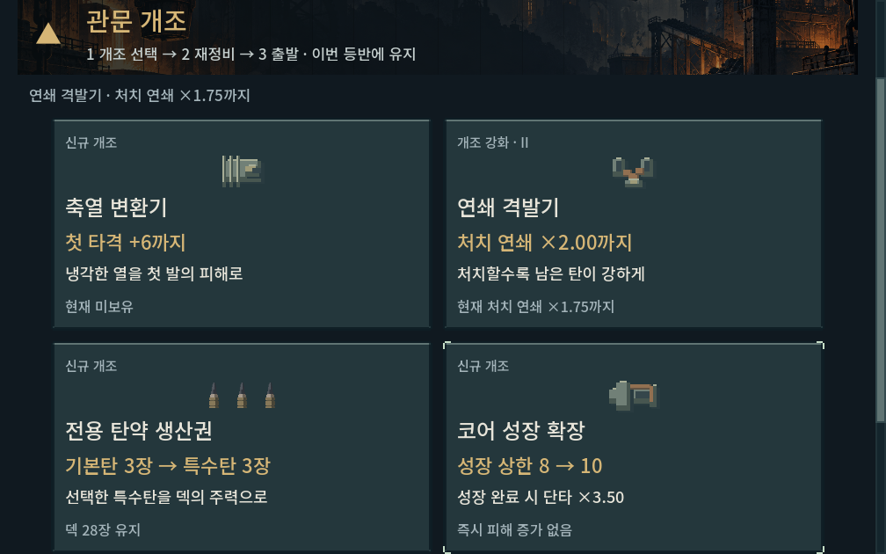
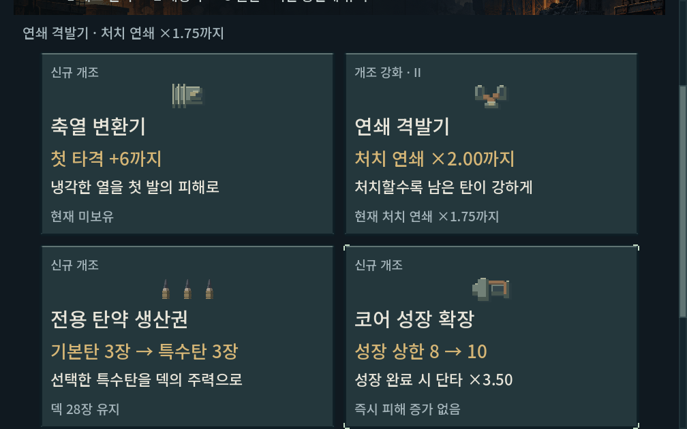
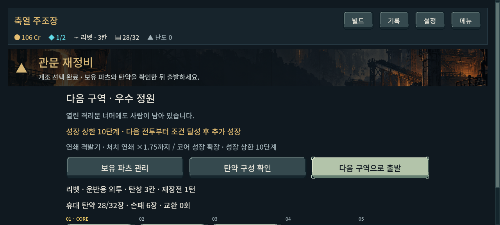

# 후반 관문 코어 성장 확장 — 적용·검증

2026-10-30. 사용자 후속 실행 요청에 따라 [통합 우선순위7번](../../direction/playtest-priorities.md)의 후반 성장 선택을 본편에 연결했다. **새 등반은 2~4구역 보스 뒤 관문에서 다른 개조 대신 ‘코어 성장 확장’을 선택할 수 있다.** 기존 8단계와 초반 성장 속도를 유지하며 상한을 선택당2단계, 최대14까지 연다. 즉시 성장하거나 피해를 지급하지 않는다. 해당 코어를 장착하고 기존 조건을 달성한 뒤 승리해야 한 단계씩 오른다.

## 결정과 비교 범위

[직전 감사](economy_audit_2026-10-30.md)에서는 운반5무기×2시드 모두2구역에서 코어8에 도달했다. 사용자 확정 사항은 후반 강화 재미와 순차 개편 방향이다. 이번의 관문 선택 방식·상한·증가량은 **디렉터 적용값**이며 사람 체감 승인을 의미하지 않는다.

| 비교안 | 판단 |
| --- | --- |
| 기존8단계를 구역별로 나누어 늦게 지급 | 초반 이미 얻던 화력을 줄이므로 이번에는 채택하지 않음. 실제 전투 시험 없이 설계 단계에서 제외했다. |
| 후반 진입 시 상한을 자동으로 추가 | 다른 관문 개조와의 선택 비용 없이 화력을 더하므로 이번에는 채택하지 않음. 이 안의 별도 전체 등반은 실행하지 않았다. |
| 기존8단계 유지 + 후반 관문에서 상한 확장 선택 | 실제 개조 하나를 포기하고 이후 전투의 성장을 얻는 방식으로 채택·구현·검증했다. |

슬롯 확대·일회용 특수탄·새 복장 획득·발사기구 파츠는 이번 문제 해결에 필요하다는 근거가 충분하지 않아 보류한다. 적 HP·발열 B1·탄약/가방·성장 획득 조건은 변경하지 않았다.

## 본편 연결

- `growth_version=1`을 새 캠페인/전투에 함께 저장한다. 표식 없는 기존 이어하기는8단계 상한과 기존 관문 후보를 유지한다.
- 2구역 보스 이후, 성장 코어를 하나 이상 소유했을 때 후보가 나온다. 미장착 상태에서도 선택할 수 있지만, 실제 성장은 장착 후 조건을 충족해야 얻는다. 파츠 슬롯을 차지하지 않으며 모든 성장 코어에 같은 상한을 적용한다. 각 코어의 이미 얻은 단계는 별도로 유지한다.
- 상한은8→10→12→14. 현재 단계는 그대로다. 선택을 늦추거나 건너뛰면 놓친 관문 기회를 소급 지급하지 않는다. 다음 지역으로 출발하기 전 저장/재개·파츠 교체를 유지한다.
- 승리당 최대1단계, 중복 정산 방지·패배 시 미성장·다음 교전 초기화를 유지한다. 개조 구매 직전 전투의 성장 조건을 재사용해 즉시 한 단계를 받지 않는다.
- 새 상한과 맞지 않는 단계, 잘못된 표식/개조 수, 너무 이른 구역의 확장 저장을 원자적으로 거부한다. 기존 저장에 새 표식을 자동 삽입하지 않는다.
- 예측 키에 규칙 표식을 포함하고 기존 성장·관문 상태와 함께 계산한다. 무작위 표적 예측은 기존 분포를 유지한다.

| 해당 상한까지 성장했을 때 | 연쇄 | 열압 | 돌파 |
| --- | ---: | ---: | ---: |
| 8 | 타격 +5 | 고열 ×2.70 | 단타 ×3.20 |
| 10 | 타격 +6 | 고열 ×3.00 | 단타 ×3.50 |
| 12 | 타격 +7 | 고열 ×3.30 | 단타 ×3.80 |
| 14 | 타격 +8 | 고열 ×3.60 | 단타 ×4.10 |

위 값은 개조를 누른 즉시 받는 효과가 아니다. 수치 원본은 `core_growth.gd`, 성장/실제 효과 계산은 `damage_engines.gd`다.

## 검증 결과

선택한15회 실행에서 **51,292검사·기능 실패0**. 반복 저장 복원과 앞 구간 재생을 포함한 검사 수이며 고유 테스트 종류 수가 아니다. 새 등반10조건에서 통합275전투를 실제 명령으로 통과했다. 기본 정책7조건, 정비 후속 포함9조건에서 엔딩 경로를 확인했으며 정찰 리액터 최종전1조건은 탐색 미해결로 남았다.

| 검사 | 결과 |
| --- | ---: |
| 새 성장 규칙·저장·예측·상한·거부 조건 | 785 / 실패0 |
| 기존 관문 규칙·재정비·출발 | 835 / 실패0 |
| 기존 성장 코어 규칙 | 657 / 실패0 |
| 연속 발열 회귀·80조건 | 1,087 / 실패0 |
| 새 관문 실제 화면·터치·저장·큰 글자 | 142 / 실패0 |
| 기존 관문 실제 화면·입력 | 151 / 실패0 |
| 새 등반·실제 정비 후속 | 47,551 / 기능 실패0, 미해결 별도 |
| 소유 파츠 대체 진단2건 | 84 / 실패0 |

**초반112전투는 직전 감사와 명령 경로·턴·소모/생성/잔탄·성장 상태가 모두 동일했다.** 이후 확장을 선택한10경로 모두3구역2단계에서10, 4구역2단계에서12, 5구역2단계에서14에 도달했다. 후반 세 구역에 성장 기회가 생겼지만, 각 구역의 초반 두 교전에 성장이 모이는 현상은 남는다. 더 긴 성장 분배가 필요한지는 사람 플레이로 확인한다.

## 전체 경로 비교

운반·시드731042·같은 획득/공방 교체/정예 우선 정책의27전투다. 기존 선택은 리액터 축열, 나머지 무기 연쇄 우선이며 신규 선택은 첫 관문을 유지하고 나머지 관문에서 성장 확장을 우선한다. 후보 검색은 이전 경로도 현재 모델에서 실제로 다시 검증한 뒤 재사용한다. **찾은 경로의 자원 비용 비교이며 최적 턴이나 순수한 동일 입력 효과가 아니다.**

| 무기 | 기존 개조 총턴 → 성장 확장 총턴 | 최종 잔탄 | 강제 재장전 총턴 |
| --- | ---: | ---: | ---: |
| 리벳 | 116 → 110 | 17 → 17 | 26 → 24 |
| 래칫 | 233 → 230 | 11 → 14 | 27 → 27 |
| 스플린터 | 213 → 203 | 10 → 17 | 75 → 75 |
| 리액터 | 228 → 228 | 4 → 4 | 122 → 122 |
| 스파이크 | 137 → 137 | 22 → 22 | 18 → 18 |

추가 성장만큼 기존 개조를 포기하기 때문에 모든 무기의 소모 턴이 줄지는 않았다. 리액터/스파이크의 실제 피해 값과 성장 단계는 올랐지만 이 경로의 처치/행동 경계는 그대로였다. 스플린터의 강제 냉각 부담도 그대로여서 발열 문제가 해결됐다고 보지 않는다.

| 추가 조건 | 실제 결과 |
| --- | --- |
| 운반 래칫·시드17 | 4구역 보스에서 탐색이 막힘. 보유 후미 점화기를 실제 지도에서 해제한 뒤 동일 패·적·난수로 진입해 남은 구간과 엔딩 통과. 통합30전투257턴, 최종 잔탄12. |
| 운반 스플린터·시드17 | 4구역 정예는 기존 장착으로 통과했지만 최종전에서 막힘. 같은 방법으로 후미 점화기를 해제한 뒤 최종전13턴·잔탄12, 통합30전투221턴. |
| 정찰 스플린터·시드731042 | 기본 정책으로27전투278턴·최종 잔탄1. 이전의 교환 후속 경로는282턴·잔탄3이므로 무조건 더 안전해졌다고 해석하지 않는다. |
| 공방 압축 우선 리액터·시드731042 | 이전 최종전 미해결 조건에서 새 등반27전투227턴·최종전24턴·잔탄1의 경로를 찾음. 압축 일반 우위나 충분한 탄약 여유를 증명하지 않는다. |
| 정찰 리액터·시드731042 | 4구역 보스는 교환 후속으로40턴·잔탄6·생존 마진1에 통과했으나 최종전은 여전히 미해결. 기존 후속의 같은 보스20턴과 비교해 성장 확장 우선이 항상 좋은 선택은 아님을 기록. |

탐색은 숨은 패와 난수를 아는 제한 탐색이다. 실패는 불가능성·기능 오류·플레이어 패배율이 아니다. 후미 점화기 대체 진단은 소유/장착 가능 여부를 확인하고, 채택한 경로를 새 등반의 원래 명령으로 지도까지 재생해 실제 해제·재진입한 뒤 검증했다. 정찰 리액터는 동일 상황의 기존 교환 후보를 현재 상태에서 검증하고 추가 탐색을 수행했다.

## 실제 화면

선택 카드에는 상한 변화, 현재 장착 코어가 확장 후 성장을 마쳤을 때의 실제 효과, 즉시 피해가 오르지 않는다는 조건을 함께 표시한다. 선택만으로 적용하지 않고 별도 적용 버튼을 유지했다. 네 후보는2열로 배치하고 글자 크기에 따라 카드 높이를 늘린다. 좁거나 짧은 화면에서는 설명·적용 버튼까지 세로 스크롤한다.

1008×630,1280×800,1280×576과 글자1.2배에서 실제 Godot 렌더·합성 터치·자동 저장/재개를 확인했다. 카드 글자 경계·기본 키보드 포커스를 검사했다. 물리 키보드/게임패드나 모바일 실기기 사용성 검증은 아니다. 최종 캡처8장 중 아래3장을 직접 검수했다.







초기 네 카드 가로 배치에서 본문이 카드 밖으로 나와2열·내용 기반 높이로 수정했다. 초기 스크립트 형식 추론 오류와 잘못 전달한 명령 인자도 수정했으며 최종 집계에 실패 실행을 섞지 않았다.

## 재현·근거·남은 일

```powershell
./tools/run_growth_checks.ps1 -Mode rules -Tag verify_rules
./tools/run_growth_checks.ps1 -Mode ui -Tag verify_ui
./tools/run_growth_checks.ps1 -Mode campaign -Tag verify_carrier
./tools/run_growth_checks.ps1 -Mode campaign -Tag verify_17 -Guns 'burst,scatter' -Seeds '17'
./tools/run_growth_checks.ps1 -Mode campaign -Tag verify_scout -Guns 'heavy,scatter' -Outfit scout
./tools/run_growth_checks.ps1 -Mode campaign -Tag verify_compress -Guns heavy -Workshop compress
```

원자료: [집계 JSON](assets/late_core_growth_2026-10-30/summary.json) · [경로 CSV](assets/late_core_growth_2026-10-30/runs.csv) · [로그·입력·실행 소스 ZIP](assets/late_core_growth_2026-10-30/evidence.zip) · [변경 전후 해시](assets/late_core_growth_2026-10-30/manifest.json) · [최종 정합성 확인](assets/late_core_growth_2026-10-30/verification.json). 재현 도구는 직전 경제 감사의 실제 획득 경로/관문 저장을 사용하며, 증거 묶음에 필요한 입력을 보존했다. 게임 동작 변경은 본편7파일로 제한했고 QA 도구와 문서를 추가/갱신했다. 기존 사용자 변경을 보존했고 전체 작업 트리 `git diff --check`는 오류 없이 통과했다.

이번 적용은 기능·성장 기회 연결의 완료다. 성장 확장의 사람 선택 가치, 각 구역 초반에 몰리는 성장 속도, 작은 복장의 조합 난도, 정찰 리액터의 최종전과 스플린터 발열 부담은 남는다. 모바일 장시간 FPS/기기 발열도 별도 확인이 필요하다. 다음 독립 작업은 후순위로 남겼던8번 관문 통과 연출 검토이며, 슬롯 확대 등 추가 성장 기능은 이번 빌드의 체감 피드백 전까지 보류한다. APK·커밋·푸시·외부 게시 없음.
