# 출시 준비 점검 — 전후 화면과 검증

2026-11-12. 결정과 이유는 [출시 준비 점검](../../../direction/launch-readiness.md)에 있다. 이 문서는 무엇을 어떻게 확인했는지와 화면 증거다.

## 세 가지 기록

| 구분 | 내용 |
| --- | --- |
| 기능 통과 | 현재 UI 검사 35종 통과(`tools/run_current_ui_checks.ps1`), 이전 규칙 회귀 6종 기준선 그대로. 새 검사 `tests/launch_balance_rules.gd` 58. |
| 시각 확인 | 둘러보기 캡처를 직접 봤다. 1170×540 리벳 100장(`qa_runtime/launch_tour_20261112/run7/`), 1040×480 리와인더 100장(`run6_1040/`). 아래 전후 그림. |
| 사람의 이해도 | **확인하지 않았다.** 문구가 읽히는지, 리와인더와 난도가 손에 맞는지는 사람 플레이가 필요하다. |

## 전후

모두 1170×540(1080p 휴대폰의 게임 단위 크기). 왼쪽이 이전, 오른쪽이 지금.

| 화면 | 이전 | 지금 |
| --- | --- | --- |
| 타이틀 |  | 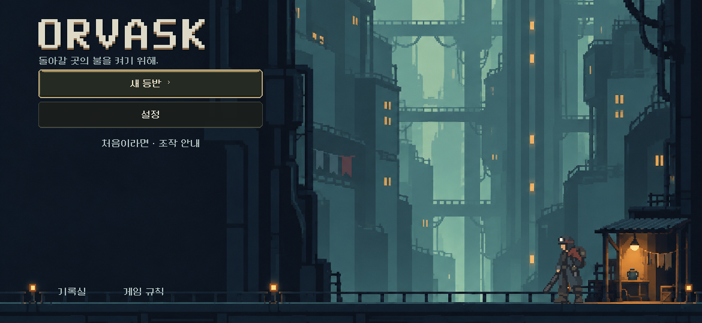 |
| 게임 규칙 | 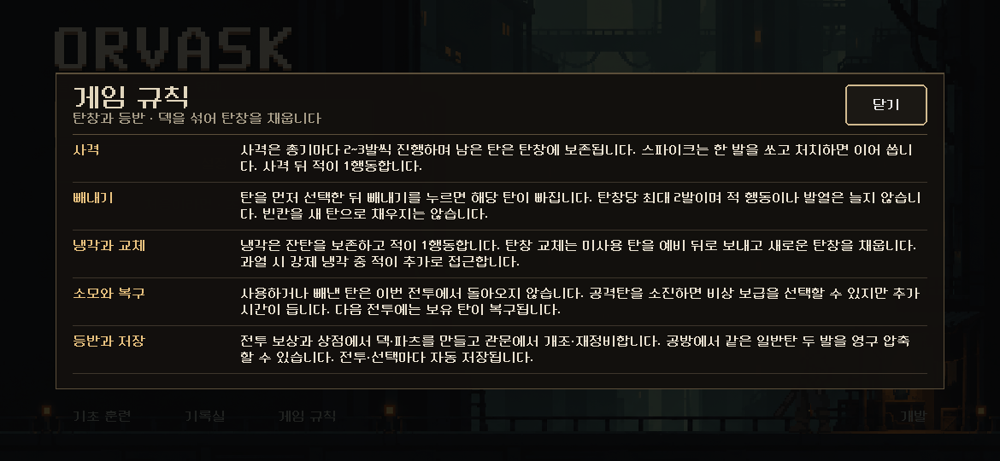 | 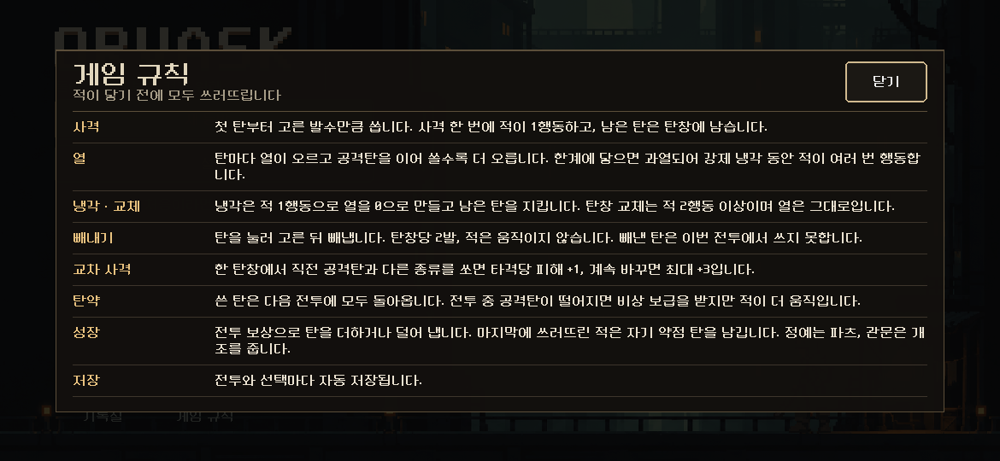 |
| 무기 정보 | 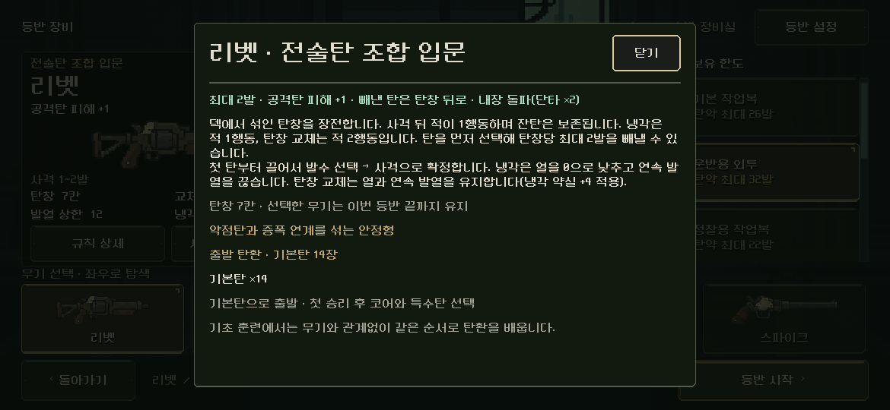 | 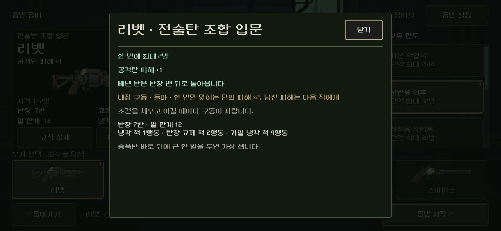 |
| 탄환 상세 | 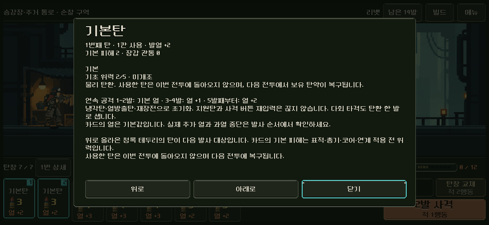 | 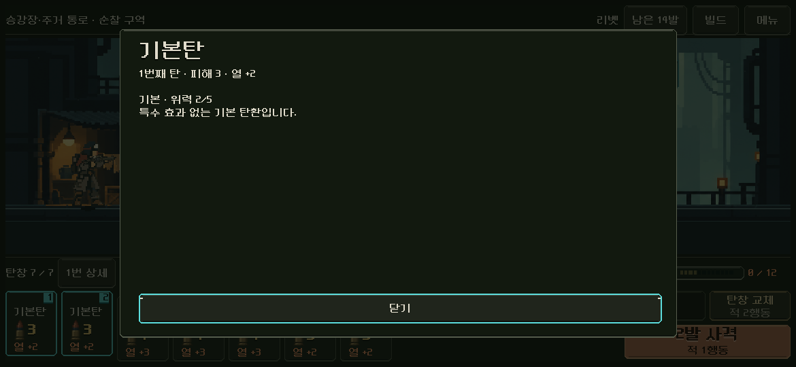 |
| 전투 보상 | 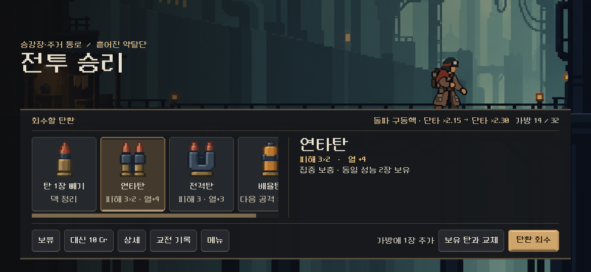 | 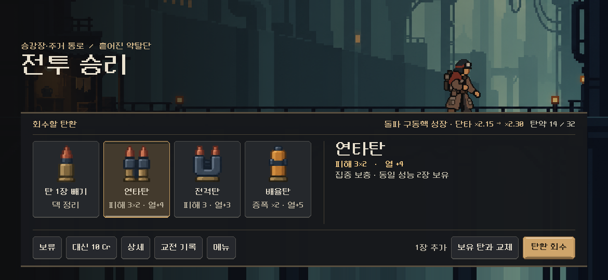 |
| 상점 메뉴 | 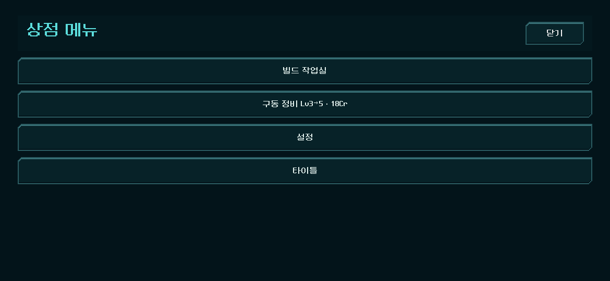 | 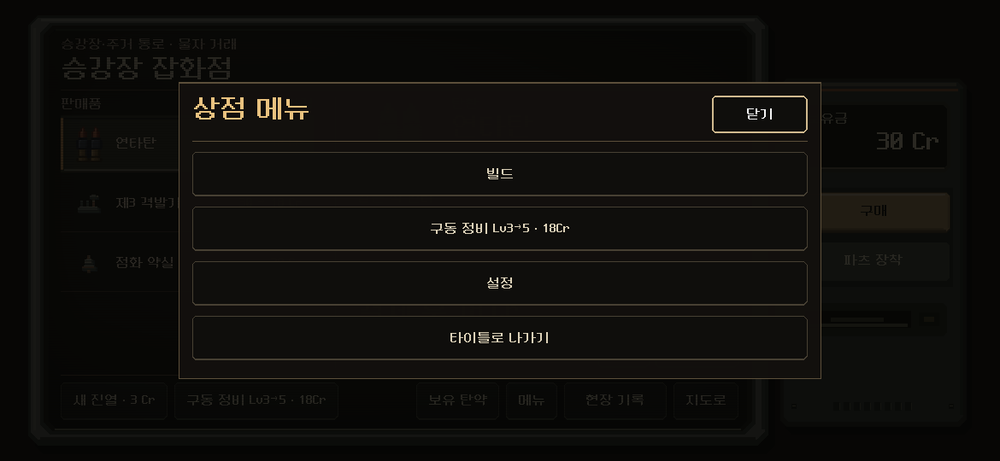 |
| 탄약고 | 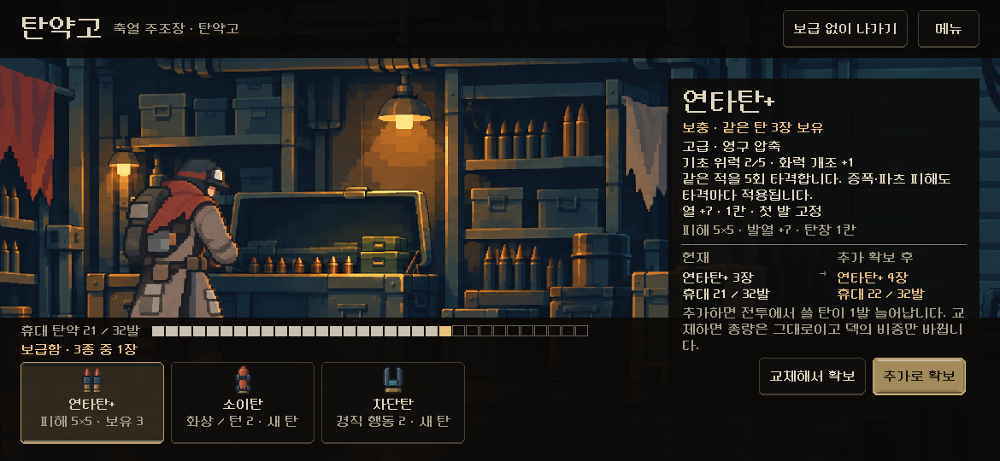 | 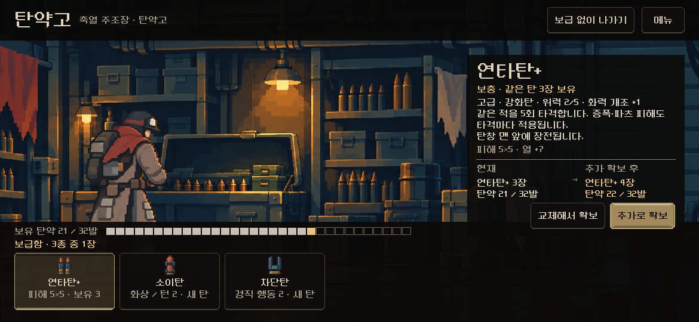 |
| 교전 기록 | 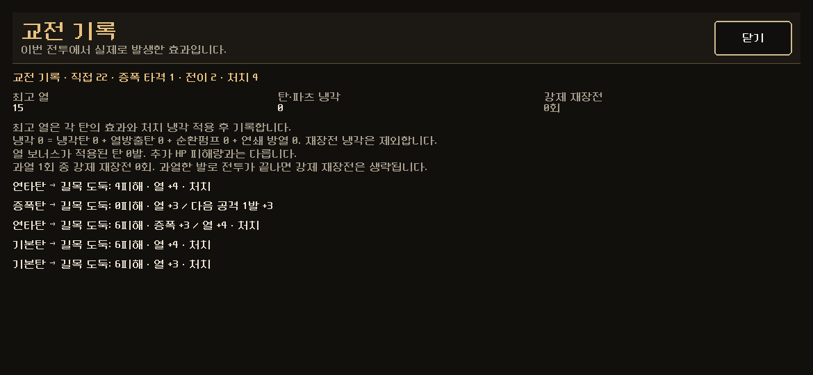 | 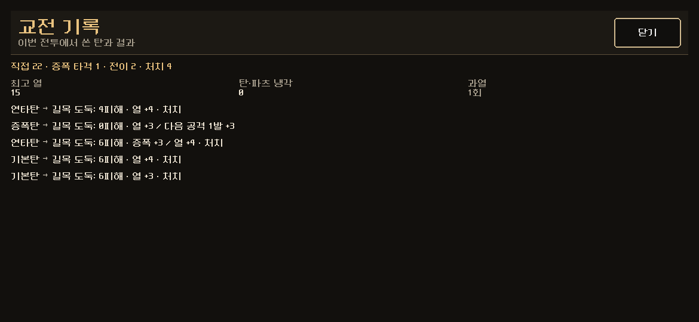 |
| 결과(승리) | 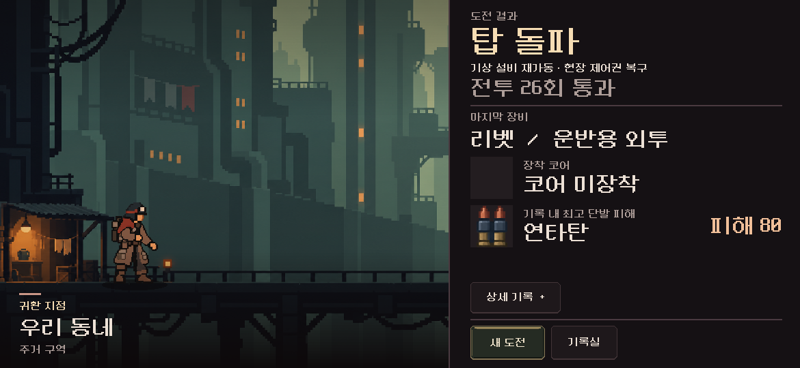 | 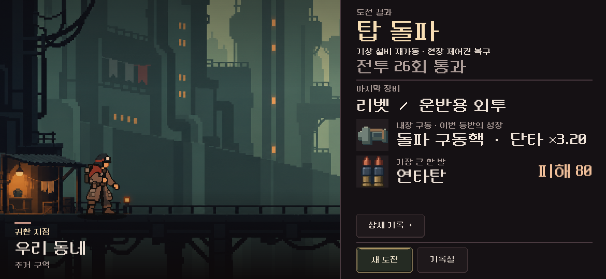 |

새로 생긴 것:

| 화면 | 그림 |
| --- | --- |
| 첫 전투 안내 줄 | 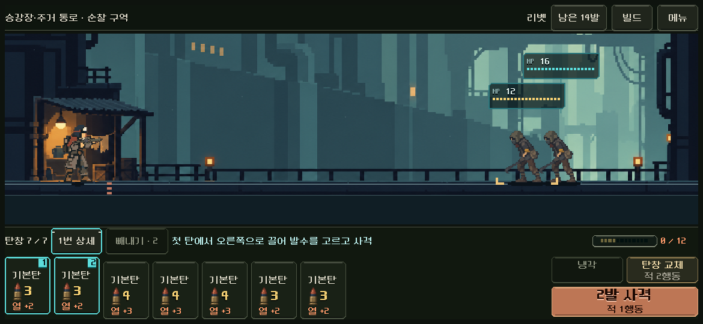 |
| 빌드 창의 내장 구동 | 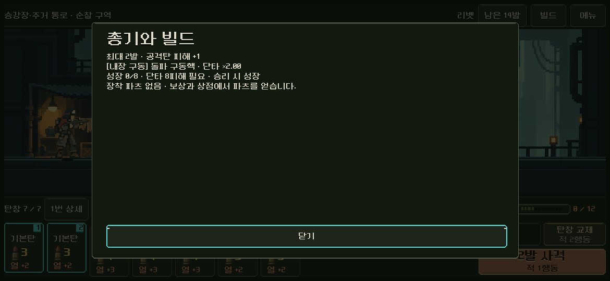 |
| 결과(패배)의 원인과 조언 | 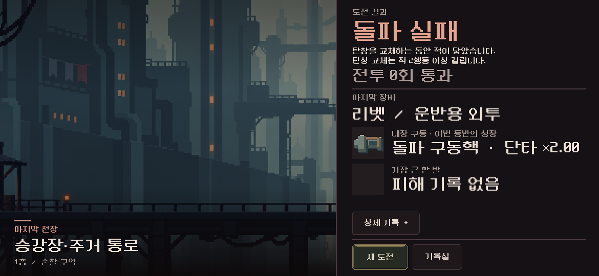 |
| 리와인더 전투(1040×480) | 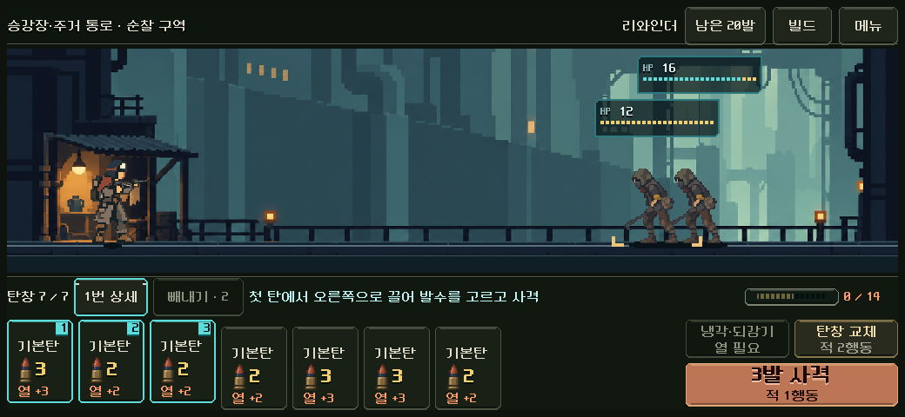 |

`before_results_won.png`은 작업 도중(결과 화면을 고치기 전)의 캡처다. `before_record.png`도 창 재질을 바꾼 뒤, 문구를 줄이기 전이다.

## 문구 전체

[text_dump.txt](text_dump.txt) — 새 등반(리벳 기준)의 탄환·파츠·총기·복장 문장. 파츠는 실제로 제시되는 것만, 제시되는 총기와 함께 적었다. 복장 설명의 '5장 중 고르고 … 교환'은 손패 훈련용 문장이며 본편에서는 보이지 않는다(장비 화면은 `탄약 최대 N발`만 쓴다).

## 자동 등반

표와 읽을 점은 [출시 준비 점검 · 밸런스](../../../direction/launch-readiness.md#밸런스--7개-총기). 원자료는 `qa_runtime/growth_v2_20261110/` 아래 폴더다.

| 폴더 | 내용 |
| --- | --- |
| `launch_1112` | 해법기 7총기(시드 17, 주력 3총기는 23도), 생각 없이 7총기 |
| `launch_1112_careful` | 신중한 플레이 7총기(리와인더는 되감기 ×3만 있던 때) |
| `launch_1112_careful_direct`, `_control` | 리와인더·리액터를 다른 빌드로 |
| `launch_1112_rewind`, `launch_1112_rewind2` | 리와인더: 되감기 ×3만 / 내장 구동까지 바꾼 뒤 |
| `launch_1112_d5`, `_d10` | 난도 5·10, 구역과 상관없이 +8%였던 때 |
| `launch_1112_d5r`, `_d10r` | 난도 5·10, 지금 방식(구역별) |

다시 돌리는 법(등반 하나에 5~10분):

```powershell
$env:QA_GUN='rewinder'; $env:QA_SEED='17'; $env:QA_NAIVE='careful'; $env:QA_AMMO='variety'; $env:QA_DIFFICULTY='5'
# QA_OUTPUT_DIR는 qa_runtime\growth_v2_20261110\ 아래 폴더여야 한다(격리 확인).
Godot --headless --path <프로젝트> --script res://tests/growth_v2_climb.gd
```

## 한계

- 자동 등반은 시드 하나가 대부분이다. 자동 선택은 사람만큼 빌드를 잘 고르지 못하고, 빼내기·교차 사격을 노리지 않는다.
- 해법기는 플레이어 행동 수를 줄이는 경로를 찾으므로 과열을 일부러 밟는다. 해법기 수치는 '가장 잘하는 플레이'가 아니다.
- 난도 6~10을 사람이 넘을 수 있는지는 재지 못했다.
- 둘러보기는 리벳(1170×540)과 리와인더(1040×480) 두 번이다. 나머지 다섯 총기의 전투 화면은 기존 검사(`weapon_live_ui`)에 맡겼다.
- 실제 기기에서 보지 않았다.
