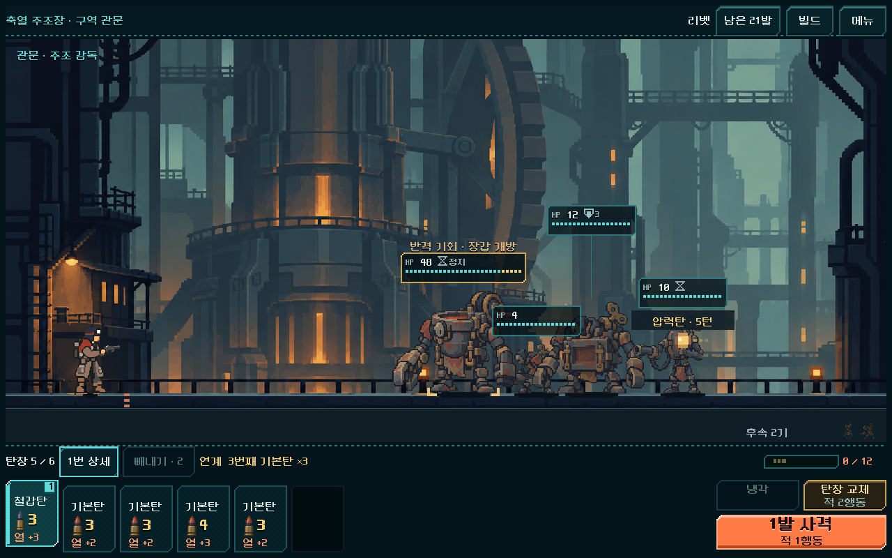

# 2구역 정예·보스 반격 구간 적용

[현재 결정](../../../direction/leader-patterns.md). 금형 파수꾼·주조 감독의 돌진 압박을 높이고 돌진 직후 한 적 행동 전까지 장갑0의 반격 구간을 연결했다. HP/호위/보상·총기/탄환/파츠 수치와 조작/배치는 유지했다. 새 도전만 `enemy_pattern_version=1`이며 이전 저장은 이전 돌진/장갑 규칙을 유지한다.

## 기능과 실제 화면

| 검사 | 결과 | 범위 |
|---|---:|---|
| 새 패턴 규칙 | 296검사 실패0 | 정예/보스 주기·5총기 실제 사격/재장전·예측 비소모/실행 일치·파쇄 영구 감소·차단/감속·화상 선처치·접촉·구규칙·불량 저장 거부 |
| 본편 UI | 111검사 실패0 | 실제 획득한 새 보스 상태,1280×800/1008×454/2340×1080, 터치 범위 선택→사격→냉각→돌진/노출→상세→반격, 중간 자동 저장/정확한 재개 |
| 기존 밸런스 규칙 | 320검사 실패0 | 이전 지속 피해·코어/파츠·새/구 저장·무작위 예측 캐시 |
| 기존 HUD | 11,558검사 실패0 | 원래 배치/입력/사격/빼내기/표시·저장 회귀 |

[규칙](runs/rules_complete/rules.json) · [UI](runs/ui_first/ui.json) · [본편 소스 해시](source_manifest.json). 실제 PC/작은 가로/S26비율 렌더를 열어 상단 반격 문구·HP 상태·상세 가독성을 확인했다. S26비율의 PC 렌더이며 Android 실기기 검증은 아니다. 제거했던 HP 아래 ‘다음’ 문구는 추가하지 않았다.

[축압](windup_1280x800.png) · [반격 후](countered_1280x800.png) · [작은 가로](open_1008x454.png) · [S26비율](open_2340x1080.png) · [상세](detail_1008x454.png).

## 실제 획득 전체 경로

실제 Campaign의 획득/상점/정비/성장과 합법 명령·저장/재개를 사용했다. 시드17/운반용으로 리벳·래칫·스플린터·스파이크의 일반 경로와 리액터 열압의 정예 선호 경로를 확인했다. 리액터는 시드731042/정찰·소이 노심 선호 경로도 확인했다.

**6개 완주 경로,179전투,15,772검사 실패0**. [집계](summary.json) · [경로/보유 덱·파츠/명령·최종 원자 저장](runs/). 미래 드로/난수를 아는 기존 유한 탐색을 사용했으므로 사람의 승률이나 최적해 증명은 아니다. 강화/가방 비교를 위해 생성한 별도 국소 분기는179전투에 합산하지 않았다.

| 경로 | 전투 수 | 2구역 정예·보스: 적 행동/잔탄 | 전체 비상 보급 |
|---|---:|---|---:|
| 리벳17 | 30 | 보스12/13 | 0 |
| 래칫17 | 30 | 보스14/18 | 0 |
| 스플린터17 | 30 | 보스11/16 | 0 |
| 리액터·열압17 정예 선호 | 31 | 정예20/6,18/8,15/11 · 보스9/15 | 0 |
| 스파이크17 | 30 | 보스10/14 | 0 |
| 리액터·소이 노심731042 정찰 | 28 | 정예16/9 · 보스23/8 | 2 |

최종 저장 원문에서 해당10조우의 행동 영수증을 다시 읽었다. **돌진19회, 열린 동안 직접 피해를 준 소비 탄30발**을 확인했다. [재장전 포함 실제 사건](committed_leader_events.json). 이 수는 지속 피해·연쇄 피해를 본체 직접 피해에 합산하지 않으며 전체 피해 기여율을 뜻하지 않는다. 스파이크의 해당 보스는 열린 동안 직접 탄을 맞히지 않아도 처치했다. 반격 창 이용을 모든 빌드에 강제하지 않는다.

## 같은 상태의 이전/새 패턴 비교

실제 획득11상태(보스7/정예4,5총기/2시드/2복장)마다 덱·파츠·발열·표적/드로 난수를 복제했다. 이전/새 규칙×4정책으로 **88개 국소 전투**를 비교했다. 이전에 얻은 상태6개와 새 정예 선호 경로의 상태4개, 정찰 경로의 추가 정예1개다. 다른 조우와의 연속 자동 플레이가 아니다.

| 국소 운용 | 이전 통과/11 | 새 통과/11 |
|---|---:|---:|
| 탄이 있으면 최대 사격, 비면 교체 | 9 | 5 |
| 공개 고열 때 냉각, 나머지1발 사격 | 1 | 1 |
| 축압 중1발/열이 있으면 냉각, 회복 중 최대 사격 | 9 | 9 |
| 미래 드로/난수를 아는 제한 탐색 | 11 | 11 |

[정책별 원문·순서·턴·잔탄·실제 돌진/노출](runs/probe_events_final/probe.json). 공개 정책은 예비 드로/난수·미래 표적을 읽지 않는다. 냉각은 열이 있을 때만 합법적으로 사용한다. 단순1발 사격도 자동 정답이 아니며, 반격을 기다리는 동안 호위·압력탄·접촉이 진행된다. 같은 시작 상태라도 사격량/처치/성장/표적 난수가 이후 경로를 다르게 만들 수 있으므로 수치 전체를 장갑 개방의 단독 인과 효과로 해석하지 않는다.

큰 직접 화력·관통/화상·제어를 약화하거나 체력/강제 무적 국면으로 패턴을 보게 만들지 않았다. 현재 범위에는 실제 반격 이득과 완주 가능한 대응이 있어1차값을 유지한다. 정찰의 후반 비상 보급2회·일부 긴 전투와 무작위 스플린터의 조작/대응 부담은 사람 관찰 대상이다. 최종 난도/모든 복장·시드·어센션의 균형과 사람의 긴장감은 미확정이다.

## 검증 중 발견과 한계

- 최초 공개 반격 정책이 열0에서 냉각을 지시해10개 불법 명령 검사가 실패했다. 제품 결함으로 분류하지 않았으며 열>0 조건을 고치고 전체 비교를 다시 수집했다. [초기 원문](diagnostics/initial_probe.json)은 최종 판단에 사용하지 않는다. 당시 노출 통계는 회복/실제 장갑 개방을 구분하기 전이다.
- 재장전 뒤 자동 장전 영수증이 추가돼 `history.back()`만 읽으면 재장전 중 돌진을 누락하는 집계 문제도 발견했다. 새 비교기는 실제 재장전 상세를 읽으며 기존 수집기도 해당 명령 영수증을 찾도록 수정했다. 전체 경로 원문의 기존 `pressure_metrics.event_kinds`는 일부 재장전 사건이 빠진 부분 집계다. 그 값을 돌진 총수로 사용하지 않고 최종 원자 저장의 영수증으로 재집계한 파일을 제공한다. 승패·턴·잔탄·합법 명령/저장 검증은 이 집계 누락과 별개다.
- 별도의 엔진 `--check-only` 명령은 C++ signal11로 중단됐다. [관측 기록](diagnostics/check_only_failure.txt). 일반 headless 실행·실제 본편 UI와 회귀는 정상이다. 수집기 수정 후 같은 실제 획득30전투를2693검사 실패0으로 재실행했고, 이전 실행과 최종 원자 저장 전체·각 전투의 명령/턴/잔탄이 정확히 일치했다. [재확인](collector_recheck.json). 이 추가 실행은 위6경로179전투 표본에 중복 합산하지 않았다. 별도 검사 모드의 중단 원인은 미확인이다.
- PC 창 크기별 본편 표시/입력·자동 검사와 사람 플레이의 이해도/재미를 구분한다. Android 실기기/장시간 발열·다른 구역 고유 패턴·전장 차단벽·탄약고/승인 관문 통합은 이번 완료 범위에 포함하지 않는다.

실행: `tools/run_leader_patterns.ps1 -Mode rules`, `-Mode probe`, `-Mode ui`; 전체 경로는 `-Mode climb -Gun heavy -Route elite` 또는 `-Gun heavy -Seed 731042 -Outfit scout -Core inferno`. 모든 실행은 전용 `qa_runtime/leader_patterns_20261106/` 저장을 사용한다. 기존 첫 밸런스 비교기는 이후 패턴 표식을 명시적으로 제외해 비교 변수를 유지한다.
