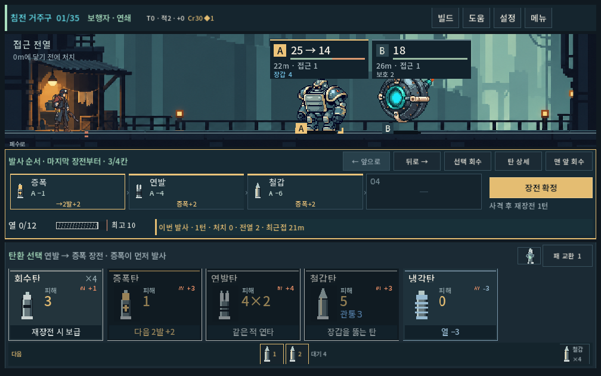
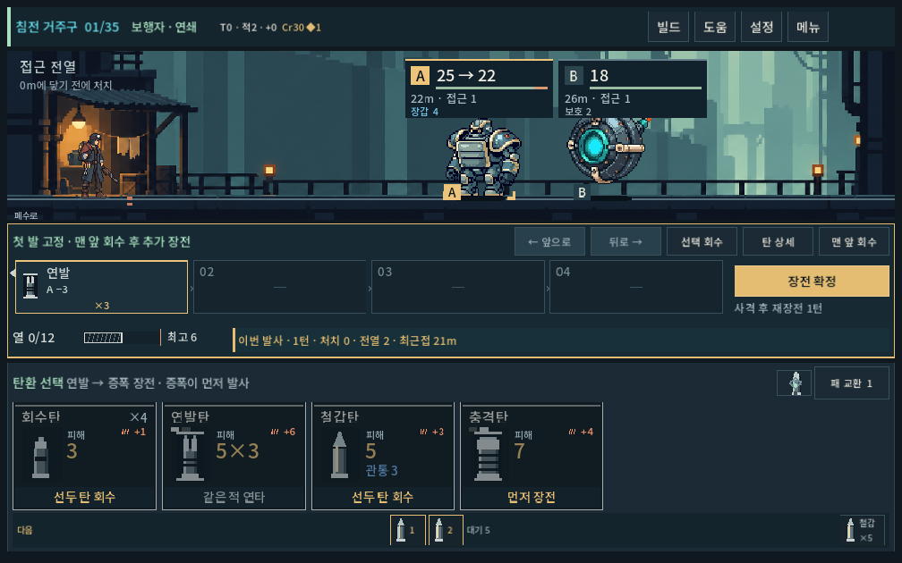
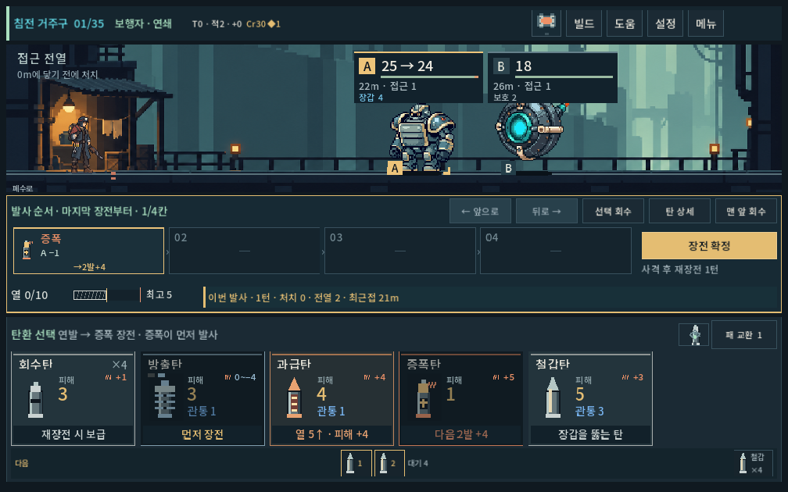

# 마지막 장전 탄 우선 발사 — 구현과 검증

2026-10-04 · `prototype/core-redesign` · Godot 4.7 · 기존 미커밋 작업 위에 적용.

사용자가 원래 의도를 명확히 했다. **장전 철갑→연발→증폭 / 발사 증폭→연발→철갑**. 탄환·파츠·적·열 수치를 바꾸지 않고 입력 규칙과 안내를 수정했다. 이전의 “아무 탄이나 넣어도 효율적”이라는 체감 문제를 해결했다고 주장하지 않는다.

## 구현

- 새 탄을 `plan` 맨 앞에 넣는다. `plan`/`magazine`은 계속 실제 발사 순서이므로 확정·예측·발사에서 다시 뒤집지 않는다. 명시적 순서 편집은 보이는 발사 순서를 바꾼다.
- `맨 앞 회수`는 현재 첫 발사 탄을 제거한다. 선택 회수·드래그·전장 압축 취소/코어 환급을 유지한다.
- 마지막 발사 고정 탄은 빈 레일에 먼저 장전한다. 첫 발사 고정 탄은 마지막에 넣으며 그 앞에 추가 삽입할 수 없다. 자동 재배치 대신 `먼저 장전`/`선두 탄 회수`를 카드 하단과 레일에 표시한다. 영구/전장 압축탄에 같은 규칙을 적용한다.
- 저장v10. v9의 편집 중·확정·부분 발사 배열을 유지하고 이후 입력부터 새 규칙을 적용한다. v8의 열 부채 이전 경로를 유지한다.
- 첫 전투 안내·규칙·상세·샘플은 장전 순서와 발사 순서를 구분한다. 작성된 발사 조합을 쓰는 검사는 역순의 실제 장전 명령으로 준비한다. 새 전용 검사는 원시 입력마다 맨 앞 삽입을 직접 확인한다.

## 이번 실행 결과

모든 실행은 `qa_runtime` 아래 격리된 APPDATA/LOCALAPPDATA를 사용했다. 아래 수치는 검사 단언 횟수이며 플레이 횟수나 사람 승률이 아니다.

| 검사 | 통과 / 실패 |
|---|---:|
| LIFO 규칙: 5무기·4시드·6순열, 앵커·압축·v9 복원·실제 발사 | 2,828 / 0 |
| LIFO 실제 화면: 1280×900, 1008×630, 1440×630 | 364 / 0 |
| 기존 탄환 확장 규칙 | 45,881 / 0 |
| 기존 발열 규칙 / UI | 757 / 0 · 272 / 0 |
| 발열 빌드 규칙 / UI와 비동기 산개 편집 | 2,479 / 0 · 274 / 0 |
| 결과 요약 규칙 / UI | 248 / 0 · 316 / 0 |
| 기존 터치·드래그·압축·상점 / 파츠 피드백·큰 글자 | 110 / 0 · 445 / 0 |
| 기존 무기 규칙 / 성장·보급·저장 규칙 | 3,605 / 0 · 4,589 / 0 |
| 새 전체 등반: 5무기×2경로×35층 | 27,051 / 0 |

전체 등반은 기본 난도, 시드731042, 후보 제한800의 기능 탐색이다. 열 경계·적·보상·상점·압축·파츠를 포함해 4,390명령마다 저장 복원을 검증했다. 모든 경로 완주는 기능 경로의 통과이며 난도 적절성의 증거가 아니다. 이번 기록의 별도 전 명령 재생은 실행하지 않았다. [경로 요약](lifo_2026-10-04_assets/campaign_summary.json), [명령·최종 상태 원본 압축본](lifo_2026-10-04_assets/campaign_report.json.gz).

실행: `tools/run_lifo_checks.ps1 -Mode rules` / `-Mode ui`, `tools/run_progression_checks.ps1 -Mode campaign -Label lifo`. 스크립트 실행 제한 환경에서는 프로세스 범위의 `powershell -NoProfile -ExecutionPolicy Bypass -File`로 실행했다. 시스템 정책은 변경하지 않았다. `tools/play_game.ps1 -CheckOnly`도 통과했다.

## 실제 화면 확인

실제 Godot 창의 공개 입력으로 장전·편집·회수·확정·발사·압축을 수행했다. 최소 화면에서 레일 안내와 제약 사유, 예측/실제 결과와 필수 조작 경계를 확인했다. 초기 캡처에서 기존 `DecisionPrompt`가 숨겨지고 카드의 `context_text`도 그려지지 않아 새 안내가 보이지 않는 점을 찾아, 실제 보이는 레일 제목과 카드 하단으로 연결한 뒤 재검사했다.

[1280px 화면](lifo_2026-10-04_assets/lifo_combo_1280.png), [실제 발사 후](lifo_2026-10-04_assets/lifo_fired_1008.png).

## 한계와 증거

검사 중 잘못된 fixture 용량, JSON int/float 비교 방식, UI 사각형 타입 추론을 수정했다. 기존 무기 검사에 남아 있던 자동 앵커 배치와 20종 파츠/짧은 상점 순환 가정도 현행 규칙·23종 파츠에 맞게 갱신했다. 최종 실행은 위 표와 같다. 인증서 저장소 경고가 있었으나 Script/Parse 오류는 없었다.

PC에서 조작·렌더·계산의 일치를 확인했다. Galaxy 실기기, 사람이 역순 장전을 얼마나 쉽게 이해하는지, 탄환 선택 가치와 장기 빌드 재미는 미검증이다. 이 변경으로 과거 밸런스 비교 수치를 새 사람 플레이 근거로 갱신하지 않는다. APK·커밋·푸시는 수행하지 않았다.

[원본 로그·소스 지문 목록](lifo_2026-10-04_assets/manifest.json), [검증한 소스 SHA-256](lifo_2026-10-04_assets/source_sha256.json). 이전 보고서는 수정하지 않고 별도 보존했다.
