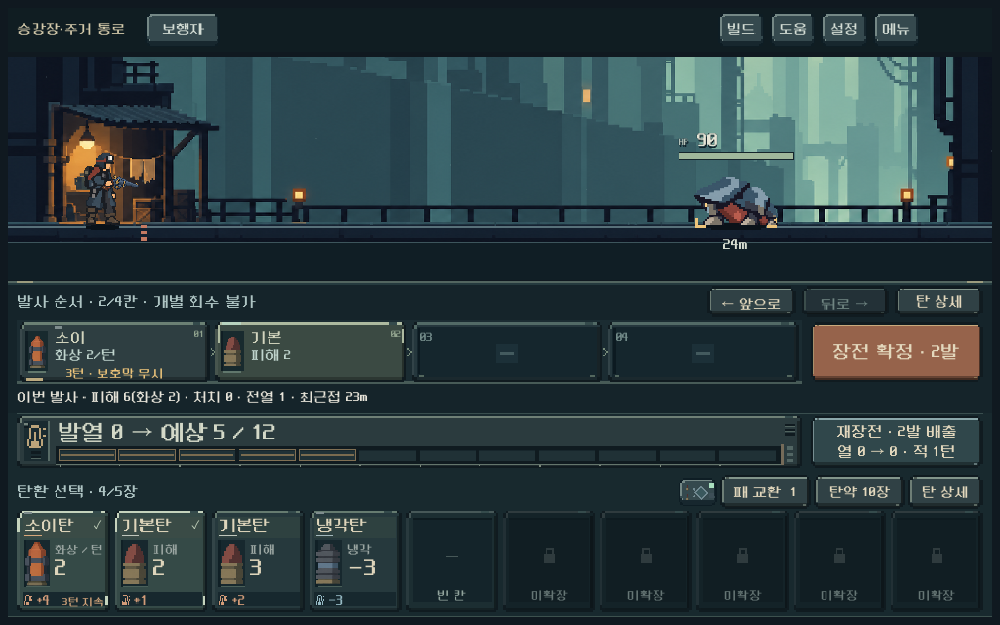
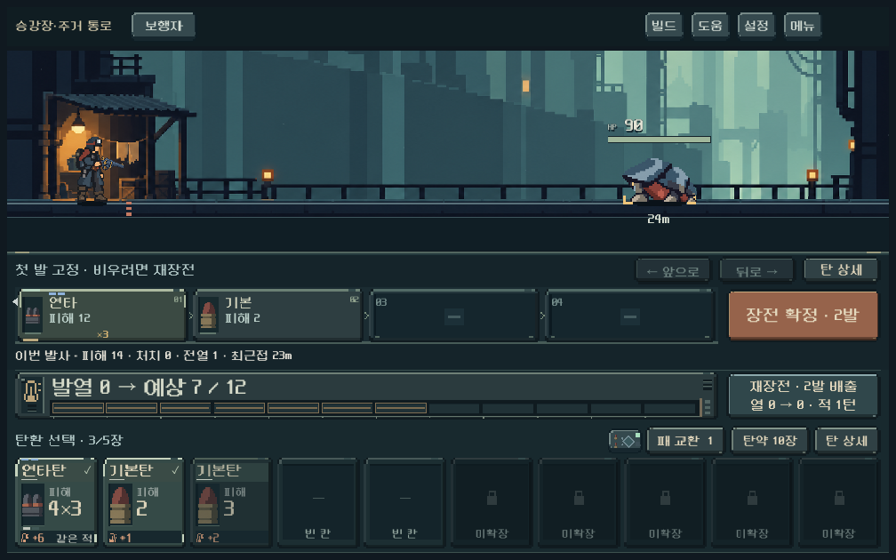
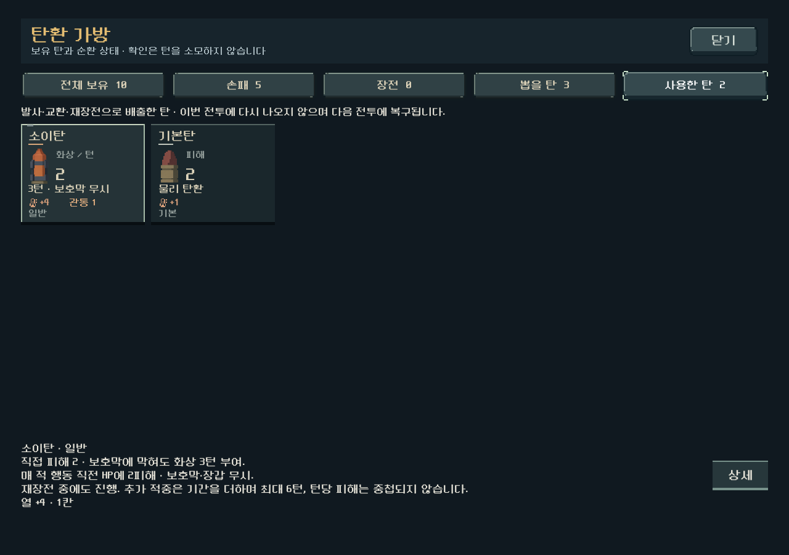

# 장전 후 개별 회수 금지 — 2026-10-21

사용자는 삽입 후 회수 불가능 방식을 제안했고, 개별 회수 금지·확정 전 순서 변경 유지·전체 재장전 배출 방식을 승인했다. 이날 앞서 구현한 [개별 회수 시 소모안](recall_cost_2026-10-21.md)을 대체한다. `prototype/core-redesign`, 기준 HEAD `197c6941`. 기존 소이탄·비축·복장 등 미커밋 변경을 보존했다.

## 적용

- `reserve_version=1` 등반에서 삽입한 탄은 확정 전에도 개별 회수할 수 없다. 버튼뿐 아니라 모델의 선택 회수·되돌리기·임시 압축 취소 경로도 거절한다. 거절은 탄/턴/열/RNG/기록을 바꾸지 않는다.
- 위치 제약 안에서 순서 이동은 무료다. 장전 전 길게 누르기/탄 상세로 효과와 발열을 확인할 수 있다. 새로운 카드별 확인 팝업은 넣지 않았다.
- 장전 구성을 포기하려면 전체 재장전으로 삽입된 탄을 사용함에 보내고 기존 무기별 턴 비용을 지불한다. 미장전 손패는 유지하고 예비 탄으로 빈자리만 채운다.
- 임시 압축탄 배출은 원본2장을 사용함으로 보내며 압축 코어를 반환하지 않는다. 다음 전투에서 소유 탄은 복구한다.
- 기존 비축 이어하기에도 적용한다. 비축 도입 전 저장과 훈련은 원래 회수/순환을 유지한다.
- 발사 순서에 `개별 회수 불가`, 재장전 버튼에 `N발 배출`과 `적 N턴`을 표시한다. 냉각 전후 열과 치명적 결과 경고는 유지한다. 첫 발 고정 탄은 `비우려면 재장전`으로 안내한다.
- 탄환 가방·도움말·압축·패배 안내를 맞추고, 현행 방향 문서의 무료 회수 설명을 정리했다.

[현행 규칙](../../direction/ammo-reserve.md). 재미와 실수 부담의 균형은 이번 기능 검증과 별도로 사용자 플레이에서 확인한다.

## 검증

Godot4.7, 실제 전투 모델과 본편 UI를 사용했다. `qa_runtime/reserve`와 `qa_runtime/heat`의 별도 APPDATA/LOCALAPPDATA에서 검사하여 사용자 저장을 덮어쓰지 않았다.

| 검사 | 통과 / 실패 | 확인 범위 |
| --- | ---: | --- |
| 비축 규칙 | 683 / 0 | 일반/동일 사본/임시 압축의 회수 차단, 거절 입력 무변경, 무료 순서 이동, 전체 배출과 무기 턴 비용, 첫 발 고정, 미장전 손패, 남은 화상 승리/탄약 소진, 진행 중·패배 저장 복원, 이전 저장 |
| 실제 UI | 682 / 0 | 1008×630/1280×900/1440×630, 터치 장전→순서 변경→전체 배출→사용함, 회수 버튼 부재, 배출 수/턴 표시, 임시 압축, 첫 발 고정, 기존 저장 회수, 탄약 소진 화면과 저장 복원. 기존 비축 UI 회귀 포함 |
| 발열 규칙 | 917 / 0 | 열 한계/사격/강제 재장전/냉각/예측의 기존 회귀 |

총 **2,282검사 실패0**. [규칙 로그](assets/load_commit_2026-10-21/rules.log) · [UI 로그](assets/load_commit_2026-10-21/ui.log) · [발열 로그](assets/load_commit_2026-10-21/heat_rules.log). `git diff --check` 통과.

앞선 작업에서 수정한 탄약 소진 패배 저장 결함도 유지한다. 마지막 탄 전체 배출과 마지막 발 사격 양쪽에서 패배 저장이 탄을 다시 채우지 않고 전체 종료 상태를 보존하는지 재검증했다.

## 실제 화면

1008×630과1280×900 실제 렌더에서 회수 버튼 제거, 순서 버튼/재장전 문구 배치, 작은 화면의 고정 위치 안내와 사용함 표시를 육안 확인했다. 재현용 손패/적을 구성한 뒤 실제 터치 이벤트로 조작한 화면이며 첫 전투의 정상 편성 자체를 보여 주는 화면은 아니다.

## 남은 확인

기능·화면 확인은 완료했으나 Galaxy 실기기, 전체 캠페인 균형, 잘못 삽입한 탄의 부담과 선택 긴장감은 사람 테스트가 필요하다. APK·커밋·푸시는 수행하지 않았다.
