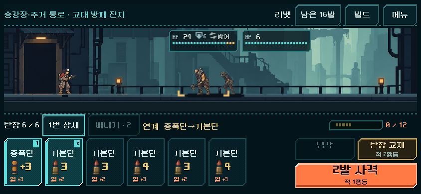
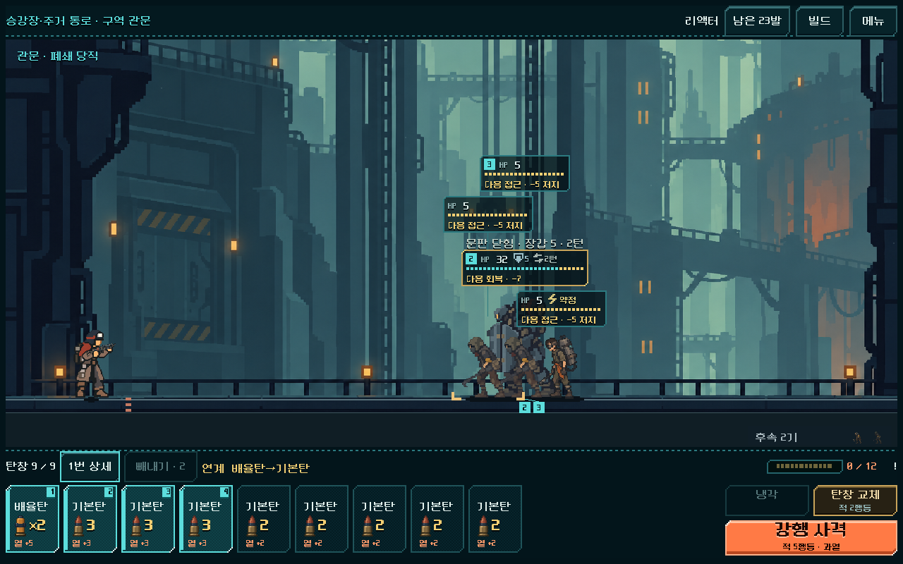
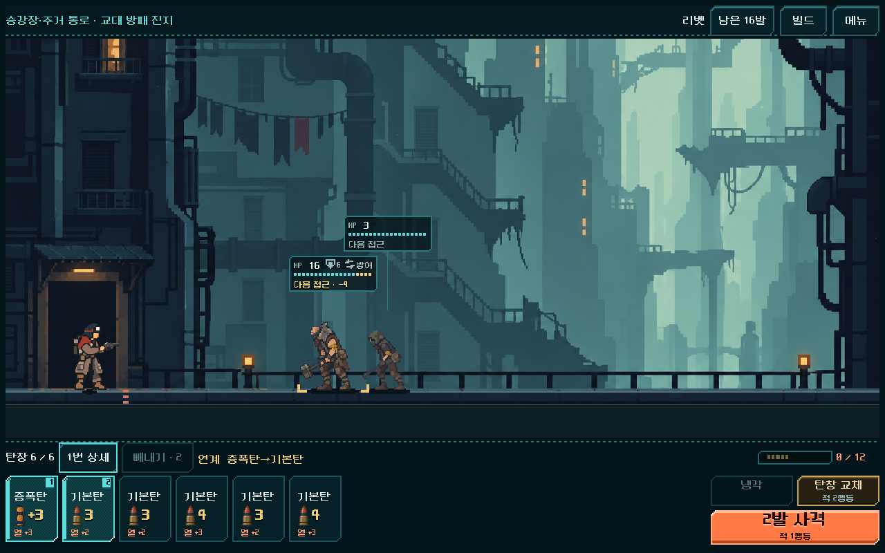
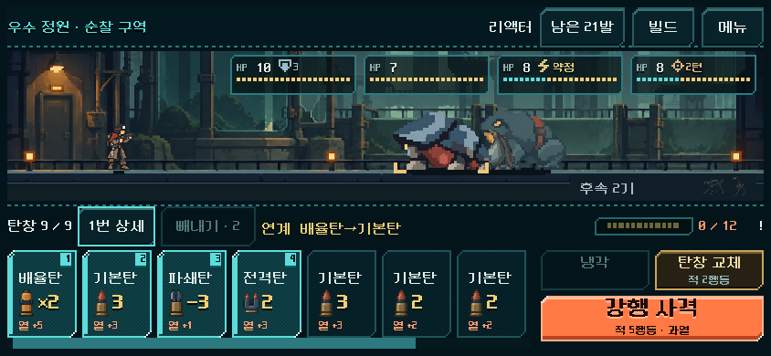

# 탄창 등반 덱 빌딩 보강 — 구현과 검증

2026-11-01. 사용자 요청: "좋아, 개편 진행해주고 다른 ai가 수정 내역 파악할 수 있도록 로그도 잘 남겨 줘." 근거는 [덱 빌딩 재미 검토](../../history/design/deckbuilding-review-2026-11-01.md), 현행 규칙은 [탄창 등반의 덱 빌딩 보강](../../direction/magazine-build.md).

**새 등반만 바뀐다.** 이전 저장의 이어하기, 훈련, 탄창 여정·비교 화면은 그대로다. APK·업로드·커밋·푸시는 하지 않았다.

## 버전 2 — 적 체력 상향(사용자 플레이 후기 후속)

사용자 후기: "덱 체감은 아직 크게 느껴지지 않아, 그냥 발사만 하면 적을 전부 처치해서 … 한 탄창 다 비우기전에 끝나버려." 새 등반은 이제 `magazine_build_version = 2`다. [현행 규칙](../../direction/magazine-build.md#버전-2--적-체력-상향2026-11-01-후속).

| 최종값 | 내용 |
| --- | --- |
| 적 체력 | 일반 ×2.0, 정예 ×1.6, **보스 원래대로**. 장갑 있는 적은 증가분의 절반(×1.5 / ×1.3) |
| 출발 거리 | 움직이는 적만 증가분의 절반(×1.5 / ×1.3). 제자리 사수는 그대로 |
| 출발 덱 | 리벳·스파이크 14장, **3발 사격 총기(래칫·스플린터·리액터) 20장** |

### 값을 정한 과정(시험 → 실패 → 수정)

| 시험 | 결과 | 조치 |
| --- | --- | --- |
| 체력만 일반 ×2.0 / 정예 ×1.6 / 보스 ×1.4 | 1구역 4번째 전투(장갑6, 빠른 교대 방패병 16→32)가 래칫·스플린터로 넓은 탐색(폭48·깊이60)에서도 불가능 | 움직이는 적 출발 거리 ×1.5 추가 |
| + 거리 | 같은 전투 여전히 불가능(관통탄 없는 덱에서 장갑 60%가 체력 2배를 증폭) | 장갑 적은 증가분 절반. 체력 24에서 사격·교체·냉각 7행동으로 승리 확인 |
| + 장갑 예외 | 리벳·스파이크 완료. 래칫 비상 보급 12회, 리액터 9회(최종 보스 57턴, 탄 42발 필요/덱 28장), 스플린터 최종 보스 불가 | 3발 사격 총기 출발 기본탄 +6 |
| + 덱 | 래칫 3회·리액터 0회로 해소. 스플린터 최종 보스는 여전히 불가. 같은 상태에서 보스 체력 ×1.2·×1.25도 불가, ×1.0은 19행동 승리 | 보스 배율 철회(원래 체력) |
| 최종 | **5총기 × 25전투 모두 최종 보스 승리, 실패0** | — |

검증 도구도 바꿨다. 길어진 전투를 기존 탐색 깊이가 따라가지 못해 이길 수 있는 전투를 실패로 보고했다(스플린터 2구역 정예: 넓게 찾으면 18행동 승리). `tests/campaign_magazine_solver.gd`가 실패하면 폭24·깊이40으로 한 번 더 찾는다.

### 개편 전(버전 1)과 최종(버전 2), 같은 시드 731042

| 총기 | 일반전 탄창 수(평균, 범위) | 정예전 탄창 수 | 일반전 평균 턴 | 사격만으로 끝난 전투 | 비상 보급 |
| --- | --- | --- | --- | --- | --- |
| 리벳 | 1.0 (0.3~1.5) → **1.6 (0.7~2.2)** | 1.4 → **2.3** | 5.5 → 10.3 | 7 → **1** | 0 → 0 |
| 래칫 | 1.2 → **1.8** | 1.8 → 2.2 | 8.6 → 14.1 | 2 → 1 | 0 → 0 |
| 스플린터 | 1.2 → **1.8** | 1.6 → 2.6 | 8.4 → 14.2 | 6 → **0** | 0 → 2 |
| 리액터 | 1.1 → **1.6** | 1.7 → 2.4 | 10.3 → 15.1 | 4 → 2 | 0 → 0 |
| 스파이크 | 0.9 → 1.3 | 1.3 → 2.0 | 5.7 → 8.6 | 6 → 3 | 0 → 0 |

전체 사격만으로 끝난 전투 25 → 7. 자동 탐색의 행동 중 교체(탄창 전환)가 리벳 28 → 41, 스플린터 31 → 54로 늘어 덱이 전투 안에서 실제로 순환한다. 총 턴(25전투)은 리벳 196 → 299, 스플린터 247 → 405로 전체 등반이 1.5배 안팎 길어졌다. 스파이크(단발 총기)는 처치 시 연속 사격 때문에 증가 폭이 가장 작다.

| 최종값 검증 | 결과 |
| --- | --- |
| 규칙 단위 `magazine_build_rules.gd` | 64검사, 실패0(총기별 덱, 체력·거리·장갑 예외, 버전1 미적용, 저장 후 재적용 없음 포함) |
| 전체 등반 5총기 × 25전투(`v3_<총기>`) | 리벳 2,372 · 래칫 2,548 · 스플린터 2,740 · 리액터 2,412 · 스파이크 2,212검사, 모두 실패0·최종 보스 승리 |
| 분기·정비(`-Mode contracts -RunTag v3_single`) | 1,002검사, 실패0 |
| 실제 화면 25전투(`-Mode ui -RunTag v3_single`) | 1,070검사, 실패0. 리벳 실제 터치 25전투·관문·귀환, 3크기 후반 화면 |
| 연계 표시 실제 HUD(리벳·리액터) | 각 23검사, 실패0 |

남은 확인: 전투가 길어진 것이 지루함이 아니라 판단으로 느껴지는지, 1구역 난도, 전체 등반 시간(약 1.5배). 사람 플레이 전에는 알 수 없다. 이어하기 중인 버전 1 저장은 체력이 그대로이므로 **새 등반으로 시작해야** 바뀐 전투를 볼 수 있다.

## 다른 작업자를 위한 요약

- 새 상태 키 두 개:
  - `magazine_build_version`(정수, 현재 **2**): 캠페인 `s`와 전투 `model.s` 양쪽에 같은 값으로 기록한다. 1 이상이면 덱·파츠·연계 표시, 2 이상이면 적 체력·거리 상향(`MagazineBuild.vitality()`). 다르면 저장 복원을 거부한다. `magazine_campaign_version=1`일 때만 허용된다.
  - `magazine_loaded`(탄 ID 배열): 전투 `model.s`에만 있다. 탄창을 장전할 때 복사하고, 빼낸 탄만 지운다. 쏜 탄은 남는다. 전투 밖에서는 빈 배열이다.
- 판정은 모두 `redesign/magazine_build.gd`에 모았다. 다른 파일은 그 함수를 부르는 분기만 추가했다. `MagazineBuild.enabled(state)`가 거짓이면 이전 동작과 같다.
- 정확한 변경분: [changes.patch](magazine_build_2026-11-01_assets/changes.patch). 작업 직전 사본과 비교했으므로 다른 작업자의 미커밋 변경은 들어 있지 않다. 공유 파일 `screen.gd`는 2020행 한 줄(출발 탄환 상세의 덱)만 바꿨다.
- 줄 끝은 기존 파일처럼 CRLF를 유지했다.

| 파일 | 바뀐 곳 |
| --- | --- |
| `redesign/magazine_build.gd` | 새 파일. `start_deck(gun)`, `on_load()`, `on_eject()`, `triad_bonus()`, `compression_ready()`, `afterburner_ready()`, `combos()`, `combo_line()`, 버전2 `vitality()`, `strengthen()`, `hp_scale()`. 수치 상수 `HP_SCALE`, `DISTANCE_SHARE`, `ARMOUR_SHARE`, `PULSE_GUN_EXTRA` |
| `redesign/model.gd` | `MagazineBuild` 상수, `begin_encounter`(초기화), `trial_load_magazine`(기록), `eject_magazine_rounds`(제거), `_shot`(압축 안정기·후미 점화기·삼중 시퀀서 분기), `restore_state`(검사) |
| `redesign/campaign.gd` | `start`의 새 등반 분기(버전, 총기별 덱), `_begin_combat`(장전 직전 `strengthen()`), `normalize_for_save`(비움), `restore_state`(범위·일치 검사) |
| `redesign/content.gd` | `MAGAZINE_BUILD_PARTS` 설명, `part_spec()` 병합 |
| `redesign/forecast.gd` | `random_analyze` 캐시 키에 두 키 추가 |
| `redesign/campaign_hud/combat.gd` | 탄창 머리줄에 `ComboLine` 라벨(금색, 16px, 넘치면 말줄임). 빼내기 선택 중에는 숨김 |
| `redesign/equipment_screen.gd`, `redesign/screen.gd` | 출발 탄환 미리보기·상세가 새 덱을 보여 줌 |
| `tests/magazine_build_rules.gd` | 규칙·저장 호환 검사(새 파일) |
| `tests/magazine_build_visual.gd` | 실제 HUD 표시 검사(새 파일) |
| `tests/magazine_build_scatter_probe.gd` | 저장된 전투 상태 하나를 넓게 탐색(진단용, 새 파일, `QA_STATE_FILE`) |
| `tests/campaign_magazine_solver.gd` | 탐색 실패 시 폭24·깊이40 재시도(긴 전투 대응) |

## 검증

Godot 4.7, 격리 APPDATA/LOCALAPPDATA. 근거 폴더: `qa_runtime/magazine_build_20261101/`, `qa_runtime/campaign_magazine_20261101/build_density/`.

| 범위 | 결과 |
| --- | --- |
| 새 규칙 단위 검사 `tests/magazine_build_rules.gd` | **51검사, 실패0.** 14장 덱, 이전 규칙 고정물 20장 유지, 장전·빼내기 기록, 삼중(3종/2종/빼내서 깨짐/이전 순서 규칙 비교), 후미 점화기(떨어진 증폭/이전 규칙), 압축 안정기, 연계 문구, 파츠 설명, 저장 복원·버전 불일치·잘못된 탄 ID 거부, 버전 없는 저장 복원 |
| 실제 HUD 표시 `tests/magazine_build_visual.gd` | **43검사, 실패0.** 실제 획득 전투(리벳 3번째 전투, 리액터 3구역)에서 1280×800·844×390 표시, 규칙과 같은 문구, HUD 안, 다른 버튼과 겹치지 않음, 빼내기 선택 중 숨김, 버전 없는 등반에서 미표시 |
| 전체 등반 자동 검증 `run_campaign_magazine.ps1 -Mode rules -RunTag build_density` | 5총기 × 25전투. **리벳·래칫·리액터·스파이크는 최종 보스까지 승리.** 스플린터는 최종 보스에서 기본 탐색 폭(32/48)으로 길을 못 찾아 실패 2건으로 끝났다. 같은 저장 상태를 폭 24×8·깊이 40으로 다시 탐색하니 19행동(비상 보급 1회 포함)의 승리 경로가 나왔다(`magazine_build_scatter_probe.gd`). 10,103검사 |
| 분기·정비 `-Mode contracts` | **786검사, 실패0.** 이벤트 매복 전투, 상점 재진열, 공방 영구 압축, 잘못된 모드 거부 |
| 실제 화면 25전투 `-Mode ui` | 리벳 실제 터치 25전투·관문·귀환, 3크기 후반 화면. 표시 위치 변경 전·후 모두 **838검사, 실패0** |

자동 탐색은 앞으로 나올 순서와 난수를 보고 고른다. **사람의 승률이나 재미의 증거가 아니다.** 전투 사이 비교의 경향으로만 읽는다.

### 개편 전후(같은 시드 731042, 같은 탐색 정책)

| 지표 | 개편 전 | 개편 후 |
| --- | --- | --- |
| 리벳 보스 직전 덱의 두 번째 탄창 특수탄(무작위 4천 회) | 1.14 / 2.04 / 2.46 / 2.68 / 3.36 | **1.69 / 2.70 / 3.14 / 3.37 / 3.73** |
| 마지막 덱(리벳) | 32장, 기본탄 14 | 29장, 기본탄 11 |
| 행동: 사격 / 교체 / 냉각 / 빼내기 | 535 / 181 / 21 / 10 | 531 / 178 / 22 / 5 |
| 사격만으로 이긴 전투 | 26 | 25 |
| 총 턴 리벳·래칫·스플린터·리액터·스파이크 | 210·293·253·332·177 | 196·283·247·337·197 |
| 접근 여유 2m 이하 전투(스플린터) | 2 | **6** |
| 전투 종료 시 최소 남은 탄(래칫·리액터) | 5·6 | **0·0** |

목표(1구역 관문부터 두 번째 탄창 특수탄 1.5발 이상)는 달성했다. 대신 탄약 총량이 줄어 **스플린터와 장기전이 빠듯해졌다.** 자동 탐색의 빼내기는 10 → 5회로 줄었다. 빼내기·냉각을 더 쓰게 하는 효과는 이번 변경으로 확인되지 않았다(이 지표는 사람의 사용과 다르다).

## 화면

탄창 수 옆 금색 줄이 지금 탄창에서 성립한 연계다. 위 리액터 화면에서는 배율탄이 기본탄에 쓰인다는 것이 보이므로, 기본탄을 빼내 배율을 전격탄으로 넘기는 판단을 할 수 있다. [빼내기 선택 중에는 숨김](magazine_build_2026-11-01_assets/combo_single_844x390_eject.png).

## 남은 위험과 확인

- **스플린터 탄약 부족:** 무작위 표적이라 기본탄 감소의 영향이 크다. 사람 플레이에서 1구역 보스·최종 보스가 억울하게 느껴지면 스플린터만 기본탄 +2 또는 위력1 기본탄 일부 유지로 조정한다(디렉터 후보, 미적용).
- 연계 줄의 문구 길이: 844×390에서 3개가 모두 성립하면 말줄임이 생길 수 있다. 전체 문구는 라벨 툴팁에 있다.
- 사람 확인 전: 덱이 "내 빌드"처럼 느껴지는지, 연계 줄을 읽고 빼내기를 더 쓰는지, 1구역 난도.
- 기존 오래된 검사 `tests/ammo_identity_ui_runner.gd`는 출발 미리보기에 위력1 기본탄이 있다고 가정한다. 이번 변경으로 그 항목은 실패하는 것이 맞다(10월 17일 기준 검사). 다시 쓸 때 새 덱 기준으로 고친다.
