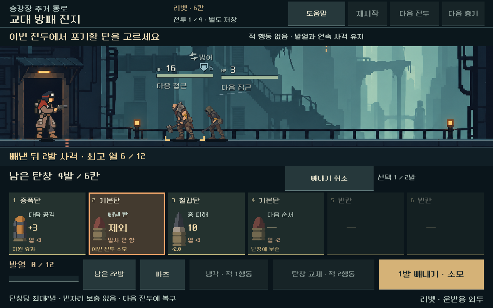
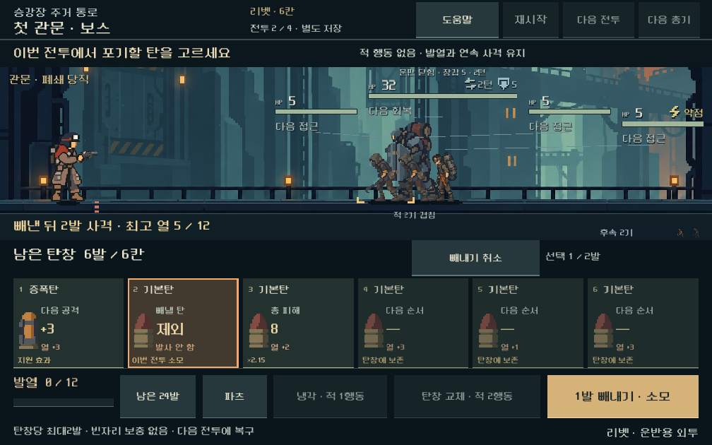
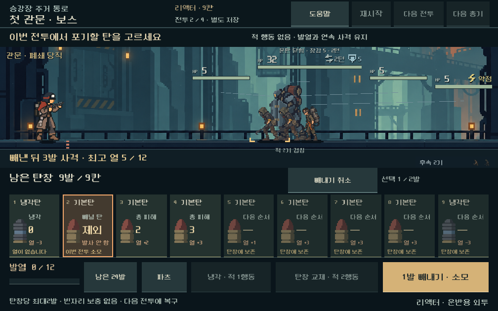
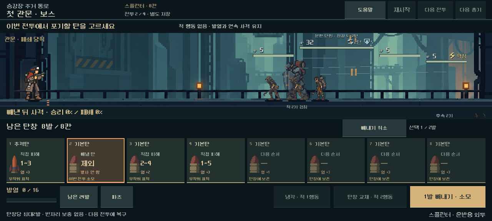

# 탄창 선택 빼내기 검증 — 2026-10-31

**상태:** A안·다섯 총기의 독립 비교 플레이에 구현. 기능·저장·실제 화면/터치 검증과 제한된 승리 경로 탐색을 수행했다. 본편 새 등반은 미활성이다. [현재 규칙·남은 작업](../../direction/magazine-ejection.md).

## 적용 범위

장전된 탄창의 어느 위치에서든 누적2발까지 선택해 빼낸다. 남은 탄의 순서를 보존하고 빈자리를 보충하지 않는다. 제거한 탄은 이번 전투에서 소모하며 보유 덱은 바꾸지 않는다. 다음 전투에서 복구한다. 추가 적 행동·열 감소·연속 사격 초기화·증폭 소비·난수 소비는 없다. 사격 사이에도 남은 한도를 쓸 수 있고, 비용을 지불한 전체 탄창 교체가 성공해야 한도가 회복된다.

선택 → 남은 탄의 다음 사격 미리보기 → 확정/취소로 조작한다. 선택 자체는 저장이나 실제 모델을 바꾸지 않는다. 확정한 소모 탄과 사용 횟수는 자동 저장/재개한다. 이전 총기 비교 저장에 횟수 필드가 없으면 미사용2발로 읽고 본편/이전 리벳 전용 비교에는 기능을 켜지 않는다.

기존 다섯 총기의 사격 단위·5~9칸·유한 탄약·전체 교체·접근 수치와 실제 획득 상태20개를 유지했다. 기본 실행은 저장소의 `OPEN_COMBAT_UI_STUDY.cmd`이며 `tools/open_weapon_magazine.ps1`을 통해 같은 비교 화면을 연다.

## 기능·예측·저장

**4,011검사, 실패0.** [기능 원자료](assets/magazine_ejection_2026-10-31/rules.json).

- 5총기×4전투×2탄 순서=40조건에서 중간/후미를 함께 제거하고, 실제 다음 발사·JSON 저장 복원 후 입력·예측의 일치를 검사했다. 스플린터의 무작위 표적 분기는 모두 열거해 범위와 확률을 비교했다.
- 빈 선택·중복 위치·분수/문자/불리언·범위 밖·한도 초과는 일부만 소모하지 않고 전체 요청을 거부한다. 같은 탄종의 두 장은 각각의 카드로 취급하며 제거 후 상대 순서와 소유량을 확인했다.
- 사격 전후의 열·적·턴·연속 사격·증폭·표적/덱 난수가 빼내기로 바뀌지 않음을 확인했다. 첫/마지막 발 파츠와 여러 칸을 차지하는 탄, 임시 압축 탄의 기존 소모 규칙을 함께 검사했다.
- 0/1/2발 사용 상태의 저장·재개, 이전 저장의 필드 생략, 잘못된 횟수의 거부, 냉각/발사로 한도가 회복되지 않음, 준비된 탄창을 다시 장전해 한도를 우회할 수 없음을 확인했다.
- 마지막 탄을 제거해도 자동 보충하지 않는다. 기존 비상 보급은 별도의 유료 행동으로 실행하고, 비상 보급 없는 완전 고갈은 기존 탄약 소진 패배로 처리한다. 다음 교전에서는 보유 탄이 복구된다.

### 중간 제거가 조합을 바꾸는 사례

실제 보유 탄에서 `증폭 → 기본 → 철갑 → 기본` 순서를 구성해 비교했다. 자연적으로 뽑힌 특정 탄창이라는 주장은 하지 않는 **통제된 보유 탄 순서**다. 나머지 보유 탄은 예비에 유지했다.

| 선택 | 다음 사격의 결과 |
| --- | --- |
| 빼내지 않음 | 증폭 뒤 기본탄 직접 피해4 |
| 첫 증폭탄 제거 | 기본탄 직접 피해1, 철갑탄 직접 피해5 |
| 중간 기본탄 제거 | 증폭 뒤 철갑탄 직접 피해10 |

중간 제거 후 `사격 → 탄창 교체 → 사격`의 실제 입력으로 승리까지 재생했다. 한 번의 사격으로 승리한 것은 아니다. 동일한 적 상태에서 어떤 탄에 증폭이 적용되는지가 바뀌는 사례이며 모든 탄창에서 중간 제거가 우세하다는 근거는 아니다.

### 이전 미해결 조건의 제한 탐색

스플린터 보스 탄 순서17은 빼내기 전 보고서에서 승리 경로를 찾지 못했다. 같은 획득 상태·고정 표적 난수에서 시작할 때만 빼내고 이후 사격/냉각/전체 교체를 탐색했다. width48/depth26, 실제 모델 재생 결과다.

| 초기 제거 | 이번 제한 탐색 | 승리까지 적 행동 턴 |
| --- | --- | ---: |
| 없음 | 경로를 찾지 못함 | — |
| 첫1발: 기본탄 | 승리 재생 | 19 |
| 첫2발: 기본탄+파쇄탄 | 승리 재생 | 13 |
| 중간1발: 파쇄탄 | 승리 재생 | 20 |

[선택·입력 경로 원자료](assets/magazine_ejection_2026-10-31/probe.json). 앞에서만 빼내도 승리하므로 이 사례를 중간 제거의 우월성으로 해석하지 않는다. 탐색 실패는 불가능 판정이 아니며 고정된 숨은 난수에 대한 경로 발견은 사람의 승률·확률 균형 또는 UI의 확정 추천이 아니다. 이전120조건 전체를 빼내기로 다시 평가한 결과도 아니다.

## 실제 화면·조작

Godot4.7 프로젝트 정보를 확인하고 기존 로컬 실행·격리 저장 경로로 검수했다.1008×630,1280×576,1280×800의 세 비율에서 실제 터치 이벤트와 전투 연출을 실행했다. **4,681검사, 실패0.** [화면/조작 원자료](assets/magazine_ejection_2026-10-31/ui.json).

- 다섯 총기의 중간 선택·취소·2발 선택/해제·확정·실제 발사·남은1발 제거·전체 교체를 조작했다. 도움말이 열린 동안 확정되지 않으며 선택 중 사격/냉각/교체/전투 전환은 차단된다.
- 선택 카드는 전체 면적이 터치 영역이고 확정/취소 버튼은 가장 작은 비율에서도 높이44px 이상이다. 버튼과 탄창/횟수 안내의 겹침, 각 카드 글씨의 경계를 검사했다. 주요 배치는 기존 비교 TSCN에 저장했다.
- 스플린터의 한 발 사용 상태를 저장·재개해 잔탄·사용 한도·표적 난수 일치를 확인했다. 통제된 보유 탄 순서에서는 실제 버튼으로 승리까지 진행했다.
- 최종 시각 확인에서 증폭탄이 공통 `cooled=0` 필드 때문에 냉각0으로 덮어써지는 기존 표시 오류를 발견했다. 실제 냉각탄에만 열 감소 표시를 적용해 증폭 `+3`과 뒤 철갑탄 피해10이 함께 보이도록 고쳤고, 화면 검사를 다시 통과했다. 전투 수치는 변경하지 않았다.
- GPU 캡처33장을 생성하고 대표8장을 보존했다. 작은 화면의6칸/9칸, 넓은 화면의 무작위 피해 범위, 선택 해제 후 빈자리 없는 정렬, 증폭 연계를 직접 시각 확인했다. 사람의 판독성/재미와 실기기 입력 검증을 대체하지 않는다.

## 회귀·재현·변경 범위

총기별 기존 기능7,101·이전 리벳 탄창797·접근3,498검사 모두 실패0. 본편5총기×5전투의 기존 재생25건도 실패0이다. 빼내기를 사용하지 않은 총기별 `rules.json`과 본편 `baseline.json`은 각각 직전 보존 결과와 JSON 전체가 동일하다.

[총기별 회귀](assets/magazine_ejection_2026-10-31/weapon_rules.json), [리벳 탄창 회귀](assets/magazine_ejection_2026-10-31/magazine_loop_rules.json), [접근 회귀](assets/magazine_ejection_2026-10-31/approach_rules.json), [본편 재생](assets/magazine_ejection_2026-10-31/legacy_replay.json).

시작 시 보존한 기존 코드/씬/데이터318개 중314개 해시가 같다. 변경4개는 공통 모델의 명시적 비교 기능/저장 검증, 비교 규칙 상수, 현재 비교 화면 스크립트/씬이다. 새로운 기능·조작·탐색 검사3개와 실행기를 추가했다. [변경·소스·증거 해시](assets/magazine_ejection_2026-10-31/manifest.json), [작업 전318개 해시](assets/magazine_ejection_2026-10-31/source_before.json). 사용자의 기존 변경은 보존했고 별도 작업 전 사본과 비교했다.

재현 명령은 저장소에서 `tools/run_magazine_ejection.ps1 -Mode rules`, 이후 `-Mode ui`, 선택적으로 `-Mode probe`다. UI 검사는 rules에서 확인한 승리 경로를 사용한다. 회귀는 `tools/run_weapon_magazine.ps1 -Mode rules`, `tools/run_combat_magazine_loop.ps1 -Mode rules`, `tools/run_combat_approach.ps1 -Mode rules`, `tools/run_combat_ui_stage1.ps1 -Mode baseline`이다.

검사 저장은 `qa_runtime/magazine_ejection_20261031`과 각 기존 검사 전용 폴더에 격리했다. 대화형 비교 저장은 기존 `qa_runtime/weapon_magazine_20261031/interactive` 경로를 유지한다. 본편 저장을 사용하지 않았고 APK·커밋·푸시·외부 게시를 수행하지 않았다.

## 남은 확인

매 탄창마다2발을 빼는 행동이 항상 유리한지, 소모 탄과 순서 조정의 대가가 충분한지, 새 규칙으로 보상을 얻는 초반 연속3~5전투·정예에서 선택이 달라지는지 확인해야 한다. 리액터의43행동 냉각 정책 전투, 스플린터의 다른 표적/순서 편차, 전체 탄약 경제와 본편 연결은 후속이다. 사람의 재미·이해도·미감, 모바일 실기기의 지속 FPS·발열은 미검증이다.
