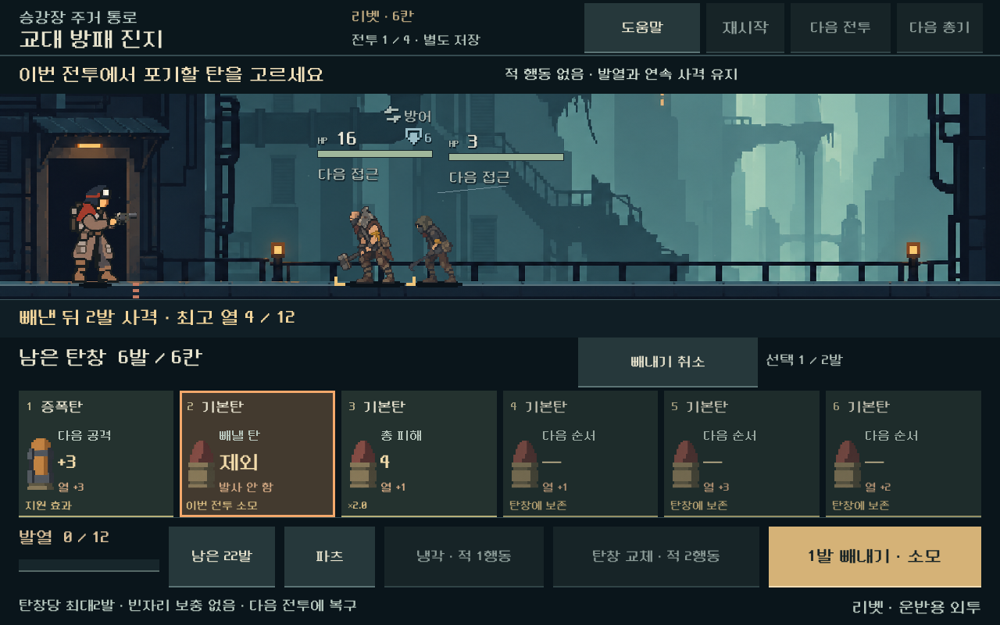

# 탄창·선택 빼내기 모바일 전달 — 2026-10-31

사용자가 밖에서 플레이 테스트할 수 있도록 Google Drive 업로드를 요청했다. 최신 A안 비교 플레이로 바로 시작하는 ARM64 APK를 기존 패키지/서명으로 만들고 ZIP으로 전달했다. 본편 진행 저장과 비교 저장은 분리되며 게임 규칙은 앞선 선택 빼내기 검증 상태 그대로다.

- 버전: `0.5.20261031.ejection` / 코드 `20261033`.
- 빌드: `LastOnBoard-20261031-135635-v20261033`.
- APK 93,573,929바이트 / ZIP 90,466,316바이트.
- [확인한 Drive 다운로드 링크](https://drive.google.com/file/d/1ASX2rQCDI0vuXS7Oc4EYIV0e4MQfZWu7/view?usp=drivesdk). 지정된 모바일 빌드 폴더에 올렸고 공유 권한은 변경하지 않았다.

## 검증

APK 서명·정렬·패키지 ID·ARM64·버전·필수 리소스와 ZIP CRC를 검사했다. APK에서 추출한 실제 컴파일 리소스를 PC Godot에서 실행해 시작 씬과5총기×4전투의 장전·중간 제거·횟수 저장/재개·실제 사격 연출을 확인했다. 별도 GPU 실행에서 실제 터치로 선택·확정·사격하고 캡처3장을 확인했다. 배포 도구의 잘못된 파일/대상/해시 거부 등8개 검사도 통과했다.

Drive의 파일명·MIME·크기·부모 폴더·URL을 확인했다. 원격 파일을 다시 내려받아 원본 ZIP의 SHA-256 `df12e01b7269470fd13ba04022be8a222183f8cda1ad24a97ca2f118cb4d042a`와 일치함을 확인했다. `latest.json`과 영수증은 `uploaded`다.

[APK 검증](assets/magazine_ejection_mobile_2026-10-31/validation.json) · [전투 실행](assets/magazine_ejection_mobile_2026-10-31/package_probe.log) · [터치 검사](assets/magazine_ejection_mobile_2026-10-31/packed_ui.json) · [업로드 영수증](assets/magazine_ejection_mobile_2026-10-31/upload_receipt.json) · [해시·설정 복구 확인](assets/magazine_ejection_mobile_2026-10-31/delivery_checks.json).

## 변경과 한계

빌드 도구에 `-PlayMode weapon-magazine`을 추가했다. 빌드 중에만 비교 시작 씬을 지정하며 `project.godot`와 기존 export preset의 원래 바이트를 복구했다. 비교 씬·코드의 참조와 동적 이미지 폴더,20개 획득 전투 JSON을 포함했다. 원본 이미지는 삭제·수정하지 않았다. [포함 목록](assets/magazine_ejection_mobile_2026-10-31/build_manifest.json). 선택 리소스 내보내기 형식은 [Godot4.7 공식 구현](https://github.com/godotengine/godot/blob/4.7-stable/editor/export/editor_export.cpp)을 확인했다.

SDK 접근/임시 폴더 문제, 검증 스크립트 중복 변수, PowerShell 배열 목록 형식을 수정했다. 비교 빌드에 본편 상점 검사를 실행하던 부분은 모드별로 분리했다. 실패한 중간 산출물은 업로드하지 않았다.

이번 전달은 독립 전투 비교이며 새 규칙의 연속 등반·상점/지도 진행 완료가 아니다. 실제 Android 기기 실행·지속 FPS·발열·사람의 재미와 판독성은 사용자 테스트가 남는다. APK 업데이트 설치 안내와 변경 내역은 ZIP에 포함했다.
