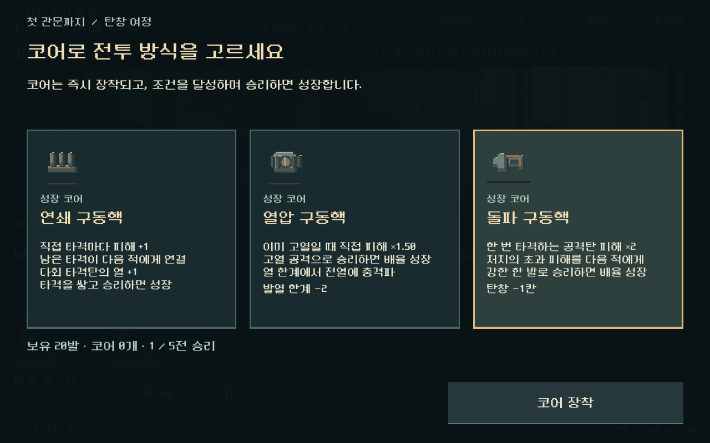
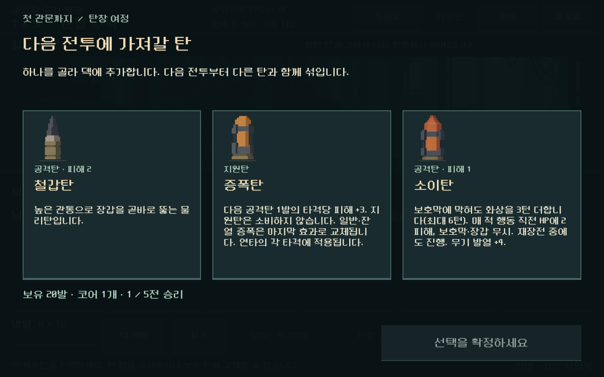
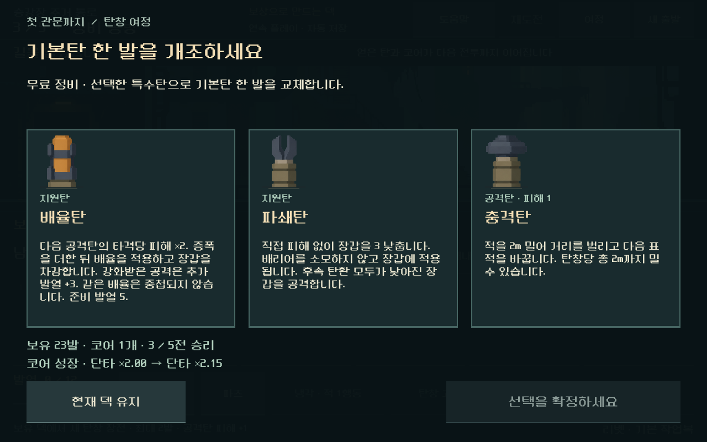
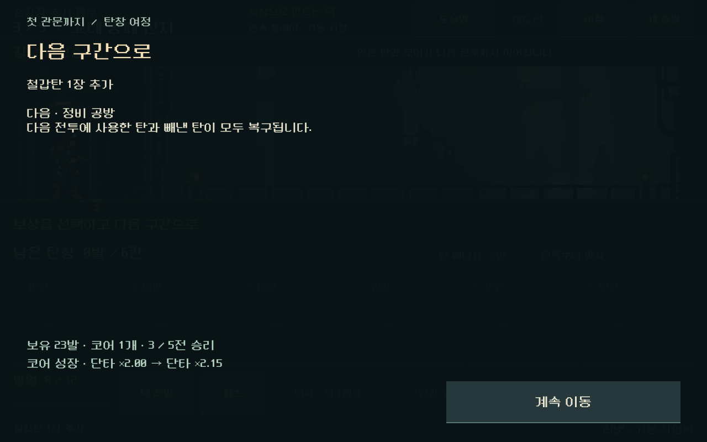
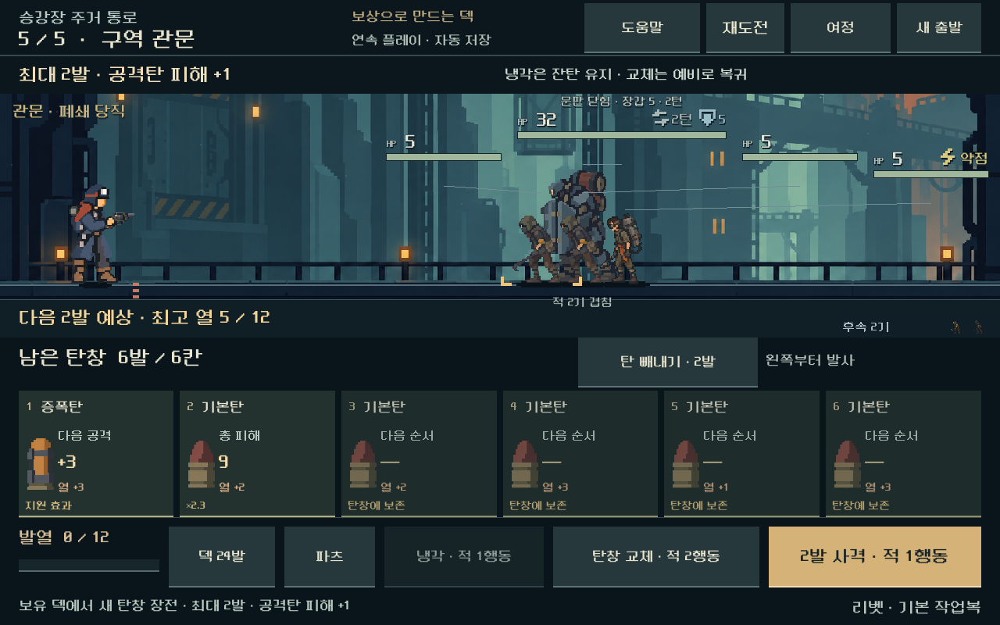
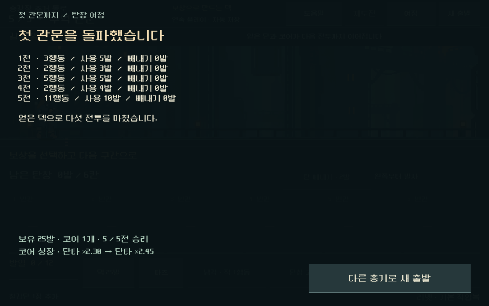

# 탄창 여정 — 검증 2026-10-31

## 결과

보상으로 획득한 덱과 성장 코어를 유지하며 **다섯 전투와 두 번의 무료 정비를 거쳐 첫 관문까지 진행**하는 별도 플레이를 구현했다. [현행 설계](../../direction/magazine-journey.md). 실행은 저장소 루트 `OPEN_COMBAT_UI_STUDY.cmd`, 기존 독립 비교는 `OPEN_MAGAZINE_COMPARISON.cmd`다.

작업 전 더러운 작업 트리는611항목이었다. 먼저 로컬 파일 해시와 수정 대상 원본을 보존했다. 실제 변경의 기준은 Git HEAD가 아니라 이번 작업 직전 사본이다. 기존 캠페인 코드에는 저장 직전 소유 탄 정리 부분을 `normalize_for_save()`로 추출한 변경만 추가했다. 동일한 기존 save()가 그 함수를 호출한다. 기존 탄창·접근·빼내기 계산은 변경하지 않았다.

## 실행 환경과 재현

- Godot4.7 stable / Windows / OpenGL Compatibility / RTX4060Ti.
- 모든 QA 저장: `qa_runtime/magazine_journey_20261031/{rules,ui,visual}` 아래 별도 APPDATA/LOCALAPPDATA. 실제 실행은 별도 `interactive` 경로.
- `powershell -NoProfile -ExecutionPolicy Bypass -File tools/run_magazine_journey.ps1 -Mode rules`
- 같은 명령의 `-Mode ui`, `-Mode visual`로 실제 입력·스크린샷 검증.
- 첫 관문 연결 경로, 순서731042, 기본 작업복. 기본 덱20발과 실제 캠페인 보상/정비 명령만 사용했다. 고정된 획득 덱을 각 전투에 삽입하지 않았다.

## 기능 검증

| 검사 | 결과 | 의미 |
| --- | --- | --- |
| 여정 규칙 | 4,361검사, 실패0 | 5총기 × 총기별 대표 코어 × 탄 보상3경로 = 15여정, 75전투를 실제 명령으로 승리·획득·연속 진행 |
| 실제 화면·입력 | 3,943검사, 실패0 | 1008×630,1280×576,1280×800에서 리벳5전투를 터치로 끝까지 진행, 보상 확정/정비/재개,5총기 새 출발/사격 |
| 최종 카드 배치 | 705검사, 실패0 | 3비율에서 그림 실제 영역과 문구 분리, 코어/탄 선택, 정비·탄 보상 건너뛰기, 성장·완료 화면 |
| 기존 빼내기 | 4,011검사, 실패0 | 선택 한도·열·예측·실제 소모 등의 기존 경계 유지 |
| 기존 전투 재생 | 25전투, 실패0 | 이전 본편 경로의 행동 수·소모 탄 일치 |

전투의 모든 행동, 보상 선택 사이, 무료 정비, 이동 대기, 패배, 완료 상태의 저장·재개를 검사했다. 재도전은 진입 시점의 탄 순서·난수·열·코어·빼내기 한도를 복원하고, 패배 시 정산 및 실패 기록도 해당 전투 이전으로 돌린다. 승리한 전투의 보상을 중복 수령하거나 전투를 건너뛸 수 없다. 손상된 버전/경로/진입 상태/결과는 거부한다. 본편 저장 파일은 생성하지 않는다.

전투마다 사용한 탄과 빼낸 탄의 복구, 선택한 탄의 추가/기본탄 교체, 코어의 장착과 성장 수치 유지, 고정 표적 총기의 예측/실제 결과 일치를 확인했다. 스플린터는 원래의 무작위 예측을 유지하며 숨은 난수로 확정 피해를 표시하지 않는다.

첫 검사에서 무료 정비의 기대 덱을 ‘기본탄 삭제 후 맨 뒤 추가’로 작성해30개 비교가 실패했다. 실제 기존 명령은 그 자리에서 교체하므로 기대값을 수정했다. 첫 UI 검사의6개 실패는 JSON 문자열의 정수/실수 표기 비교였으며, 실제 값 비교로 수정해 재검증했다. 기능 결함으로 집계하지 않는다. 캡처에서 탄 그림/그림자와 분류 문구의 간격을 조정한 뒤 최종 배치 검사를 따로 수행했다.

## 연속 선택에서 관찰한 것

15여정 모두 빼내기 없는 합법 승리 경로를 찾고 재생했다. 이는 제한 탐색이 숨은 뽑기·표적 난수까지 보는 고정 순서의 도달 가능성이다. 사람 승률, 보상 선택 간 동등성, 모든 코어/순서의 균형으로 해석하지 않는다.

기본 리벳 경로의 적 행동 수는3/2/5/2/11, 소모 탄은5/3/5/4/10발이었다. 코어는 첫 승리 후 장착되고 이후 실제 조건 달성으로 성장했으며, 최종 단타 배율은×2.45다. 같은 경로의 보상 탄을 바꾸면 성장2 또는3으로 달라졌다.

자연스럽게 획득한 순서에서도 빼내기 선택에 따라 다음 공격이 달라졌다. 리벳 관문의 `증폭 → 기본 → 충격…`에서는 중간 기본탄을 빼면 강화 대상이 충격탄으로 바뀌고 다음 공격의 직접 피해는12→10이었다. 리액터에서도 직접 피해가 줄어드는 사례가 있었다. 무조건 빼내기가 이득이라는 근거로 쓰지 않는다. 해당 선택이 접근 위험이나 전체 승패를 개선하는지는 별도 비교가 필요하다.

## 실제 화면

작은 화면·넓은 화면·기본 화면의 카드/버튼 경계와 입력 영역을 자동 검사하고 PNG를 직접 확인했다. 현행 도트 리소스·색을 유지하고, 코어와 첫 특수탄은 별도 확정, 긴 설명은 카드 내부 스크롤, 주요 버튼은 최소44물리px 영역이다. 사람의 가독성/미감 평가는 남는다.

## 남은 범위

보상 후 덱 변화의 체감, 빼내기/그대로 사격의 선택 이유, 관문까지의 긴장감은 다음 사람 플레이에서 확인한다. 고정된 한 경로와 대표 코어를 중심으로 검사했으므로 모든 코어 조합·다른 순서·정예/후반은 아직 검증하지 않았다. 모바일 APK/실기기 지속 FPS·발열과 본편 기본 진입 변경은 이 작업에 포함하지 않았다. GPU 데스크톱 입력 검사를 모바일 성능 증거로 쓰지 않는다.

원시 결과·캡처·최종 소스 해시는 같은 이름의 `_assets` 폴더, 작업 전 원본은 `qa_runtime/magazine_journey_20261031/source_before`에 둔다.
