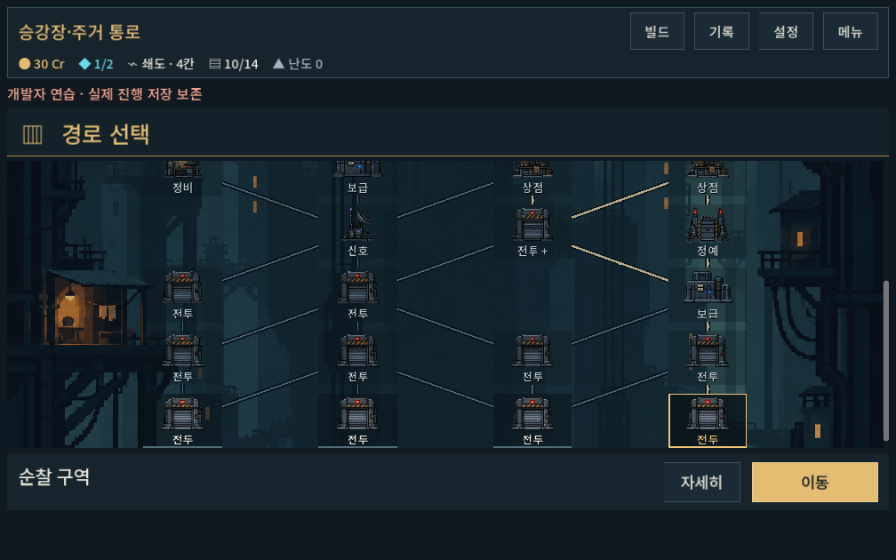
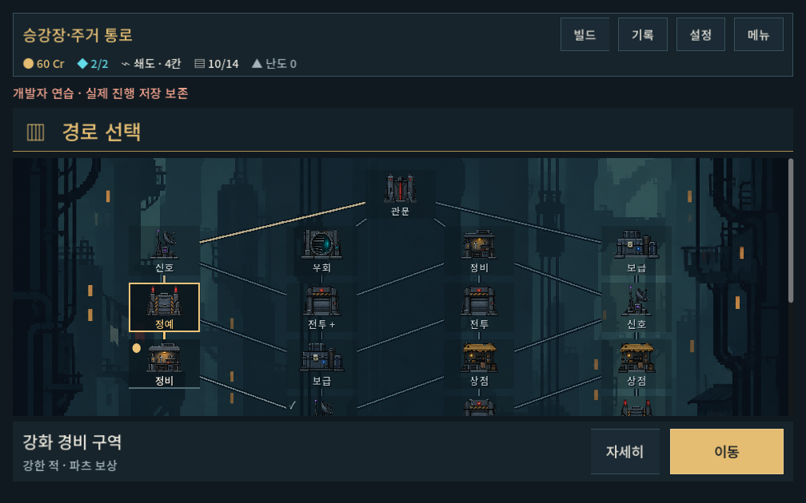

# 지도 아트 1차 적용

2026-10-09 · 사용자 승인: 첫 구역 배경+독립 시설을 적용해 실제 화면에서 검증한 뒤 다른 구역 확장.

## 결과

- 첫 구역에 거대한 승강기 수직 공간과 작은 생활 조명의 도트 배경 적용. 노드/경로/숫자는 배경에 포함하지 않음.
- 전투·정예·정비·관문·상점·보급·신호·우회 8종 시설은 독립 RGBA 아틀라스. 공통 시설로 전 구역/두 맵 버전에 사용. 나머지 지역 배경은 이전 자산 유지.
- `redesign/map_facility.tscn`은 편집기에서 기본 전투 시설이 보이는 재사용 버튼. 시설 그림/이름/현재·방문 표시를 분리하고 자식 장식의 터치 입력 무시.
- 노드 78높이/90간격으로 그림과 짧은 이름 배치. 선택은 금색 테두리, 현재 위치는 점, 방문은 체크. 그림은 nearest 샘플링. 클릭 영역은 축소하지 않음.
- 경로는 시설/이름 뒤를 관통하지 않도록 경계에서 잘라 연결. 초기 적용의 상단/하단 연결은 분기가 수평으로 보여 대각 방향을 보존하는 사각 경계 교점으로 수정.
- 지도 제목의 별도 사진 띠를 제거해 지도 배경과 경쟁하지 않게 함. 하단 장소명/이동/선택형 상세는 유지.

[원본·프롬프트·해시·가공 범위](../../../새-게임-프로젝트/assets/art/map_residential_20261009/provenance.json). 원본 PNG는 그대로 복사했으며 아틀라스 영역은 Godot에서 분리한다. 엄격한 저해상도 원화/고정 팔레트 제작을 완료했다는 의미는 아니다.

## 검증

- 격리 저장 `tools/run_map_checks.ps1 -Mode ui -Label art_verified`: **506검사 / 0실패**.
- 1280×900 / 1008×630(글자1.1배) / 1440×630 실제 입력. 4번째 출발 선택, 상세 열고 닫기, 미래 방 진입 제한, 진입/정비/정예/스크롤/현재 위치 표시/시설 이미지 입력 방해 여부/이전 맵v1 진입 확인.
- Godot headless editor import 오류 없음. UI stderr 비어 있음. `git -c core.safecrlf=false diff --check` 통과.
- 초기 추가 레거시 QA가 존재하지 않는 무기 ID `walker`를 사용해 실패했다. 시험 데이터를 실제 보행자 ID `single`로 바로잡고 전체 UI 재실행에서 통과했다. 게임 규칙 결함으로 해석하지 않는다.
- 기능 검증과 별도로 실제 작은 화면/넓은 화면/현재 위치/기존 맵 캡처를 직접 확인했다. 경로·선택·그림과 이름이 구분됨. 스크롤 경계에서 일부 미래 시설이 잘리는 것은 내부 스크롤 영역이며 현재 후보/하단 이동은 보인다.

[실행 로그](map_art_2026-10-09_assets/stdout.log) · [오류 로그](map_art_2026-10-09_assets/stderr.log) · [임포트](map_art_2026-10-09_assets/import.log)

[넓은 화면](map_art_2026-10-09_assets/selected_1440x630.png) · [기존 맵](map_art_2026-10-09_assets/legacy_map.png) · [기존 상층 배경](map_art_2026-10-09_assets/upper_region.png)

## 후속

사용자의 시설 구분/분기 읽기/배경 도트 체감과 Galaxy 실기기 검증은 미확인이다. 다른4구역 전용 배경과 시설의 구역별 외형은 후속. 전투·경제·연결 생성·저장 규칙은 변경하지 않았다. APK/커밋/푸시는 수행하지 않았다.
