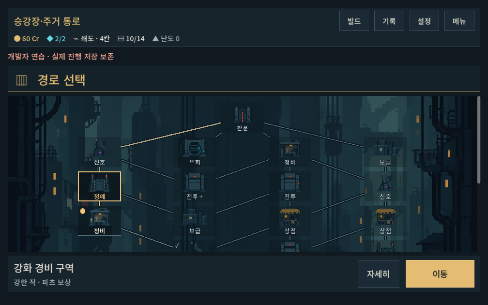
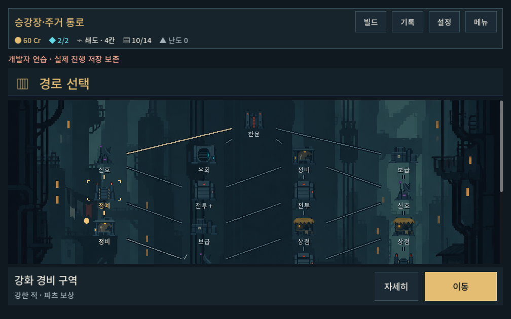
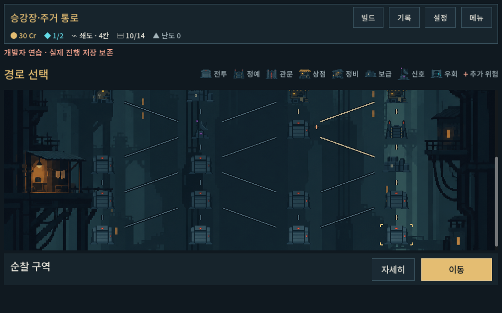
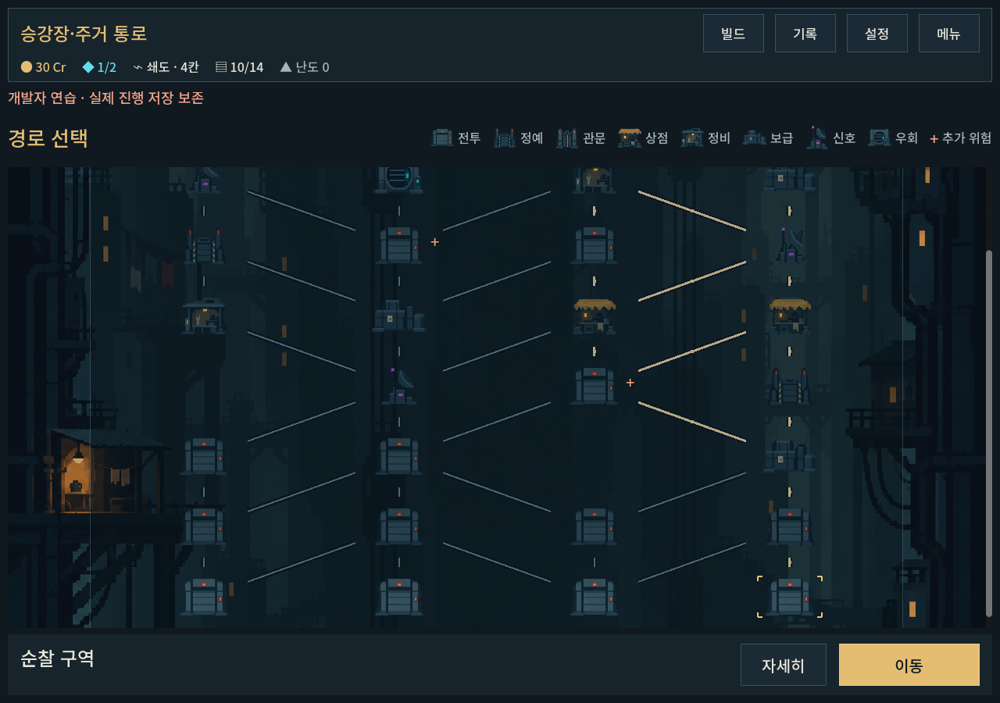

# 지도 시설과 배경의 화풍 통일

2026-10-09 · 사용자: 시설 아이콘이 배경과 이질적으로 보인다는 피드백.

## 변경과 판단

첫 아틀라스의 세밀한 금속 질감/볼트/반사광/강한 윤곽이 큰 색면 중심 배경과 충돌했다. 배경을 스타일 참조, 기존8종 아틀라스를 편집 대상으로 image_gen에서 다시 제작했다. `facilities_v2.png`는 청회색 큰 덩어리, 적은 내부 경계, 작은 상태 조명으로 정리했다. 시설 역할/이름/선택 테두리/위치/터치 영역/경로는 유지한다. 기존 원본은 보존했고 배경을 수정하지 않았다.

[프롬프트·입력·해시](../../../새-게임-프로젝트/assets/art/map_residential_20261009/provenance_v2.json). 재생성 PNG를 그대로 복사하고 런타임 아틀라스 경계만 조정했다. 단순 블러나 강제 픽셀 필터를 적용한 결과가 아니다. 고정 팔레트/정확한 논리 픽셀 규격을 보장하는 것은 아니다.

## 검증

Godot 격리 import 후 `tools/run_map_checks.ps1 -Mode ui -Label art_cohesion_v2`: **506검사/0실패**, 1280×900/1008×630/1440×630. 선택/미리보기/상세/진입/정비/정예/기존 맵 호환. 작은 화면의 첫 선택/진행 이후 캡처를 직접 확인해 세밀한 윤곽의 감소와 시설별 실루엣을 검토했다. 사용자 화풍 승인과 Galaxy 실기기 체감은 후속이다.

[검사 로그](map_art_cohesion_2026-10-09_assets/stdout.log) · [오류 로그](map_art_cohesion_2026-10-09_assets/stderr.log)

[같은 화면의 이전 버전](map_art_2026-10-09_assets/traveled_1008x630.png) · [첫 선택](map_art_cohesion_2026-10-09_assets/selected_1008x630.png)

배경·규칙·저장 형식은 유지. APK/커밋/푸시는 수행하지 않았다.

## 추가 — 시설 뒤 상시 박스 제거

사용자가 상시 사각 박스 제거와 선택 시 작은 모서리 표시를 승인했다. 시설 버튼의 모든 배경/테두리 스타일을 빈 스타일로 바꾸고 그림 둘레의 짧은 금색 모서리만 선택 상태에 표시한다. 키보드 포커스에는 별도 옅은 모서리 표시가 있으며 입력 영역·현재 점·방문 체크·이름 그림자는 유지한다. 이미지 파일은 변경하지 않았다.

`tools/run_map_checks.ps1 -Mode ui -Label no_node_boxes`: 기존3해상도 UI **506검사/0실패**. 작은 화면 첫 선택/진행 후 화면을 직접 확인해 박스 제거와 이름·선택 표시를 검토했다. 사용자 체감 확인은 후속.

[검사 로그](map_art_cohesion_2026-10-09_assets/no_boxes_stdout.log) · [오류 로그](map_art_cohesion_2026-10-09_assets/no_boxes_stderr.log)

## 추가 — 시설명은 공통 범례로 이동

사용자가 전투/우회 등 종류명을 별도 범례에 모으고 지도에는 아이콘만 남기길 요청했다. 노드 Caption을 제거하고 그림을 버튼 중앙에 배치했다. 동일 아틀라스를 사용하는 상단 공통 범례8종+추가 위험 `+`를 표시하며 폭이 부족하면 범례만 줄바꿈한다. 위험 노드의 기존 `+`는 작은 별도 표식으로 보존했다. 선택 모서리/현재 점/방문 체크/전체 터치 영역과 하단 선택 장소명·이동·상세는 유지한다.

`tools/run_map_checks.ps1 -Mode ui -Label icon_legend_final`: **506검사/0실패**, 기존3해상도/2개 맵 버전 입력. 실제1008×630 화면에서 범례와 지도/선택/위험 표시를 확인했다. 사용자의 아이콘 학습·구분 체감과 Galaxy 확인은 후속.

[검사 로그](map_art_cohesion_2026-10-09_assets/legend_stdout.log) · [오류 로그](map_art_cohesion_2026-10-09_assets/legend_stderr.log)

## 추가 — 지도 높이 확장과 공통 반투명 바탕

사용자가 선택 장소 카드 아래의 빈 공간 제거와 지도 전체를 묶는 반투명 바탕을 요청했다. 지도 작업 영역/내부 스크롤/지도에 세로 확장을 적용해 남는 높이를 지도가 사용하고 하단 선택·이동은 안전 여백 위에 둔다. 고정410높이는 최소300+가용 높이 확장으로 변경했다. 반투명 청회색 바탕과 가는 경계는 전체 경로 영역에 한 번만 그리며 시설별 박스는 복구하지 않는다. 그래프 폭과 정렬을 따른다. 원본 PNG와 규칙은 변경하지 않았다.

`tools/run_map_checks.ps1 -Mode ui -Label map_fill_final`: **518검사/0실패**. 기존506검사에 3해상도의 일반/예외 설명 상태에서 하단 선택 영역이 본문 끝까지 채워지는지, 지도와 조작이 겹치지 않는지12검사를 추가했다. 작은 화면과1280×900 실제 캡처를 확인했다. 안전 여백은 유지한다. 사용자 체감/실기기 확인은 후속.

[작은 화면](map_art_cohesion_2026-10-09_assets/fill_selected_1008x630.png) · [예외 정보가 있는 선택](map_art_cohesion_2026-10-09_assets/fill_traveled_1008x630.png) · [검사 로그](map_art_cohesion_2026-10-09_assets/fill_stdout.log) · [오류 로그](map_art_cohesion_2026-10-09_assets/fill_stderr.log)
