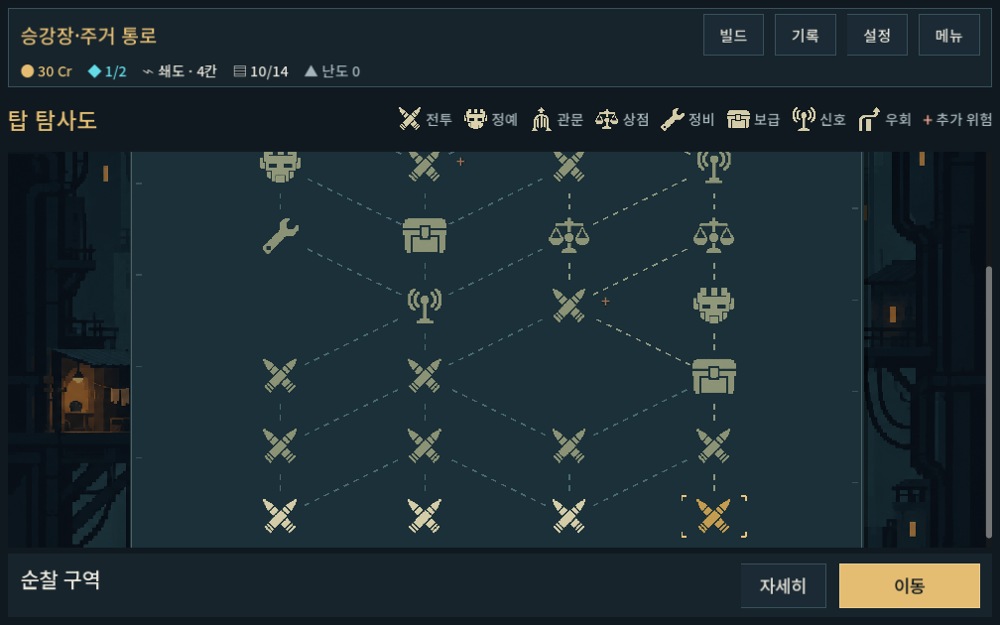
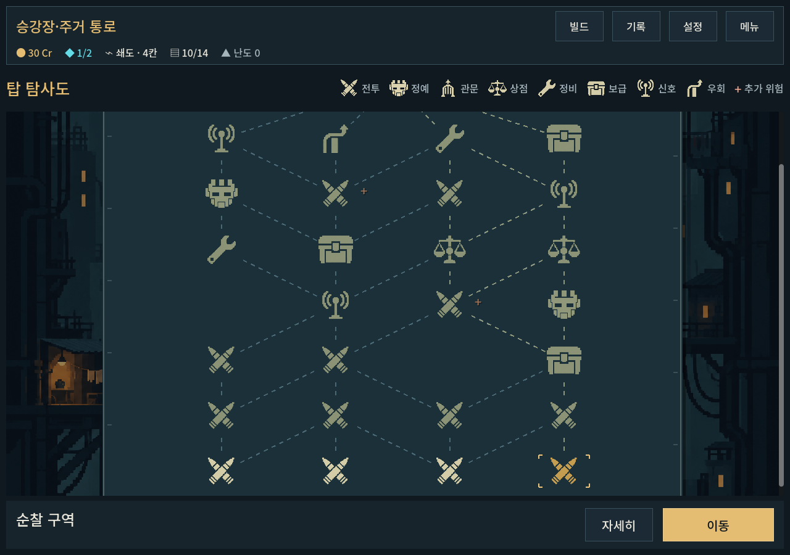
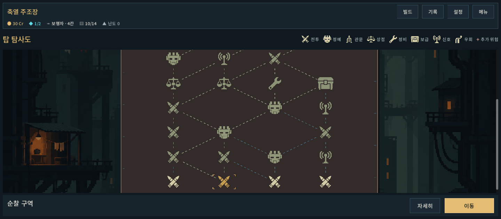
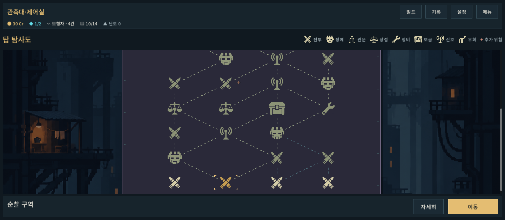

# 탑 탐사도 본편 통합 검증

2026-10-09 · 사용자 시안 채택 후 구현. Godot 4.7 Compatibility, 격리 저장.

## 변경

- 본편과 개발 지도에서 승인된 중앙 탐사도/역할 기호8종/공통 범례를 사용한다. 이전 별도 시안 진입은 제거했다.
- 현재 후보/미래 경로/방문 경로를 대비와 실선·점선으로 나눈다. 기호별 박스 없이 전체 지도 면, 하단 조작, 선택형 상세를 유지한다.
- 기호 선택 시0.14초 밝기 반응, 이동 확정 뒤0.18초 상단 표시를 추가했다. 연출 설정 배율을 따르며 instant에서는 생략한다. 이동 계산·저장·입력을 지연시키지 않는다.
- 5구역은 지도 바탕과 공통 탑 배경의 색조를 다르게 한다. 5개의 신규 환경 그림을 제작한 것은 아니다.
- 같은 노드를 중복 선택할 때 반응을 취소하지 않도록 선택 처리를 정리했다.

## 기능 검사

`tools/run_map_checks.ps1 -Mode chart -Label adopted_final`

**MAP UI COMPLETE checks=583 failures=0**, stderr 비어 있음. [stdout](map_chart_adoption_2026-10-09_assets/stdout.log) · [stderr](map_chart_adoption_2026-10-09_assets/stderr.log).

- 실제 개발 메뉴 진입과 본편 chart 사용, 1280×900 / 1008×630(글자1.1) / 1440×630.
- 선택·미래 미리보기·상세 왕복·이동·정비·압축·정예 보상, 기존 map_version1 표시.
- 지도 가용 높이/하단 안전 여백/버튼 겹침 검사.
- 5구역과 normal/fast/instant 설정, 이동1회 반영·전환 표시 정리, instant 선택 tween 생략.

개인 저장을 읽거나 쓰지 않았다. UI 검사 내부에서 정상 본편 표시 경로를 사용했으며 저장은 비활성화했다. 규칙·전투 수치는 이번에 변경하지 않았다.

## 시각 확인

작은 화면과 높은 화면의 지도/하단 조작, 주조 구역과 정상 구역의 대비를 실제 캡처로 확인했다. 잘림·겹침 없이 기호와 선택 상태가 보인다. 스크롤 경계 밖의 일부 미래 기호는 의도된 부분 노출이다.

## 남은 확인

사용자가 승인한 범위는 앞선 탐사도 구도/기호 방향이다. 이번 짧은 반응과 구역별 색감의 체감, Galaxy 터치 판독성은 사용자 플레이 확인이 남아 있다. 자동 검사를 재미/사람의 즉시 이해도 검증으로 보지 않는다. 지역별 고유 배경은 후속 아트다. APK·커밋·푸시는 수행하지 않았다.

플레이: `PLAY.cmd → 이어하기/새 등반`, 빠른 연습: `개발 → 탑 탐사도`.
