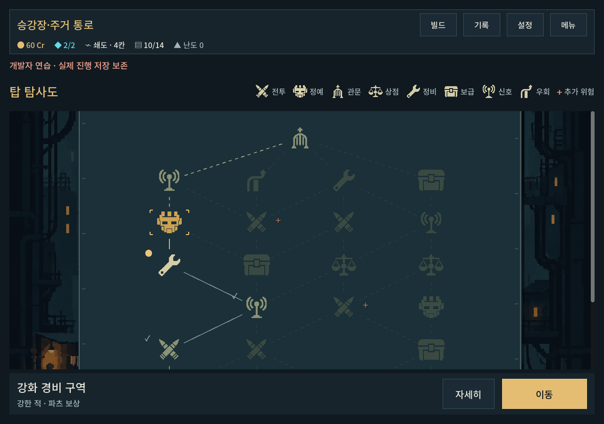
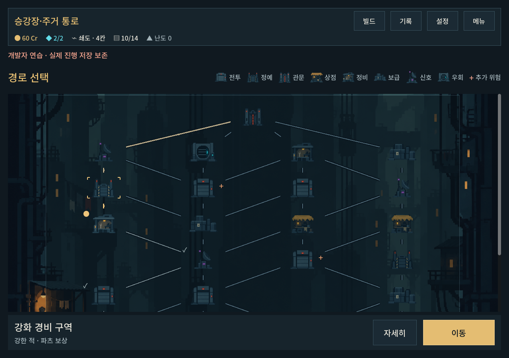

# 탑 탐사도 통합 시안과 아이콘 컨셉 검토

> 후속: 사용자가 시안을 채택해 [본편 통합](map_chart_adoption_2026-10-09.md)을 완료했다. 아래 미채택/개발 전용 표시는 제안 당시 이력이다.

2026-10-09 · 사용자 요청: 화면 전체 구성과 아이콘 컨셉을 함께 재검토.

## 검토 결론과 제작 상태

이전 화면은 실제 건축 배경·미니어처 시설·연결 그래프가 서로 다른 공간 표현을 사용했다. 도트 밀도를 맞춰도 시설이 떠 보이는 문제가 남았다. 전투/정예/관문은 모두 문 형태라 실루엣 차이도 약했다.

디렉터 제안은 **주인공이 읽는 탐사도**다. 중앙은 별도 지도 면으로 묶고 원경은 양쪽에 남긴다. 미니어처 대신 지도에 찍힌 단순 도트 표식8종, 직접 선택 가능/현재 위치를 가장 밝게, 선택은 금색, 이후 경로는 낮은 대비의 점선, 방문 이력은 실선으로 표시한다. 아직 갈 수 있는 이후 노드는 읽을 수 있게 남기고 도달 불가능한 경로는 더 낮춘다. 지도 높이/하단 조작/범례/예외 정보 공개는 유지한다.

**현재는 비교 가능한 개발 시안이다. 본편 지도 교체로 확정하지 않았다.** 사용자가 진행을 승인한 것은 통합 시안과 아이콘 검토이며 새 컨셉의 최종 채택까지 대신 확정하지 않는다.

## 아이콘의 역할

| 역할 | 기존 표현의 문제 | 시안 |
|---|---|---|
| 전투 | 셔터 문이 관문과 비슷함 | 교차 탄환 — 사격 위험 |
| 정예 | 큰 셔터 문에 불빛 추가 | 기계 경비병 표장 — 강화 경비 |
| 관문 | 문끼리 크기만 다름 | 수직 차단문+상향 표식 — 구역 통과 |
| 상점 | 작은 가판대 세부가 흐림 | 거래 저울 |
| 정비 | 작업대 내부 공구가 작음 | 큰 렌치 |
| 보급 | 건축 노드와 크기가 섞임 | 잠금 상자 |
| 신호 | 작은 설비 그림 | 전파 표식 |
| 우회 | 환기구가 출구인지 불명확 | 장애물을 돌아가는 화살표 |

정예의 첫 생성안은 뿔 달린 가면이라 판타지/악마 이미지가 강해 제외했다. 기계 얼굴로 수정한 영역만 사용하고 나머지7종은 첫 원본을 유지한다. 이 표장은 특정 몬스터 종이나 인간 개조 설정을 확정하지 않는다. 표식별 의미의 첫 인지와 선호는 사용자 플레이에서 확인할 가설이다. 단색 실루엣과 범례를 함께 제공한다.

[출처·프롬프트·해시](../../../새-게임-프로젝트/assets/art/map_chart_20261009/provenance.json).

## 실행과 구현

- `PLAY.cmd → 개발 → 탑 탐사도 · 시안`. 기존 저장과 분리된 연습 캠페인에서 선택/상세/진입/전투 이후 경로를 확인할 수 있다.
- 비교: `개발 → 도시 분기 맵`. 동일 개발 시작 시드/총기로 기존 지도 확인.
- `city_map_chart_view.gd`는 기존 생성/이동을 공유하는 표시 전용 파생 클래스. `map_chart_symbols.gd`는 표식 영역. `campaign_ui.gd`는 개발 세션의 메타 플래그에서만 시안을 선택한다.
- 본편/기존 연습의 시설 아트·세이브·규칙은 유지한다. 시안 플래그는 캠페인 저장 데이터에 넣지 않았다.

## 검증과 한계

- `tools/run_map_checks.ps1 -Mode chart -Label chart_verified`: **522검사/0실패**. 실제 개발 메뉴 버튼 진입+맵v2 확인과 기존 UI 전 과정.
- `tools/run_map_checks.ps1 -Mode ui -Label chart_verified`: **518검사/0실패**. 본편 표시 경로 회귀.
- 1280×900 / 1008×630(글자1.1배) / 1440×630. 격리 저장에서 선택/미래 미리보기/상세/이동/정비/정예 보상/스크롤/기존 맵v1을 확인했다. 자동 승리 fixture는 UI 검증에만 사용한다.
- import와 UI 오류 없음. 작은 화면/높은 화면 실제 시안 캡처에서 배경과 지도 면 분리, 기호 간 실루엣, 현재/이후 대비를 직접 확인했다.
- 사용자 이해도·분위기 선호·Galaxy 실기기 검증은 미확인. 이 시안을 완성 아트나 본편 채택으로 보고하지 않는다. 신규 APK/커밋/푸시 없음.

[시안 로그](map_chart_proposal_2026-10-09_assets/proposal_stdout.log) · [기존 회귀 로그](map_chart_proposal_2026-10-09_assets/existing_stdout.log)

## 실제 화면 비교

시안:

기존:

[작은 화면 시안](map_chart_proposal_2026-10-09_assets/proposal_selected_1008x630.png) · [넓은 화면 시안](map_chart_proposal_2026-10-09_assets/proposal_selected_1440x630.png)
