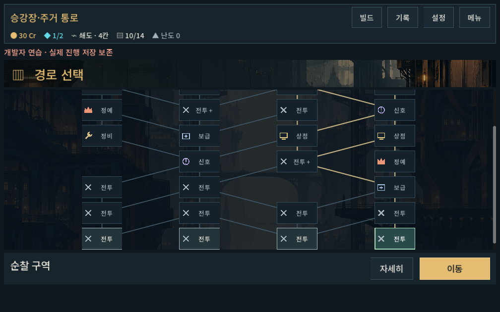
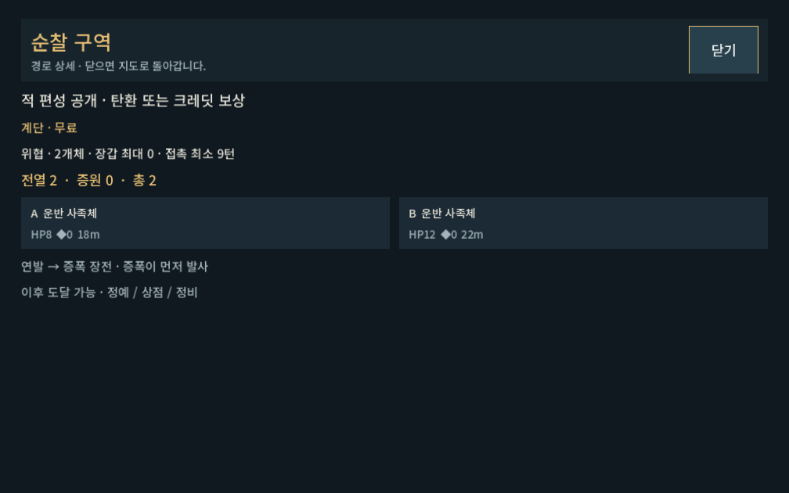

# 지도 정보량 축소 검증

2026-10-09 · 사용자 피드백: 노드 선택 정보량과 텍스트 가독성.

## 변경

- 오른쪽 상시 설명 패널을 제거하고 전체 폭 지도+하단 장소명/이동으로 재배치.
- 일반 장소 설명은 숨기고 정예/무료 정비/거리 감소 같은 예외만 한 줄로 표시.
- 적 편성·학습 설명·상점 가격·이후 시설은 `자세히`의 게임 내 화면으로 이동. 닫으면 지도 선택 유지.
- 미래 방은 미리보기, 이동 불가. 현재 진행의 접근 페널티는 즉시 진입 후보에만 적용해 설명.
- 노드 툴팁은 장소명만 표시. 넓은 화면의 지도 연결 폭을 제한하고 중앙 정렬.

## 기능 검증

`tools/run_map_checks.ps1 -Mode ui -Label minimal_final`: **328검사 / 0실패**.

격리 저장으로1280×900,1008×630(글자1.1배),1440×630의 실제 입력을 실행했다. 출발4곳/선택/미래 미리보기/진입/상세 열기·닫기/정비/정예 보상/상부 지역 스크롤/저장 복원을 검사했다. 상세 보기만으로 진입하지 않고 닫은 뒤 같은 이동 버튼이 유지되는 것도 확인했다. 전투·보상·경로 생성 규칙은 이번에 변경하지 않았다.

[로그](map_information_2026-10-09_assets/stdout.log) · [오류 로그](map_information_2026-10-09_assets/stderr.log)

## 시각 확인과 한계

작은 화면의 지도 선택/상세 캡처를 직접 확인했다. 선택명·이동 버튼이 함께 보이고 상세 화면의 제목·닫기·편성이 잘리지 않는다. 화면 배치 확인과 자동 기능 통과는 사용자의 이해도/터치 체감 통과를 뜻하지 않는다. Galaxy 실기기 확인은 후속이다.

[미래 방 미리보기](map_information_2026-10-09_assets/future_1008x630.png)
