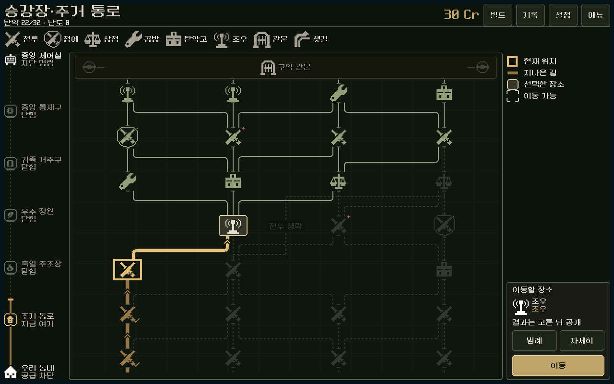

# 지도 UI — 철제 배관도와 경로 상태

2026-11-06. 사용자 ‘다음은 지도 UI 개편’ 지시에 따라 본편 지도 표현을 장비 선택/정비소의 승인된 먹색·철제·아이보리·황동 언어에 맞췄다. 새 지도 체계나 다른 게임의 화면을 도입하지 않았다. 기존 승인 배관도 목업과 [현행 경로 기준](../../../direction/route-map.md)이 구성 원본이다.

## 실제 본편

[기존 PC](before/1280x800.png) · [변경 PC 시작](after/1280x800.png) · [1170×540](after/1170x540.png) · [S26 비율2340×1080](after/2340x1080.png) · [실제 진행2340×1080](current/earned_trail_2340x1080.png) · [작은 창/마지막 구역](current/region_5_740x360.png) · [범례](current/legend_1280x800.png) · [상세](current/details_1280x800.png).

## 구현과 디자인 판단

- 왼쪽5구역 진행표, 고정 관문, 가운데 배관도 스크롤, 오른쪽 아래 선택 장소/이동을 유지했다. 노드 기호/터치60×44·행 간격/연결·방문 기억은 그대로다. 네 시작 창 크기에서 Header/MapWorkspace/범례/구역표/지도/이동 패널 등 기존 주요 Rect는 그대로이며, 잔액을 별도로 떼어낸 `RunStatusBar` 폭만 달라졌다. [전](before/geometry.json) · [후](after/geometry.json).
- 지도 전용 `pipe_map/theme.tres`, 네이티브 StyleBox와 `material.gd`를 저작했다. 반복 청록 무늬와 고채도 사격색 이동 버튼 대신 어두운 철제 면/절제된 격자·윤곽/황동 이동 버튼을 사용한다. 전역 테마와 다른 화면은 바꾸지 않는다. 기존 도트 기호 자산을 재사용했고 생성형/외부 이미지를 게임 자산으로 추가하지 않았다.
- 현재 구역은32px 제목, 소지금은 실제 `credits`의 독립32px 숫자로 표시한다. 탄약 보유/상한·난도는 기존16px 줄에 남긴다. 소지금은 중복 표시하지 않는다. 글자 역할은 기존 native/정수 배율·픽셀 폰트 정책을 따른다.
- 지나온 길은 낮은 밝기의 황동 실선/방문 체크, 선택 경로는 밝은 황동/기존 흐름 반응, 이동 가능한 노드는 아이보리 모서리, 현재 위치는 두꺼운 황동 테두리, 미래 갈래는 가는 낮은 대비 선/막힌 갈래는 점선이다. 색뿐 아니라 굵기·모서리·체크·전체 테두리를 함께 사용한다. 상태 판정/경로 산출은 바꾸지 않았다.
- 오른쪽 빈 Spacer 안에 네 상태 견본을 씬으로 저작했다. 이 보조 표시는 최소 크기에 참여하지 않으며 공간112 미만이면 숨겨 이동 패널을 밀지 않는다. 상시8종 장소 범례와 팝업 범례는 계속 사용할 수 있다. 선택/범례/상세 복귀는 같은 목적지/스크롤을 보존한다.
- ‘선택한 장소’는 ‘이동할 장소’, ‘기호’는 ‘범례’로 명확히 했다. 미래 장소는 계속 ‘미리보기’이며 이동할 수 없다. 샛길의 전투/보상·성장 포기와 위험 표시는 유지한다. 상세/범례 창은 같은 지도 재질을 적용하되 기존 스타일의 내용 여백과 입력/포커스·닫기 구조를 보존한다.

실제 선택/이동을 읽기 쉽게 하려는 디자인 판단이며 사람의 이해도나 미감이 검증됐다는 뜻은 아니다. 기본 배관도와 최근 승인 재질을 재사용한 범위로 진행했고, 새 장면/구도에 대한 승인 단계를 추가하지 않았다.

## 검증

Godot MCP로 활성 프로젝트/4.7을 확인한 뒤 기존 네이티브 PC 실행·격리 APPDATA/LOCALAPPDATA를 사용했다. Compatibility/RTX4060Ti, PC의 작은 창과 모바일 비율 결과이며 Android 실기기 검증이 아니다.

| 검사 | 결과 | 실제 범위 |
|---|---|---|
| `tools/run_map_material.ps1 -Mode current` | 15,770항목 실패0 | 현재v4 리액터/시드17의 획득된293명령 기록,5구역의 실제 지도 터치·미리보기·상세/범례 복귀·이동·샛길·첫/마지막 관문, 실제 저장/복원, 원래 최종 상태와 완전 일치 |
| `-Mode legacy` | 1,337항목 실패0 | 구버전 지도v1/v2/v3의 저장→복원→동일 그래프 표시→실제 후보 선택/이동. 구버전 전체 완주 검사는 아님 |
| `-Mode preview` | 11항목 실패0 | 바인딩 전 저작 씬의 주 구성/대표 장소와 실제 렌더 |
| 기존 `tools/run_prototype_hud.ps1 -Mode ui -Fast` | 11,558항목 실패0 | 기존 전투 HUD 조작 회귀 |

현재 경로 재생은 `qa_runtime/boss_skills_20261106/heavy_elite`의 실제 첫 전투 저장과 확정 명령/최종 저장을 재사용했다. 첫 `enter`는 이미 저장에 반영되어 중복 실행하지 않는다. 전투는 실제 모델 명령, 지도 조작은 실제 공개 터치다. 보상/승리/돈/부품을 임의로 주입하지 않았다. 최종 캠페인·전투 이력/RNG·프로필이 원래 기록과 정확히 같았다. 보조 상태 견본/잔액, 정상/즉시 모션의 기존 지도 처리, JSON 복원 뒤 방문 경로도 확인했다. 1280×800/844×390/740×360에 더해 실제 방문 경로와 범례/상세를2340×1080에서 확인했다.

[현행 원본/화면 목록](current/result.json) · [현행 출력](current/stdout.log) · [현행 오류](current/stderr.log) · [구버전 검사](legacy/result.json) · [정식 씬 출력](preview/stdout.log) · [HUD 출력](hud_stdout.log). 최종 실행들의 파싱/런타임 오류0.

### 구형 통합 검사 기록의 불일치

원래 `pipe_map_ui.gd` 전체 경로는 첫 전투 보상 `siege_drive`를 현행 보상에서 받을 수 없어 중단됐다. 이로 인해 원본 통합 실행은 첫 보상 실패와 후속 완주/샛길/관문 미도달4실패를 기록했으며 통과로 세지 않는다. 같은 명령을 **지도 UI를 하나도 만들지 않은 headless 실제 Campaign**에 재생해 index4에서 동일 거절을 확인했다. [재현 JSON](stale_route.json) · [진단 스크립트](stale_route_probe.gd). 게임 규칙을 이 오래된 기록에 맞춰 바꾸지 않고 최신 획득 기록과 별도의 구버전 지도 진입 검사를 사용했다.

## 변경 경계와 남은 확인

`Model`, `Campaign`, `CampaignContent`, `RouteMap`, 본편 호스트 `screen.gd`의 파일 해시는 작업 전후 동일하다. 저장 버전·경로 생성·전투·보상·경제는 변경하지 않았다. [전 해시](before_hashes.json) · [이번 기존 파일 변경](changes.diff) · [최종 소스 해시/범위](validation.json).

남은 확인은 사람의 경로/명도 판독과 S26의 실제 OS 안전 영역·손가락 조작·지속 발열이다. APK 생성·커밋·푸시·외부 게시 없음. 실행은 기존 `PLAY.cmd`의 본편 지도에서 확인할 수 있다.
