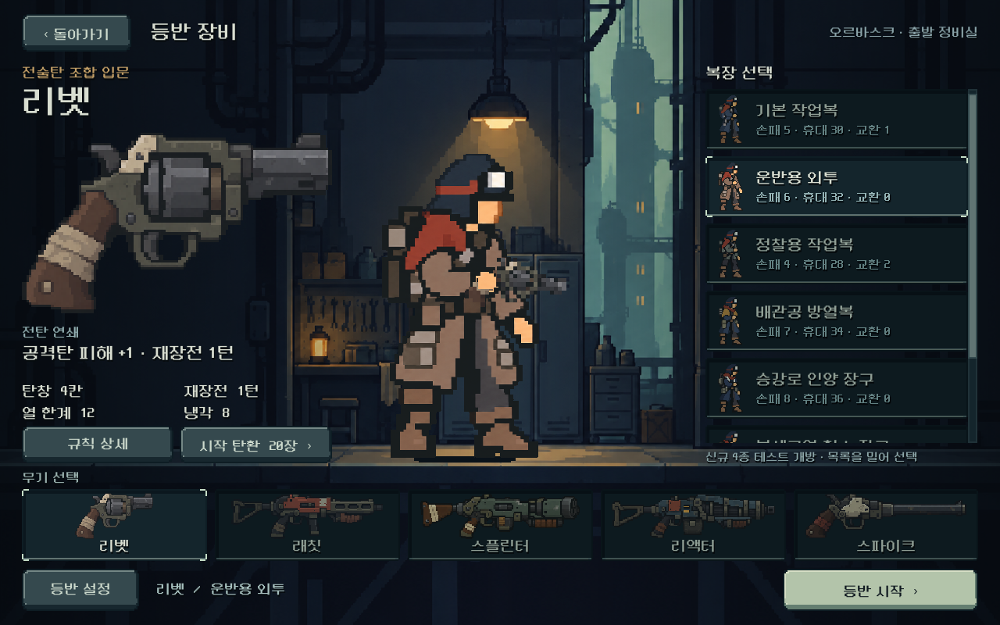

# 모바일 후기 대응 — 성능 2차·장비 캐릭터 접지

2026-10-28. [통합 우선순위](../../direction/playtest-priorities.md)의 첫 작업을 적용했다. **로컬 구현·기능·화면 검증 완료, 실제 모바일 지속 FPS·기기 발열은 미검증**이다. ADB 조회에 연결 기기가 없었다. 아래 측정은 Windows / Godot 4.7 / Compatibility / RTX 4060 Ti에서 얻었으며 모바일 성능으로 해석하지 않는다.

## 적용 내용

- 전장 좌표와 체력 표시의 가로 배치를 입력값이 같으면 재사용한다. 기존에는 적의 발 위치를 요청할 때마다 전체 적을 정렬·배치하고, 체력 표시 정렬 안에서 그 계산을 반복했다. 거리·생사·투사체·몸체 폭·화면 크기가 바뀌면 즉시 다시 계산한다. 기존 배치 결과는 유지했다. 적 겹침·거리 숫자 개편은 다음 별도 단계다.
- 잔열 증기의 갱신을 초당12단계로 줄였다. 대기 동작의 별도8단계 갱신과 합쳐 실제 전장 그리기는 약19회/초였다. 발사·피격·재장전의 동작 갱신은 유지한다.
- 무기 합성과 장비 캐릭터의 중첩 뷰포트는 외형·자세가 바뀔 때 한 번 갱신하고 결과를 재사용한다. 내부 무기와 외부 몸체를 함께 갱신해 무기만 이전 자세에 남는 것을 막았다.
- 모바일에는60FPS 상한을 지정했다. 고주사율 화면의 불필요한 렌더링을 제한하는 설정이며, 실제 기기의60FPS 유지나 온도 하락을 검증한 것은 아니다.
- 저장은 전체 이력과 기존 JSON 구조·임시 파일 후 교체 방식을 유지한다. 변경되지 않은 이력 항목의 JSON 인코딩을 재사용한다. 별도 값 사본과 비교하므로 과거 항목의 내부 수정, 동일 길이의 교체, 되돌리기, 새 등반도 저장에 반영된다. 이력 삭제나 저장 빈도 감소는 없다.
- 장비 캐릭터는 이미지 아래의 투명 여백 대신 실제 발 기준점으로 바닥에 맞추고 접촉 그림자를 추가했다. 1280화면에서 약13px 아래로 이동하며 화면 비율에 맞춰 조정된다.

뷰포트·프레임 설정 확인: [Godot SubViewport](https://docs.godotengine.org/en/stable/classes/class_subviewport.html#class-subviewport-property-render-target-update-mode), [ProjectSettings](https://docs.godotengine.org/en/stable/classes/class_projectsettings.html#class-projectsettings-property-application-run-max-fps). QA는 렌더러의 실제 휴지 상태를 [RenderingServer](https://docs.godotengine.org/en/stable/classes/class_renderingserver.html#class-renderingserver-method-viewport-get-update-mode)에서 확인했다.

## 같은 상태의 PC 전후 측정

기존 실제 등반 시드731042의1구역/5구역 저장을 복원했다. 화면 갱신7회, 저장7회의 중앙값이다. 화면 갱신은 자동 저장을 끈 CPU 처리 시간이며, 저장은 격리 경로에 실제로 기록·복원했다. 아래 두 수치를 합친 값은 전체 입력 지연 측정치가 아니다.

| 작업 | 변경 전 | 변경 후 |
| --- | ---: | ---: |
| 후반 래칫 화면 갱신 | 70.118ms | 47.396ms |
| 후반 스플린터 화면 갱신 | 72.622ms | 50.310ms |
| 초반 래칫 화면 갱신 | 45.476ms | 47.843ms |
| 초반 스플린터 화면 갱신 | 46.353ms | 47.618ms |
| 후반 래칫 반복 저장 | 31.637ms | 13.178ms |
| 후반 스플린터 반복 저장 | 27.539ms | 13.578ms |

초반 화면 갱신 개선은 확인하지 못했다. 이력 인코딩 캐시가 없는 첫 후반 저장은 약34.9ms로 여전히 비용이 크다. 반복 저장의 개선을 최초 저장에도 적용되는 수치로 설명하지 않는다. 비교 저장 크기는 각각672,399/616,604바이트로 동일했고, 모든 필드와 전체 이력의 복원도 별도로 확인했다.

1280×800의120프레임 대기 표본에서 후반 잔열 상태의 전장 다시 그리기는 래칫 약64→19회/초, 스플린터 약65→19회/초로 줄었다. 같은 PC의 해당 프레임 중앙값은 약15.2/15.0→6.1/6.1ms였다. 이는 프레임 상한을 적용하지 않은 데스크톱의 짧은 표본이며 모바일 FPS 또는 지속 발열의 증거가 아니다. 장비 화면의 전체 렌더 호출 중앙값은114→111로 줄었고, 내부/외부 뷰포트가 갱신 후 실제로 쉬는지는 별도 검사했다.

이력 값 사본을 보관하는 비용으로 후반 표본의 PC 정적 메모리는 약7MB 증가했다. 캐시는 현행 이력 길이에 맞춰 줄어들고 다음 상태의 값과 다시 대조한다. 화면 재생성15회씩4상태에서 노드 수가 늘지 않는 것은 확인했으나 장시간 모바일 메모리 안정성을 대신하지 않는다. 남은 전체 UI 재생성 비용과 최초 저장 비용도 후속 측정 대상이다.

자료: [화면 전](assets/mobile_revision_2026-10-28/ui_before.json) · [화면 후](assets/mobile_revision_2026-10-28/ui_after.json) · [저장/프레임/배치 전](assets/mobile_revision_2026-10-28/metrics_before.json) · [저장/프레임/배치 후](assets/mobile_revision_2026-10-28/metrics_after.json). 초기 측정기의 `process_median_ms`는 모니터 갱신 주기 때문에 직전 작업 시간을 포함해 해석할 수 없었고 최종 측정기에서 제거했다. 위 판단에는 사용하지 않았다.

## 최종 검증

| 검사 | 결과 | 확인 범위 |
| --- | --- | --- |
| 본편 전투 UI | 113 / 실패0 | 실제 장전·확정·발사, 예측과 표시 결과 |
| 성능·배치·디스크 저장 | 142 / 실패0 | 4상태×3화면×5변형의 기존 좌표 동일, 이동/동거리/사망/투사체 변경, 전체 이력 복원, 반복 재생성 노드 수 |
| 저장 집중 검사 | 133 / 실패0 | 한글·이스케이프, 과거 내부 값 변경, 추가/축소/새 상태, 실제 장전·사격 후 저장, 쓰기 실패 후 재저장, 훈련 호환 |
| 기존 예측·복사 규칙 | 273 / 실패0 | 실제 계산·예측·저장 정합성 |
| 비상 보급 | 1,716 / 실패0 | 임시 탄·반복 보급·기존 저장 회귀 |
| 휴대·교체 | 771 / 실패0 | 기존 획득·가방·교체·저장 회귀 |
| 장비 선택 UI | 650 / 실패0 | 35장비 조합의 실제 시작,3화면·큰 글씨·이전 저장 보호 |
| 전투 동작 | 509 / 실패0 | 관찰3,068프레임에서 순서/접지 오류0, 반동·재장전·접근·피격·처치 |
| 합성 렌더·장비 접지 | 693 / 실패0 | 7복장×5무기×6자세의 픽셀을 상시 렌더 기준과 대조, 갱신 후 휴지,3화면×7복장 캡처 |

총5,000검사 실패0. 각 결과는 [증거 폴더](assets/mobile_revision_2026-10-28/)의 해당 로그에 남겼다. QA 저장은 전부 `qa_runtime/` 아래에 격리했다.

테스트 개발 중 잘못된 투사체 키/명령 이름, JSON 파싱 전후 숫자 타입 비교, 화면 재생성 후의 오래된 노드 참조를 수정했다. 뷰포트 노드 속성은 `UPDATE_ONCE`를 유지하므로 실제 휴지 판정은 렌더 서버 조회로 교정했다. 최종 결과만 위 표에 집계했다. 제한된 Windows 환경의 인증서 저장소 읽기 오류는 네트워크를 쓰지 않는 검증과 분리하고, 기존 복장 검사 실행기에서 그 정확한 오류만 제외했다. 다른 엔진·스크립트 오류의 실패 판정은 유지했다.

## 실제 화면

7복장 각각의 대표 화면을 직접 확인했다. 전체21개 접지 캡처는 [화면 폴더](assets/mobile_revision_2026-10-28/ground/)에 둔다. 자동 배치 통과와 사용자 미감 확인은 별개다.

[같은 장비 화면 변경 전](assets/mobile_revision_2026-10-28/ground_before.png) · [변경 후](assets/mobile_revision_2026-10-28/ground_after.png) · [짧은 화면](assets/mobile_revision_2026-10-28/ground_short.png) · [넓은 화면](assets/mobile_revision_2026-10-28/ground_wide.png).

## 재현과 남은 일

- `tools/run_playtest_revision_checks.ps1 -Mode ui -Tag mobile_after`
- 같은 실행기의 `-Mode mobile_ui -Tag mobile_final`, `-Mode mobile_save -Tag final`, `-Mode render_ui -Tag final`
- 같은 실행기의 `-Mode rules`, `-Mode emergency`, `-Mode inventory` 각각 `-Tag mobile_final`
- `tools/run_unified_outfit_checks.ps1 -Suite equipment -OutputDirectory qa_runtime/mobile_revision_20261028/equipment`
- 같은 실행기의 `-Suite motion -OutputDirectory qa_runtime/mobile_revision_20261028/motion`

PowerShell 실행 정책은 해당 검증 프로세스의 `-ExecutionPolicy Bypass`로만 처리했다. [검증 시점 소스 해시](assets/mobile_revision_2026-10-28/source_hashes.json).

실기기에서 동일 빌드·경로의 초반/후반, 대기/장전/발사, 자동 저장 포함, 장시간 프레임 시간·열 상태·메모리를 비교해야 한다. 프레임 상한의 기기 적용도 함께 확인한다. 이 확인 전에는 모바일 성능·발열 문제를 닫지 않는다. 독립적인 다음 구현은 **관문 재정비와 명시적 출발**이다. 전투 수치·고장 규칙은 바꾸지 않았고 APK·커밋·푸시·외부 게시를 수행하지 않았다.
