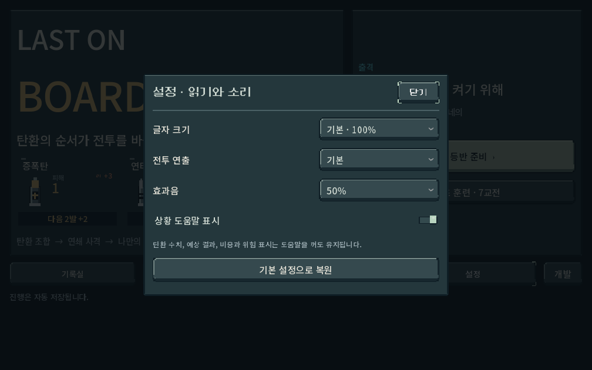
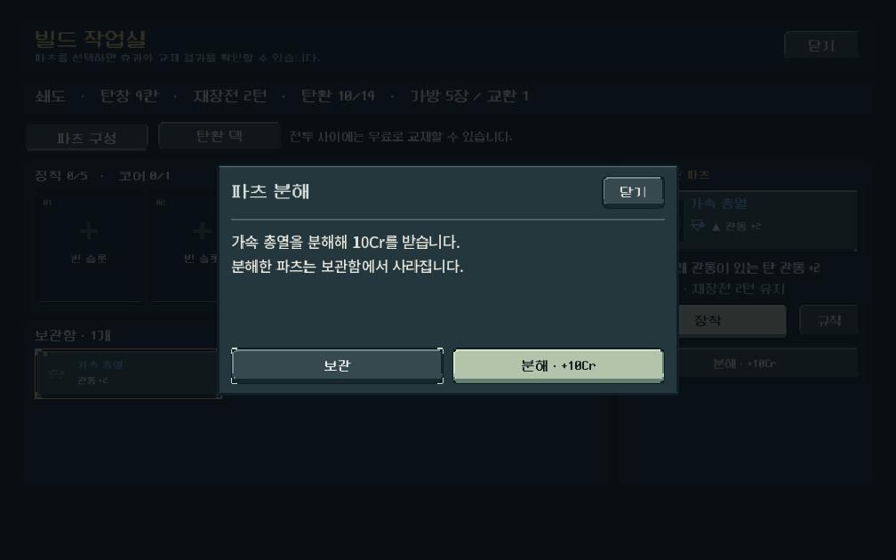
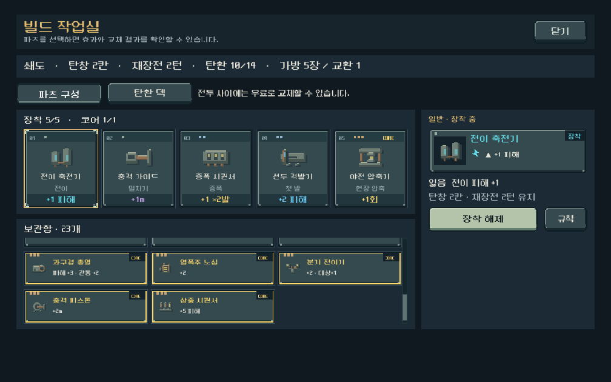
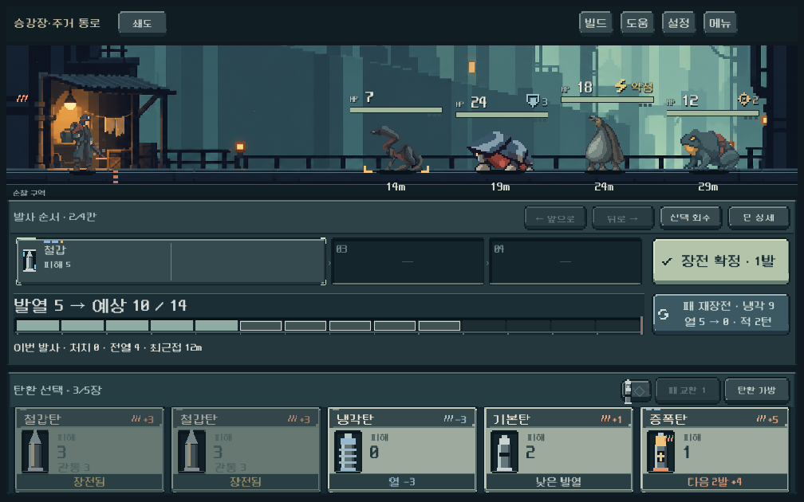

# 공통 도트 창·터치 스크롤

## 적용과 원인

- 설정·규칙·탄환/파츠 상세·개발 목록에 쓰던 AcceptDialog와 새 등반/파츠 분해 ConfirmationDialog를 공용 `console_dialog.tscn`으로 교체했다. 기존 도트 패널/버튼·동적 한글 제목을 사용한다. 제목/닫기와 확인/취소는 고정하고 내용만 스크롤한다. 취소가 기본 포커스이며 뒤로 가기는 가장 위의 창부터 닫는다.
- 배경 클릭 차단, 창 내부 Tab 순환, 닫은 뒤 이전 포커스 복귀, 설정 드롭다운 우선 닫기를 유지했다. `.tscn`에 외곽·레이아웃·대표 내용을 직렬화하고 스크립트를 제거한 실행에서도 구성을 캡처했다.
- 수정 전 실제 ScreenTouch/ScreenDrag 재현에서 긴 설명과 맵의 스크롤 위치가0/236에 멈췄다. 중간 PanelContainer/Control/카드 버튼의 STOP 입력 필터가 ScrollContainer까지 이동 입력을 전달하지 않았다.
- 공통 `touch_scroll_policy.gd`가 스크롤 하위의 일반 컨테이너/버튼만 PASS로 연결한다. Godot 기본 관성·스크롤 시작 시 버튼 취소를 사용하며, 별도의 스크롤 물리나 탭 재생을 만들지 않았다. 탄환 압축 카드·탄창 순서 드래그·입력 필드·슬라이더·드롭다운은 자기 조작을 유지한다. 중첩 ScrollContainer는 안쪽에서 입력을 종료한다.
- 터치→마우스 호환 입력과12px 움직임 기준을 명시했다. PC 마우스의 터치 에뮬레이션은 출시 설정에서 켜지 않는다. QA에서만 터치 장치 힌트를 활성화했다.

엔진 동작 확인에 사용한 공식 소스: [ScrollContainer4.7](https://github.com/godotengine/godot/blob/4.7-stable/scene/gui/scroll_container.cpp), [BaseButton4.7](https://github.com/godotengine/godot/blob/4.7-stable/scene/gui/base_button.cpp). 소스 복사 없음. Godot MCP 프로젝트 조회는4.7로 정상 응답했고 런타임 검사는 기존 격리 CLI 경로로 수행했다.

## 검증

| 검사 | 결과 |
|---|---|
| `tools/run_modal_touch_checks.ps1` | 79검사/0실패 |
| `tools/run_director_ui_checks.ps1 -Mode navigation` | 418검사/0실패 |

- Godot4.7 Compatibility, Windows/RTX4060Ti. APPDATA/LOCALAPPDATA는 각 `qa_runtime` 경로에 격리. 사용자 저장/실기기/APK 미변경.
- 1008×630·1280×900·1600×720, 글자110%에서 창과 고정 닫기 버튼을 확인했다. 프로젝트의1280×800 기준/expand 스케일을 그대로 사용했다. 추가로 논리960×540에서 출격 준비 화면의 실제 넘치는 내용을 손가락으로 스크롤했다.
- Input.parse_input_event로 ScreenTouch/ScreenDrag를 보내 터치→마우스→Control 경로를 검증했다. 스크롤 값을 직접 바꾸어 성공 처리하지 않았다. 수정 후 긴 규칙0→670, 맵236→0 이동. 파츠 보관함 카드 위 스와이프, 바깥 스크롤 정지, 손을 뗄 때 선택/장착/게임 상태 변경 없음.
- 맵 아이콘 위 스와이프가 노드를 선택하지 않음. 탄환 두 장을 실제 터치 드래그로 압축, 기본탄 터치로 장전. 기존 버튼/키보드 탐색도 검사했다. 마우스 휠 전용 재검사는 수행하지 않았다.
- 파츠 분해 취소/확정, 새 등반 취소 시 기존 저장 보존, 실제 설정 드롭다운 열기/뒤로 가기, 모달 Tab 포커스, 부분 창 닫기 뒤 빌드 작업실 유지.
- 기존 navigation 검사에서 과거 보급 원본 수량과 현행 순환 덱을 직접 비교하던 기대값1건 발견. 해금 프로필을 가진 실제 Campaign 시작 결과와 비교하도록 수정한 뒤418검사 통과. 모달 검사 헬퍼들의 구형 Window 타입 가정도 새 공통 Control 창에 맞췄다.
- 최종 두 런타임 stderr 비어 있음. import 단계 기존 Android build-tools 안내는 남아 있으며 이번 작업은 Android 내보내기가 아니다.

## 직접 확인한 화면

## 한계와 후속

Windows에서 터치 입력/장치 힌트를 재현한 기능 검사다. 실제 Galaxy에서의 손가락 감도·관성·복수 손가락·Android 뒤로 버튼은 아직 확인하지 않았다. 모바일 사용감 최종 확인은 다음 요청 APK에서 수행한다. UI 잔재 중 이번 대상은 공통 상세/설정/확인 창이며, 몬스터 본편 편성/첫 지역 밸런스는 이번에 변경하지 않았다.
