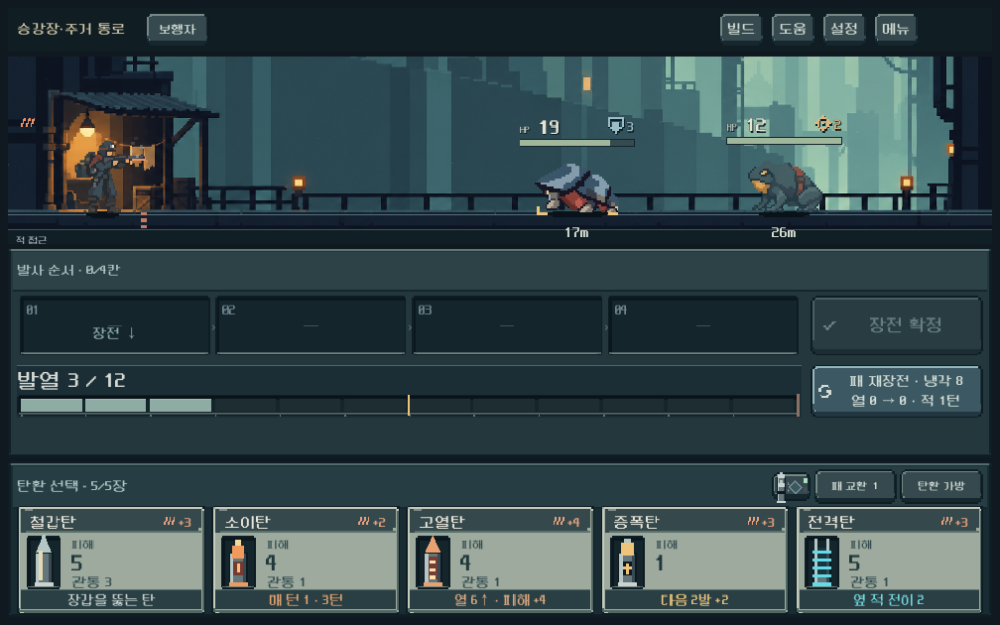
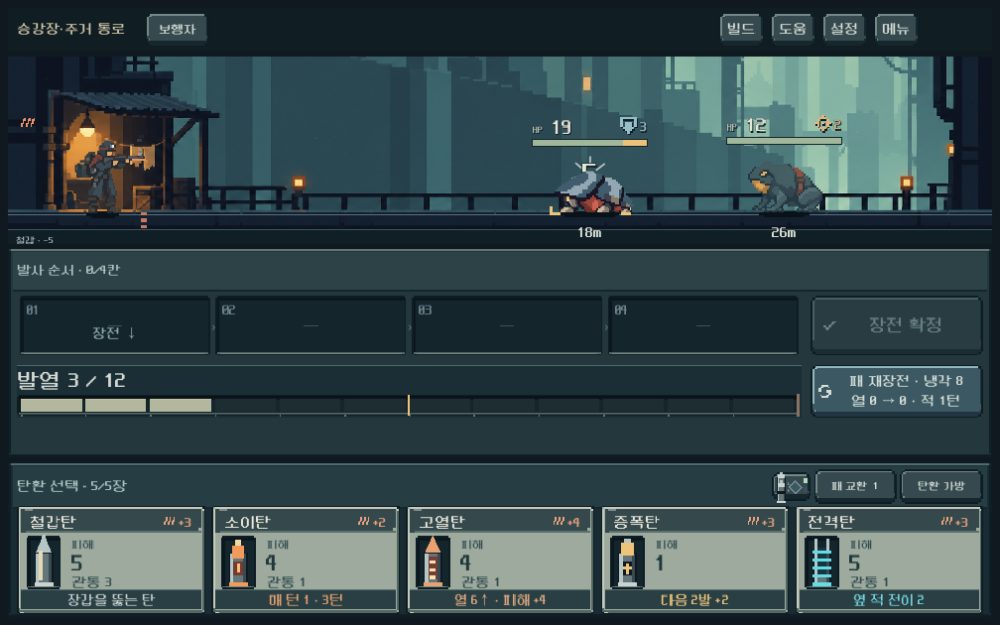
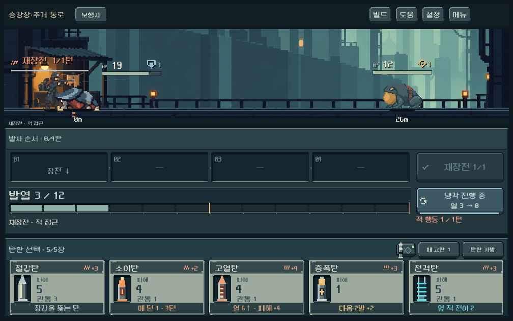

# 처마등 동작과 제작 경로

## 적용

메인 → **개발 → 몬스터 동작 · 처마등**. 기존 **몬스터 시안 · 주거 통로**와 전투 비주얼 시연에서도 처마등 동작을 사용한다. 일반 캠페인 출현 목록/전투 역할/수치/다른 몬스터는 이번 작업에서 교체하지 않았다.

승인 처마등과 주거 배경을 실제 이미지 참조로 전달해 4개 키포즈를 생성했다. 대기, 앞발을 든 걷기, 등판을 낮춘 피격, 앞으로 민 접촉 공격이다. 대기 1프레임 / 걷기 2프레임 / 피격 1프레임 / 공격 1프레임의 짧은 동작이며 다프레임 완성 애니메이션과 구분한다. 외형과 동작은 내부 게임 크기 검수 완료, 사용자의 새 동작 선호는 확인 전이다.

## 연결 방식

- 원본 `art_source/monsters/eavesback/eavesback.ase`는 실제 4프레임 타임라인이며 idle/walk/hit/attack 태그와 시간을 포함한다. 최초 생성 이미지, 등록 좌표, 전체 생성 프롬프트도 같은 폴더에 보존했다.
- `tools/export_monster_animation.py`가 LibreSprite 출력의 frameTags/duration을 읽어 PNG·Godot SpriteFrames·발 좌표 데이터를 함께 갱신한다. `--check`는 다시 출력해 RGBA와 메타데이터가 게임 출력과 같은지 검사한다.
- 생성 이미지에 남은 흐린 알파는 전용 shader에서 0.5 기준으로 제거한다. 창작 픽셀은 후처리로 다시 그리지 않았으며 원본 RGBA는 유지한다. 게임 내 외곽과 원본 PNG의 외곽은 다르다. 사망 투명도는 원본 알파와 분리해 점진적으로 사라진다.
- 걷기는 실제 move 이벤트를 재생하는 동안만 발생한다. 피격은 실제 피해 반응, 공격은 생존한 wall 역할이 move/pull로 0m에 닿은 경우만 발생한다. 대기 시간으로 적의 공격 단계가 진행되지 않는다.
- 기존 거리/레인/발 위치를 그대로 사용하고 새 각 프레임의 발 좌표로 고정한다. 일반 기계 적에 사용하던 확대/축소 변형을 새 그림에 중복 적용하지 않는다.
- `eavesback_animation_preview.tscn`은 AnimatedSprite2D로 편집기/F6에서 태그와 시간을 확인하는 독립 미리보기다. 전투는 동일 SpriteFrames를 기존 턴 재생 시간으로 샘플링한다.
- Importality의 태그/시간 메타데이터 분리 방식을 참고했다. 종료 시 자원 경고가 확인됐던 외부 애드온을 본편에서 활성화하지 않았다. 파일 포장은 [공식 ASE 규격](https://github.com/aseprite/aseprite/blob/main/docs/ase-file-specs.md)을 확인해 구현했고 LibreSprite로 실제 재출력했다. 외부 코드/샘플 아트 복사 없음.

## 검증

Godot 4.7 / Compatibility / 격리 APPDATA·LOCALAPPDATA.

| 검사 | 결과 | 범위 |
|---|---|---|
| `python tools/export_monster_animation.py --check` | 통과 | 4프레임/4태그/시간/발 좌표/RGBA 일치 |
| `tools/run_monster_motion_checks.ps1` | 81검사/0실패 | 1008×630,1280×800,1440×630의 실제 모델 발사·재장전 결과 재생, 걷기 두 프레임 관측, 피격/접촉, 발 고정, HUD 여백, 모델/RNG 상태 불변, 감소된 연출/건너뛰기, 처치 투명도 |
| `tools/run_eavesback_checks.ps1 -Mode concept` | 163검사/0실패 | 기존 공개 개발 메뉴/터치 입력/명중/재장전/4적/검사 영역/일반 캠페인 복귀 |
| `tools/run_eavesback_checks.ps1 -Mode family` | 221검사/0실패 | 기존 생물 가족·주인공·배경·전장/HUD·입력 회귀 |
| 독립 preview 씬 headless 실행 | 통과 | 미리보기 파싱/프레임 연결 |

첫 검수에서 그리기 위치를 반올림할 때 발 기준점이 소수 픽셀만큼 어긋나는 것을 발견해 수직 발 좌표를 정확히 유지하도록 수정했다. 최종 대기·걷기·피격·공격·처치 화면을 직접 확인했다. 새 런타임/파싱 오류 없음. 기존 Python 런처의 위치 안내는 출력되지만 내보내기 종료값과 검증은 성공했다.

총 **465검사 통과**는 기능/배치 증거이며 사람의 동작 선호나 모바일 실기기 확인을 대신하지 않는다. 신규 motion 검사는 모델 결과의 직접 재생이고 기존 concept/family 검사는 공개 화면 입력을 포함한다. 새 APK·커밋·푸시는 수행하지 않았다.

## 남은 작업

걷기 중간 프레임을 늘리고 다른 몬스터의 고유 기관 동작으로 확장하는 작업, 접촉 연출의 체감 속도 확인이 남는다. 이번 새 Sprite2D는 전장 그림보다 뒤에 그려지는 것이 아니라 전장 자식으로 올라가므로, 향후 몸이 더 큰 적을 추가할 때 HUD/피해 숫자와의 겹침을 다시 확인해야 한다. 현재 처마등 크기에서는 검수한 세 해상도에서 여백을 유지한다.
