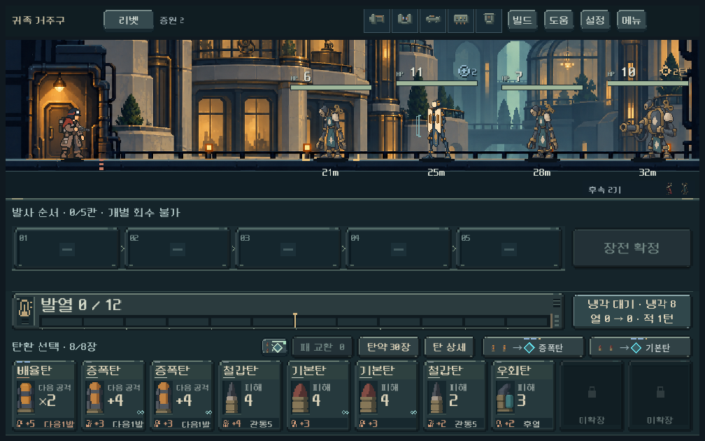
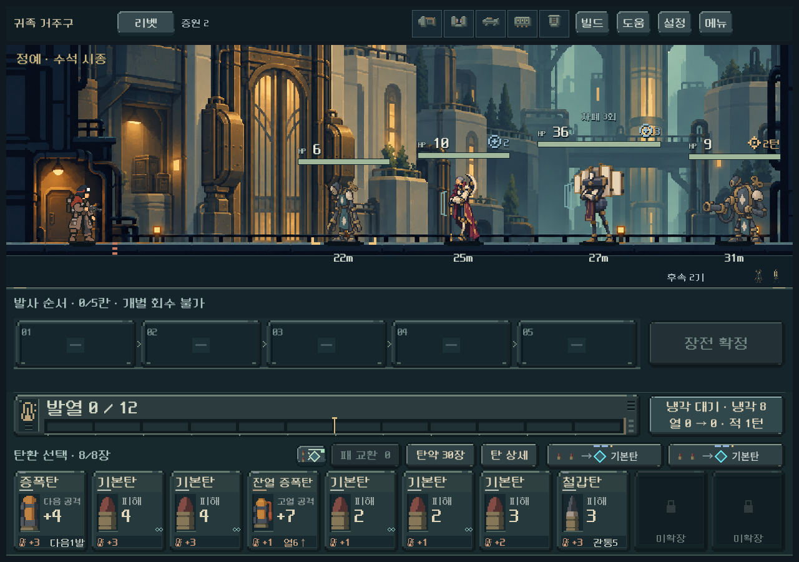
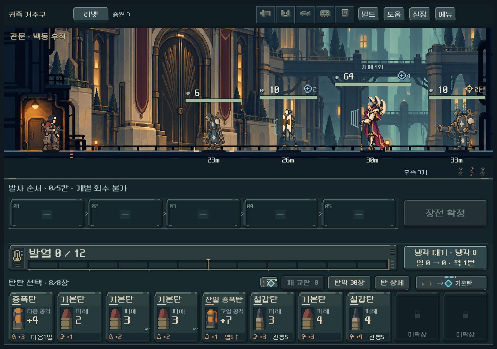
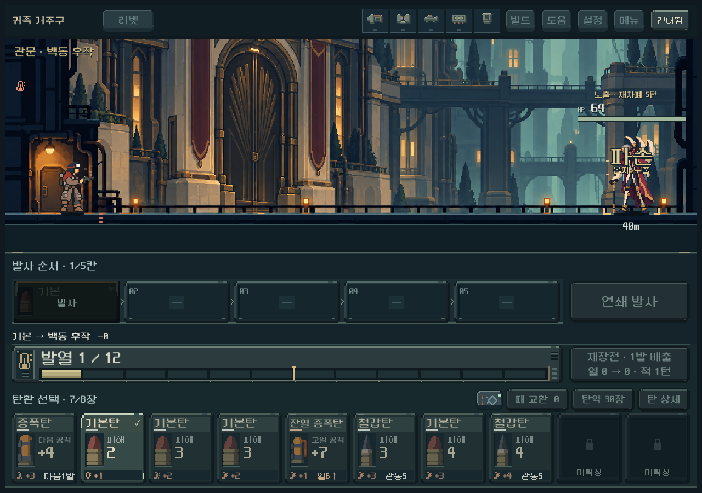
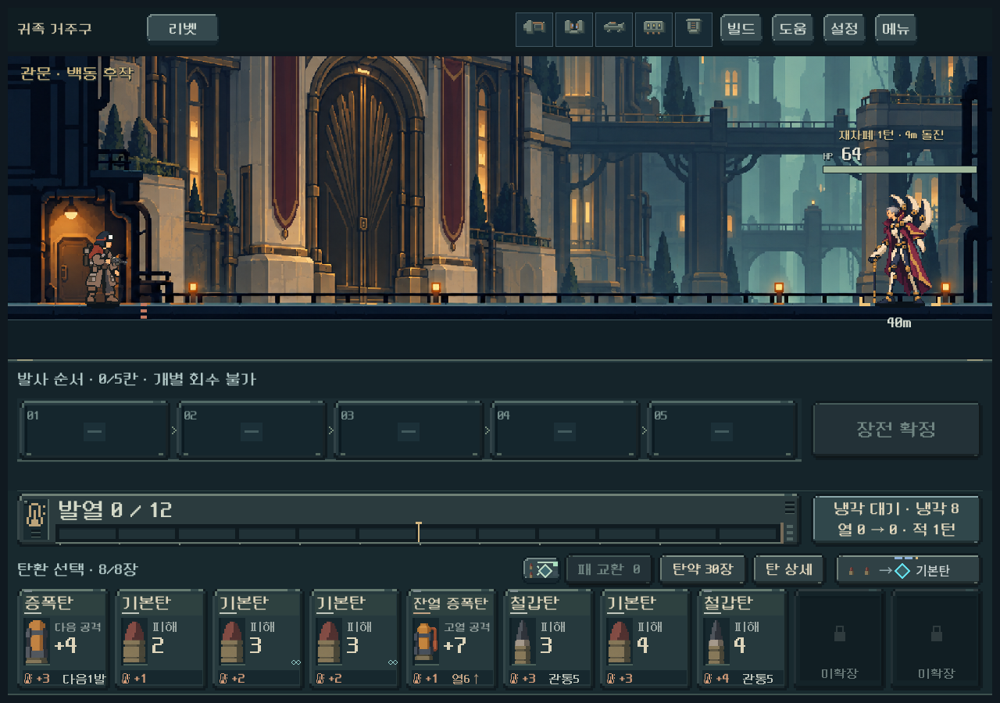
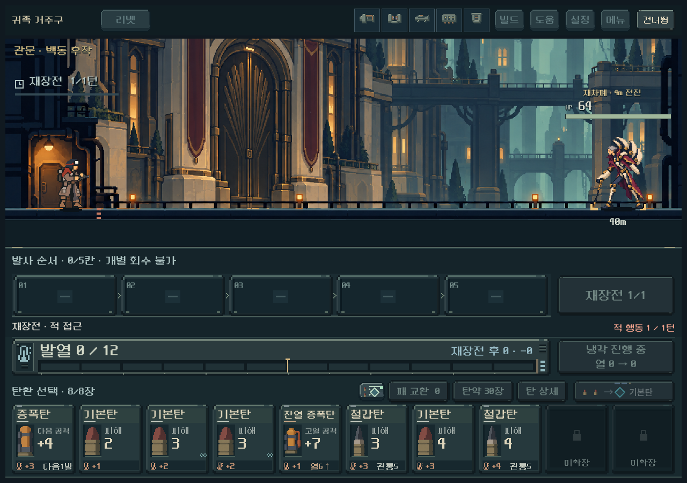
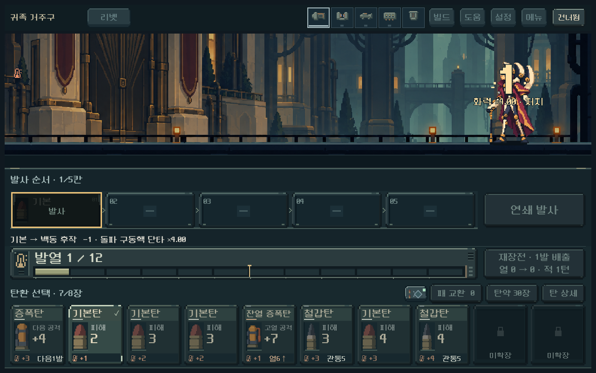

# 4구역 귀족 거주구 — 본편 적용 및 검증

2026-10-25 · Godot 4.7 · 활성 프로젝트 core-redesign

## 적용 결과

귀족 거주구의 일반4종, 정예 수석 시종, 보스 백동 후작을 실제 전투에 연결했다. 차폐를 소모시켜 공격 기회를 열고, 노출된 동안 화력을 집중하는 지역이다. 강한 빌드는 노출 한 번에 처치할 수 있으며, 특정 탄을 확보하지 못하면 진행 불가능한 자물쇠는 만들지 않았다.

새 등반 편성10에 적용한다. 기존 저장1~9는 원래 편성을 유지한다. 현재 주인공/무기 파지, 다른 구역 규칙, 배경3단계 구조는 보존했다. [현재 설계·수치](../../direction/noble-enemies.md).

## 실제 게임 화면

### 일반전 · 작은 화면

차폐 없는 시종을 전열에 섞고, 방호 대상과 압력탄 사수를 배치한다. 아래는1008×630 렌더다.

### 정예 · 수석 시종

순수 기계 시종의 넓은 어깨 가로대와 여러 문판을 사용해 일반 귀족과 실루엣을 구분했다.

### 보스 · 백동 후작

기계화 귀족의 부채형 방호 장치와 바랜 자주색 외투. HP64/차폐4회를 첫 기준으로 사용한다.

### 파손과 복구 예고

차폐에 막힌 공격도 남은 횟수를 줄인다. 마지막 차폐를 깨면 '파손 / 본체 노출'을 표시하며, 원화의 문판이 열리는 자세로 바뀐다. 아래 파손/복구 장면은 단일 보스의 관찰용 상태를 만들어 캡처한 것으로 공략 성공 증거가 아니다.

### 피니시

적중 전 줌인과 기존 슬로우/처치/줌아웃 경로를 유지한다. 아래는 보스HP를1로 만든 연출 검증 장면이다.

## 검증 결과

| 범위 | 최종 검사 | 실패 | 확인 내용 |
|---|---:|---:|---|
| 4구역 규칙 | 893 | 0 | 편성 전체 저장, 차폐/전기/연타/화상/차단/과열, 예측, 연쇄·돌파·열압, 무작위 표적 |
| 전투 화면 | 847 | 0 | 세 해상도, 적과HP 중심 정렬, 상세 터치, 파손·복구, 연출 건너뛰기·축소 |
| 배경/통합 화면 | 1,678 | 0 | 세 배경 단계, 세 화면 비율, 바닥 접점, 넘침, 발사·재장전·압력탄, 보스 피니시→보상 |
| 2구역 회귀 | 1,408 | 0 | 기존 주조장 규칙·저장 |
| 3구역 회귀 | 359 | 0 | 기존 정원 규칙·저장 |
| 실제 획득 덱 첫 진행 | 7,041 | 0 | 다섯 무기3→4구역, 5구역 진입. 이 실행의 heavy는 이전 압쇄 규칙 |
| 현행 리액터 재검증 | 1,749 | 0 | 같은 획득 기록에서 현행 리액터로3→4구역, 5구역 진입 |

각 실행은 격리 저장에서 수행했다. 오류 로그는 최종0바이트, 실제 사용자 저장은 수정하지 않았다. 검사 횟수에는 명령마다 수행한 저장 왕복이 포함되며, 이 수치가 사람의 재미 검증을 대신하지 않는다.

화면은1008×630,1280×900,1440×630과 배경 회귀의1280×800에서 확인했다. 제작자 시각 검토: 본체와HP 대응, 바닥 접점, 일반/정예/보스 실루엣, 차폐 열림, 짧은 예고, 작은 화면의 전체 배치. 사용자 미감과 Galaxy 실기기는 확인 전이다.

### 실제 획득 덱 진행의 범위

시드731042의 기존 두 번째 관문 도달 기록에서 시작해, 실제 맵 진입·전투·보상·상점·관문 선택으로3구역과4구역을 진행했다. 탄환·파츠·성장 레벨을 임의로 추가하지 않았다. 후반 방으로 바로 이동하는 개발자 미리보기와 별도 검증이다.

| 무기 | 3·4구역 검증 전투 | 4구역 보스 적 행동 턴 |
|---|---:|---:|
| 리벳 | 11 | 7 |
| 래칫 | 11 | 13 |
| 스플린터 | 11 | 13 |
| 리액터 · 현행 능력 | 11 | 16 |
| 스파이크 | 11 | 6 |

다섯 경우 모두4구역 관문 보상을 선택하고5구역 입구까지 도달했다. 이는 각 무기의 한 획득 빌드·한 시드에 대한 도달 가능성이다. 모든 카드 순서·성장 선택·시드의 난이도를 보증하지 않는다. 리액터는 기존 두 번째 관문 기록의 보유품을 유지한 채 무기 규칙만1로 설정한 뒤3구역부터 재검증했다. 나머지 네 무기는 무기 버전0/1의 능력이 동일하다.

현행 결과는 [진행 요약 JSON](assets/noble_live_2026-10-25/current-route-summary.json), 이전 압쇄가 포함된 첫 실행과 현행 리액터 재검증은 별도 로그로 보존했다. 실제4구역 입구 기록은 게임의 `tests/fixtures/noble_arrivals_20261025/`에 있다.

### 발견·수정한 문제

- 큰 원화만을 기준으로 간격을 계산해 HP표시가 옆 적 쪽으로 밀리는 문제: HUD너비까지 배치 간격에 포함하고, HP중심과 몸체 중심을 검증했다.
- 기존 '막힘' 문구로 차폐가 줄어드는 효과가 드러나지 않는 문제: 실제 제거 횟수/파손/노출을 분리했다. 보조 연쇄에도 정확한 제거량을 전달한다.
- 후반 일반전의 예비 압력탄 사수가 중복되어 전체 저장 검증이 거부되는 문제: 사수를 전투 전체1기로 제한하고 추가 시종으로 교체했다. 모든 구간을 완전한 모델로 복원하는 검사 추가.
- 무작위 예측 분기에서 노출 시간 차이가 합쳐질 가능성: 분기 구분 값에 노출 시계를 포함했다.
- 새 연출 클래스에서 기존 적중 피드백 누락: 상위 적중 연출을 유지한 뒤 차폐 파손 반응을 덧붙였다.
- Windows PowerShell의 프로세스 종료 코드가 비어 기존 회귀 검사가 실패로 보고되는 문제: 실행 직후 프로세스 핸들을 확보해 실제 종료 코드를 확인한다.
- 테스트 복원 실패 뒤 빈 모델로 재장전하던 검사기: 실패 상태를 증거 파일로 남기고 중단하도록 수정했다.

## 아트 제작 기록

최종5PNG: 차폐 귀족v2, 겹문 시종v2, 수석 시종v2, 백동 후작v1, 가문 시종/경호기 공용v1. 차폐형4종×3키포즈 + 작업기2종 정지 원화, 총14자세다. 인게임 움직임은 기존 이동·피격·사망 및 재차폐 타이밍과 연결한다.

원본은 native image_gen으로 제작하고 PNG픽셀을 보존했다. Python은 알파 범위와 발 좌표 측정만 수행한다. Godot의 폴리곤 분리·알파 컷아웃·최근접 표시·공통 아트 셰이더를 사용한다. 초기 수정본도 원본과 제작 이력으로 보존했다.

[프롬프트·입력 참조·원본·채택 상태](../../../새-게임-프로젝트/assets/art/noble_enemies_20261025/provenance.json) · [등록 좌표](../../../새-게임-프로젝트/assets/art/noble_enemies_20261025/registration.json)

## 테스트 진입

1. [PLAY.cmd](../../../PLAY.cmd) 실행.
2. 메인 화면 아래 **개발**.
3. **귀족 거주구 · 일반전 / 수석 시종 / 백동 후작** 선택.
4. 해당 미리보기는 실제3구역을 통과한 리벳의 보유 덱을 사용하며 기존 저장에 기록하지 않는다. 후반 방을 직접 여는 경우 그 사이의 보상 성장은 더하지 않는다.

일반 진행에서는 새 등반을 시작해야 새 편성이 적용된다. 기존 이어하기의 적 구성은 바꾸지 않는다. Godot 편집기에서는 [project.godot](../../../새-게임-프로젝트/project.godot)를 열어 실행한다.

## 남은 판단

- 차폐를 여는 행동과 열린 동안 몰아치는 행동을 플레이어가 직관적으로 구분하는지.
- 리액터의 긴 보스전과 스파이크/리벳의 짧은 공략 시간 차이가 적절한지.
- 한 시드 외의 성장 선택, 낮은 성장 빌드의 탄약 소진 위험.
- 새 원화의 미감·동작 체감과 Galaxy 터치 가독성.

APK·커밋·푸시·외부 업로드는 이번 요청 범위에 포함하지 않았다.
