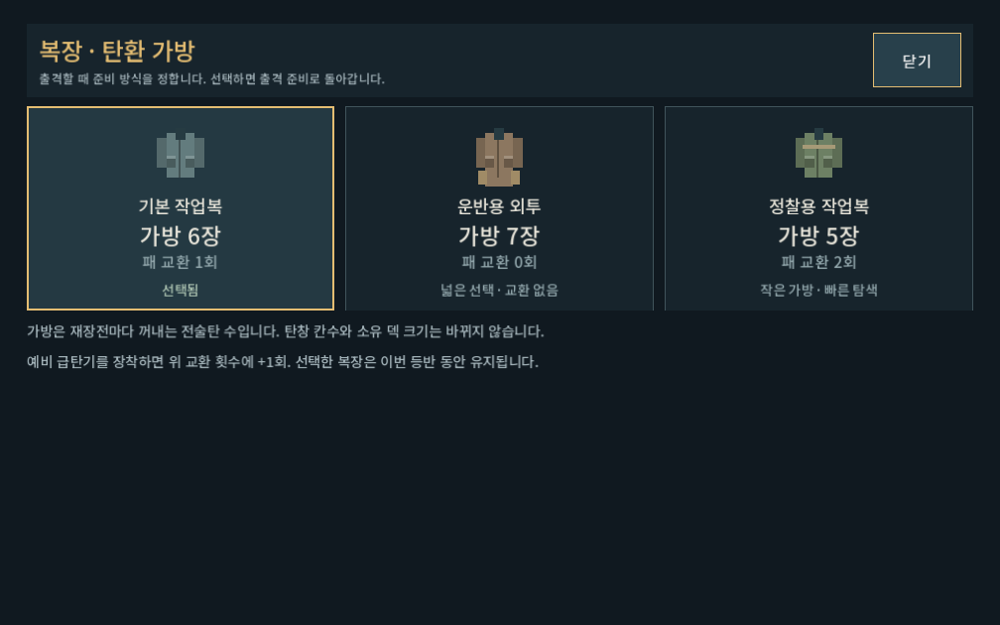

# 복장·가방3종 적용 검증

2026-10-09 · [현행 설계](../../direction/outfit-bag.md). 실제 기능 적용, 내부 시각 확인 완료. 사람 선택 체감/최종 밸런스/Galaxy 실기기 확인은 후속이다.

[출격 준비](outfit_bag_2026-10-09_assets/preparation_carrier_1008.png) · [운반복7번째 탄 장전](outfit_bag_2026-10-09_assets/combat_carrier_1008.png) · [정찰복 전투](outfit_bag_2026-10-09_assets/combat_scout_1008.png) · [장비 가방 정보](outfit_bag_2026-10-09_assets/build_scout_1008.png)

## 검증

- `tools/run_outfit_bag_checks.ps1 -Mode rules`: **2030검사/0실패**. 5총기×3복장×6파츠 구성, 탄창확장+2·가방 고정·예비 교환 추가·교환 소진/거부·재장전 복구·큰 탄창 기본탄 충전/확정/발사. 각 복장 과열 강제 재장전의 새 패/교환, 실제 예측과 결과, 파일 저장 후 계획/복장 복구. 기존 복장 없는 산개7장과 소진된 교환을 보존하고 알 수 없는 ID/타입/캠페인 불일치 거부.
- `tools/run_outfit_bag_checks.ps1 -Mode ui`: **486검사/0실패**. 실제 Godot1008×630/1280×900/1440×630에서3복장 비교→선택→출격→전투→빌드 열람. 공개 터치로 출격에 복장이 전달되는지, 운반복 교환 버튼이 비활성인지,7번째 탄을 페이지 이동해 장전할 수 있는지 확인했다. 전투는 합법적인 다양한10장 덱을 설정해 페이지 접근을 검증했다.
- 성장 회귀 `run_progression_checks.ps1 -Mode rules -Label outfit_bag`: **5189/0**.
- 패 순환 회귀 `run_decision_revision_checks.ps1 -Mode rules`: **827/0**. 이전 탄창+2 고정 검사를 새 복장 기준으로 갱신했고 기존 저장은 별도 레거시 검사로 보존했다.
- 파츠 회귀 `run_parts_checks.ps1 -Mode rules`: **2265/0**.
- 격리 APPDATA/LOCALAPPDATA와 UI 저장 비활성. 개인 저장 접근/변경 없음. 초기 테스트의 준비 단계 재장전 호출과 잘못된 맵 키를 수정한 뒤 전체 관련 검증을 다시 수행했다.

## 시각·제작과 범위

작은 화면 복장 비교/출격 준비/운반복 두 번째 페이지/정찰복 장비 화면을 직접 확인했다. 준비 화면의 기존 줄에 복장 버튼을 배치해 화면 높이를 늘리지 않았고 카드에는 이름·가방·교환·선택 상태를 우선했다. 도트 기호는 Godot CanvasItem 도형으로 직접 작성한 UI 자산이며 외부 생성 이미지/프롬프트는 없다. 실제 캐릭터 의상 스프라이트3종을 제작한 것은 아니다.

새 시스템이 장기 승률/빌드 재미에 미치는 영향은 자동 기능 통과로 확정할 수 없다. 특히 큰 탄창 무기의 가방 선택 강제와 정찰복 교환2회 효율은 플레이 관찰 대상이다. 복장 수집/헬멧/전투 외형은 후속. APK/커밋/푸시 없음.

실행: `PLAY.cmd` → 새 등반 준비 → 현재 복장 버튼. 기존 이어하기는 이전 패 규칙을 유지하므로 새 등반으로 시험한다.
