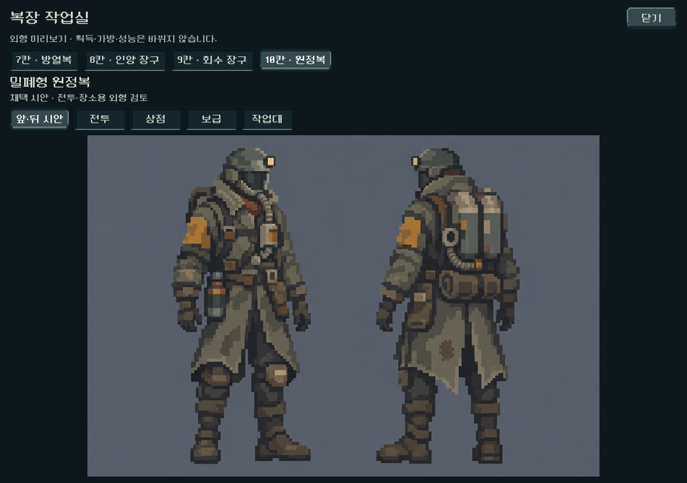
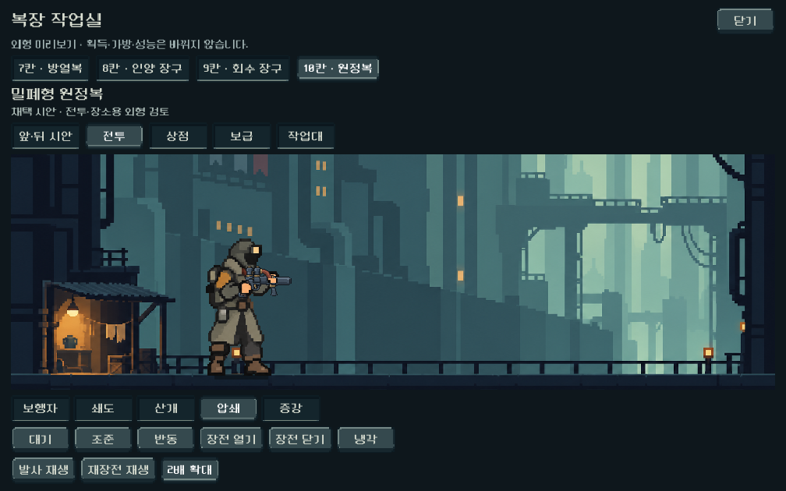
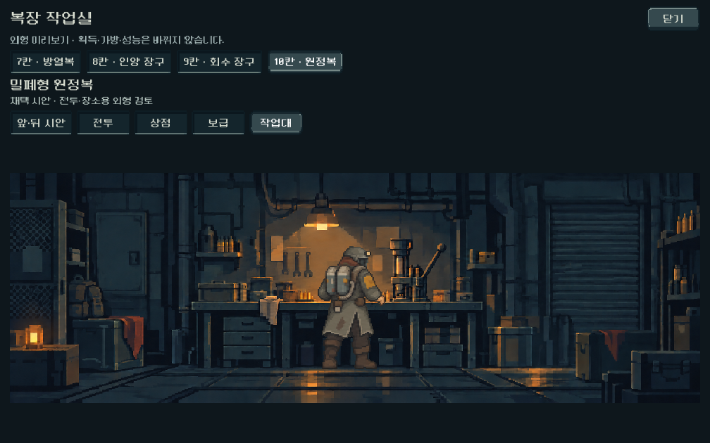

# 복장 작업실 — 아트와 미리보기

## 범위와 결정

- 사용자 채택: 10칸 밀폐형 원정복 v3.
- 최신 사용자 범위: 복장 획득은 나중에 결정, 지금은 아트와 미리보기.
- 방열복/인양 장구/회수 장구/원정복 시안 4종을 비교한다. 원정복만 새 전투·장소 자세를 제작했다. 다른 세 복장의 동작은 완료로 보지 않는다.
- 본편의 복장 ID, 획득, 가방 용량, 시작 선택, 교환 횟수, 기존 저장은 변경하지 않았다. 기본4칸은 앞서 확정한 목표이며 이번 구현 범위 밖이다.

## 확인 방법

- 저장소 루트의 [OUTFIT_PREVIEW.cmd](../../../OUTFIT_PREVIEW.cmd)를 실행한다.
- 또는 PLAY.cmd → 메인 메뉴 개발자 테스트 → 복장 작업실.
- 상단4종으로 앞·뒤 시안을 비교한다. 원정복 선택 시 전투/상점/보급/작업대 탭이 열린다.
- 전투는5총기,6자세, 발사/재장전 재생,2배 확대를 지원한다. 기본은 약110px 인물 높이이며 확대는 세부 검토용이다.
- 닫기 또는 Escape로 종료한다. 독립 실행은 앱을 닫고, 메인 메뉴에서 연 경우 오버레이만 닫는다.

## 제작

내장 image_gen으로 승인 원정복을 기존 동작에 입혔다. 권총/장총 각각6자세 PNG와 장소3자세 PNG를 생성했다. 원본 알파/캔버스를 보존하며 새 파일은 assets/art/outfit_preview_20261011에 저장했다. 같은 폴더 provenance.json에 전체 프롬프트, 참조 역할, 생성 원본, SHA256을 기록했다.

- 권총 조준의 손이 기존보다28 소스 픽셀 앞으로 이동한 것을 색 영역 분석으로 확인하고 미리보기 전용 총/손 등록값으로 보정했다.
- 장소 인물의 실제 불투명 영역을 측정해 별도 리소스에 등록했다. 배경은 기존 공통 실내를 재사용한다.
- 알파의 약한 외곽 번짐은 기존 alpha cutout 셰이더로 제외한다. 원본 이미지를 사후 재가공하지 않았다.
- 공유 총기 렌더러에 몸체/손/총 변환 조회 지점만 추가했다. 기본 구현은 기존 값 그대로이며 신규 복장은 전용 미리보기 하위 클래스에서만 선택한다.
- 신규 화면은 outfit_preview.tscn에 선언돼 에디터에서도 구성과 대표 시안을 볼 수 있다. standalone launcher는 격리 사용자 경로를 사용한다.
- 프로젝트 AGENTS가 허용한 기존 Godot CLI 실행·캡처 경로를 사용했다.

## 검증

- tools/run_outfit_preview_checks.ps1: **1,172검사 / 실패0**.
- tools/run_weapon_heat_checks.ps1: **100검사 / 실패0**.
- 합계 **1,272 / 실패0**, 런타임 stderr 비어 있음. Import에는 기존 Android build-tools 경로 경고가 있으나 새 스크립트/리소스 파싱 오류 없음. APK는 생성하지 않았다.
- 1280×900 / 1008×630 / 1440×630에서 터치 시안·모드 선택, 버튼 경계, 이미지 잘림,5총기×6자세, 실제 렌더 변화, 재장전 완료, 확대, 장소 접지, 메뉴 진입/닫기를 확인했다.
- 본편 모델과 선택 복장 값이 미리보기 조작 전후 동일하며 신규 복장은 gameplay OUTFITS에 추가되지 않은 것을 확인했다.
- 기본 몸체/총/손 등록값이 이전 정적 조회와 같음을 검사하고 기존 발열/총구 회귀도 실행했다.

## 시각 확인과 남은 범위

실제 화면에서 헬멧, 황토 소매, 두 등 장치가 구별되고 총과 손, 작업대 높이가 연결되는 것을 확인했다. 초기 캡처에서 버튼 텍스트 여백이 좁아 좌우12px을 보강하고 검사를 다시 통과했다.

정밀한 연속 프레임 애니메이션의 완성본은 아니다. 기존6키포즈 및 총 부품 움직임을 사용하는 외형 미리보기다. 생성본의 손은 기존 부착 위치를 유지하려고 맨손이며, 채택 시안의 장갑과 차이가 있다. 높은 확대에서 장소 스프라이트의 부드러운 소스 묘사가 드러난다. 실제 착용 전 최종 장갑/표현 정리와 사용자 체감 검토가 필요하다. Galaxy 실기기와 나머지3종의 전투/장소 동작은 미검증·미제작이다.

