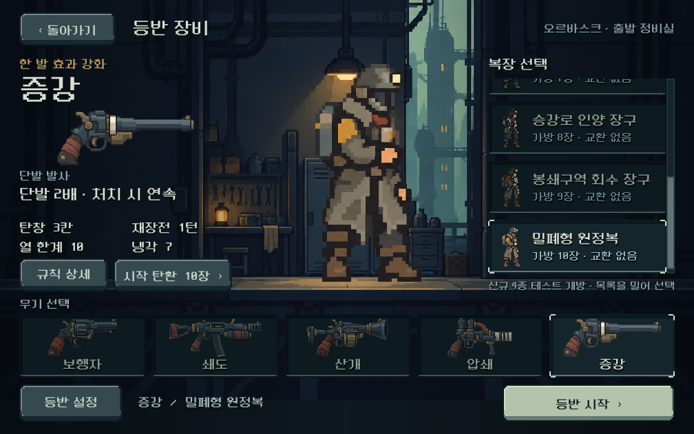
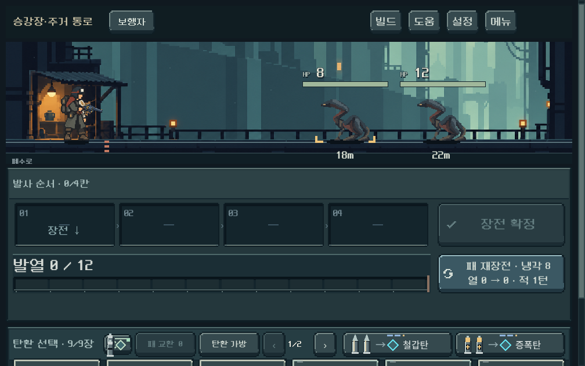
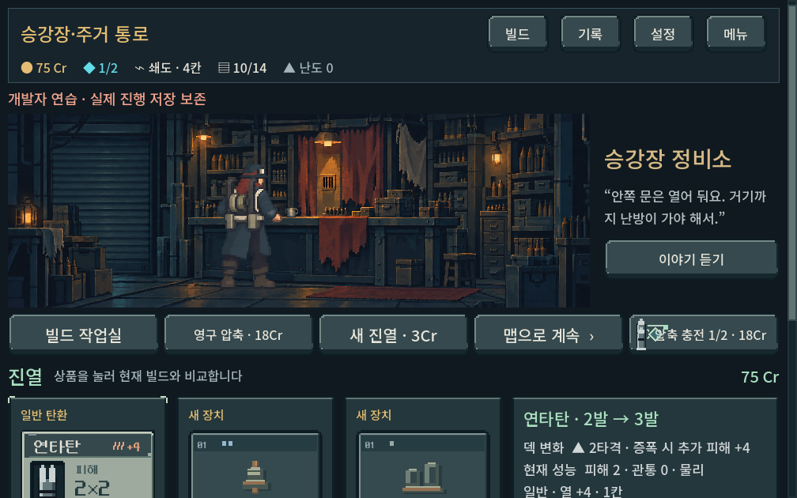
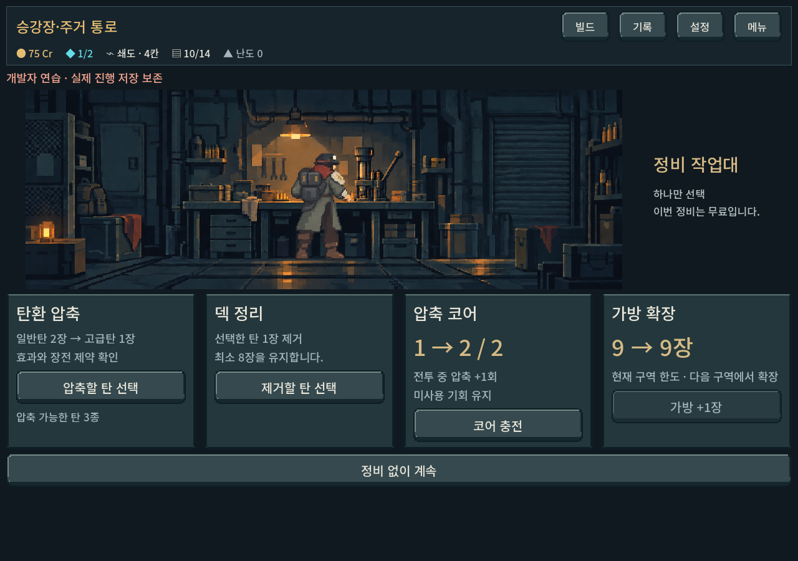

# 신규 복장 4종 본편 연결

## 범위와 결정 상태

- 사용자 요청: 새로 제작한 복장을 본 게임에 추가한다. 이전의 아트·미리보기 한정 범위를 확장했다.
- 본편 추가: 배관공 방열복 7칸, 승강로 인양 장구 8칸, 봉쇄구역 회수 장구 9칸, 밀폐형 원정복 10칸.
- 기존 사용자 확정에 따라 새 장비 선택의 기본값은 정찰복 4칸이다. 훈련의 작업복과 기존 저장은 보존한다.
- 제작 당시 디렉터 임시 결정으로 신규 4종을 장비 선택에서 테스트 개방했다. 2026-10-14 사용자 답변으로 이 테스트 개방 방식이 확정됐다. 정식 획득 방식은 미정이다. 패 교환은 기존 대용량 복장처럼 0회로 두었다. 최종 해금·밸런스 확정이 아니다.
- 기존 가방 성장 상한 10칸은 유지하며, 성장했다고 복장이 자동 변경되지 않는다. 새로운 방어·냉각 보너스는 추가하지 않았다.

## 구현

신규 세 복장에 권총·장총 6자세 아틀라스와 상점·보급소·작업대 인물을 제작했다. 15개 PNG의 원본 알파와 캔버스를 보존하고 provenance.json에 프롬프트·참조·원본·해시를 기록했다. 원정복은 채택한 기존 5개 리소스를 재사용한다. 인양 장구의 첫 생성본에서 대기 자세 손 위치가 어긋나 권총·장총을 v2로 재생성했다.

outfit_art.gd와 service_actor_catalog.gd를 통해 본편과 작업실이 같은 리소스를 사용한다. 장비 선택의 7종 목록은 별도 스크롤 영역이며 시작 버튼과 무기 선택 영역을 밀어내지 않는다. 신규 4종의 선택 그림도 전투 리소스로 연결했다.

전투 표시 상태에서 outfit이 누락되어 기존 몸체가 표시되던 문제를 실제 렌더 검사로 발견해 수정했다. 원정복의 권총 조준 손 보정과 실제 총구 위치 계산도 공유 렌더러로 옮겼다. 재장전·반동·독립 총기 합성은 기존 동작을 활용한다.

## 기능 검증

Godot 4.7 stable / Windows / OpenGL Compatibility. 사용자 저장과 분리된 APPDATA·LOCALAPPDATA, screen.save_enabled=false를 사용했다. 본편 복장 규칙 시드 19324, 이전 저장 호환 시드 231. 기존의 많은 미커밋 변경을 보존했으며 커밋·APK는 만들지 않았다.

| 검사 | 통과 | 범위 |
|---|---:|---|
| 장비 선택 UI | 649 | 7복장 × 5총기 시작, 선택·미리보기·훈련·확대 글꼴 |
| 복장 작업실 | 1,172 | 4종 선택과 원정복 동작·장소 회귀 |
| 신규 복장 본편 | 1,487 | 시작 패, 실제 장전·발사, 상태 복원, 가방 성장, 터치 스크롤, 4종 × 5총기 × 6자세 렌더, 3장소 |
| 총기 잔열 표시 | 100 | 기존 돌출 막대 회귀 |
| 총기 동작 | 502 | 기존 반동·장전·접지 회귀 |

최종 실패 0. 본편 실행 증거는 qa_runtime/outfits_live/20261013_233718이며 대표 화면과 최종 로그를 아래 증거 폴더에 복사했다. QA 스크립트는 tools/run_outfits_live_checks.ps1이다.

초기 본편 검사는 outfit 전달 누락을 발견하여 수정했다. 첫 터치 검사는 데스크톱 입력 에뮬레이션 설정 누락으로 실패했고, 기존 모바일 입력 검사와 같은 설정 및 window_id를 적용한 후 통과했다. 이 입력 수정은 검사 코드에만 적용했다. 실행 로그 충돌을 피하도록 새 검사 출력 경로는 실행 시각별로 분리했다.

## 시각 확인

1280×900, 1008×630, 1440×630에서 본편과 장소 화면을 캡처했다. 대표 화면에서 의상 실루엣, 손과 총기의 연결, 발 위치, 카운터·작업대와의 관계를 확인했다. 작은 전투 화면은 기존 전체 스크롤 구성을 유지하므로 탄환 영역을 내려서 보는 동작이 필요하다. 이를 모든 내용이 한 화면에 들어온 것으로 판정하지 않았다.

## 남은 범위

- 정식 획득 조건과 7~10칸 시작의 균형은 미확정이다. 현재는 테스트 개방이다.
- Galaxy 실기기 조작과 사람의 복장 선호·동작 체감은 별도 확인이 필요하다. 자동 검사 수는 UX 완성 점수가 아니다.
- 기존 정찰복·운반복의 독립 전투/실내 몸체는 여전히 작업복 대체 리소스를 사용한다. 이번 신규 4종은 각각 연결됐다.
- 동작은 6개 주요 자세와 기존 보간 기반이며 프레임별 신규 풀 애니메이션 제작은 아니다. 원정복의 맨손 및 확대 시 세부 질감은 후속 아트 검토 여지가 있다.

실행: PLAY.cmd → 등반 장비 → 오른쪽 복장 목록을 스크롤해 선택 → 등반 시작.
