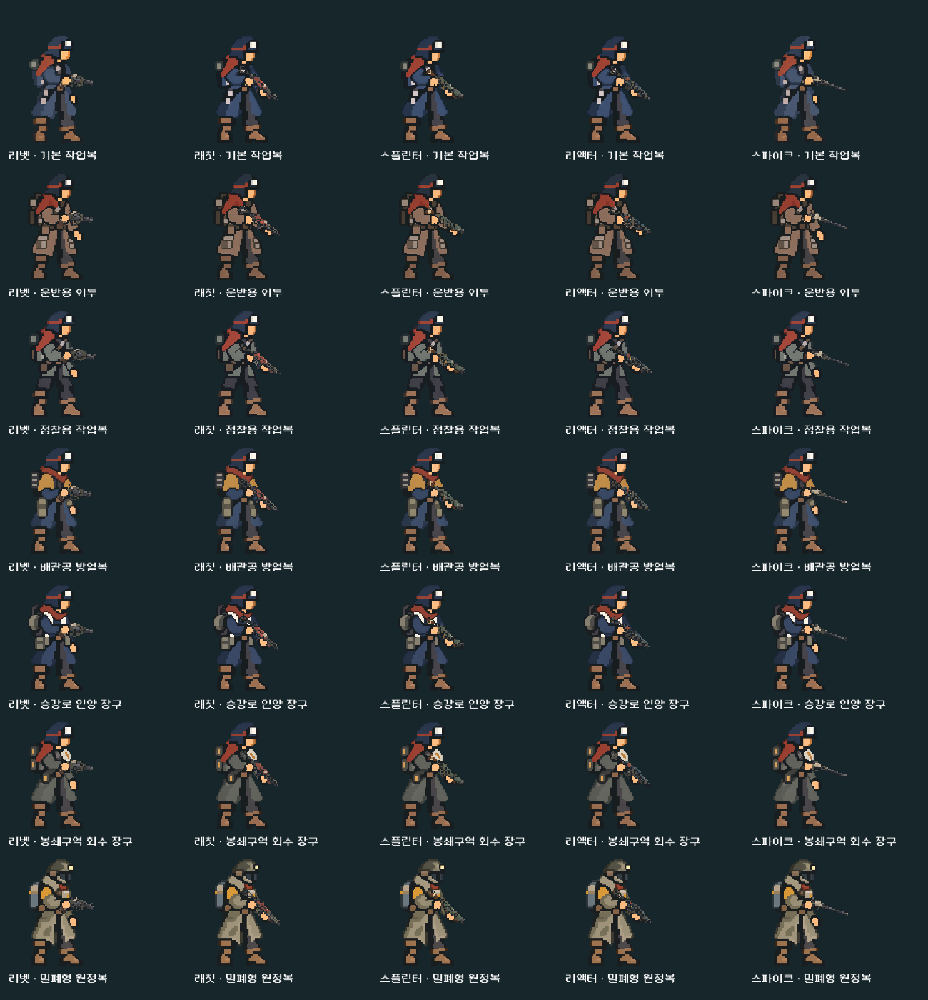
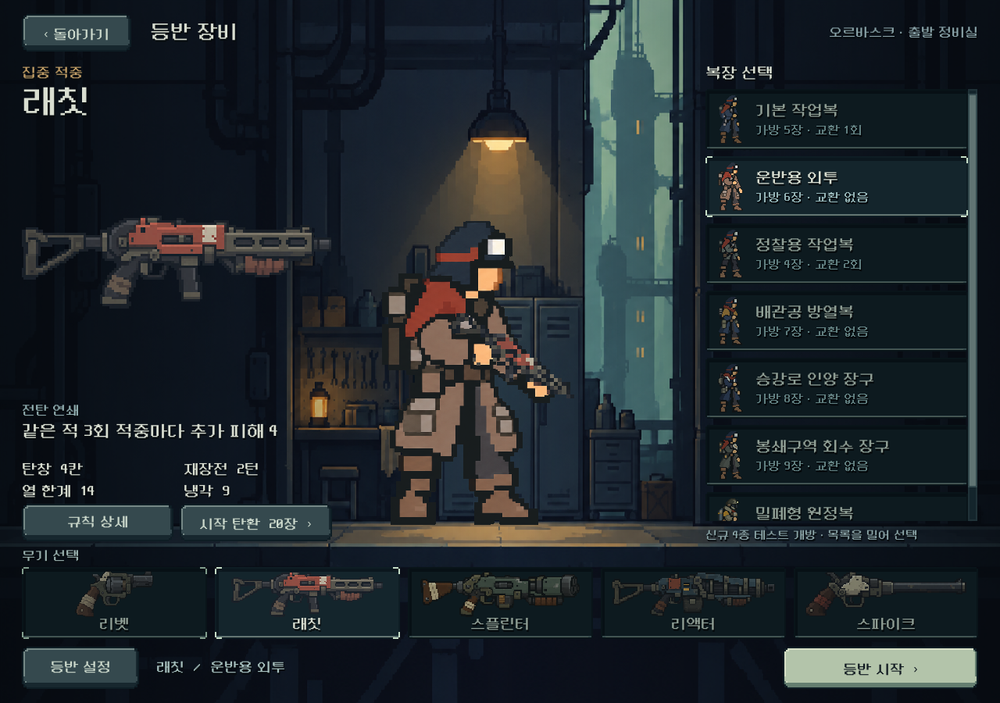
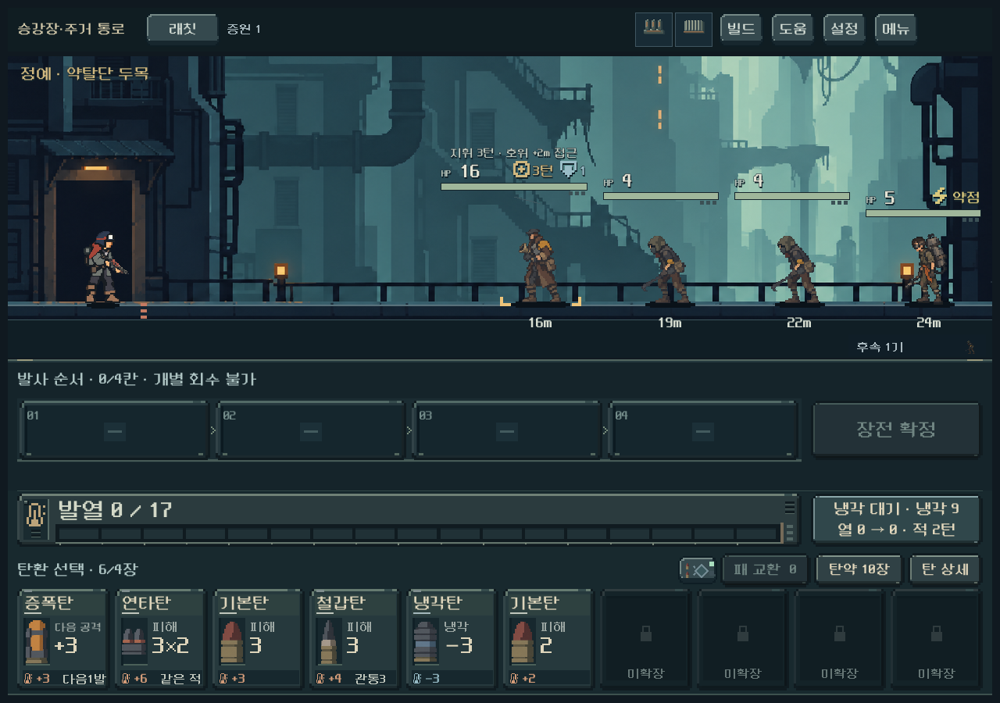
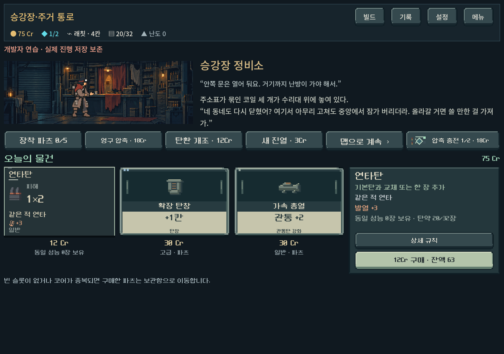
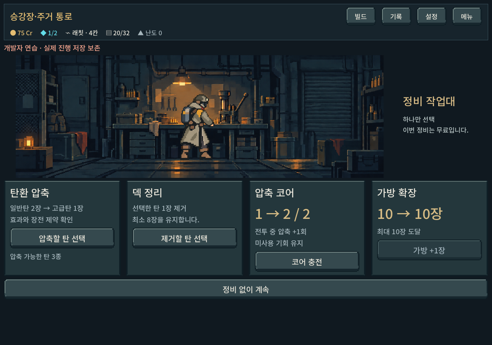

# 승인 복장 7종 본편 통합

사용자 요청: 리벳·스파이크의 C 몸체 표현을 기준으로 전 무기의 화풍·체형을 맞추고, 운반복·정찰복을 구분한 승인 시안을 본편에 적용한다. 기존 한손/양손 파지는 유지한다.

## 적용

- 기본·운반·정찰·방열·인양·회수·원정 7종. 운반복의 멜빵은 앞팔 뒤에 놓고, 정찰복은 짧은 재킷, 인양 장구는 원형 릴, 원정복은 밀폐 헬멧을 유지했다.
- 장비 선택과 전투는 같은 `weapon_actor` 합성을 사용한다. 승인된 2자세 원화를 대기 상태에 직접 연결했다. 기본 권총 몸체는 기존 C 파일/접점을 그대로 보존했다.
- 새 동작 아틀라스 13장과 원형 릴/재킷 길이 교정 2장을 제작했다. 각 복장·파지별 손과 발을 측정해 조준·반동·재장전·냉각을 등록했다. 총기 크기는 자세·복장에 따라 출렁이지 않도록 기존 고정 축척을 유지한다.
- 상점·보급·작업대도 7종 각각의 3자세로 연결했다. 운반/정찰의 기본복 대체 표시를 해소했다. 실내는 기존 배경·가구 배치를 재사용하며 캐릭터만 교체한다.
- 선택 목록 축소 그림과 개발자 복장 작업실도 현행 원화를 사용한다.

복장 ID·가방 용량·획득·해금·전투 계산은 변경하지 않았다. 실제 플레이 결과와 사람의 미감 평가는 자동 검사와 구별한다.

## 실제 화면

## 검증

Godot 4.7 Compatibility, RTX 4060 Ti. 모든 검사는 `qa_runtime` 아래 분리 저장으로 실행한다.

최종 **5,378검사, 실패0**. 승인 기본 권총 C의 SHA-256 유지, 이번 작업 시작 시점 대비 `model/content/campaign/screen`의 파일 해시 불변도 확인했다. 이는 게임 규칙을 변경하지 않았다는 증거이며 아트 미감의 점수는 아니다.

| 범위 | 결과 |
|---|---|
| 35조합 × 6자세 실제 GPU 렌더·잘림 | 210검사, 실패0 |
| 장비 선택/전투 35조합 픽셀 일치·손/총구·실내 3비율 | 1,368검사, 실패0 |
| 장비 선택 터치·전체 조합 출발·저장 보호 | 650검사, 실패0 |
| 실제 발사·반동·부품 장전·냉각·연출 종료 | 509검사, 실패0 |
| 복장 저장·성장·실내·목록 터치 | 1,487검사, 실패0 |
| 복장 작업실의 터치·동작·장소 전환 | 1,154검사, 실패0 |

선택/전투 일치 증거: [same_actor_evidence.json](assets/outfits_unified_2026-10-25/integration/same_actor_evidence.json). 화면 크기 1280×900, 1008×630, 1440×630; 장비 UI 검사는 1280×800도 포함한다. Galaxy 실기와 사용자의 동작 연결감·최종 미감은 확인 전이다. 6키포즈와 절차적 반동/장전이며 연속 애니메이션 프레임을 새로 완성했다는 뜻은 아니다.

시각 검수: 35조합의6자세 비교판 전체, 운반복 장비 선택·정찰복 전투, 운반복 상점/보급, 원정복/정찰복 작업대, 짧은 화면의 원정복 전투를 확인했다. 모든 캡처 파일을 하나씩 검토한 것은 아니다. 1008×630 전투 캡처에서는 전투 패널의 가로 스크롤이 관찰됐다. 해당 검사는 캐릭터 렌더·접점 범위이며 전체 전투 UI가 스크롤 없이 맞는다는 검증은 아니다. 이번 작업에서 전투 패널 배치를 수정하지 않았다.

검수 중 발견한 인양 장구의 사각 등짐, 정찰복의 긴 옷자락을 다시 제작했다. 운반복 상점 손이 명목상 아틀라스 셀을 넘은 부분은 실제 투명 간격을 기준으로 등록해 손 잘림과 보급 셀에 잔상이 섞이는 것을 교정했다.

초기 복장 회귀에서2개 실패가 발생했다. 검사가10월13일의 정찰4장 기본 선택을 요구했고, 현재10월15일 이후 기본 선택은 운반6장이었다. 기존 `screen.gd`와 현행 결정 문서에서 확인한 뒤 게임 설정을 바꾸지 않고 검사 전제만 갱신했다. 스크롤 검사는 입력 전후 선택 ID가 같아야 한다는 조건으로 보존했다. 최종 재실행1,487검사 실패0. [초기 로그](assets/outfits_unified_2026-10-25/outfits/initial_obsolete_default.log).

## 제작 및 재실행

- 원본/전체 프롬프트/참조: [provenance.json](../../../새-게임-프로젝트/assets/art/outfits_unified_20261025/provenance.json)
- 실제 접점: [outfit_art.gd](../../../새-게임-프로젝트/redesign/outfit_art.gd), [registration_final.json](../../../새-게임-프로젝트/assets/art/outfits_unified_20261025/registration_final.json)
- 측정/등록: `python tools/measure_outfit_registration.py`, `python tools/register_unified_outfits.py`. PNG를 편집하지 않고 메타데이터/리소스만 만든다.
- 검사: `powershell -NoProfile -ExecutionPolicy Bypass -File tools/run_unified_outfit_checks.ps1 -Suite integration`. `catalog/equipment/motion/outfits/preview`도 지원한다.
- 실행: [PLAY.cmd](../../../PLAY.cmd) → 새 등반 → 복장/무기 선택. 기존 실행 중인 게임은 종료 후 다시 실행해야 새 아트를 읽는다.
