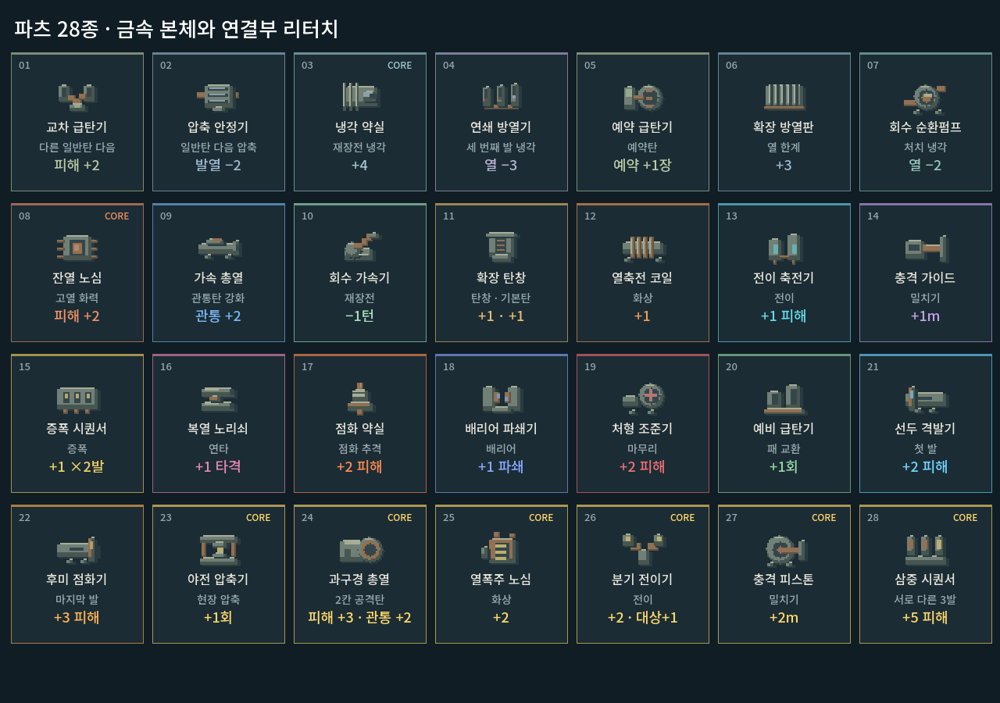

# 파츠28종 도트 리터치 · 2026-10-09

사용자 요청: 현재 파츠의 뭉개진 도트를 캐릭터·몬스터의 화풍 정도로 맞춘다. 적용 완료이며 새 디자인의 사용자 승인은 아직 받지 않았다.

## 비교

이전에는 12×8 문자 패턴을 큰 픽셀로 그려 부품이 작은 기호처럼 보였다. 본체·접속부·홈을 분리하고, 넓은 강철 면에 짧은 하이라이트와 구리 배관을 더했다. 28종 모두 독립된 부품 형상이다. 카드 크기·글자·효과·저장 ID는 유지한다.

[이전 전체](part_art_2026-10-09_assets/catalog_before.png) · [수정 전체](part_art_2026-10-09_assets/catalog_after.png)

[상점](part_art_2026-10-09_assets/shop_compression_sink_1008.png) · [장비](part_art_2026-10-09_assets/equipment_1008.png) · [전투 HUD](part_art_2026-10-09_assets/compressed_plan_1008.png) · [두 표시 크기](part_art_2026-10-09_assets/sizes.png)

## 제작과 출처

- 도구: Godot CanvasItem의 정수 좌표 도형, 직접 작성한 도트 그림. 이미지 생성 프롬프트/외부 이미지 변환 없음.
- 원본: `새-게임-프로젝트/redesign/part_icon_art.gd`. 공용 `part_card_view.gd`가 호출하며 전투 HUD도 같은 그림을 사용한다.
- 참조: 승인 주인공 `assets/art/actor_cohesion_20261005/reclaimer_grouped_v2.png`, 처마등 `assets/art/monster_concept_20261009/eavesback_v1.png`, 주거 통로 통합 화면 `residential_creatures_2026-10-09_assets/family_1008.png`. 의상/생물 모양을 복제하지 않고 명암 면·색감·윤곽의 강도를 비교했다.
- 현재 구현: 논리32×24, 카드2배/작은 HUD1배 정수 표시. 이 수치는 이번 아이콘의 구현이며 전체 게임의 영구 해상도 규칙이 아니다.
- 색: 강철 `#718077`, 그림자 `#475650`, 밝은 면 `#a7ad96`, 구리 `#927051`. 역할색은 제한된 부위에만 혼합한다. 기능 수치/상태색은 기존 UI가 담당한다.
- 이전 원본: 같은 증거 폴더 `part_card_before.gd`. 재현용이며 게임 실행에는 사용하지 않는다.

## 검증

- 격리된 `qa_runtime/part_art/ui`에서 실제 Godot 렌더: `tools/run_part_art_checks.ps1` →199검사/0실패. 28종 누락·카드 범위·그림별 출력·64×48 경계·정수 픽셀 정렬 확인. 서로 다른 이미지라는 사실은 사람의 형태 인지를 보장하지 않는다.
- 격리된 `qa_runtime/parts_revision/ui`: `tools/run_parts_checks.ps1 -Mode ui` →677검사/0실패. 1008×630/1280×900/1440×630 상점·장비·전투의 표시와 조작 검증.
- 내부 시각 확인: 이전/수정 전체표, 1008×630 상점/장비/전투 HUD, 승인 배우 통합 화면을 직접 비교. 카드 글자와 그림 겹침 없으며 총열/방열판/코일/압축기 구조가 이전보다 드러난다. 작은 HUD는 상세 묘사보다 큰 실루엣을 우선한다.
- 사람 체감과 Galaxy 실기기 확인은 후속이다. 기능 통과만으로 화풍 승인을 주장하지 않는다. APK/커밋/푸시 없음.

실행: `PLAY.cmd` → 개발 → **파츠 아이콘**. 본편 상점/빌드/전투에도 적용된다.
