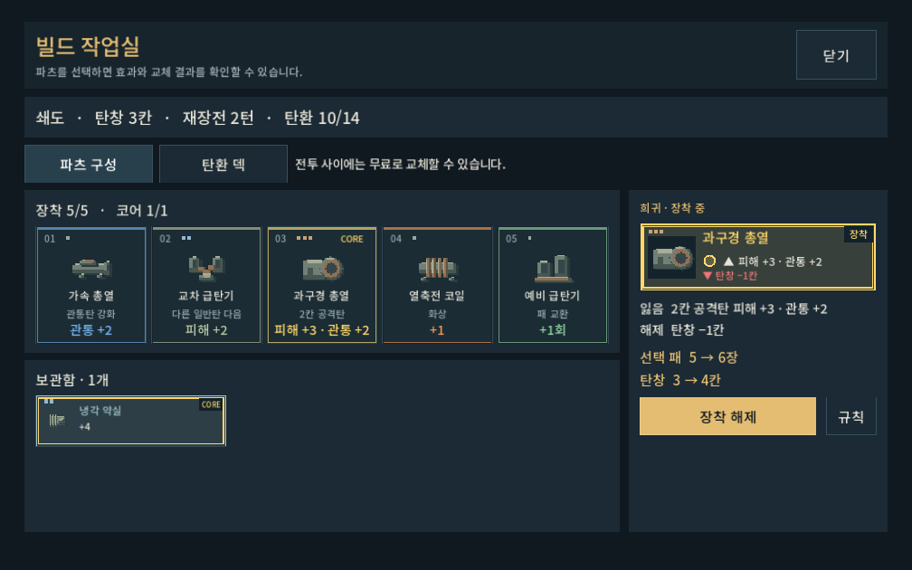

# 파츠 등급 적용과 검증 · 2026-10-09

[분류와 획득 설계](../../direction/part-grades.md). 일반8/고급13/희귀7, 작은 막대1/2/3개로 표시. 효과·가격·5개 장착·코어1개 제한은 유지했다. 전체 파츠 그림은 직전 사용자 긍정 평가를 받은 리터치판이다.

## 실제 화면

[상점](part_grades_2026-10-09_assets/grades_shop_1008.png) · [등급과 코어 설명](part_grades_2026-10-09_assets/grades_details_1008.png)

카드 전체를 등급색으로 바꾸지 않고 짧은 막대만 추가했다. 냉각 약실은 고급 막대2개/CORE, 과구경 총열은 희귀 막대3개/CORE로 두 속성을 분리한다. 기능 수치와 역할색, 장착 강조는 기존 표시를 유지한다. 전투 HUD에는 발동 표식을 우선해 등급을 추가하지 않는다.

## 검증 결과

- `tools/run_part_grade_checks.ps1 -Mode rules`: **9,046검사/0실패**. 등급 분류·코어 제한·혼합5칸·등급별10,000회 추첨·시드 재현·미소유/중복 제외·마지막 희귀 후보·모두 보유한 경우·이전 저장 구조/진열 보존.
- `tools/run_progression_checks.ps1 -Mode rules -Label part_grade`: **5,189검사/0실패**. 기존 성장/저장/첫 진열/미등장 우선/전체 파츠 접근 회귀.
- `tools/run_part_grade_checks.ps1 -Mode ui`: **95검사/0실패**. 실제 Godot1008×630/1280×900/1440×630, 장비 선택→규칙 열기→닫기→상점 비교의 터치 입력과 화면 범위. 개인 저장 비활성/별도APPDATA.
- 내부 시각 확인: 작은 화면 장비·등급 상세·상점 이미지 직접 확인. 숫자/코어와 등급 막대가 겹치지 않으며 기존 카드 높이와 버튼 공간을 유지한다.
- 초기 UI검증의 상세창을 닫지 않은 입력과 동명 장비 패널을 잘못 찾는 테스트 문제를 수정했다. 최종 실행은 정상적으로 상세창을 열고 닫은 후 상점 입력까지 통과했다.

### 획득 분포

쇄도, 가속 총열 보유, 시드0~999, 각 경로의 신규 진열/보상2개 기준. 미등장/역할 필터 뒤 실제 등장 수이며 고정 최종 확률을 뜻하지 않는다.

| 경로 | 일반 | 고급 | 희귀 |
| --- | ---: | ---: | ---: |
| 첫 지역 초기 진열 |1205|795|0|
| 후반 상점 |929|792|279|
| 정예 보상 |391|1038|571|

첫 지역 초기 진열은 기존 비코어 우선 때문에 희귀가0이다. 갱신/정예에는 이 제한이 없다. 미등장 후보가 희귀 코어뿐이면 해당 후보를 보여 주므로 수집을 막지 않는다. 보유 파츠와 발견 이력에 따라 최종 비중은 달라진다.

## 남은 판단

이 결과는 기능/화면 검증이다. 장기 플레이에서 희귀가 필수화되는지, 일반 기반 파츠가 끝까지 선택되는지, Galaxy 실기기 판독성은 추가 확인이 필요하다. 등급 분류/가중치는 디렉터 초기값이며 사용자 체감 승인은 아직 받지 않았다. APK/커밋/푸시 없음.

실행: `PLAY.cmd` → 개발 → 파츠 아이콘 또는 본편 빌드/상점. 저장 중인 진열은 보존하며 새 진열/갱신/정예부터 획득 가중치 적용.
