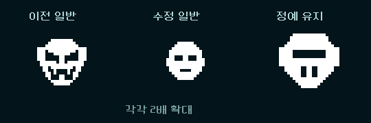
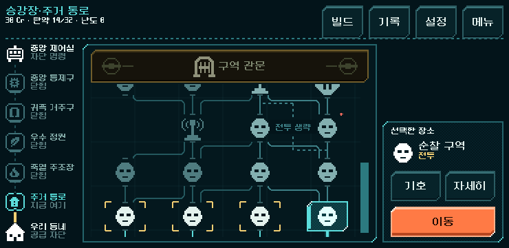
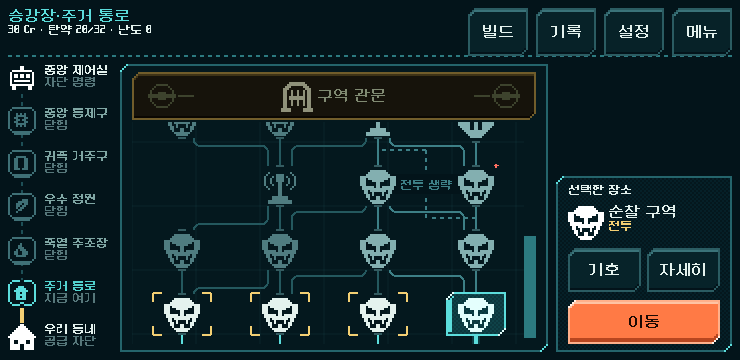
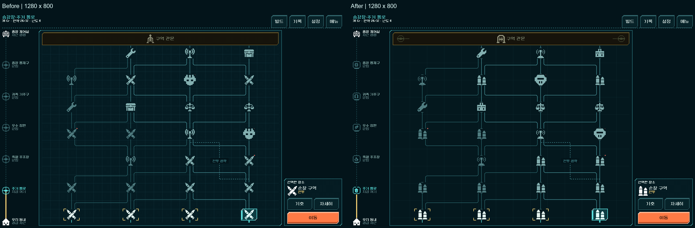
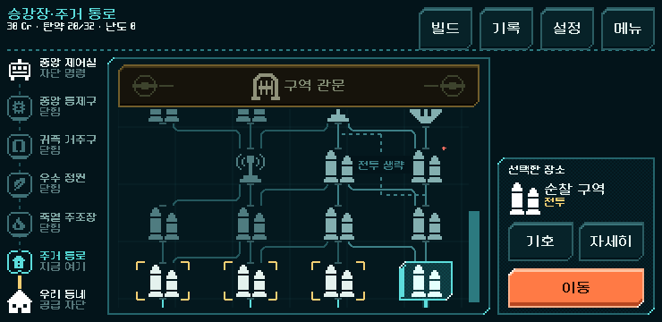
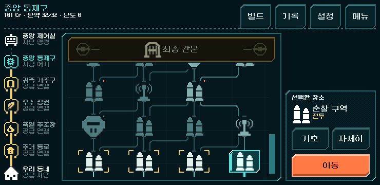
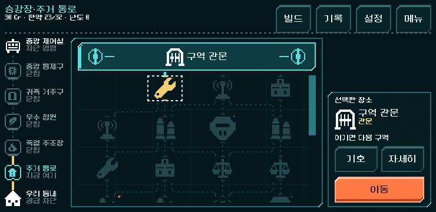
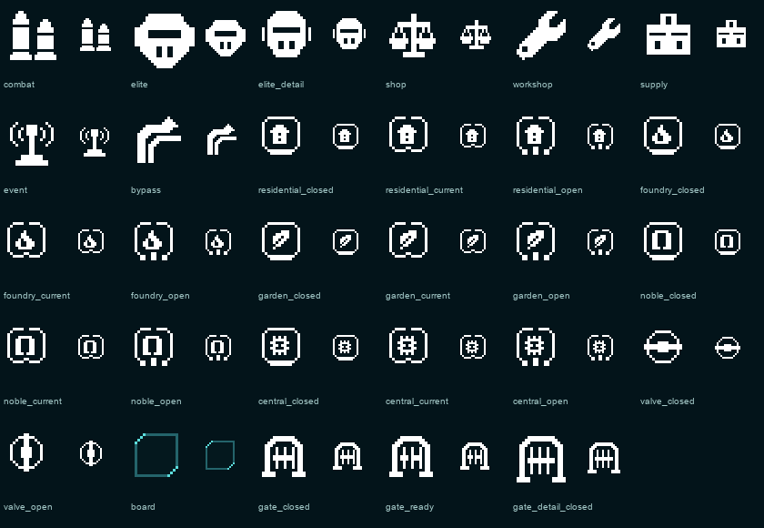

# 배관도 전용 그래픽 마감

## 최신 후속 — 일반 전투의 위압감 완화

사용자가 첫 몬스터 얼굴이 정예보다 강해 보인다고 평가했다. 일반 기호의 사선 눈·송곳니·벌어진 턱을 제거하고 작은 둥근 얼굴/수평 눈/짧은 입으로 바꿨다.36px 캔버스 안의 실제 그림은28×28px이며, 정예의44px 원화와36px 상세 판은 유지한다. 터치 영역과 배치도 유지한다.

[1280×800](pipe_map_monster_soft_2026-11-01_assets/region_1_1280x800.png) · [844×390](pipe_map_monster_soft_2026-11-01_assets/region_1_844x390.png) · [기호 창](pipe_map_monster_soft_2026-11-01_assets/legend_1280x800.png).

Godot4.7 MCP 확인·임포트 통과. 격리 저장의 기존 첫 구역3크기 검사 재사용: 선택/상세/범례/미리보기/이동/저장1,910검사 실패0. 다른 그림·씬·지도/규칙 코드는 작업 전후 동일한41파일로 확인했다. 전체 등반/HUD는 단일 그림 교체에서 재실행하지 않았다. [결과](pipe_map_monster_soft_2026-11-01_assets/result.json) · [범위](pipe_map_monster_soft_2026-11-01_assets/scope.json). 실제 화면과2배 격자 확인, 사용자 미감과 Android 실기기는 후속이다.

## 이전 후속 — 일반 전투 몬스터 얼굴 첫 적용

사용자가 일반 전투를 몬스터 얼굴로 표시하도록 직접 지시했다. `combat.png`를 사선 눈과 송곳니 턱이 있는18px 원본/36px 그림으로 교체했다. 기존 정예의 넓은 가로 시야창과 크기를 유지해 구별한다. 지도·선택 패널·기호 창에서 공통 사용하며 특정 적 종의 예고는 아니다. 아래 최초 마감의 탄환 그림은 이전 상태다.

[1280×800](pipe_map_monster_face_2026-11-01_assets/region_1_1280x800.png) · [844×390](pipe_map_monster_face_2026-11-01_assets/region_1_844x390.png) · [일반/정예 기호 비교](pipe_map_monster_face_2026-11-01_assets/legend_1280x800.png).

Godot MCP 연결/4.7 확인, 리소스 임포트 통과. 격리 저장에서 기존 `pipe_map_ui.gd`의 첫 구역3크기 검사만 재사용해 선택·상세·범례·미리보기·이동·저장 복원1,910검사 실패0. 다른28개 그림과 지도 씬/스크립트·규칙 파일은 작업 전후 동일하며 전체 등반/HUD는 이번 단일 그림 교체에서 재실행하지 않았다. [결과](pipe_map_monster_face_2026-11-01_assets/result.json) · [변경 범위](pipe_map_monster_face_2026-11-01_assets/scope.json). 새 그림의2배 격자·이진 알파와 실제 화면을 확인했다. 사람의 첫 의미 이해/미감과 Android 실기기 확인은 별도다.

## 최초 그래픽 마감 기록

2026-11-01. 사용자가 핵심 기호 정리 → 관문/밸브 상태 → 구역 문양 → 전체 화면 마감을 승인했다. 본편 `PLAY.cmd`에 적용했다. 기존 배치·입력·경로 생성·전투·보상·저장은 유지한다.

## 실제 전후

각 원본1280×800. 같은 첫 구역·후보104 선택 상태이며, 비교판에는 제목과 간격만 추가했다. 아래는 실제740×360 렌더다.

## 그림과 연결

| 요소 | 반영 |
| --- | --- |
| 전투 | 기존 교차 기호의 거친 축소 윤곽을 정리하고 높이가 다른 두 탄환 실루엣으로 표시 |
| 정예 | 기계 경비 의미를 유지한 방호판/가로 시야창/방열구. 지도44px, 상세/범례는 별도로 그린36px 판 |
| 시설 | 거래 저울·공구·탄약함·전파·샛길을 같은 굵기/음영 없는 도트 기호로 정리 |
| 관문 | 차단문과 양끝 손잡이. 아직 먼 관문은 가로 차단, 실제 다음 후보가 되면 손잡이가 세로로 바뀌고 빗장이 물러남 |
| 구역표 | 주택·불꽃·잎·아치·제어 회로5문양. 닫힘/현재/공급 연결은 아래 차단부와 흐름구 형태로 구별 |
| 지도 면 | 이 지도에서만 반복 디더 제거, 격자32→64px/낮은 대비. 다른 공통 패널·버튼·글꼴 유지 |
| 연결부 | 장소 위/아래에 작은 관 이음 표시. 실제 경로 좌표/허용 연결은 유지 |

관문의 손잡이 해제는 **현재 진입할 수 있음**을 나타낸다. 아직 관문 전투를 이긴 것이 아니다. 지나온 구역의 개방 문양은 실제 구역 진행에 따른다. 기존 기호의 역할과 문구는 유지하며 별도 세계관 규칙이나 임의 상태를 추가하지 않는다.

[최종 관문 도달](pipe_map_art_2026-11-01_assets/gate_ready_region_5.png) · [샛길 선택](pipe_map_art_2026-11-01_assets/earned_shortcut.png) · [기호 창](pipe_map_art_2026-11-01_assets/legend_1280x800.png).

## 제작 근거와 파일

이번 작업은 작은 평면 기호/틀을 코드의 픽셀 좌표로 직접 그렸다. 기존 승인 지도 원본(교차 탄환·기계 경비 등)의 역할, 라인 UI 레퍼런스와 현재 본편 구성을 실제로 열어 비교했다. 예전 원본의 뿔 가면은 사용하지 않았다. 생성형 이미지 호출/프롬프트는 없고, 자동 축소 후 임계값으로 남기는 방식도 쓰지 않았다.

- 편집 가능한 좌표: `tools/build_pipe_map_art.py`.
- 1배 원본: `art_source/ui/pipe_map_20261101/`. 미사용 관문 변형3장은 제작 초안으로만 보존한다.
- 본편: `assets/ui/pipe_map_art_20261101/`29PNG + 지도 면StyleBox. 기호7+정예 상세1, 구역5×3, 밸브2, 관문3, 지도 면1.
- 기존 동네/제어실 기호2개와 모든 이전 지도 자산을 보존했다. HTML 프로토타입도 변경하지 않았다.
- 연결: `redesign/pipe_map/art.gd`, `place.gd`, `rail.gd`, `gate.gd`, `screen.gd`, `graph.gd`,3TSCN. 레이아웃의 원본은 기존 공식 씬이며 생성 도구도 같은 자산 연결로 갱신했다.
- [출처/해시](../../../새-게임-프로젝트/assets/ui/pipe_map_art_20261101/provenance.json) · [검수 시점 파일 지문](pipe_map_art_2026-11-01_assets/manifest.json).

## 검증

Godot MCP의 프로젝트 정보 호출 성공,4.7 확인. 기존 격리 실행 도구로 검사했다. 사용자 저장에는 접근하지 않았다.

| 검사 | 결과 | 범위 |
| --- | --- | --- |
| `run_pipe_map.ps1 -Label art_final_20261101` | 16,249검사 실패0 | 실제 획득266명령으로5구역 완주 재생, 각 구역3크기 지도 입력/경로/저장 복원, 샛길·이전 지도v1/v2, 첫/최종 관문 실제 선택/상세/진입 |
| `run_pipe_map.ps1 -Mode preview -Label art_final_preview_20261101` | 11검사 실패0 | 데이터 연결 전 주 화면 구성과 렌더 |
| `run_line_world_checks.ps1 -Mode map` | 654검사 실패0 | 현행 지도·장소 회귀 |
| `run_prototype_hud.ps1 -Mode ui -Fast` | 11,536검사 실패0 | 기존 전투 HUD 회귀 |
| `run_prototype_hud.ps1 -Mode import` | 통과 | 임포트·파싱 |
| 자산/배치 대조 | 통과 | 29PNG 모두 정확한2배 격자·이진 알파, 공식 화면의 배치 필드172개 동일, 규칙4파일 해시 동일 |

[통합 결과](pipe_map_art_2026-11-01_assets/result.json) · [자산/배치 검사](pipe_map_art_2026-11-01_assets/asset_audit.json) · [데이터 연결 전 씬](pipe_map_art_2026-11-01_assets/authored_scene.png).

기존 전체 등반에서 얻은 리벳 시드731042의 합법 명령을 재생했다. 모든 전투를 사람처럼 다시 조작했다는 뜻이 아니다. 지도 선택/범례/상세/미리보기/진입과 관문 진입은 실제 화면 터치 입력이다.1280×800·844×390·740×360의 터치 영역·연결·고정 행동 패널을 기존 검사로 확인했다.

제작 중 정예의 눈구멍 인상을 가로 시야창으로 정리했고, 실제5구역 화면에서 공급선이 문양의 빈 공간을 채워 버리는 것을 발견했다. 문양 뒤에서는 공급선을 가려 자체 흐름구만 보이게 보정한 뒤 전체 지도 검사를 재통과했다. 장식은 입력 영역을 추가하거나 가로채지 않는다.

Model/Campaign/RouteMap/CampaignContent는 작업 전후 동일하다. 버튼과 패널의 크기/위치, 일반36px·정예44px의 그림 영역,60×44px 터치 영역을 유지했다. 지도 전용 면과 상태 그림 외에 공통 전투 HUD 자산을 바꾸지 않았다.

## 남은 사람 확인

기능 검사와 제작자 화면 검수는 완료했다. 새 기호를 처음 보았을 때의 의미 이해·지도 전체의 미감·구역별 차이 체감은 사용자 플레이에서 확인한다. Android 실기기의 터치·선명도·지속 성능/발열은 미검증이다. APK·커밋·푸시·외부 게시 없음.
