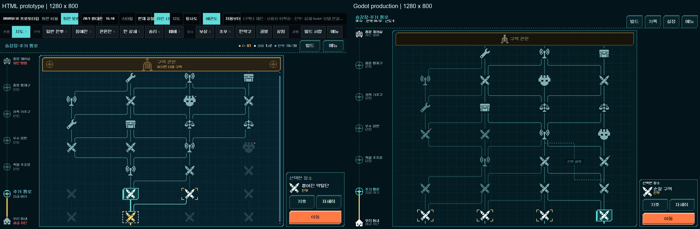
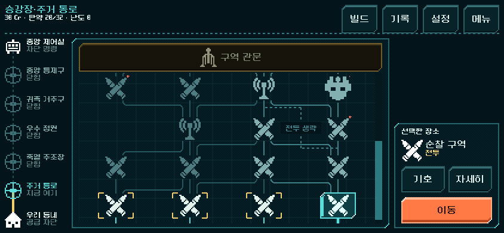
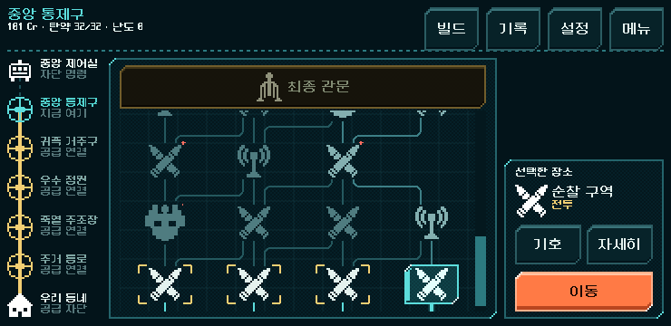
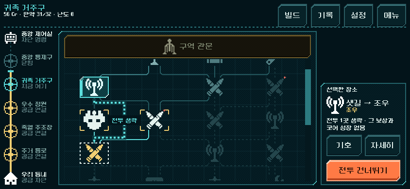

# 배관도 지도 — Godot 본편 통합

2026-11-01. 사용자 지도 목업 검토와 후속 실행 승인에 따른 본편 적용. 실행은 저장소 루트 `PLAY.cmd`다. 새 등반과 기존 이어하기 모두 새 지도 화면을 사용하며, 각 저장의 원래 경로와 게임 규칙을 유지한다.

## 적용 결과와 비교

목업의 왼쪽 5구역 진행표, 고정 관문, 스크롤 배관도, 오른쪽 아래 선택/이동 패널을 본편에 연결했다. 실제 `Campaign.current_nodes()`와 `choices()`/`visited`/`next`를 사용한다. 샛길은 방을 새로 만드는 대신 실제 전투를 건너뛰는 연결로 표시한다.

두 캡처는 각각1280×800 원본이며 비교판에는 제목과 간격만 추가했다. HTML은 개발 도구 줄과 첫 전투 이후 상태를 포함하고 Godot은 새 등반 첫 선택이다. 실제 보유 탄/크레딧·노드 이름과 진행이 다르다. 본편은 개발 도구 줄이 없는 높이를 지도 행 사이에 사용하므로 화면 전체 픽셀 일치를 주장하지 않는다. 관문 띠의 반복 밸브와 안내는 덜고, 기존 기록/설정 접근은 헤더에 유지했다.

## 조작과 구현

- 실제 허용 후보 선택 → 장소/위험 확인 → 이동. 미래 노드와 관문은 미리보기만 가능하다. 기호/자세히를 닫으면 같은 선택과 스크롤로 돌아온다.
- 샛길 선택 시 `샛길 → 목적지`, 전투1곳과 그 보상/코어 성장을 포기한다는 설명, `전투 건너뛰기` 버튼을 표시한다.
- 현재/방문 경로는 황금색, 선택 후보/경로는 청록색, 이후 연결은 낮은 대비로 표시한다. 즉시 연출 설정은 기호 반짝임과 흐르는 점을 생략한다.
- 일반 기호36px/정예44px, 터치60×44px. 행 간격은 그림 끝과 굽힘 여유로 정하고, 작은 화면에서는 지도만 스크롤한다. 관문과 이동 버튼은 고정한다.
- `redesign/pipe_map/screen.tscn`에 헤더/구역표/관문/스크롤/선택 패널을, `place.tscn`에 기호 버튼을, `key.tscn`에 범례를 직렬화했다. 바인딩 전에도 배치와 예시 기호를 볼 수 있다. 실행 시 반복 노드/연결과 값만 실제 진행에서 채운다.
- 기존 지도 v1의 두 갈래, v2/v3의 네 갈래, 5구역별 길이와 샛길을 그대로 사용한다. 미확정 선택과 스크롤은 화면 메모리이며 저장 형식을 추가하지 않는다.

Godot MCP의 프로젝트 정보/버전 호출에 성공했고4.7을 확인했다. 기존 실행·캡처 도구와 로컬 씬 편집 경로를 사용했다. 승인 HTML의 `pm_*.png`12종을 손실 없이 복사했으며 새로운 생성형 아트를 만들지 않았다.

## 기능 검증

모든 실행은 `qa_runtime/` 하위의 격리 APPDATA/LOCALAPPDATA를 사용했다. 실제 사용자 저장을 읽거나 변환하지 않았다.

| 검사 | 결과 | 범위 |
| --- | --- | --- |
| `tools/run_pipe_map.ps1 -Label final_20261101` | 14,686검사, 실패0 | 실제 획득266명령의5구역 완주, 구역마다3크기 공개 터치, 선택/미리보기/상세/범례/이동, 디스크 저장 복원, 샛길, 이전v1/v2 |
| `tools/run_pipe_map.ps1 -Mode preview -Label preview_20261101` | 11검사, 실패0 | 데이터 바인딩 전 공식 씬의 주 구성10개와 선택 이름, 실제 렌더 |
| `tools/run_line_world_checks.ps1 -Mode map` | 654검사, 실패0 | 현행 지도/장소와 공개 조작 회귀 |
| `tools/run_prototype_hud.ps1 -Mode ui -Fast` | 11,536검사, 실패0 | 기존 공통 전투 HUD 조작 회귀 |
| `tools/run_prototype_hud.ps1 -Mode import` | 통과 | 리소스 임포트·스크립트 파싱 |

통합 검사는1280×800·844×390·740×360에서 터치 영역 최소44px/비겹침, 지도와 선택 패널 비겹침, 관문/이동 버튼 화면 내부, 원본의 모든 `next` 연결 표시, 길이0/역방향 연결 없음, 샛길의 중간 기호 터치 영역 회피를 검사한다. 범례/미리보기는 상태와 RNG를 바꾸지 않고, 이동 한 번은 방문을 한 번만 추가한다. 첫 구역은 같은 화면 인스턴스의 크기를 바꿔 선택 유지도 확인했다.

완주 경로는 기존 전체 등반 검사에서 합법 명령으로 얻은 리벳 시드731042의266명령이다. 새 검사에서 매 전투를 공개 터치로 다시 싸운 것은 아니며, 전투는 실제 모델 명령을 재생하고 각 구역 지도·샛길·이전 지도는 실제 화면 입력으로 확인했다. 경로 재생 자료는 `qa_runtime/campaign_magazine_20261101/integrated/rules/balance.json`을 사용한다.

Model/Campaign/RouteMap/CampaignContent4개 파일의 SHA256은 작업 전후 동일하다. [비교 값](pipe_map_godot_2026-11-01_assets/rules_unchanged.json) · [최종 결과](pipe_map_godot_2026-11-01_assets/result.json) · [변경 화면/검사 파일 지문](pipe_map_godot_2026-11-01_assets/manifest.json).

### 중간 실패와 처리

- 최초 임포트에서 Godot 기본 클래스와 `Skin` 상수가 충돌했다. `LineSkin`으로 이름을 바꾸고 임포트/실행을 통과했다.
- 지도 화면 교체 뒤 지연 복원 콜백이 해제된 트리에 접근했다. 트리와 노드 유효성을 확인하도록 수정했고 현행 지도 검사를 재통과했다.
- 최초 통합 검사의 저장 비교16실패는 JSON을 거친 숫자의 int/float 비교 차이였다. 양쪽을 같은 직렬화 형태로 비교하도록 검사기를 고쳐 최종14,686검사를 통과했다. 실제 저장 경로나 규칙을 바꾸지 않았다.
- 이전 `run_map_checks.ps1 -Mode chart -Label pipe_20261101`은 현재 개편 이전 보상 흐름과 제거된 공방 충전을 기대해 실패했다. 통과로 표시하지 않는다. 본 작업의 근거는 현행 `line_world_ui.gd`와 새 통합 검사이며 구 검사 전체의 현행화는 이번 범위가 아니다.
- Godot 바이너리 직접 실행의 검사 경로가 한 번 signal11로 종료했다. 기존의 숨김 창 실행 래퍼에서는 임포트·렌더·검사를 정상 완료했다.

## 실제 화면 확인

844×390: 관문과 이동 패널을 고정하고 지도만 스크롤한다.

740×360의5구역: 이전 구역 공급 연결과 현재 구역·최종 관문을 구분한다.

실제 등반 중 획득한 샛길 선택: 건너뛸 연결과 포기하는 보상/성장을 확정 전에 보여 준다.

[이전v1 두 갈래](pipe_map_godot_2026-11-01_assets/legacy_v1.png) · [이전v2 네 갈래](pipe_map_godot_2026-11-01_assets/legacy_v2.png) · [데이터 연결 전 공식 씬](pipe_map_godot_2026-11-01_assets/authored_scene.png).

## 남은 확인

기능 통과와 캡처 확인을 사람의 길 판독성·미감·장기 선택 가치 검증으로 취급하지 않는다. 다음 사용자 전체 등반에서는 현재/선택/미래 경로 구분, 샛길의 대가 이해, 후반 긴장감/보상 선택을 확인한다. Android 실기기 터치·선명도·지속 성능/발열은 미검증이다. APK·커밋·푸시·외부 게시를 하지 않았다.
