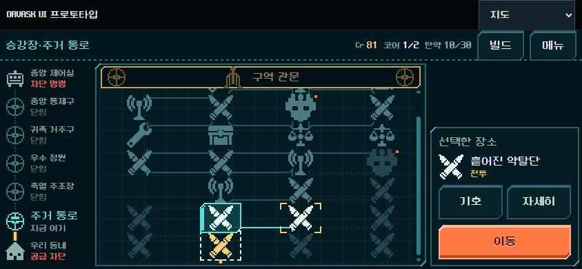
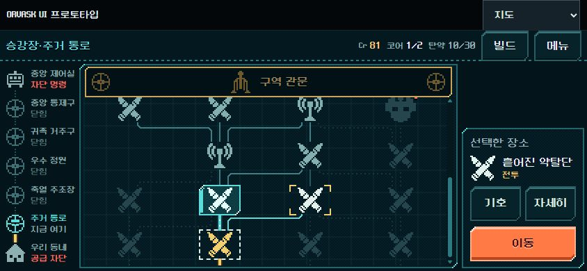

# 배관도 목업 모바일 간격·경로 보완 — 2026-11-01

사용자 검토 후 실행 승인에 따라 [지도 검토](pipe_map_review_2026-11-01.md)의 모바일 간격·연결선·후속 경로 가독성을 보완했다. **HTML 목업 반영 완료. Godot 본편 통합은 후속이다.** 노드 연결, 이동 허용, 보상과 전투 계산을 바꾸지 않았다.

## 변경

- 고정 40px 행 간격을 제거했다. 인접 행의 가장 큰 기호와 연결선 굽힘에 필요한 여유를 계산해 간격을 정한다. 현재 목업의 작은 화면에서는 64~68px이며, 60×44px 터치 영역 사이에 최소20px가 남는다.
- 직선 경로 길이0과 꺾인 경로의 역방향 구간을 없앴다. 직각 굽힘은 기호 중심 대신 실제 연결 끝점 사이에 배치한다. 선택 틀과 기호 크기는 유지한다.
- 현재 선택한 후보에서 `next`로 이어지는 후속 경로/기호를 낮은 청록 명도로 강조한다. 지금 이동 가능한 길보다 약하고, 일반 미래 경로보다 밝다. 추가 애니메이션은 없다. 이동 불가 장소가 이동 가능해지는 것은 아니다.
- 작은 화면의 구역 막대/선택 패널을 압축하는 기준을760→900px로 넓혔다. 844px 화면에서 지도 프레임 폭은480→544px가 됐다. 관문 터치 높이는32→44px로 확보했다.
- 지도 내부만 스크롤한다. 범례 열기/닫기 등 같은 선택 상태의 다시 그리기에서는 사용자가 본 위치를 유지한다. 선택한 장소가 화면 밖이면 보여 주고, 크기가 바뀔 때 현재 장소와 다음 후보가 함께 들어갈 수 있으면 둘 다 보이도록 맞춘다.
- 기존 상태 검사 실행기가 새 라인 테마 초기화에 필요한 `location`/`documentElement`를 제공하지 않아 실행 전 실패하던 문제를 보정했다. 게임 코드를 우회하거나 검사를 삭제하지 않았다.

## 기능 검증

- `node --check .../assets/map_pipe.js`: 통과.
- `node tools/test_ui_prototype.mjs`: **10개 상태 회귀 검사 통과**. 이 검사는 지도 기하를 검사하지 않으며, 화면/조작 검증은 아래와 별도로 수행했다.
- 별도 브라우저 탭에서 선택 변경 → 상세 열고 닫기 → 미래 상점 미리보기/이동 숨김 → 범례 열기/Escape 닫기 → 전투 진입 → 승리 → 보상 건너뛰기 → 지도 복귀 확인.
- 101에서102로 바꾸면 후속 강조가201/202에서202/203으로 바뀐다. 전투 복귀 후 현재102와 후보202/203을 확인했고,203 선택 시 다음 줄의303을 강조하며302는 일반 미래 상태로 유지한다.
- 직접 위로 스크롤한 뒤 범례를 열고 닫아도 `scrollTop=0` 유지. 상세 닫기 후 선택/스크롤 유지.
- 최종 스크롤 보정 후 새로 실행해 첫 전투2행동 → 승리 → 보상 → 지도 복귀를 다시 확인했다.

## 화면·기하 검증

브라우저 뷰포트 크기에는 목업 도구 줄이 포함된다. 본편/실기기 크기와 혼동하지 않는다. 공개 UI로 전투를 완료한 상태에서 DOM의 표시 좌표와 SVG 경로만 읽어 확인했다. 내부 게임 상태를 주입하지 않았다.

| 뷰포트 | 노드 터치 영역 겹침 | 최소 세로 여유 | 길이0 경로 | 역방향으로 꺾인 경로 | 102→202 선택 직선 |
| --- | --- | --- | --- | --- | --- |
| 1280×800 | 0 | 42px | 0 | 0 | 46px |
| 844×390 | 0 | 20px | 0 | 0 | 24px |
| 740×360 | 0 | 20px | 0 | 0 | 24px |

각 크기에서 지도 내부26개 노드와 생성된 전체 경로를 확인했다. 740×360 크기 전환 시 현재 위치102와 선택202가 모두 스크롤 영역 안에 완전히 들어온다. 최초 점검 중 현재 위치가 일부 잘리는 문제를 발견해 함께 표시하도록 보정한 뒤 다시 확인했다.

브라우저 실측 요약: [geometry.json](pipe_map_mobile_fix_2026-11-01_assets/geometry.json). 전체 경로 배열이 아닌 확인한 결과와 선택 경로 좌표를 기록했다.

## 비교 화면

844×390, 현재102/다음 선택202인 동일 지도 진행 상태. 전투에서 사용한 탄 순서와 행동 수는 달라도 지도 상태는 같다.

수정 전:

수정 후:

[740×360](pipe_map_mobile_fix_2026-11-01_assets/after_740x360.png) · [1280×800](pipe_map_mobile_fix_2026-11-01_assets/after_1280x800.png).

## 변경 경계와 다음 단계

- 구현 파일: `assets/map_pipe.js`, `assets/map_pipe.css`. 검증 실행기: `tools/test_ui_prototype.mjs`.
- 공통 입력/전투/경제가 있는 `index.html`의 전후 SHA-256은 `3102DDBBC6812E3F35803DA392166691F7C42F89B04730A181600B69A1BE4C80`로 동일하다. Godot 소스·저장·APK는 수정하지 않았다.
- 이번에는 Godot `run_prototype_hud.ps1`을 재실행하지 않았다. HTML 상태 검사 결과를 Godot 검증으로 표현하지 않는다.
- 사람의 경로 이해도와 실제 휴대폰 터치/성능은 미검증이다. 작은 화면에서 모든 줄을 한 번에 표시하지 않으며, 터치 여유를 확보하고 스크롤로 확인한다.
- 다음은 이 외형을 본편 지도에 연결하면서 실제5구역 전환·샛길 연결·기존 저장을 검증하는 단계다. 목업의 첫 구역 고정 데이터는 그대로여서 전체 등반 통합 완료를 뜻하지 않는다.
