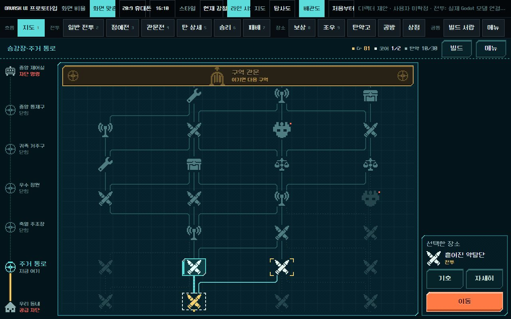
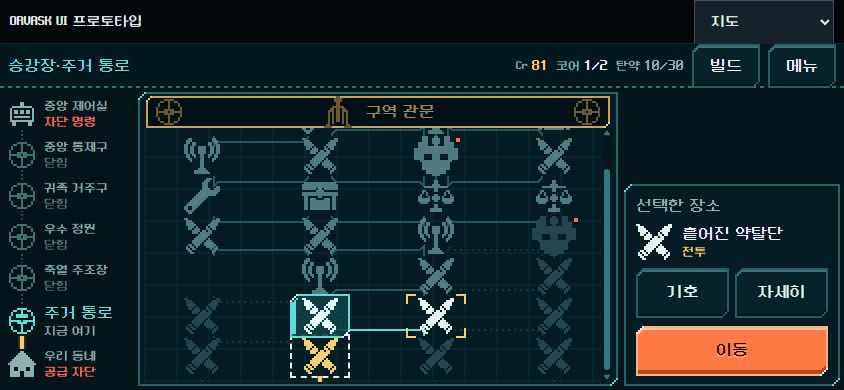
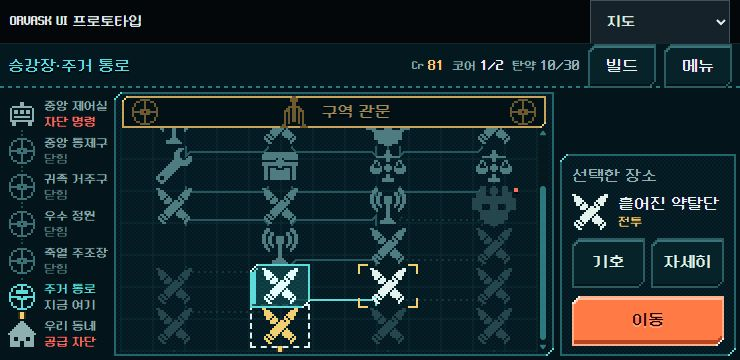

# 개편 지도 배관도 검토 — 2026-11-01

후속: 사용자 실행 승인으로 모바일 간격·연결선·후속 경로 강조를 목업에 보완했다. [수정 결과와 재검증](pipe_map_mobile_fix_2026-11-01.md). 아래 내용은 수정 전 검토 기록이다.

사용자 요청: 개편한 지도 목업 확인. **검토만 수행했으며 본편 채택, 지도 규칙 변경 또는 Godot 적용을 결정하지 않았다.** HTML/Godot 소스는 수정하지 않았다.

대상: `ui_prototype_2026-10-31/index.html#tab=map&theme=line&map=pipe`, `assets/map_pipe.js`, `assets/map_pipe.css`. 현행 기준은 `docs/direction/route-map.md`이며 이전 제작 기록은 `ui_pipe_map_2026-11-01.md`이다.

## 판단

배관도 방향을 유지할 것을 권한다. 직각 배관·단색 픽셀 기호·황동 관문이 라인 테마와 어울리고, 왼쪽 전체 구역 진행과 가운데 현재 구역 경로가 서로 다른 규모의 진행을 전달한다. 층수 숫자 없이 상승 목표를 보여 주며, 장소 설명을 상세 창으로 분리한 점도 현행 정보 축소 방향에 맞는다.

다만 모바일 간격 문제를 먼저 수정해야 한다. 큰 화면에서의 여백과 연결선 모양을 그대로 좁은 높이에 압축하면서 터치 영역과 선의 공간이 함께 사라진다.

## 확인된 결함과 권고

### 1. 우선 수정: 작은 화면의 노드 간격과 연결선

- 844×390, 740×360 브라우저 뷰포트에서 노드 높이 44px, 같은 열의 세로 중심 간격 40px. 위아래 터치 영역이 4px 겹친다.
- 출발 후보 102에서 전투를 완료하고 다음 후보 202가 선택된 상태에서, 바로 위 노드로 가는 선택 경로가 각각 `M176 244V244`, `M160 244V244`로 생성된다. 시작점과 끝점이 같아 선택 연결선이 보이지 않는다.
- 원인: 최소 중심 간격 40px와 일반 기호의 연결 끝 여백 합계 40px가 같다. 정예 등 더 큰 기호에서는 끝점 간 여유가 더 부족하다.
- 권고: 행마다 양쪽 기호의 실제 높이, 연결선 여유, 터치 영역을 함께 계산한다. 터치 영역은 줄이지 않고 간격을 확보한다. 한 화면에 다 넣기 위한 압축보다 지도 내부 스크롤을 허용한다. 관문과 이동 조작은 고정한다.

### 2. 시각 개선 권고: 휴대폰에서 후속 경로를 따라가기 어렵다

- 밝은 다음 후보와 막힌 경로의 구분은 작동한다. 다만 어두운 미래 배관들이 기호 바로 옆에서 꺾여, 먼 시설로 이어지는 길을 눈으로 추적하기 어렵다.
- 오른쪽 선택 정보와 왼쪽 진행 막대가 함께 폭을 쓰므로 가운데 지도 폭도 제한된다. 844px 폭에서 지도 프레임은 480px, 740px에서는 440px이다.
- 권고: 위 간격 문제를 먼저 해결한 다음, 고른 후보에서 실제로 이어지는 후속 경로에 약한 강조를 주는 방식을 비교한다. 텍스트를 늘리지 않는다. 휴대폰에서는 구역 막대/선택 패널의 폭을 줄인 안도 검토한다. 하단 패널로 단순 이동하면 지도 높이가 줄 수 있으므로 가로·세로 공간을 함께 평가해야 한다.
- 이는 시각 검토자의 판단이며 사람의 터치/경로 이해도 검증을 완료했다는 뜻은 아니다.

### 3. 본편 통합 전에 채워야 할 상태

- 현재 목업의 구역 진행은 `ZONE_NOW = 0`으로 고정되어 있다. 다섯 구역의 실제 전환·완료 상태는 검증하지 못했다.
- 현행 샛길은 별도 방이 아니라 일반 전투 한 곳을 건너뛰는 연결이다. 목업 범례에는 샛길 기호가 있지만 현재 표시 데이터에는 해당 연결 사례가 없어, 본편의 샛길 표현을 별도로 검증해야 한다.
- 우측 선택 패널은 현행 본편의 하단 고정 패널과 다른 제안이다. 새 디자인을 채택하면 배치 변경으로 기록하되, 정보 축소 원칙은 유지한다.
- 통합 시 `next` 연결, 기존 저장 버전, 구역/방 진행을 그대로 사용하고 외형만 연결해야 한다. 이 검토로 새 게임 규칙이 확정된 것은 아니다.

## 이번에 직접 확인한 조작

별도 브라우저 탭에서 공개 UI만 사용했다. 본편 저장은 사용하지 않았다.

1. 네 출발 후보 중 선택 변경: 101 → 102.
2. `자세히` 열기/닫기 후 102 선택 유지.
3. 미래 상점 선택 시 `미리보기` 표시, `이동` 숨김.
4. `기호` 열기, Escape 닫기. 740×360에서도 기호/설명 읽기 확인.
5. 102 선택 → `이동` → 전투 진입 → 사격 3회 → 승리 → 보상 받기 → 건너뛰기 → 지도 복귀.
6. 복귀 후 현재 위치 102, 이동 가능 후보 202/203, 기본 선택 202 갱신 확인. 금색 현재 기호, 지나온 입구 관, 다음 선택 경로의 상태도 확인.
7. 동일 진행 상태를 1280×800, 844×390, 740×360에서 비교.

브라우저 뷰포트 크기에는 목업 도구 줄이 포함된다. 이번 844×390의 실제 경로 스크롤 영역은 254px, 740×360은 224px이다. 이전 제작 보고서의 앱 영역 기준 측정값과 혼동하지 않는다. 이 결함은 해당 HTML 화면에서 재현한 것이며 Godot 본편에서 재현했다고 주장하지 않는다.

Godot 자동 검사는 실행하지 않았다. 본편 코드 변경이 없는 HTML 검토이며, 실기기 터치 감각·장시간 성능·다섯 구역 전체 등반·기존 저장 호환은 이번 검증 범위에 포함하지 않았다.

## 캡처

동일하게 첫 전투 완료 후 다음 장소를 선택한 상태다.

다음 권고 순서: 모바일 간격/연결선 수정 → 선택 후속 경로 강조 비교 → 다섯 구역·샛길·저장 상태를 연결한 Godot 통합 검증.
