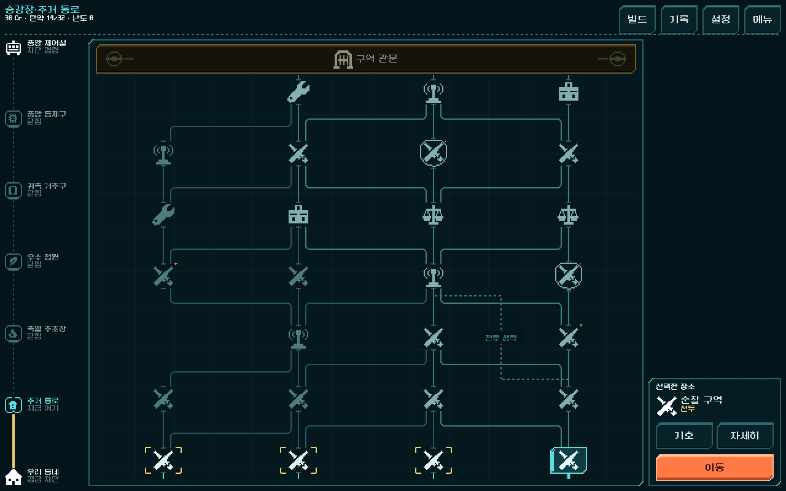

# 배관도 전투 기호 적용과 관문 전 전투 횟수 조사

2026-11-01 · 활성 `core-redesign` 작업 트리 · Godot 4.7 stable · 지도 v3. 작업 당시 소스 해시는 [scope.json](pipe_map_symbols_density_2026-11-01_assets/scope.json)에 기록했다.

## 전투 기호 — 사용자 승인 방향 구현

일반 전투는 교차 총기, 정예는 교차 총기 뒤 방호판으로 바꿨다. 관문 차단문은 유지한다. 총열·몸통·개머리판·탄창의 도트 실루엣을 공통 사용하고, 교차 지점은 한 픽셀의 빈틈으로 구분한다. 작은 상세/범례용 정예는 따로 그렸다.

- 변경: `combat.png`36px, `elite.png`44px, `elite_detail.png`36px와 제작 원본/출처 기록.
- 원본: `tools/build_pipe_map_art.py`, `art_source/ui/pipe_map_20261101/`. 직접 작성한 정수 픽셀 좌표를 nearest 2배로 내보낸 공통 UI 기호다.
- 지도·선택 장소·상세·범례가 같은 자산을 사용한다. 기호 크기/터치/배치 유지. 기준으로 저장한 런타임46파일 중3PNG만 변경, 나머지43파일 동일. 경로 생성·전투 계산·저장 로직 변경 없음.

[범례](pipe_map_symbols_density_2026-11-01_assets/legend_1280x800.png) · [844×390](pipe_map_symbols_density_2026-11-01_assets/region_1_844x390.png) · [740×360](pipe_map_symbols_density_2026-11-01_assets/region_1_740x360.png)

### 검증

- `run_prototype_hud.ps1 -Mode import` 성공.
- 기존 `tests/pipe_map_ui.gd`의 `review_earned_map`을 재사용했다. 실제 현재 Campaign의 새 등반(seed731042, 리벳, 운반복, 탄창 모드, 출발 덱14장)에3크기 선택·상세 복귀·범례·미래 관문·이동·저장/복구 **1,910검사 실패0**. [결과](pipe_map_symbols_density_2026-11-01_assets/result.json) · [사용한 실행 스크립트](pipe_map_symbols_density_2026-11-01_assets/capture.gd).
- 새 Godot 렌더에서 일반/정예의 형태 차이, 작은 화면의 기호·터치 영역 유지 확인. 사용자 미감과 Android 실기기 판독성은 미확인.
- 이번 아이콘 변경에서는 전체 등반 전투 및 HUD 기능 검사를 다시 돌리지 않았다. 기존 통과 숫자를 새 실행 결과로 사용하지 않는다.

## MAP-DENSITY-01 — 관문 전1~2전투 경로

**상태: 재현·원인 조사 완료, 생성 규칙 개편 미적용.** 사용자는 전투2회 정도로 관문에 도달하는 현상을 제보하고 조사를 요청했다. 지도 표시의 연결 오류가 아니라 실제 생성 경로의 전투 밀도 문제다. 최소 전투 횟수의 구체적 기준은 아직 사용자 확정값이 아니다.

### 조사 범위와 집계

실제 `CampaignContent.nodes(region, seed, 3)`를 사용했다. 구역별 seed0~999, 합계5,000개 지도의 모든 시작점→관문 경로를 동적 계획법으로 집계했다. 같은 그래프에서 `shortcuts`로 표시된 간선만 제외한 경우도 계산했다. 아래 횟수는 **관문 전 일반+정예 전투**이며 관문 자체는 제외한다. 조우의 돌발 전투는 선택에 따라 피할 수 있으므로 보장 전투로 세지 않았다.

| 구역 | 2전투 이하 길이 있는 지도/1,000 | 샛길을 제외한 경우 | 관측 최소 전투 |
|---|---:|---:|---:|
| 주거 통로 | 335 (33.5%) | 306 (30.6%) | 2 |
| 축열 주조장 | 332 (33.2%) | 306 (30.6%) | 1 |
| 우수 정원 | 301 (30.1%) | 276 (27.6%) | 1 |
| 귀족 거주구 | 315 (31.5%) | 295 (29.5%) | 1 |
| 중앙 통제구 | 172 (17.2%) | 162 (16.2%) | 1 |

이는 **해당 길이 하나라도 존재하는 지도의 비율**이다. 사람의 실제 선택률이나 모든 경로의 비율이 아니다. 후반 구역1전투 경로의 지도 수는 각각39/36/40/13개다. 샛길을 제거해도 이1전투 경로는 남는다. 지도 길이8/9/9/9/10 자체는 유지된다.

### 구체적 재현

첫 구역 **seed2**, 샛길 없이 다음 연결을 따른다.

`전투102 → 전투203 → 조우304 → 공방404 → 조우504 → 조우604 → 탄약고703 → 관문802`

즉, 초반2전투 뒤 **비전투5곳 연속**으로 관문에 도달한다. 조우는 떠나기, 공방/탄약고는 통과할 수 있다. `Campaign.choices/enter/resolve/leave`의 실제 진입 검사와 매 단계 저장/복구를 통과했다. 출발점에서 관문 직접 진입은 거절된다. **이 재현은 전투 승리를 주입한 흐름 검사**이며 전투 승률·소모·전체 등반 플레이 검증은 아니다.

주조장 seed28은 `전투10101 → 조우10201 → 조우10302 → 조우10403 → 상점10503 → 조우10603 → 조우10703 → 조우10803 → 관문10902`로 전투1회 경로가 존재한다(생성 그래프 조사).

기존 대표 seed731042에서도 귀족 거주구는 샛길 없이2전투 경로가 있다. 다른 구역의 최소는3/3/3/4회다. 대표 시드 한 개의 일반적인 플레이만으로 검출하기 어려웠다.

### 원인

1. 첫 구역은 처음2개 진행 단계, 나머지 구역은 첫 단계만 전투를 보장한다.
2. 중간 시설 단계와 관문 직전 단계는 모든 후보가 비전투다. 이 두 휴식 구간은 의도된 구성이다.
3. 나머지 단계의 조우가 서로 연결될 때 전체 경로의 전투 수나 비전투 연속 길이를 검사하지 않는다. 그래서 휴식 구간 사이도 계속 비전투로 연결될 수 있다.
4. 샛길이 일반 전투1곳을 추가로 생략하지만 주원인은 아니다. 샛길만 없애도 문제 경로 대부분이 남는다.

### 디렉터 제안 — 아직 미적용

- **일반 경로 최소4전투, 샛길을 이용해도 최소3전투**를 관문 전 기준의 첫 값으로 검토한다. 일반/정예를 합치고, 관문 및 선택형 돌발 전투는 제외한다. 첫 관문까지 성장과 운용을 시험할 기회를 확보하려는 가설이며 체감 확정 수치가 아니다.
- 상점/공방/탄약고와 관문 직전 재정비를 보존한다. 비전투가3곳 이상 연속되는 연결을 제한하되, 모든 길을 같은 전투 순서로 고정하지 않는다. 분기별 일반/정예·성장 보상·정비 선택은 남긴다.
- 생성 후 **각 전체 경로의 최소치와 비전투 연속 길이**를 확인하고 필요한 후보/연결만 조정한다. 샛길 추가 이후에도 기준을 다시 검사한다. 노드 총수를 늘리는 방식부터 적용하지 않는다.
- 구현 시 기존 v3 생성은 동결하고 새 등반의 `map_version=4`로 도입한다. v1/v2/v3 저장과 같은 경로 재도전은 원래 그래프를 유지해야 한다.
- 검증: 여러 시드의 모든 경로·시설 도달성·분기 다양성·샛길의 생략1회·이전 저장 재현성, 현행14장 출발 덱의5총기 등반/보상 흐름. 이후 사람 플레이에서 반복감·성장 체감·관문 준비 정도를 확인한다.

### 재실행과 증거

`tools/run_route_density_audit.ps1 -Label 20261101` → `qa_runtime/maps/route_density_20261101/density.json`.

본편 생성기를 직접 호출하는 `tools/audit_route_density.gd`와 격리 저장을 사용한다. 그래프/전이 검사771,798개 실패0은 **현재 희박 경로가 재현되고 연결·저장이 유효함**을 뜻하며, 균형이 적절하거나 문제가 수정되었다는 의미가 아니다. [원시 집계·대표 경로·검사 결과](pipe_map_symbols_density_2026-11-01_assets/density.json).
