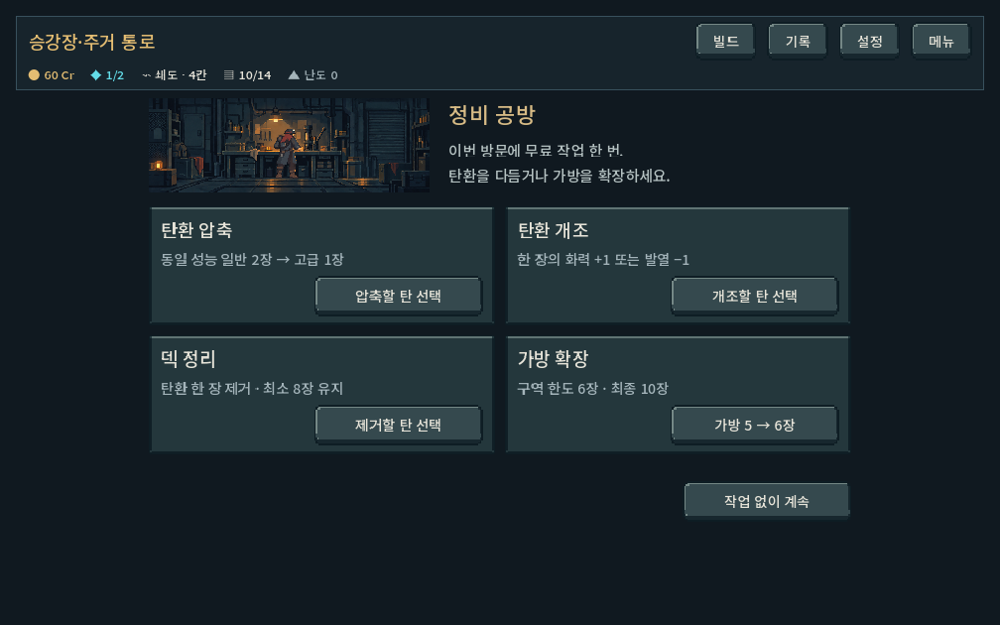
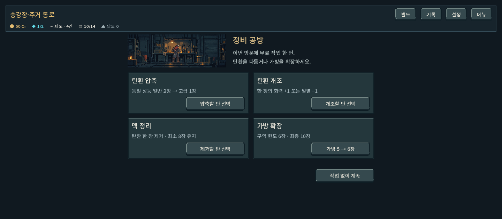
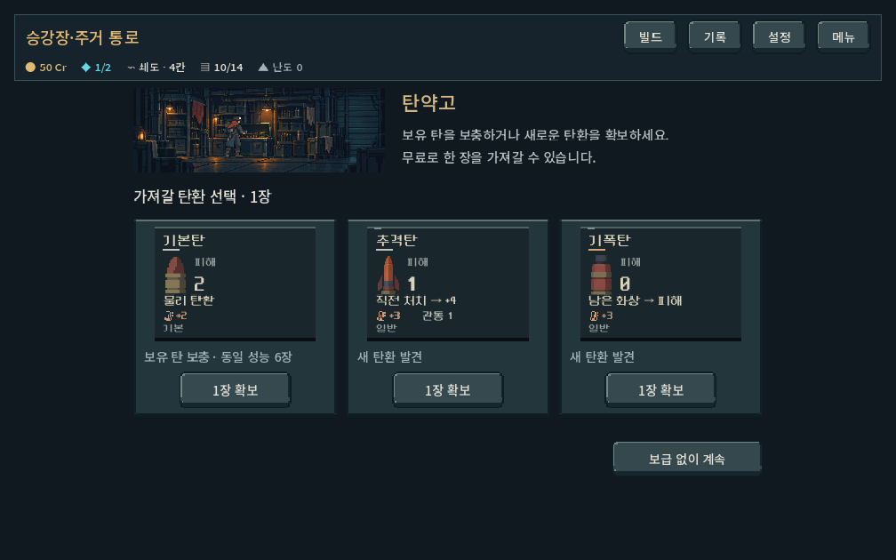
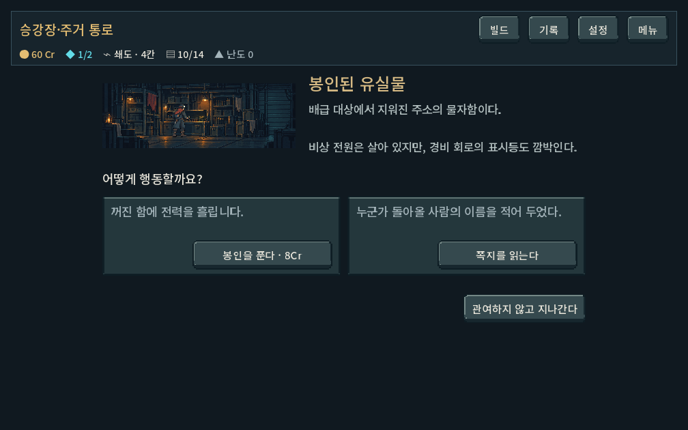
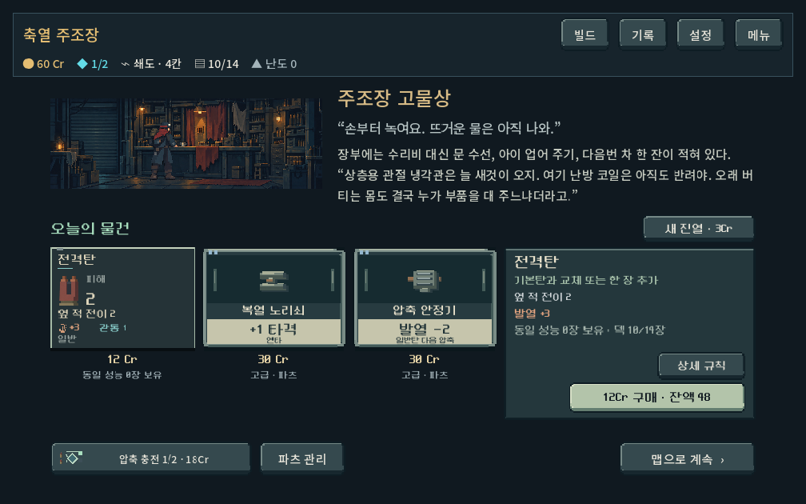
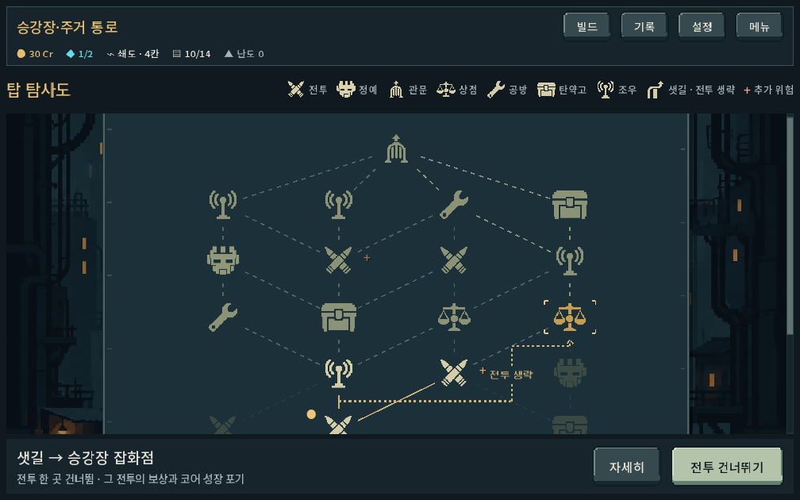

# 장소 정렬·버튼 폭·샛길 용도 — 2026-10-18

## 요청과 원인

사용자가 샛길의 실제 용도와 장소 화면의 정렬·과도하게 늘어난 버튼을 재지적했다. 기존 화면은 실내 소개는 화면 왼쪽, 상품/카드 목록은 별도 중앙 폭, 나가기는 화면 맨 아래/오른쪽을 기준으로 삼았다. 남는 너비를 버튼이 전부 사용했고, 긴 조우 문구가 줄바꿈되며 버튼 높이까지 달라졌다.

## 적용

- 현대 장소(map3/place1)의 실내·설명·선택·나가기를 하나의 중앙 콘텐츠 열로 묶었다. 현재 기준 폭은 상점1120, 공방/탄약고/조우900 논리px. 화면의 추가 너비는 바깥 여백으로 남기며 선택 카드를 가로로 늘리지 않는다.
- 나가기는 선택지 바로 아래로 이동했다. 전체 화면 높이를 채우던 가변 공백을 제거하고 공통 좌우 끝선을 사용한다.
- 공방 버튼216, 탄환 확보160, 조우260, 상점 상세140/구매280px를 기본 최소 폭으로 사용한다. 버튼은 확장 플래그 없이 필요한 폭만 사용하며, 행동 문구가 줄바꿈되지 않도록 한다. 긴 문구는 필요한 만큼 자연스럽게 넓어진다. 터치 높이52px(상점 부가 상세44/구매48)는 유지한다.
- 조우의 맥락 설명은 카드에 두고 실행 문구를 ‘봉인을 푼다’, ‘쪽지를 읽는다’, ‘수레를 끌어낸다’로 줄였다. 즉시 비용과 결과 공개 규칙은 유지한다.
- 상점 인사와 이야기 전문의 즉시 표시, 기존 비전투 탄환 카드230px 폭, 실내/복장 합성의3:1 비율은 유지했다.
- 샛길의 연결선에는 ‘전투 생략’, 범례에는 ‘샛길 · 전투 생략’을 표시한다. 목적지 선택 시 ‘샛길 → 목적지’, ‘전투 한 곳 건너뜀 · 그 전투의 보상과 코어 성장 포기’, 실행 버튼 ‘전투 건너뛰기’로 실제 행동을 설명한다.

샛길은 별도 시설이 아니다. 선택 가능한 특정 연결에서 보통 전투 하나를 거치지 않고 그 다음 방으로 가는 선택이다. 전투 위험을 피하고 다음 시설에 먼저 도착하는 대신 전투 보상/코어 성장을 포기한다. 생성·진입·저장·가격·전투 계산은 바꾸지 않았다. 장기 선택 가치가 충분하다는 의미는 아니다.

## 검증

Godot4.7 OpenGL 실제 렌더, 사용자 저장과 분리된 qa_runtime 경로, save_enabled=false. 1008×630 /1280×800 /1440×630 및 공개 큰 글씨110% 설정.

| 검사 | 최종 결과 |
|---|---:|
| place_layout_ui_runner: 화면 넘침, 콘텐츠/버튼 정렬, 길이에 맞는 단일행, 조우3종, 하위 도구, 합성 터치 스크롤, 구버전 장소 | 1,459 / 실패0 |
| place_clarity_ui_runner: 상점5지역 전문, 비전투 카드 크기, 확보/보상/덱, 샛길 실제 진입 | 1,336 / 실패0 |
| place_revision_ui_runner: 구매·정비·보급·조우·돌발 전투·샛길 실제 입력 | 495 / 실패0 |
| 합계 | 3,290 / 실패0 |

첫 실화면 검수에서 조우 버튼 높이 불일치와 큰 글씨의 통과 버튼 한 글자 줄바꿈을 발견해 수정하고 최종 검사를 다시 통과했다. git diff --check 통과. 로그에는 기존 Windows 루트 인증서 읽기 경고만 있으며 GDScript 오류는 없었다.

실제 캡처의 글자 잘림·정렬·정보 연결을 확인했다. Galaxy 실기기 터치/가독성, 사용자가 샛길을 쉽게 이해하는지, 경로별 보상 균형은 별도 확인이 필요하다. 자동 통과 횟수를 UX 완성도로 환산하지 않는다.

## 실제 화면

원본/전후 변경/최종 로그: qa_runtime/place_alignment/. 재현: tools/run_place_revision_checks.ps1 -Mode layout|clarity|ui. APK·커밋·푸시는 실행하지 않았다.
