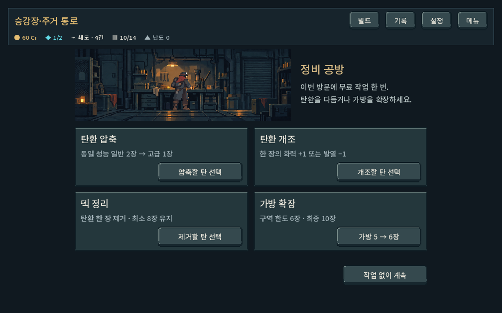
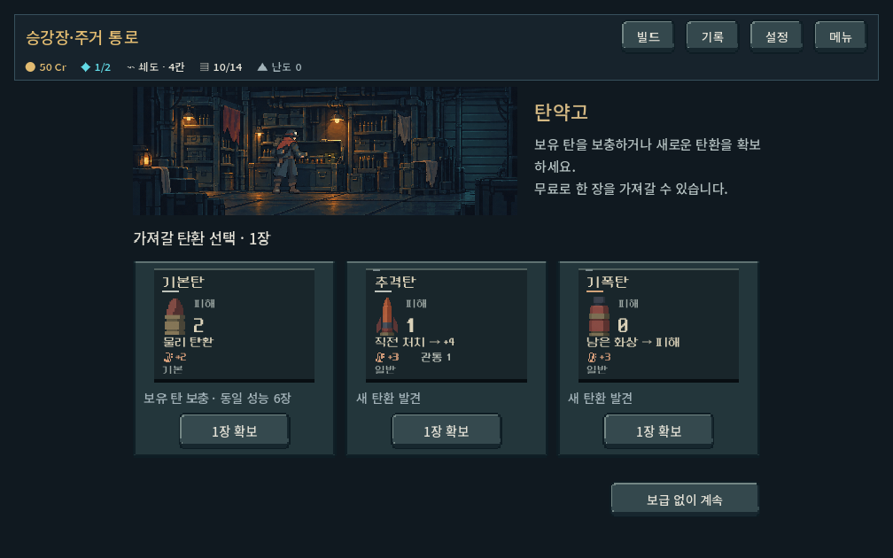
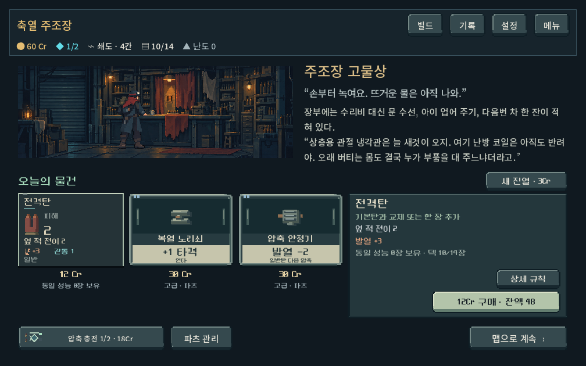
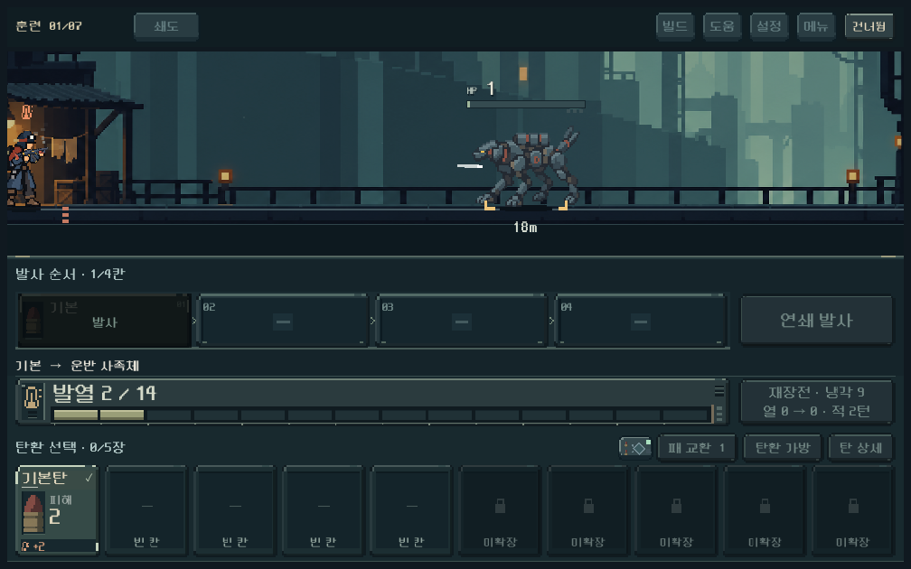
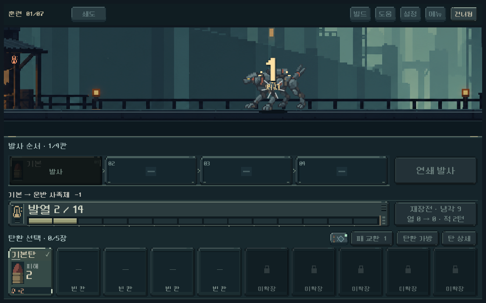
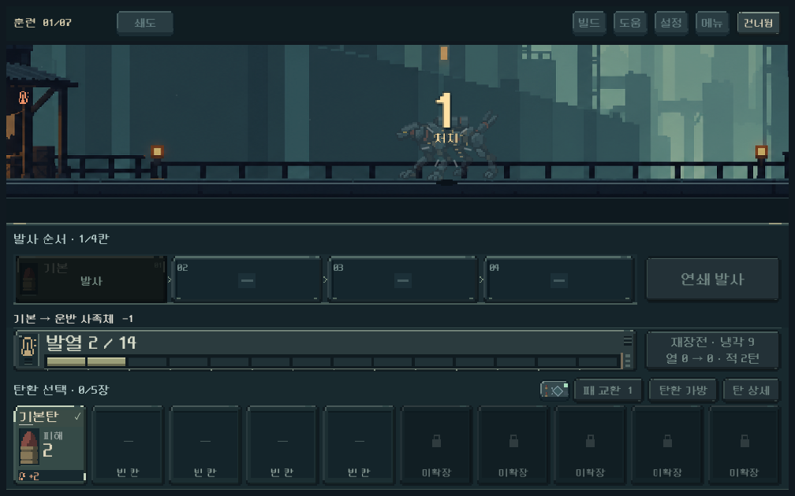

# 장소 배경 확대·피니시 시작 시점 — 2026-10-18

## 요청과 적용

사용자: 장소 화면의 버튼 정렬은 유지하되 작아진 배경을 확대. 마지막 탄 적중 직전부터 슬로우/줌인, 피해 확인과 사망 이후 줌아웃.

### 장소 그림

- 상점 실내432×144 →600×200, 공방/탄약고/조우360×120 →552×184 논리px. 가로 기준 약39%/53% 확대했다. 원화3:1 비율과 복장 레이어 등록은 유지한다.
- 공방/탄약고/조우 콘텐츠 폭900과 선택 버튼 크기·좌우 정렬 유지. 상점은 확대 그림 옆의 이야기 전문을 읽을 폭을 확보하기 위해 중앙 콘텐츠1120→1200으로 확장했다. 카드230px와 버튼의 자연스러운 폭은 유지한다.
- 상점의 중복 하단 간격을 줄였다. 첫 검증에서 구매 알림이 뜰 때806px, 긴 이야기/큰 글씨에서819px까지 늘어나던 결함을 발견했고, 이야기 공간과 중복 간격을 조정한 최종 화면은 스크롤 없이 들어온다.
- 상점 전문 즉시 표시와 계속 버튼의 선택지 인접 배치는 유지한다.

### 피니시 타임라인

이미 계산된 전투 결과를 시각적으로 재생한다. 이번 탄환과 후속 피해가 남은 모든 적을 처치하는지 확인해 마지막 탄의 비행80% 지점에서 시작한다. 살아 있는 압력탄/증원이 있으면 미리 승리 연출을 시작하지 않는다.

1. 마지막 비행20%를 약0.5초 동안 보여주며 슬로우/줌인. 적 HP, 피해 숫자, 사망은 이 구간에서 적용하지 않는다.
2. 실제 적중 이벤트에서 HP와 피해 숫자를 갱신하고 짧은 타격 정지. 최대25% 확대 상태에서 숫자를 읽을 시간을 둔다.
3. 확대를 유지하며 사망 동작/페이드를 완료한다.
4. 약 마지막0.7초에 원래 화면으로 돌아온다.

연출 기본 길이는2.5초이고 기존 타격 정지·프레임 대기로 실제 보통 설정 탄환 피니시는2.560~2.619초였다. 화상 처치는 탄 비행이 없으므로 적중 시점부터 시작하며2.487~2.511초. 빠르게 설정은 약1.40초, 즉시/건너뛰기 지원. HUD와 Engine.time_scale은 유지하고 로컬 전장 시계만 느려진다. 전투 모델·RNG·저장·대미지 규칙은 변경하지 않았다.

## 최종 검증

Godot4.7 OpenGL 실제 렌더. 사용자 저장과 분리된qa_runtime, save_enabled=false. 1008×630 /1280×800 /1440×630, 장소 큰 글씨110%.

| 검사 | 결과 |
|---|---:|
| 장소 배치: 넘침/버튼/공방/보급/조우/구매/하위 도구/합성 터치 |1,459·실패0|
| 장소 집중: 상점5지역 전문/큰 글씨/카드/확보/보상/샛길 |1,336·실패0|
| 피니시 카메라: 화면 양끝/다중 처치/별도 몬스터 스프라이트/HUD 고정/배경·숫자 범위/복귀 |504·실패0|
| 피니시 피드백: 일반·큰 피해·비최종 처치·증원·최종·다중·화상/건너뛰기/빠르게/즉시/본편 보상 |550·실패0|
| 합계 |3,849·실패0|

추가 확인: 적중 전 확대가 실제 관측됨, 적중 전 숫자·사망 없음, 피해 이벤트보다 접근 이벤트가 먼저 발생, 사망 완료 후 줌아웃, 전투 모델과RNG가 별도 계산 결과와 일치. git diff --check 통과. 기존 Windows 루트 인증서 읽기 경고 외 GDScript 오류 없음.

대표 장소 화면과 피니시 접근/피해/사망/복귀 단계 캡처를 직접 확인했다. 자동 검증은 사용자 체감의 대체가 아니며 실제 Galaxy와 사용자 타이밍 선호는 후속 확인 대상이다.

## 실제 화면

재현: tools/run_place_revision_checks.ps1 -Mode layout/clarity, tools/run_finish_zoom_checks.ps1, tools/run_finish_feedback_checks.ps1. 변경 전 코드와 이번 제품 변경 패치, 최종 로그는qa_runtime/place_art_finish_timing/. APK·커밋·푸시 없음.
