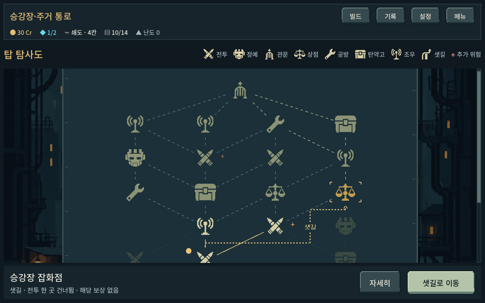
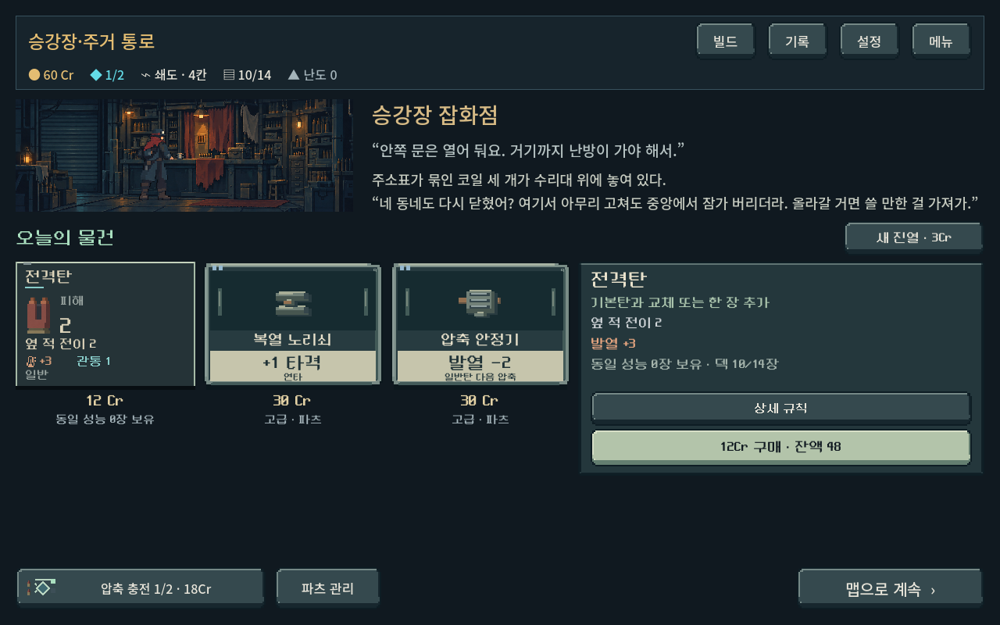
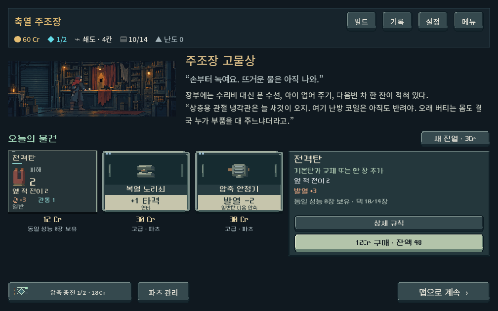
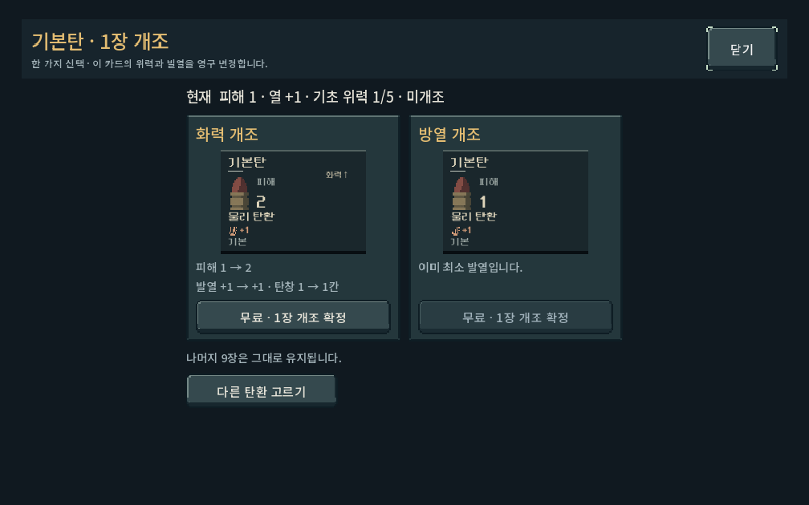
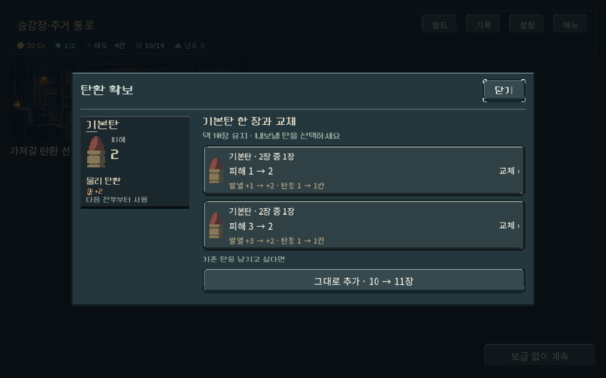
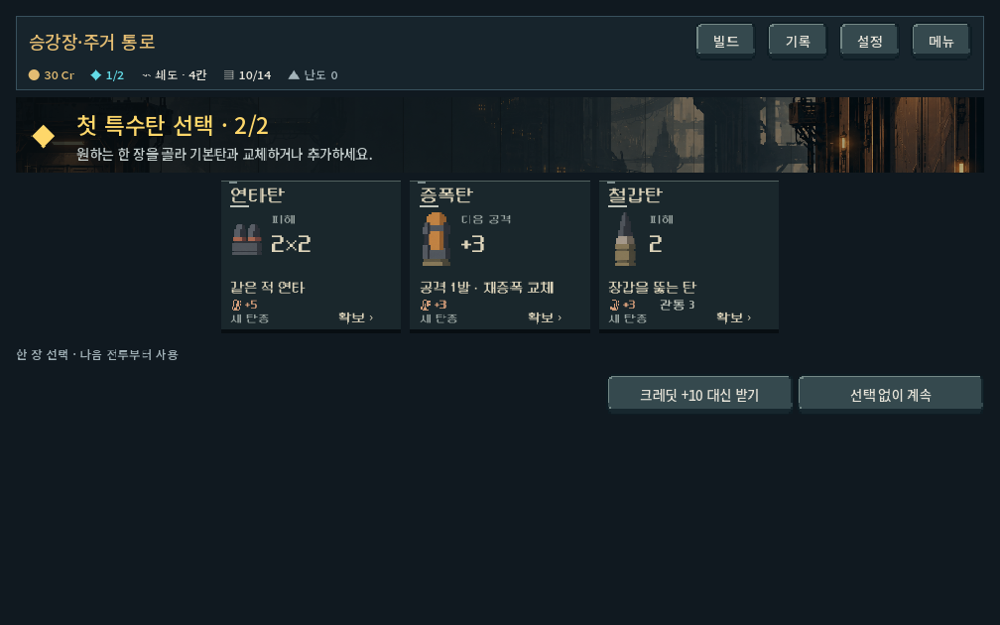

# 샛길·탄환 카드 크기·상점 이야기 — 2026-10-18

## 사용자 피드백과 조정

왼쪽으로 빠지는 샛길 연결이 지도 이탈처럼 보이고, 일부 탄환 카드가 지나치게 크며, 상점 이야기를 입장 즉시 보고 싶다는 피드백을 반영했다.

- 샛길: 지도 가장자리를 도는 긴 연결을 제거하고 노드 사이의 열 간격을 통과하게 했다. 도착 노드 아래에 진행 방향, 연결 중앙에 `샛길` 표기를 둔다. 선택 시 기존의 ‘전투 한 곳 건너뜀·해당 보상 없음’ 안내와 이동 동작은 유지한다. 연결 그래프/보상/진입 규칙은 수정하지 않았다.
- 탄환 카드: 공용 비전투 카드230×164, 확보/보상230×196. 일반 카드의 가로 확장과 보상 카드의 세로 확장을 해제했다. 상점 상품, 공방 개조/제거, 덱 확인, 보상/확보에서 확인했다. 개조/제거의 컬렉션 영역에 폭 상한을 두고 설명/뒤로가기 버튼도 같은 가장자리로 맞췄다. 전투 손패의10자리/132px 설계는 변경하지 않았다.
- 상점: 인사말+지역별 이야기 전문을 실내 그림 옆에 직접 표시한다. `이야기 듣기` 버튼/별도 대화 창 진입을 없앴다. 구매·상점 나가기를 이야기 읽기 뒤에 잠그지 않는다. 신규 기록 획득이나 대화 소비 상태를 추가하지 않았다. 기존 저장의 상점에도 직접 표시한다.
- 탄환 확보: 후보 수가 아니라 실제 표시한 교체 선택지 수로 창 높이를 계산해 하단 빈 공간을 줄였다. 가격과 기본탄 교체/추가 조건은 그대로다.

## 검증

Godot4.7 GPU 캡처, 격리 APPDATA/LOCALAPPDATA, 사용자 저장 비활성화. 창1008×630/1280×800/1440×630, 공개 큰 글씨110%.

| 명령 (`powershell -NoProfile -ExecutionPolicy Bypass -File tools/run_place_revision_checks.ps1`) | 결과 | 범위 |
| --- | --- | --- |
| `-Mode clarity` | 1,053검사, 실패0 | 5지역×3화면 상점 전문/버튼 시야, 카드 폭·높이/확보 동작, 개조 기준선/취소, 덱/첫 특수탄 보상, 실제 샛길 선택/진입/연결 범위, 긴 이야기와 큰 글씨 |
| `-Mode layout` | 997검사, 실패0 | 공방·탄약고·상점·조우 배치, 구매 이후, 큰 글씨,14장 덱 터치 스크롤과 오삭제 방지, 기존v2 장소 |
| `-Mode ui` | 493검사, 실패0 | 구매·개조·취소·확보·조우 공개·정상 전투 발사·샛길 이동. 대화 창 버튼 클릭 검사 대신 입장 시 전문 표시를 검증하도록 갱신 |

총2,543검사 실패0. 마지막 로그는 기존 Windows 인증서 경고만 남았다. 관련 `git diff --check` 통과. 상품/공방 등은 캠페인 진입 픽스처, 첫 특수탄 화면은 전투 완료 전환 픽스처이며 사람의 플레이/난이도 검증으로 해석하지 않는다.

실제 캡처에서 샛길이 출발/도착 노드 사이에 남는지, 상점 전문과 거래 영역의 분리, 카드 크기/주요 수치 판독성, 개조 정렬과 확보 창 빈 공간 감소를 직접 확인했다. 실제 Galaxy 터치와 사용자 미감은 후속 확인이 필요하다. APK/커밋/푸시 없음.

이번 변경 전 사본/정확한 제품 코드 변경은 `qa_runtime/place_clarity/before/`, `changes.patch`에 보관했다.

이전 `story_flow_runner`/`service_location_ui_runner`의 대화 버튼 기대값도 직접 표시/거래 가능 검사로 갱신했다. 이 두 파일의 전체 과거 시나리오는 이번에 별도 재실행하지 않았으며, 현행 직접 표시와 거래 검증은 위 세 러너의 통과 결과에 한정한다.
