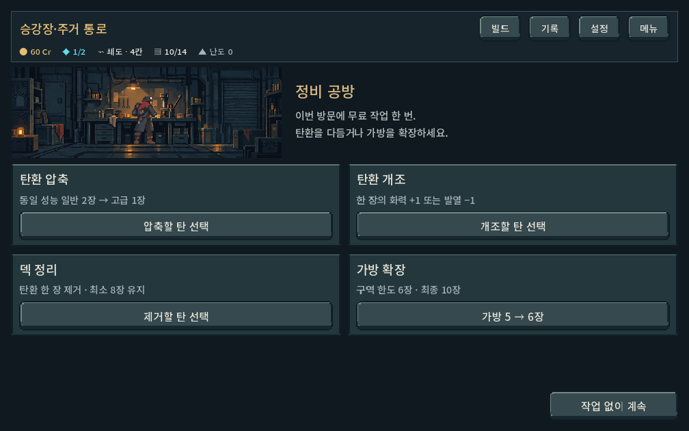
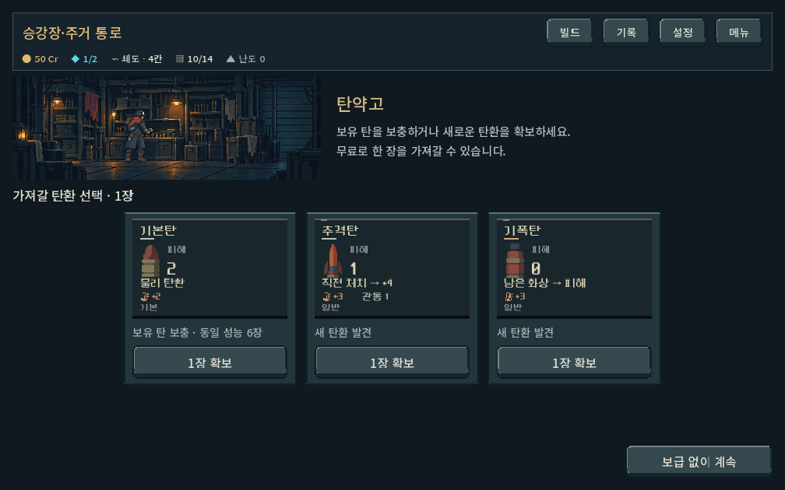
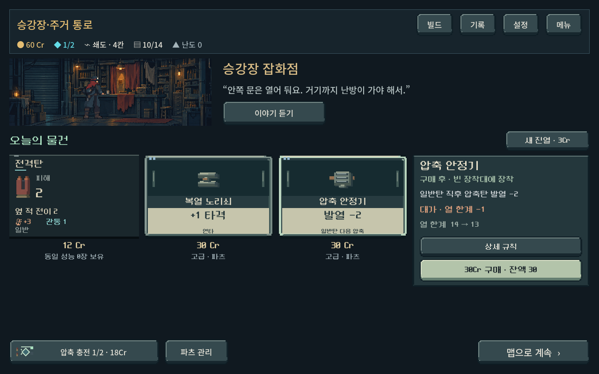
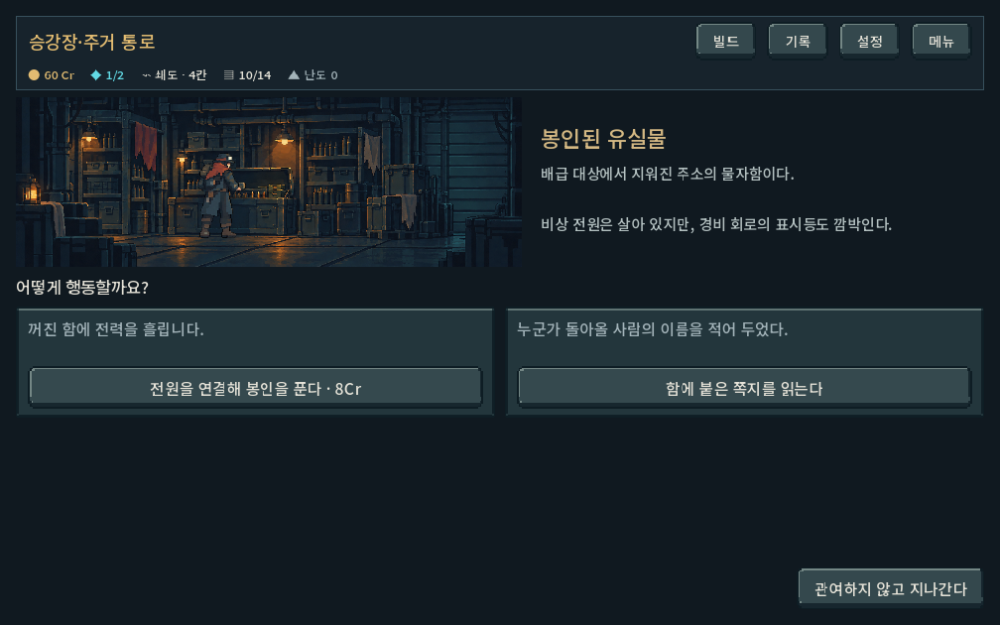
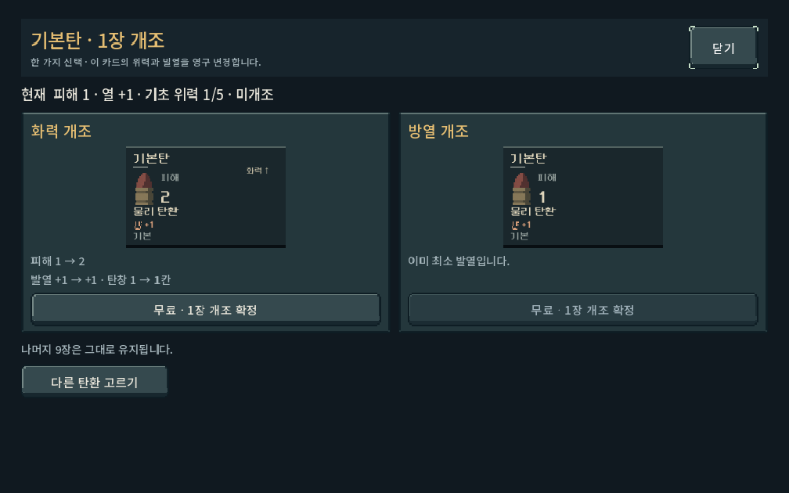
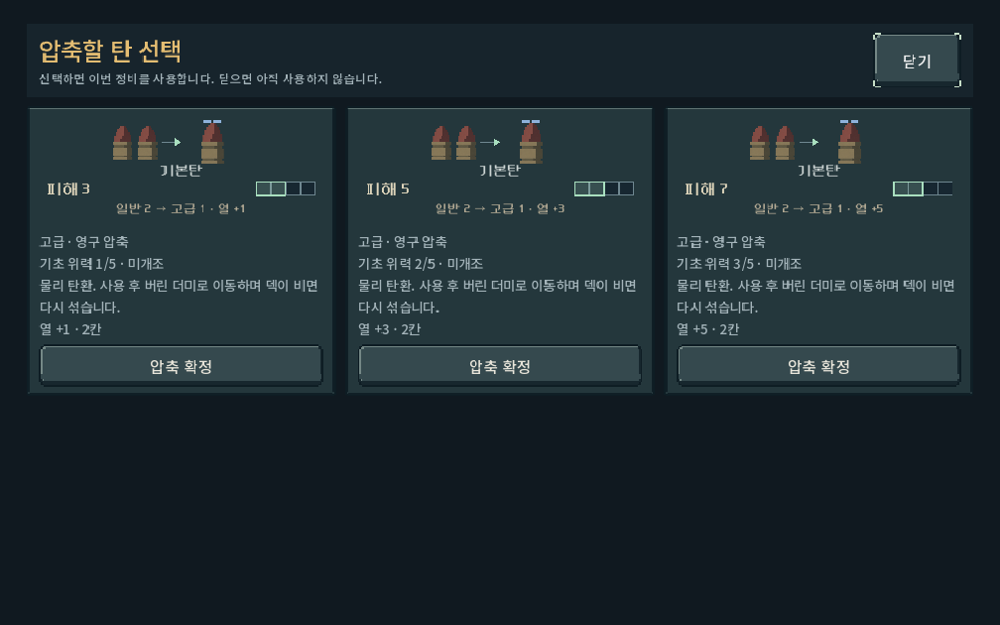

# 장소 UI 배치·간격 — 2026-10-18

## 범위

사용자 요청으로 새 장소 구성에 맞춰 배경/설명, 선택지, 완료/나가기 영역을 재배치했다. 실제 적용 코드는 `redesign/campaign_ui.gd`, `redesign/service_location.gd`. 게임 규칙과 거래 계산은 수정하지 않았다. 기존 map1/2 저장의 장소 동작과 UI는 유지하며, 공통 개조 비교의 버튼 정렬과 상단 버튼 줄바꿈만 함께 개선했다.

- 장소 소개: 상점144px, 공방/탄약고168px, 조우216px의 원본 비율3:1 실내 그림과 넓은 설명 영역. 복장 레이어와 발 위치를 유지한다. 카드가 많은 시설과 이야기 중심 조우의 그림 비중을 구분했다.
- 공방: 압축/개조/제거/가방2×2 선택지와12px 간격. 같은 행의 실행 버튼 아래선을 맞춘다. 선택 창에는 실내 그림을 반복하지 않고 결과 비교를 바로 보여준다.
- 탄약고/발견 탄환: 카드285px 고정 폭과12px 간격, 소수 후보를 가로로 늘리지 않는다. 선택 수와 보충/발견 표기를 유지한다.
- 상점: 새 진열은 상품 제목 옆, 구매는 선택한 상품 비교 아래. 압축 충전/파츠 관리는 하단 왼쪽, 맵 복귀는 오른쪽. 진열 영역은 최대1240px로 제한해 긴 화면에서 카드를 늘리지 않는다. 중복 잔액과 상시 안내 문단을 정리하되 실제 거래 결과는 표시한다.
- 공통 하단: 계속/통과 버튼은 오른쪽, 최소240×52. 설명 길이와 선택 상태가 바뀌어도 하단 동선 유지. 취소와 무료 작업 소모 시점은 그대로다.
- 조우: 단서/즉시 비용 → 행동 선택 → 결과/후속 버튼. 결과는 그림 옆 설명 영역에 표시하며 숨은 결과나 확률을 사전에 노출하지 않는다.

새 레이아웃은 새 등반(map3/place1)에 적용된다. 실행: 저장소 `PLAY.cmd`. APK/커밋/푸시 없음.

## 검증

Windows Godot4.7 실화면, 사용자 저장 비활성화. APPDATA/LOCALAPPDATA는 저장소 `qa_runtime/place_layout/`와 `place_revision/`로 격리했다.

| 명령 | 결과 | 확인 범위 |
| --- | --- | --- |
| `powershell -NoProfile -ExecutionPolicy Bypass -File tools/run_place_revision_checks.ps1 -Mode layout` | 997검사, 실패0 | 1008×630/1280×800/1440×630, 하단 버튼 시야·가로 넘침·터치 높이·개조/공방 버튼 기준선, 상품별 선택/충전 구매 후 배치, 큰 글씨110%, 실제14장 덱 제거 목록 터치 스크롤/오삭제 방지, 기존v2 장소 |
| `powershell -NoProfile -ExecutionPolicy Bypass -File tools/run_place_revision_checks.ps1 -Mode ui` | 511검사, 실패0 | 구매/주민 대화/무료 개조/취소/탄환 확보/조우 공개/실제 전투 발사/샛길 진입 회귀 |

총1,508검사 실패0. 기본 공방은 더 이상 스크롤이 필요 없으므로 기존 테스트의 무조건 스크롤 기대를 제거하고, 실제로 길어진14장 목록의 터치 검사를 별도로 수행했다. 최초 상점 검사에서 폭이 없는 압축 충전 버튼이 글자마다 줄바꿈해 하단 행이312px로 커진 결함을 발견해320×52 최소 폭/높이로 교정했다. 최종 로그에는 기존 Windows 인증서 경고만 남았다. `git diff --check` 통과(기존 줄바꿈 경고 제외).

대표 결과를 직접 열어 배경 잘림/복장 위치, 카드 비율, 버튼 정렬과 내용 가독성을 확인했다. 아래는 실제 Godot 캡처이며 콘셉트 시안이 아니다.

## 한계

실제 Galaxy에서의 터치감과 사람의 미감/정보 이해도는 미확인이다. 합성 터치 입력 통과와 실제 기기 검증은 구분한다. 조우별 전용 삽화는 제작하지 않고 기존 실내/복장 리소스를 사용했다. 게임의 장기 경제/선택 균형은 이전 과제로 유지한다.
