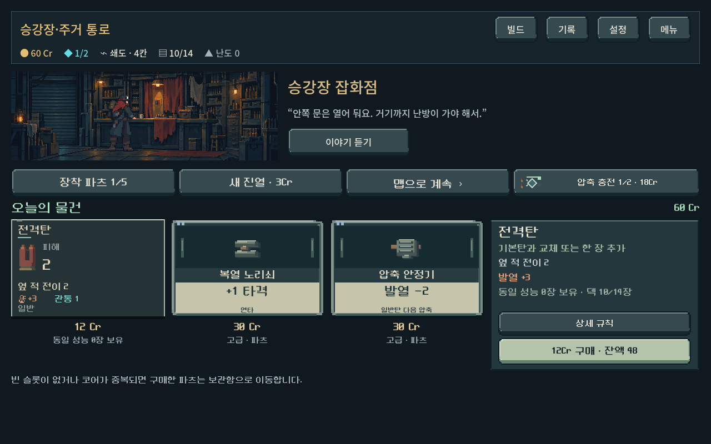
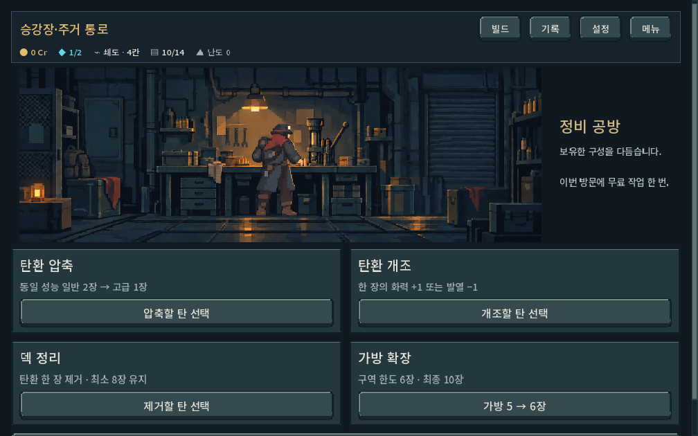
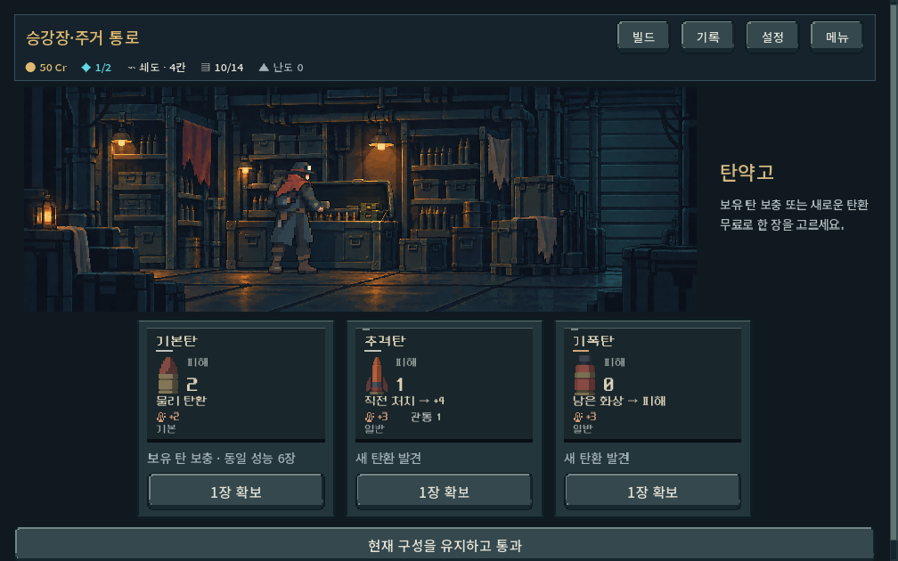
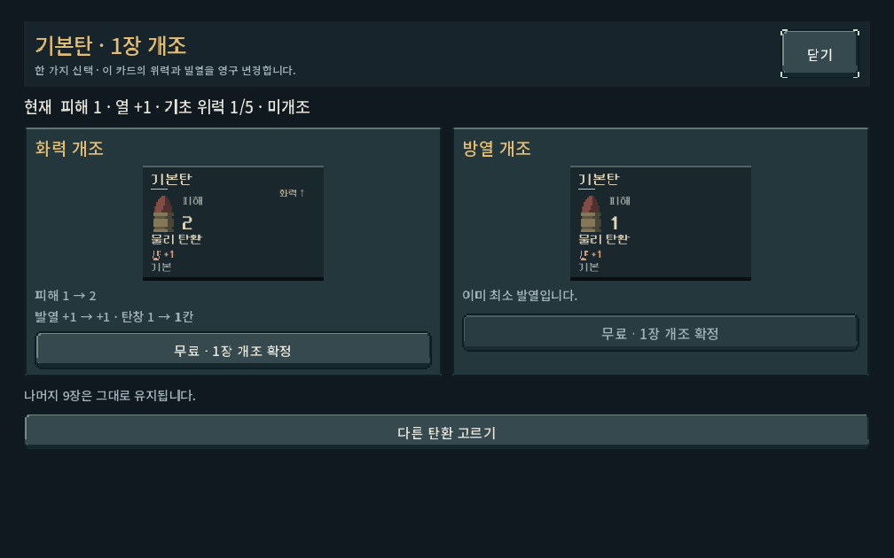
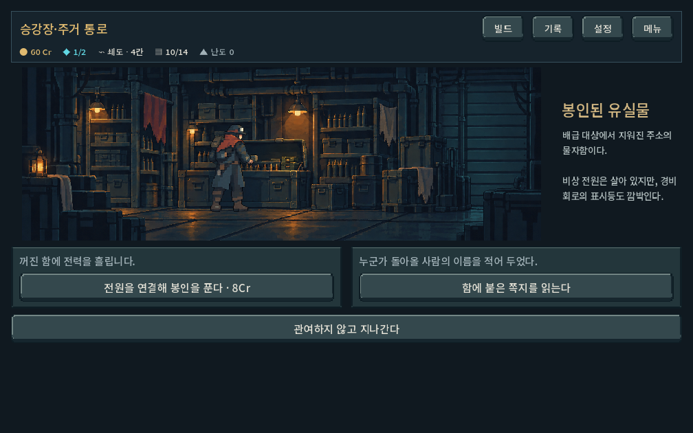
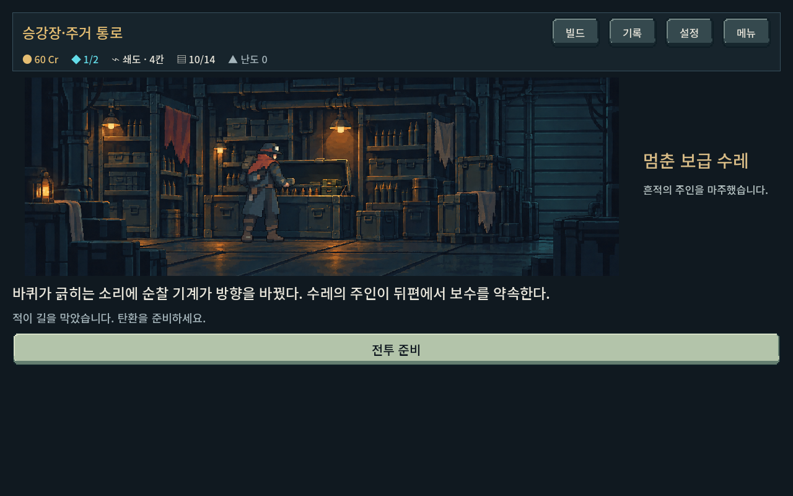
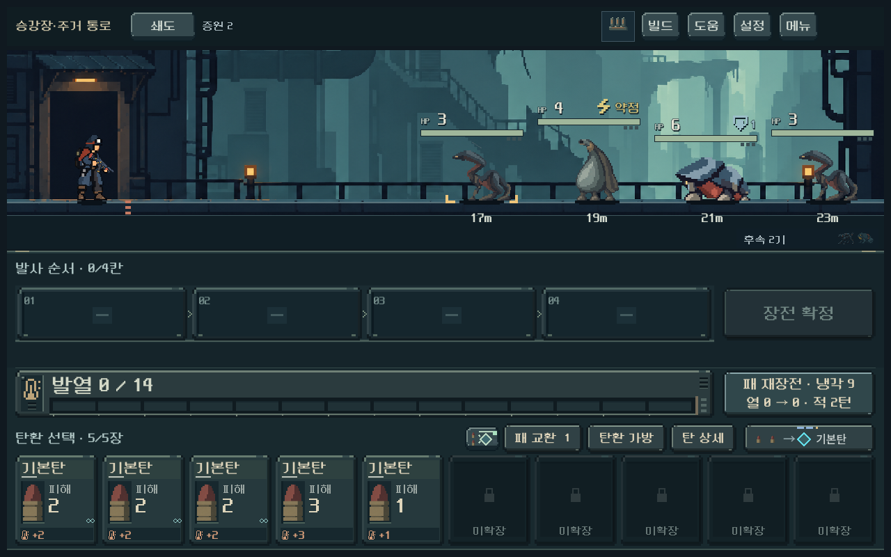
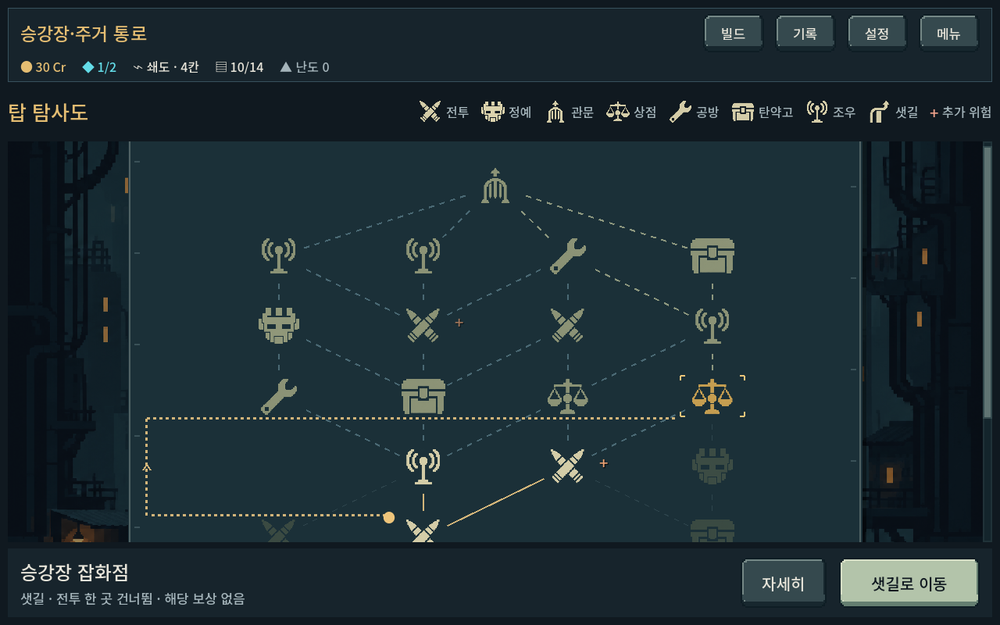

# 비전투 장소 개편 검증 — 2026-10-18

## 적용 범위

Godot4.7, `prototype/core-redesign`, 새 등반 map3/place1. 기존 변경을 포함한 작업 트리를 유지하고 이번 수정 전8소스의 별도 사본과 git 상태를 `qa_runtime/place_revision/before/`, `status_before.txt`에 보관했다. APK/커밋/푸시 없음. 실행은 저장소 `PLAY.cmd` → 새 등반. 이어하기는 원래 map1/2 서비스를 유지한다.

[현행 결정과 수치](../../direction/route-map.md#비전투-장소-개편--2026-10-18).

- 상점: 구매/진열/전투 압축 충전. 공방: 무료 가공1회(압축·개조·제거·가방). UI뿐 아니라 상태 변경 API에서도 기능 소유를 구분.
- 탄약고: 일반 보유 탄의 정확한 프로필 보충+지역 발견, 후보 저장, 1장 선택/기본탄 교체/추가/통과.
- 조우3종: 비용·단서 공개 → 선택 결과 → 전투 준비/탄환 확보/맵. 즉시 비용·기록·보상은 한 번만 적용. 재접속으로 다시 뽑히지 않음.
- 돌발 전투: 정상 열0/손패/장전 시작, 정상 지역 편성. 승리 현장 보상+일반 선택 보상. 패배·보상 전후 저장 복원.
- 샛길: 새 그래프만 변경, 일반 전투1곳 건너뜀, 관문/정예/시설 미건너뜀, 추가 보상 없음. 방문 이력은 실제 연결을 검증.
- 실제 획득 알림을 빠르게 연속 표시할 때 발견한 해제된 UI 객체의 타이머 참조를 WeakRef로 정리했다. 상점 상세 규칙 버튼의 터치 높이는44px로 보정했다.

## 자동 기능 검증

모든 QA 저장은 저장소 `qa_runtime/` 아래 APPDATA/LOCALAPPDATA를 사용했다. 화면 테스트의 사용자 저장은 비활성화했다.

| 명령 | 결과 | 무엇을 확인했는가 |
| --- | --- | --- |
| `tools/run_place_revision_checks.ps1 -Mode rules` | 4,963검사, 실패0 | 5구역×40시드, 변경 전v2 그래프200개의 SHA256 일치, v3 연결/첫 진입4갈래/관문/샛길 제약, 실제 연결 진입과 저장 복원, 5구역 완료 흐름, 공방1회·가격·가방, 탄약고 한도·교체·프로필, 조우7결과 유형·비용·중복 방지·잘못된 저장 거부 |
| `tools/run_place_revision_checks.ps1 -Mode combat` | 89검사, 실패0 | 시드5의 실제 조우 진입·11개 합법 장전/확정/발사 명령으로 승리, 매 명령 저장 복원, 추가18Cr와 일반 보상 후 맵 복귀 |
| `tools/run_place_revision_checks.ps1 -Mode ui` | 515검사, 실패0 | 본편1008×630/1280×800/1440×630. 구매·무료 개조·취소·탄환 확보·조우 공개·전투 시작/실제 발사·샛길 클릭. 가로 넘침·터치 높이·공방 화면 터치 스크롤과 오작동 방지 |
| `tools/run_map_checks.ps1 -Mode rules -Label place_revision` | 214,984검사, 실패0 | 기존v1/v2 생성/연결/분기/시설/저장/전체 등반 회귀 |
| `tools/run_earned_ammo_checks.ps1 -Mode rules` | 3,975검사, 실패0 | 기존 기본탄 시작 덱·첫 코어/특수탄·교체·한도·기존 저장 호환 |

이번 변경의 집중 검증은 총5,567검사다. 자동 검사 수는 사람의 재미·UI 이해도 점수가 아니다.

흐름 검사에서는 전투 완료 상태를 만들어 캠페인 전환을 검사했고, 별도의 전투 검사는 실제 계산/합법 입력으로 승리를 재현했다. 전투 탐색기는 미래 손패/RNG를 알고 있으므로 사람의 플레이 난이도나 블라인드 체감 증거로 보지 않는다.

첫 검사에서 직렬화 숫자의 int/float 차이를 그대로 비교한 테스트 오류와 새 탄약고 확보 버튼의 잘못된 테스트 이름을 수정했다. 터치 검사는 Godot 창ID·데스크톱 터치 에뮬레이션을 지정한 뒤 실제 ScreenTouch/ScreenDrag 입력으로 통과했다. 최종 런타임 로그에는 기존 Windows 루트 인증서 경고만 남았다. Android 도구 경로 경고는 초기 에디터 import에만 있었고 APK 작업은 하지 않았다.

## 실제 화면 검수

세 해상도의 화면을 렌더링하고 대표 캡처를 직접 확인했다. 기능 선택과 가격을 먼저 읽을 수 있으며 조우의 숨은 결과/확률은 선택 전 표시되지 않는다. 공방 선택지는2열, 탄환 보상은 고정 폭 카드다. 작은 화면의 공방은 세로 스크롤을 허용하고 화면을 밀어 내려도 작업이 실행되지 않는지 확인했다. 기존 실내/복장 그림을 재사용했으며 사건 전용 새 삽화를 제작한 것은 아니다.

## 남은 검증

- 실제 Galaxy 터치/발열/긴 플레이와 사람의 장소 이해도는 미확인.
- 사건3종의 재방문 반복감, 비용/보상/확률, 공방의 가방 선택 편향, 탄약고와 유료 상점의 경제 경쟁은 장기 플레이 데이터로 조정할 대상.
- 샛길의 지역당 수와 지도 점선 판독성, 코어 성장 포기 체감은 사용자 테스트 대상.
- 구역별 독립 사건/전용 삽화·효과음은 추가 제작 범위이며 이번 완료에 포함하지 않는다.
