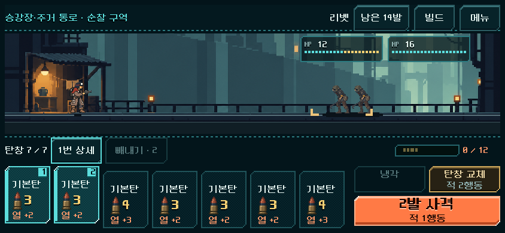
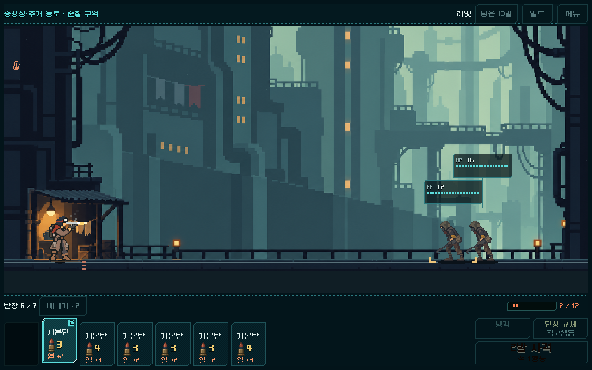
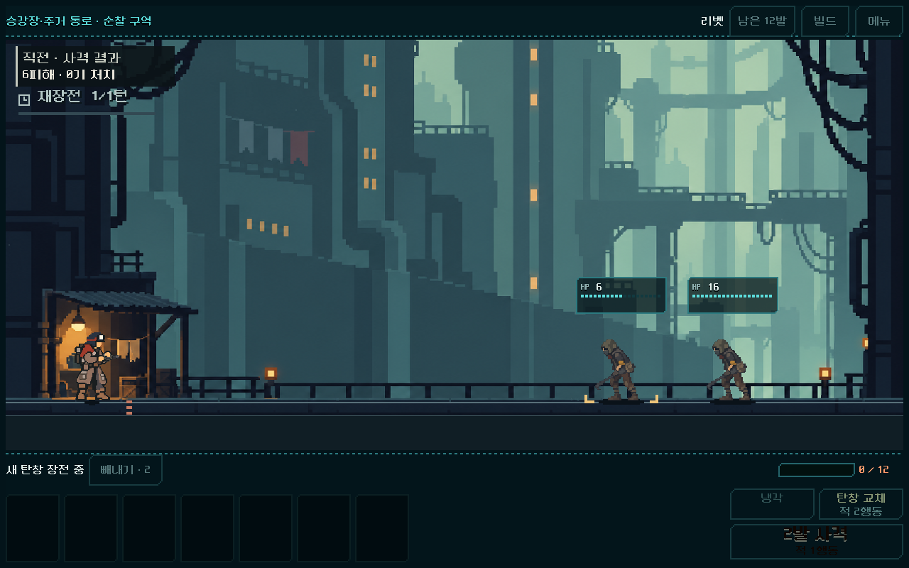
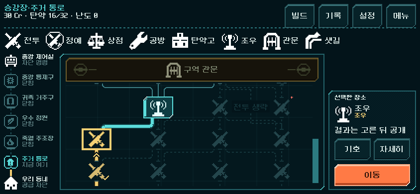

# 플레이 후기 반영 — 화면 배율·탄창 피드백·지도 판독성

2026-11-02. 사용자 후기와 실행 승인에 따라 우선순위 1~2의 재현 가능한 오류와 표시를 수정했다. [전체 후기와 후속 순서](../../history/design/playtest-review-2026-11-02.md). 본편 `PLAY.cmd`와 공통 탄창 HUD에 적용되며, 사격 입력·열/교체 수치·지도 생성 규칙은 이번에 변경하지 않았다.

## 적용 내용

| 요구 | 실제 변경 |
| --- | --- |
| 플레이 중 화면 확대 | 전투 HUD를 제거할 때 크기 변경 콜백을 먼저 끊어, 메뉴/지도에 전투용 2배 배율이 다시 적용되는 오류 수정 |
| 다음 발사 탄 식별 | 실제 Forecast에 포함된 탄을 8px 올리고 기존 청록 테두리·순서 번호 유지. 카드 그림 76×96 유지, 슬롯은 기존 탄창 영역 안에서 위 여유를 포함한 높이104. 터치/빼내기 의미 유지 |
| 발사 시 카드 소모 | `shot_started`의 실제 탄 하나마다 해당 소켓을 비우고 탄창/남은 탄 수 갱신. 다른 탄은 원래 위치를 유지하다 행동 종료 후 정렬. 다중 타격을 탄 여러 발로 세지 않음 |
| 교체/냉각 연출 | 교체는 묶음 분리→빈 소켓→실제 새 탄창 삽입. 냉각은 탄을 유지하고 열 영역 반응. 발열 증가/과열/냉각에 짧은 색 변화. 즉시 처리 설정은 움직임 생략 |
| 작은 글자 | 카드 순서·개별 열·행동 비용 12→16px. 지도 자원/선택 설명/샛길 설명과 상시 범례도16px |
| 지도 기호 | 전투·정예·상점·공방·탄약고·조우·관문·샛길 8종을 지도 상단에 항상 표시. 상세 범례 버튼 유지 |
| 경로/현재 위치 | 지나온 길·선택 경로6px, 이동 가능한 길4px. 방향 표시, 현재 장소 금색 실선, 방문 장소 밝은 금색/체크. 공간이 충분하면 직전·현재·다음 장소를 함께 표시 |
| 저장 후 방문 경로 | JSON 복원 뒤 방문 ID가 float가 되어 `Array.has/find`의 정수 ID와 맞지 않던 표시 오류 수정. 표시용 ID만 정수로 정규화하며 저장 파일/경로는 그대로 |

## 오류 재현과 상태

**화면 배율 — 로컬 재현/수정 검증됨.** 2016×908 창에서 본편 전투→메뉴를3회 반복했다. 수정 전에는 전투 종료 시 `content_scale_mode`와 `size`를 복원하는 동안 여전히 연결된 HUD `resized`가 다시 factor2를 설정했다. 메뉴 표시 범위가1776×800에서888×400으로 줄어 확대되었다. 수정 후3회 모두 원래 상태를 복원했다. [전](playtest_presentation_2026-11-02_assets/scale_before.json) · [후](playtest_presentation_2026-11-02_assets/outfits_and_scale.json). 추가로 740×360/844×390/2016×908 진입, 전투 중2400×1080까지 크기 변경, 기존 factor1/1.25를 각각 보존했다. [확장 검사](playtest_presentation_2026-11-02_assets/scale_resize.json).

**방문 경로 — 저장 복원 재현/수정 검증됨.** 실제2전투 승리 후 복원한 방문 배열 `[101,201]`에서101→201이 `trail` 대신 `off`로 표시되었다. 기존의 “trail이 하나라도 있음” 검사는 시작→101만 확인해 이 결함을 놓쳤다. 모든 연속 방문 간선과 방문 장소 상태를 검사하도록 보강했고,3크기에서 실패3건→0건이다. 수정 전 로그: `qa_runtime/playtest_20261102/map_trail_audit/`. [최종 전체 지도 검사](playtest_presentation_2026-11-02_assets/map.json).

**재장전 복장 혼합 — 미재현, 미해결.** 본편 첫 전투, 시드731042에서7복장×5총기의 실제 재장전 입력을 실행하고 매 프레임 선택 복장 ID와 등장한 포즈/텍스처 경로를 기록했다. 다른 복장으로 바뀌는 경우는 없었고 work/carrier/scout의 일부 실제 화면도 확인했다. 이 결과로 제보를 기각하거나 수정 완료로 처리하지 않는다. 사용자가 테스트한 빌드·복장/총기·발생 조건과 실제 모바일 화면을 통한 후속 확인이 필요하다.

Android 실기기의 회전·앱 복귀·배율/안전 영역과 지속 성능/기기 발열은 이번 환경에서 확인하지 않았다. PC의 같은 배율 오류 재현을 모바일 전체 검증으로 간주하지 않는다.

## 실제 화면

844×390. 다음 발사2발은 올라오고, 대기 탄은 낮은 줄을 유지한다.

1280×800. 첫 발 발사 시 첫 소켓만 비고, 두 번째 발은 아직 남아 있다.

1280×800. 교체 중 빈 소켓을 보인 뒤 새 탄창을 묶어서 끼운다. [삽입 순간](playtest_presentation_2026-11-02_assets/reload_seated.png).

844×390. 금색은 지난 경로/현재 장소, 청록은 다음 이동이다. [740×360 처음 지도](playtest_presentation_2026-11-02_assets/region_1_740x360.png).

## 검증

Godot4.7 Compatibility, 격리 APPDATA/LOCALAPPDATA. Godot MCP `get_project_info` 연결 정상. 실행·캡처는 기존 로컬 CLI/검사 경로를 사용했다. 사용자 저장·APK·외부 게시·커밋은 변경하지 않았다.

| 명령 | 결과/범위 |
| --- | --- |
| `tools/run_playtest_presentation.ps1 -Label scale_fixed` | 2,986검사 실패0. 반복 배율 복원·35복장/총기 재장전 조합. 프레임 수에 따라 검사 횟수는 달라짐 |
| `tools/run_playtest_presentation.ps1 -Label scale_resize -Script res://tests/playtest_scale_ui.gd` | 54검사 실패0. 창 크기/초기 배율 조합과 전환 복원 |
| `tools/run_playtest_presentation.ps1 -Label cards_final -Script res://tests/playtest_cards_ui.gd` | 1,752검사 실패0.5총기×3연출 설정×사격/냉각/교체 실제 터치. 매 탄 소모, 빈 소켓, 삽입, 입력 잠금 해제, 전체 모델/RNG와 같은 상태 oracle 일치 |
| `tools/run_playtest_presentation.ps1 -Label map_final -Script res://tests/playtest_map_ui.gd` | 19,115검사 실패0. 최신 버전2에서 획득한 명령으로5구역 규칙 재생, 지도3크기, 후보/범례/상세/이동/저장 복원·샛길·관문·이전 지도v1/v2. 이 검사에서 전투25개를 모두 UI로 플레이한 것은 아님 |
| `tools/run_prototype_hud.ps1 -Mode ui -Fast` | 기존 HUD11,536검사 실패0.5총기·4크기, 빼내기/상세/메뉴·입력 크기·배치·결과. 개별 열 글자 기준만 새16px 요구로 갱신 |
| `tools/run_prototype_hud.ps1 -Mode probe` | 통과.844×390와2016×908의 HUD/2배 배율/입력 영역 |
| `tools/run_prototype_hud.ps1 -Mode feedback -Suite journey_feedback_20261101` | 169검사 실패0. 실제 열/소리 이벤트, 강제 냉각, 장면 재개, 즉시/음소거와 상태 일치 |
| `tools/run_prototype_hud.ps1 -Mode import` | 통과. 신규 파싱 오류 없음 |

실제 화면을 확인했으며 자동 성공 횟수가 미감·이해도·재미의 통과를 뜻하지 않는다. 다음 사람 플레이에서는 발사 묶음과 교체 시점, 현재/지난 길이 즉시 읽히는지 확인한다.

## 변경 추적과 다음 작업

- [이번 런타임 변경만 추린 patch](playtest_presentation_2026-11-02_assets/changes.patch), [관련 소스 SHA256](playtest_presentation_2026-11-02_assets/manifest.json). 작업 직전 사본과 비교하여 기존 미커밋 변경을 분리했다. `redesign/` 최상위149개 스크립트는 직전 해시와 전부 같다. 전투/저장/최신 적 HP·총기별 덱/지도 생성 수치 유지.
- 런타임은 `combat_hud_presenter.gd`(배율/사격 묶음), `combat_hud_feedback.gd`(실제 이벤트), `combat_hud.tscn`(8px 여유/글자), `pipe_map/{screen.tscn,screen.gd,graph.gd,place.gd}`(범례/경로/방문 표시)다. 새 검사4개와 공용 실행 래퍼를 추가했다.
- 구현 중 자동 장전의 마지막 history가 `load`인 것을 발견해 직전 `reload`와 함께 교체로 해석했다. 새 회귀 검사가 교체 연출 누락을 검출하며, 냉각/강제 냉각과 구분한다.
- 다음은 **사격 입력과 냉각/교체·열의 역할 비교**다. 앞줄 연속 범위 드래그/누르고 있기/파츠별 발수, 교체 냉각 축소/제거, 고열 피해/명중 변화는 아직 채택하지 않았다. 지도 전투 밀도v4 제안과 최신 적 HP·덱 부담의 공동 검증도 후속으로 유지한다.
