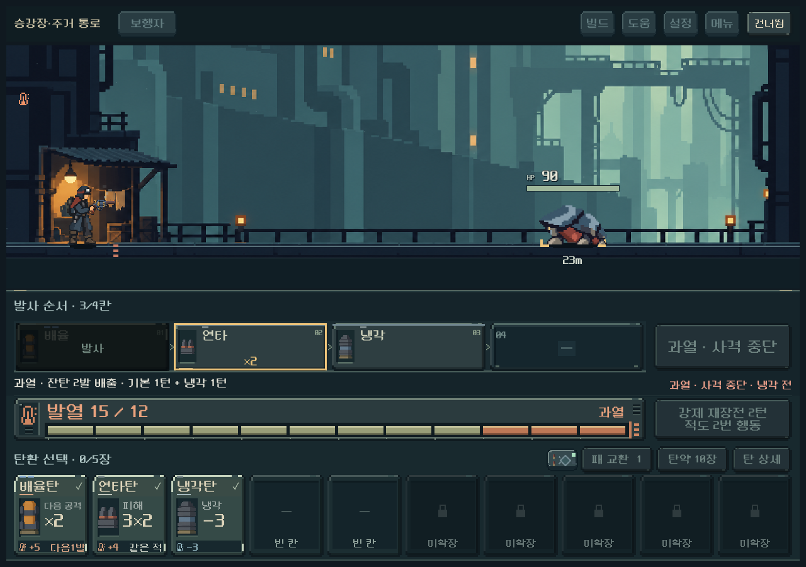
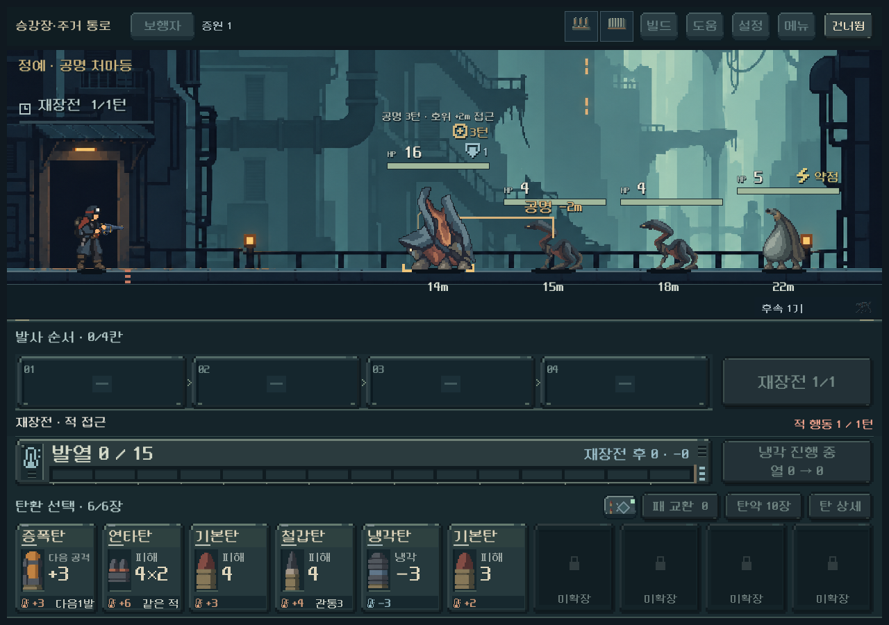
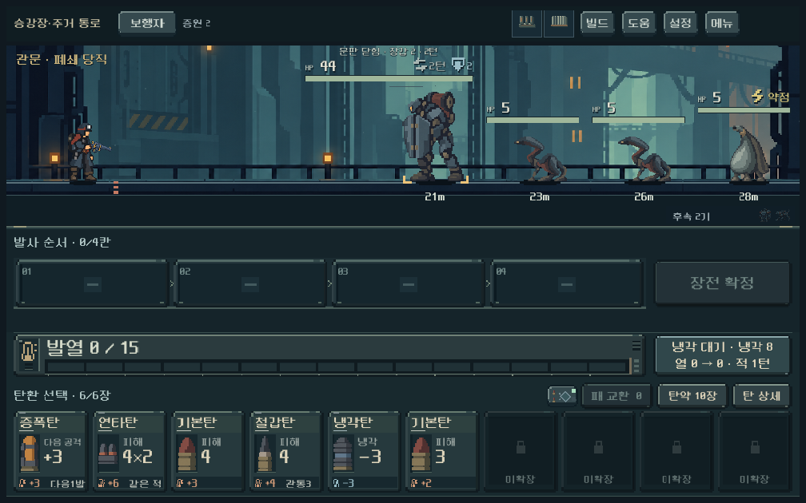
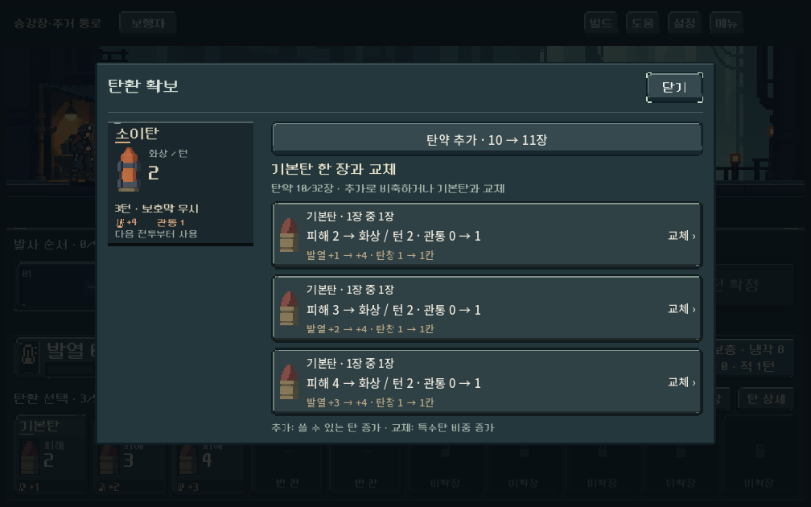
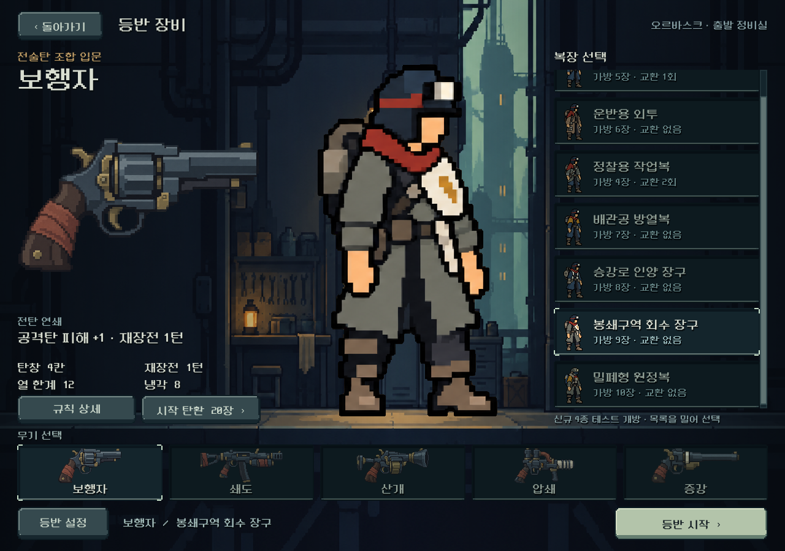
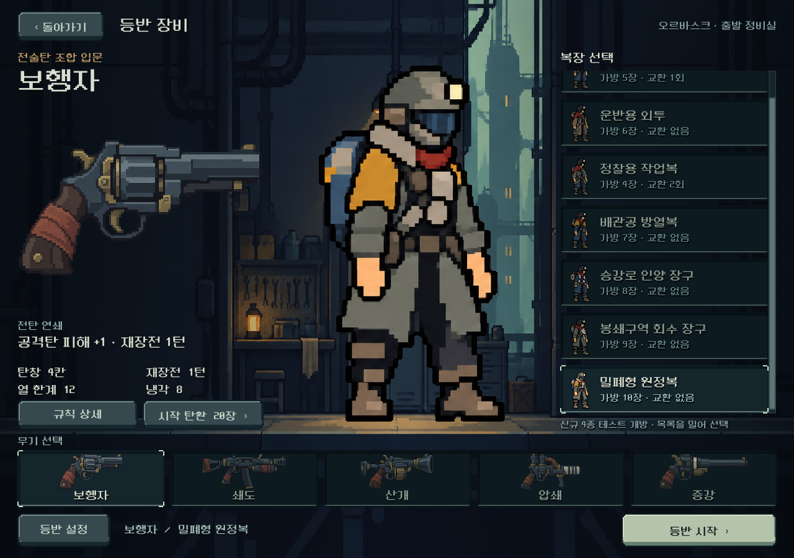

# 플레이 피드백 후속 구현 — 2026-10-20

사용자가 소이탄 통합 이후 앞서 정리한 수정 작업 진행을 승인했다. 활성 저장소 `core-redesign`, 브랜치 `prototype/core-redesign`, 기준 HEAD `197c6941`. 작업 시작 시 소이탄 통합과 당일 점검 문서가 수정 상태였으며 이를 보존했다. 커밋·푸시·APK는 수행하지 않았다.

## 적용한 것과 결정 상태

- **탄약 배분:** 새 등반 기본탄20장(위력1×6/2×8/3×6), 전체 소유 상한32장. 발사/교환/확정 후 배출한 탄은 해당 전투에서 재사용하지 않고 다음 전투에서 복구한다. 재장전은 미사용 손패를 유지하고 빈자리만 채운다. 손패4~10장 및 탄창과 별도다.
- **회수:** 확정 전 선택 취소/순서 편집은 무료이며 새 탄을 주지 않는다. 장전 확정 후 배출은 잔탄을 사용함으로 보내고 재장전 턴을 지불한다. 회수 횟수 제한과 회수 리롤은 추가하지 않았다.
- **획득:** 탄약 추가를 먼저 제시한다. 추가는 총량, 교체는 특수탄 비중이라는 차이를 표시한다. 확보한 특수탄 중1장을 전투 첫 손패에 포함한다. 시작부터 미소유 특수탄을 지급하지 않는다.
- **고갈:** 손패/예비/장전탄이 모두 없으면 탄약 소진 패배. 남은 화상이 있으면 대기로 처리할 수 있고 마지막 화상 처치로 승리할 수 있다.
- **발열:** 냉각 전 과열값을 잠시 보여 주고 사격 중단/배출 잔탄/기본 재장전+냉각1턴/적 행동을 연결한다. 일반 속도0.65초, 연출 축소0.2초이며 건너뛰기/즉시 설정을 따른다.
- **정예/보스:** 공명 본체→호위 연결선과 추가2m 접근, 호위 없음의 무효 상태를 표시한다. 보스 HP 위에 문판/장갑/발사 예고를 배치하고 상태 전환을0.65초로 늘렸다. 무적이나 강제 생존은 추가하지 않았다.
- **복장 선택:** 신규4종을 기준으로 선택 전용7종 대기 그림을 만들고 같은 방향/팔 자세/표시 신장/발 기준으로 등록했다. 전투·실내 그림은 기존 역할을 유지한다.

수치·첫 특수탄 보장·세부 회수 방식은 디렉터 비교 결정이다. 기능 구현 완료와 사용자의 재미/미감 채택을 구분한다. [현행 규칙](../../direction/ammo-reserve.md).

## 비교에서 발견한 문제와 보완

초기 전투별 탄약 규칙으로 실제 첫 구역을 진행했을 때 쇄도/증강은 통과했지만 압쇄+열압은 보스 노드802에서 제한 탐색으로 해를 찾지 못했다. 덱23장 중20장은 기본탄, 나머지는 소이2/냉각1장이었고 첫 손패는 기본탄만 있었다. 사용 탄을 제한하는 것과 별개로 획득한 빌드 탄을 접하기 어려운 문제가 있었다.

동일 전투 저장으로 비교했다.

| 조건 | 제한 탐색 결과 |
| --- | --- |
| 첫 손패 기본탄만, 새 비축 규칙 | 경로 미발견 |
| 이미 소유한 특수탄1장을 첫 손패로 이동 | 32명령으로 승리 |
| 기존 재순환 규칙 | 31명령으로 승리 |

이 비교를 근거로 섞인 더미의 첫 특수탄을 첫 손패에 옮겼다. 새로운 탄 생성이나 추가 RNG는 없다. 이후 실제 첫 구역3구성을 다시 진행해 모두 관문을 통과했다. 제한 탐색의 실패는 ‘모든 수에서 승리 불가능’의 증명이 아니며, 승리 경로 발견도 평균 난도/승률의 증명이 아니다.

[초기 비교](assets/playtest_revision_2026-10-20/initial_comparison.json) · [동일 저장 감사](assets/playtest_revision_2026-10-20/choice_audit.json) · [최종 전체 진행](assets/playtest_revision_2026-10-20/reserve_campaign.json).

## 검증

Godot4.7, 격리 `qa_runtime` 아래 APPDATA/LOCALAPPDATA. 실제 사용자 저장에 접근하지 않았다. UI는 Windows OpenGL 렌더와 터치 입력 이벤트, 규칙/탐색은 실제 전투 모델을 사용한다.

| 검사 | 통과/실패 | 범위 |
| --- | ---: | --- |
| 신규 비축 규칙 | 565 / 0 | 35무기/복장 조합, 손패 보존, 회수/교환/압축, 고갈/화상, 첫 특수탄25시드,32장 상한, 저장/구버전 보존, 예측 |
| 신규 UI | 459 / 0 | 1008×630/1280×900/1440×630, 복장7종, 확보/사용함, 실제 확정/재장전, 과열 비용, 정예/보스 |
| 비축 전투 비교 | 407 / 0 | 5총기×2시드×정예/보스20조건, 실제 명령 재생 모두 승리 경로 |
| 첫 구역 캠페인 | 1,482 / 0 | 쇄도+연쇄, 압쇄+열압, 증강+돌파, 실제 획득/경로/매 명령 저장 복원 |
| 동일 저장 비교 | 3 / 0 | 위3조건의 저장 유효성, 경로 결과 별도 기록 |
| 기존 정예/보스 UI | 1,913 / 0 | HUD/몸체/상태 조합/실제 장면 회귀 |
| 기존 정예/보스 규칙 | 310 / 0 | 기존 패턴 계산 |
| 발열 규칙 | 917 / 0 | 열 경계/과열/재장전 |
| 소이탄 통합 규칙 | 1,705 / 0 | 당일 앞서 변경한 화상/구형 저장 전환 |

합계7,761개 자동 검사 실패0. 비축 전투 비교는 기본탄20+특수6장, 코어2레벨/방열 파츠의 명시적 구성이다. 20조건에서 사용4~20장/남은6~22장. 전체 첫 구역 검사는 실제로 확보한 덱으로 별도 수행했다. 전 구역 난도 검증으로 확대 해석하지 않는다.

최종 로그: [비축 규칙](assets/playtest_revision_2026-10-20/reserve_rules.log), [UI](assets/playtest_revision_2026-10-20/reserve_ui.log), [전투 비교](assets/playtest_revision_2026-10-20/reserve_balance.log), [캠페인](assets/playtest_revision_2026-10-20/reserve_campaign.log), [기존 보스 UI](assets/playtest_revision_2026-10-20/challenge_ui.log), [발열](assets/playtest_revision_2026-10-20/heat_rules.log), [소이탄](assets/playtest_revision_2026-10-20/incendiary_rules.log).

실행: `tools/run_reserve_checks.ps1 -Mode rules|ui|balance|campaign|choice_audit`. 비교용 전투 원본은 `tests/fixtures/reserve_earned_round.json`에 보존해 ignored 런타임 파일 없이 감사 재실행이 가능하다.

### 검사 중 고친 결함

- 가방 탭이 현재 도트 테마의 StyleBoxTexture를 StyleBoxFlat으로 강제 변환하던 오류를 공용 선택 스타일로 교체했다.
- 신규 의도 라벨을 확보하려고 HUD를 내린 첫 수정에서 기존 UI 검사13개가 몸체 겹침을 검출했다. 최소 높이와 라벨 공간을 조정한 후 기존1,913/신규459검사 모두 통과했다.
- UI 테스트의 화면 재생성 후 참조가 해제된 문제는 테스트가 현재 뷰를 다시 찾아 관찰하도록 수정했다.
- 복장 v2에서 회수 장구/원정복의 팔 굽힘이 남아 imagegen으로 재편집했다. 활성v3, 비교v2, 실제 참조와 전체 프롬프트는 [provenance](../../../새-게임-프로젝트/assets/art/equipment_portraits_20261020/provenance.json)에 보존한다.

## 실제 화면

격리 상태로 실제 게임 UI를 렌더한 화면이다. 특정 경계를 확인하는 장면은 재현용 전투 상태를 설정한 뒤 공개 UI로 조작했다. 아래10장 표시는 해당 재현 상태의 보유량이며 새 등반 시작은20장이다.

육안으로 위 장면의 겹침/발 기준/팔 방향/과열 전후 정보와 작은 화면 확보 창을 확인했다. 초상화의 사용자 선호와 원화의 최종 채택은 확인 전이다.

## 다음 확인

- **새 등반**으로 테스트한다. 기존 이어하기 저장과 훈련은 종전 재순환을 유지한다.
- 낮은 탄을 보존할 이유, 추가/교체의 가치, 과열 배출의 비용, 확보한 특수탄의 첫 패 보장이 체감에 적절한지 확인한다.
- 발사기구 파츠는 후보로 보류했다. 기존5총기의 행동 경제를 바꾸는 별도 비교가 필요하다.
- Galaxy 실기기, 상위 구역/장기 균형, 대규모 시드별 승률, 사용자의 패턴 이해도는 이번 검사로 확인하지 않았다.
