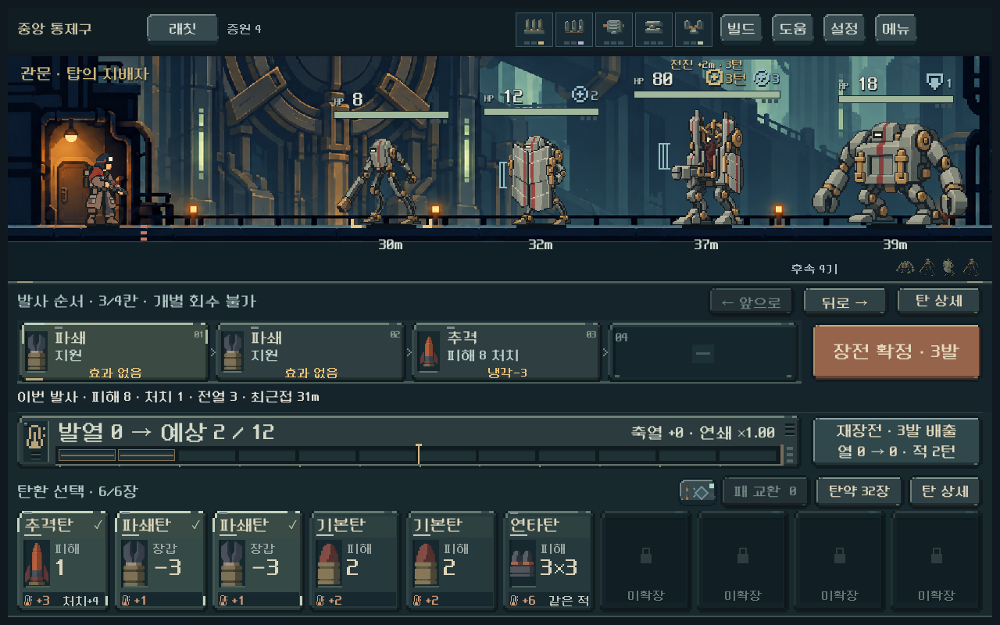
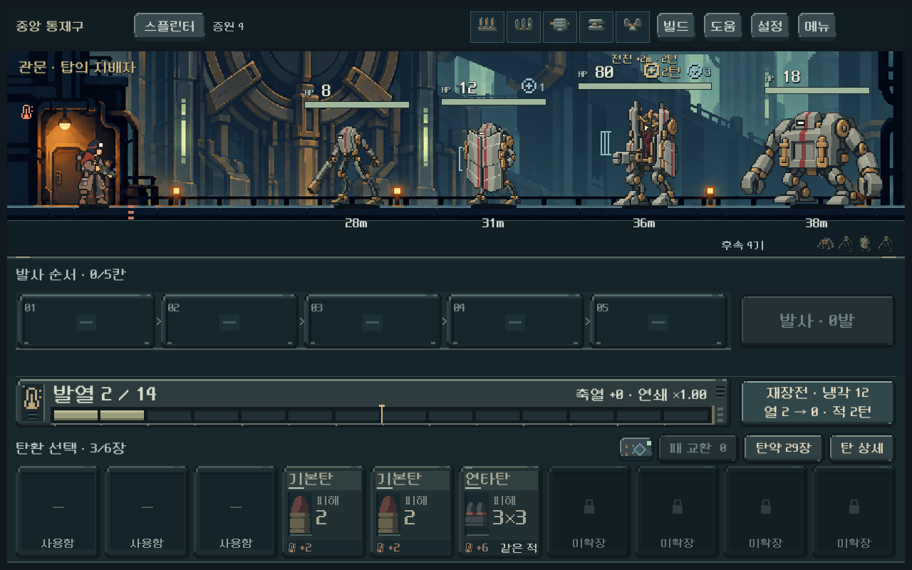

# 플레이 피드백 순차 개편 — 후반 입력 지연 1차 개선

2026-10-26 시작, 2026-10-27 검증. 사용자가 [전체 피드백과 개선안](../../history/design/playtest-review-2026-10-26.md#후속-요청--피드백-전체와-개선안-정리)의 순차 실행을 승인했다. 이번 반영은 **전체 기록 복사로 커지는 예측·장전 지연의 개선**과 다음 단계의 빌드 비교 기반이다. 전체 전투 개편이나 프레임 문제 전부가 완료된 상태는 아니다.

## 본편 변경

실제 캠페인 상태는 등반 전체의 사격 결과를 보관한다. 기존 예측·연계 후보·다음 탄 미리보기·사격 연출은 매번 이 전체 상태를 깊게 복사했고, 비동기 예측 요청은 전체 기록까지 문자열로 바꿔 비교했다. 후반 래칫 저장은 기록227개/상태약636KB로 커져 있었다.

`Model.simulation_state`는 가장 최근 탄창 확정부터의 기록만 추린 뒤 깊게 복사한다. 단발 무기의 발사 이력, 서로 다른 탄종 수, 후속 파츠 조건은 유지한다. 예측·재장전 예측·연계 후보·연출·비동기 요청에 적용했다. 실전 상태와 저장 파일의 전체 기록은 줄이지 않으며, 임의의 기록 개수 상한도 넣지 않았다. 저장 형식과 전투 수치는 동일하다.

## 같은 저장의 전후 측정

Godot 4.7 / Windows / Compatibility / RTX 4060 Ti. 실제 기존 검증 캠페인의1구역·후반 진입 상태를 복원하고 공개 장전 명령 및 본편 버튼으로 측정했다. 시간은 CPU 작업 지연이며 FPS나 Galaxy 성능 수치가 아니다.

| 작업 | 변경 전 중앙값 | 변경 후 중앙값 | 범위 |
|---|---:|---:|---|
| 5구역 래칫 사격·재장전 예측 | 15.480ms | 0.687ms | 동일한3장 장전 상태 |
| 5구역 래칫 재장전만 예측 | 4.591ms | 0.157ms | 동일 상태, 실제 재장전 계산 |
| 5구역 래칫 요청 상태 문자열화 | 20.874ms | 0.261ms | 변경 후 값에는 최근 상태 복사도 포함 |
| 5구역 래칫 본편 화면 갱신 | 109.866ms | 70.229ms | 실제 GPU 창, 동일 저장·화면 |
| 5구역 스플린터 본편 화면 갱신 | 79.942ms | 68.689ms | 실제 GPU 창, 동일 저장·화면 |
| 1구역 래칫 본편 화면 갱신 | 50.142ms | 50.689ms | 시작 상태, 사실상 동일 |

본편 장전 버튼3회의 CPU 처리도 래칫 약113~136ms→70~72ms, 스플린터 약92~93ms→72~73ms였다. 자동 저장을 끈 격리 UI 검사이며 디스크 저장 비용은 포함하지 않는다. 단순 예측 함수는9회, 전체 예측은3회, 본편 화면 갱신은7회의 중앙값을 사용했다. 스플린터 예측 함수 값은 캐시가 준비된 상태이므로 분기 계산 자체의 가속으로 해석하지 않는다.

성능 기준 상태는4무기의1/5구역과 리액터의1/2구역이며 스파이크의 실제 한 발 발사 후 상태도 포함한12건이다. 해당 리액터 기록은 당시2구역에서 종료한 경로이므로5구역 결과로 표기하지 않는다.

자료: [CPU 전](assets/playtest_revision_2026-10-27/cpu_before.json) · [CPU 후](assets/playtest_revision_2026-10-27/cpu_after.json) · [본편 UI 전](assets/playtest_revision_2026-10-27/ui_before.json) · [본편 UI 후](assets/playtest_revision_2026-10-27/ui_after.json).

## 기능·시각 검증

- 실제 저장12상태의 다음 탄/사격/재장전 예측이 변경 전 기록과 동일하고, 예측 후 원본 상태와 RNG가 유지됨.
- 집중273검사 실패0:5무기·3코어/모듈 조합, 확정·연속 사격·중간 정지·재장전·탄약/열/RNG, 비동기 요청 교체, 깊은 복사 격리, 전체 기록의 실제 디스크 저장·복원.
- 현행 중앙 규칙1,775검사 실패0, 연계 후보 규칙142검사 실패0.
- 실제 본편 UI113검사 실패0, 전후 각각8캡처. 장전·확정·발사 후 화면이 실제 결과와 일치. 수정 후 후반 장전/발사 대표2장을 직접 시각 확인함.
- 빌드 비교162조건/756검사 실패0. 이는 비교 실행과 예측 정합성 확인이며 밸런스 통과가 아니다.

과거 탄환 확장 묶음은45,961검사 중977실패했다. 구형 시작 덱·발견 후보·일부 과거 수치 기대값이 현행과 맞지 않는다. 이번 복사 변경을 모두 전체 복사로 되돌린 **별도 프로젝트의 비교 모델**에서도45,961/977과 실패 메시지 전체가 동일했다. 이 묶음을 성공으로 집계하거나 이번 최적화의 회귀로 단정하지 않는다. 비교 프로젝트 생성 중 줄바꿈과 전역 스크립트 등록 문제를 교정한 후, 스크립트 오류 없는 최종 결과끼리 대조했다. [기존 전체 복사 결과](assets/playtest_revision_2026-10-27/legacy_full_copy.log) · [최근 상태 복사 결과](assets/playtest_revision_2026-10-27/legacy_compact.log).

## 다음 단계와 한계

화면 갱신에는 여전히약50~70ms가 든다. 추가 측정에서 적 정보 버튼을 포함한 전장 동기화약17ms, 상단 UI 구성약8ms 등 화면을 다시 만드는 비용이 남았다. 상시 GPU 프레임·장시간 연출·디스크 저장·Galaxy 기기는 미측정이다. 사용자가 겪은 모든 프레임 저하의 원인을 하나로 확정하지 않는다.

다음은 **파츠·탄환·방어·발열의 선택 차이 개편**이다. 준비한 [162조건 비교 자료](assets/playtest_revision_2026-10-27/build_baseline.json)는 연타/돌파/고열, 성장0/4/8, 일반 무리/장갑/보스형 적, 맞는/맞지 않는/없는 모듈, 선택탄/기본탄을 비교한다. 같은 빌드 안에서는 총기·코어 성장·초기 적·장전 수가 동일하다. 탄약 획득 희귀도와 실제 캠페인 보급량까지 같게 맞춘 것은 아니며, 가상의 비교 전투다. 여기서 끝까지의 클리어율이나 사람의 체감을 주장하지 않는다. 후속 개편은 현재 이미 존재하는 시너지와 자원 대가를 보존하며 이 비교 결과를 기준으로 진행한다.

복장/총 휴대량, 파츠 슬롯 확대, 적 겹침·거리 표시, 비상 보급/일회용 탄약, 관문 씬은 이번 변경에 포함하지 않았다. 승인된 순서는 유지하며 다시 승인을 요구하는 상태는 아니다. 사용자 저장 변경, APK·커밋·푸시·외부 게시 없음.

재현: `tools/run_playtest_revision_checks.ps1 -Mode performance -Tag compact`, `-Mode rules -Tag final`, `-Mode ui -Tag compact`, `-Mode builds -Tag current`. 성능 비교는 기존 `qa_runtime/central_live/balance/final_731042` 기록과 변경 전 `performance/baseline/reference.json`을 사용한다. [검증 시점 소스 해시](assets/playtest_revision_2026-10-27/source_hashes.json).
