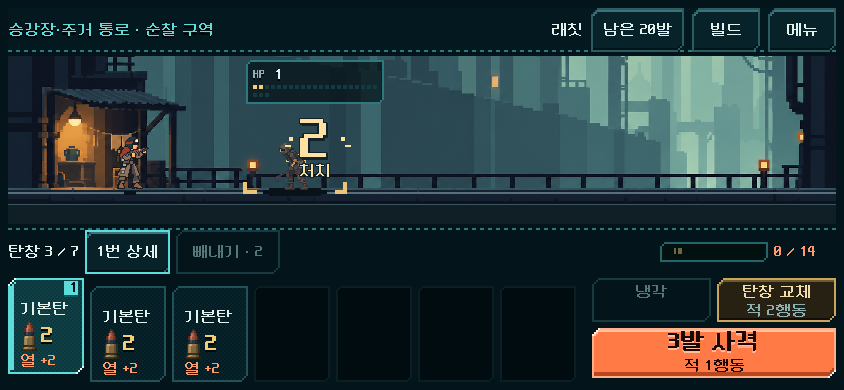
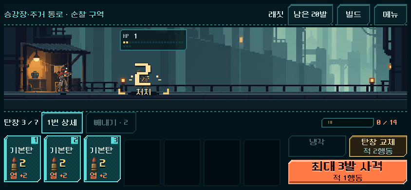
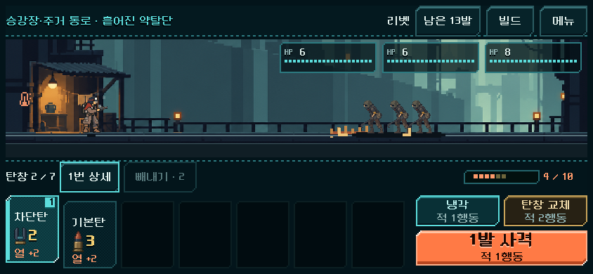
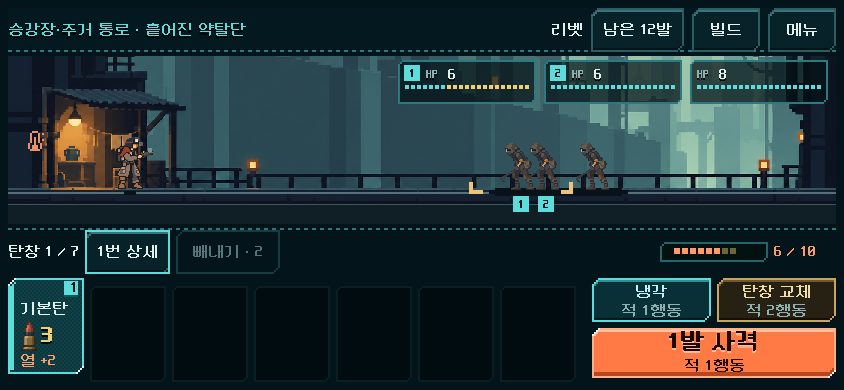
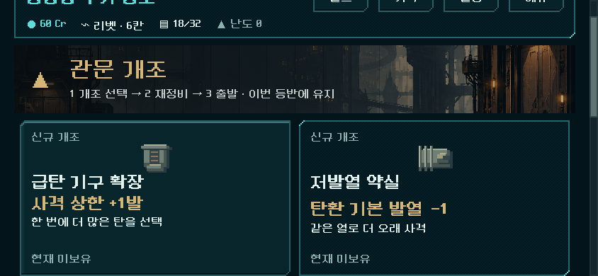

# 2026-11-03 플레이 피드백 개편 검증

사용자 실행 지시에 따라 [입력/히트·지도·탄종/코어/파츠·복장/발수 성장](../../direction/combat-roles-growth.md)을 본편 새 등반에 적용했다. Godot 4.7, 활성 `core-redesign` 작업 트리, 격리 저장 `qa_runtime/playtest_rework_20261103/`에서 검사했다. 사용자 저장·APK는 건드리지 않았다.

## 요구와 결과

| 요구 | 구현·검증 | 경계 |
|---|---|---|
| 히트가 다른 위치에 표시됨 | HP 카드 열에 붙던 숫자를 충돌 시점의 대상 위치에 고정. 740×360/844×390/1280×800에서 가까운 적/조기 처치 사례를 확인했다. | 제보 당시 빌드·정확한 장면과 동일하다는 주장 아님. |
| 드래그 감도·선택/발사 표시 불일치 | 끝 이동 없이 해제, 카드 사이 빈틈, 초기 대각선 흔들림, 밖에서 취소, 조기 처치의 표시 차이를 재현. 수정 전 24검사 중 14실패 → 수정 후 해당 사례 모두 통과. 상승/순번과 버튼은 선택 최대 카드 수로 통일했다. | Windows에서 실제 터치 이벤트 주입. Android 손가락 체감은 미검증. |
| 지도에서 계속 전투 회피 | 5구역×1,000시드의 모든 경로를 검사. 일반 최소4/샛길 최소3, 비전투 최대2연속. v2/v3 그래프와 시설/연결/샛길 보존. 캐시 복사본 변경이 원본에 영향 없음을 확인. | 전투 최소 수는 첫 적용값, 모든 시드의 실제 승률을 측정한 것이 아님. |
| 과도한 처치 전이 | 추가1기 상한, 관문/전격 분배 투자에 따른 증가. 연쇄 잔여 타격과 돌파 잔량을 실제 resolver로 검사. | 일반 광역탄과 열압 충격파는 별도 역할로 유지. |
| 다른 탄을 고를 이유 | 소이의 지역 불길, 차단탄의 제한된 감속, 관련 파츠, 소이/전격 시작 묶음과 지원 후보 적용. 화상/불길 중첩·기간·범위·예측/실전·저장 확인. 소이 주력의 실제 획득 전체 등반 완료. | 선택 가치·재미의 사람 확인 대기. |
| 복장별 min/max와 정비 | 7복장의 시작/편집 최소/휴대 상한, 수납3회, 이전 손패와 독립된 확장, 저장 확인. 장비·덱·공방 표시 연결. | 전체 등반은 운반용 외투 기준. 다른 복장 경제는 기능 검사와 구별. |
| 성장 후 발사량 증가 | 실제 발사 상한+1과 기본 발열−1을 관문 선택에 연결. 최대2회씩, 특수 사격/연속 추가 열 유지. 스파이크의 무효 상한 선택 제외. | 무제한 연사/전탄 보장 아님. |

## 실제 화면

동일 844×390의 히트 위치와 선택 탄수 표시. 숫자는 대상 몸체에 붙고, 선택3장의 상승/순번과 `최대 3발` 표시가 일치한다. 조기 처치하면 실제로는 1장만 소모된다.

| 수정 전 | 수정 후 |
|---|---|
|  |  |

[소이/제어 시작 묶음](playtest_rework_2026-11-03_assets/role_packages.png) · [복장 최소/최대 안내](playtest_rework_2026-11-03_assets/equipment.png). 전투 연출 사진은 소유한 탄을 검사 목적에 맞게 배치한 통제 사례다. 공개 시작→첫 전투→코어→소이 묶음 획득과 관문 진입 저장은 별도로 실제 경로로 확인했다. 관문 캡처는 실제로 도달한 저장을 사용했다.

## 검사

| 검사 | 결과/증거 |
|---|---|
| 새 규칙/예측/구버전 전투/7복장/관문 성장 | `rules_final/result.json`: 319검사, 실패0 |
| 드래그·공개 새 등반·보상·불길/감속·관문 입력·작은 화면 | `ui_final_layout2/result.json`: 80검사, 실패0 |
| 지도 v4 전체 경로/이전 그래프/시설/캐시 격리 | `maps_cached_final/result.json`: 982,401검사, 실패0 |
| 리벳·래칫·리액터 실제 획득 등반 | `climb_primary/balance.json`: 84전투, 7,479검사, 실패0 |
| 스플린터·스파이크 초기 등반 | `climb_alternate/balance.json`: 56전투, 4,882검사, 실패0. 스파이크의 무효 개조 제거 전 결과는 보존하고 아래로 대체. |
| 스파이크 최종 성장 선택 | `climb_amplifier_final/balance.json`: 28전투, 2,535검사, 실패0 |
| 소이 주력 리액터 | `climb_incendiary/balance.json`: 28전투, 2,485검사, 실패0 |
| 최종 소스의 전체 명령 재생 | `replay_verified/result.json`: 16,133검사, 실패0. 6등반168전투의 결과·턴·획득 덱·개조·저장/복구 일치. |
| 별도 프로세스에서 불길이 남은 전투 이어하기 | `restart_verified/write_result.json` 6 / `read_result.json` 5검사, 실패0. 실제 획득 전투의 합법 명령으로 불길 상태 저장 후 새 프로세스의 다음 사격 결과 전체 일치. |
| 기존 위치 파츠/집중 획득 | `focus_build_20261103/rules_role_regression/result.json`: 643검사, 실패0 |
| 기존 다섯 총기 실제 사격/냉각/교체/빼내기·이전 저장 | `fire_control_20261102/ui_role_regression/result.json`: 165검사, 실패0 |
| 기존 HUD | `tools/run_prototype_hud.ps1 -Mode ui -Fast`: 11,536검사, 실패0 |
| 임포트 | `tools/run_prototype_hud.ps1 -Mode import`: 성공 |

전체 등반은 seed731042, 운반용 외투, 실제 보상/상점/관문 선택과 합법 명령을 사용했다. 전투 승리나 재화를 주입하지 않았다. 탐색은 미래 RNG를 보므로 사람 승률이나 자연스러운 선택의 증거가 아니다. 최종 경로는 5총기 기본 빌드 140전투 + 소이 빌드28전투, **6등반168전투**다. 전투마다 저장/복구를 검사했다.

[최종 명령 재생 결과](playtest_rework_2026-11-03_assets/replay_verified.json)는 16,133검사, 실패0이다. 같은 시드/획득 정책에서 측정한 값이며 서로 다른 총기의 화력만 비교하는 통제 실험은 아니다.

| 구성 | 전투 | 총 행동 턴 | 긴급 보급 | 전투 중 최소 잔탄 | 최종 덱 |
|---|---:|---:|---:|---:|---:|
| 리벳 | 28 | 310 | 1 | 1 | 21 |
| 래칫 | 28 | 333 | 0 | 8 | 28 |
| 리액터 | 28 | 428 | 3 | 1 | 26 |
| 스플린터 | 28 | 320 | 0 | 7 | 28 |
| 리액터 · 소이 주력 | 28 | 509 | 4 | 0 | 26 |
| 스파이크 | 28 | 270 | 0 | 1 | 21 |

잔탄은 저장 시 복구되기 전의 전투 탄약에 비상 생성분을 포함해 계산했다. 소이 빌드는 사격 행동 중 지역 불길 타격82회, 감속 적용12회가 있었고 잔탄0에서도 이미 남은 불길이 전투를 이어갈 수 있음을 확인했다. 냉각/재장전 때의 모든 불길 타격을 합산한 수치는 아니다. 소이 빌드509턴/긴급 보급4회는 개선 완료 지표가 아니라 다음 균형 검토의 근거다.

## 작업 중 발견과 수정

- 히트 표시/드래그 불일치는 수정 전 검사에서 실제 실패했다. 피격 기준점 변경 시 파생 전장에 남아 있던 이전 메서드 참조도 수정했다.
- 작은 관문 화면을 원래 글자 크기로 바꾼 뒤 고정 930px 작업 영역의 가로 잘림을 발견했다. 뷰포트에 맞춘 작업 폭/열 수와 모든 개조 카드의 가로 경계 검사를 추가했다. 차단탄의 긴 수치가 작은 카드에서 넘치던 문구도 줄였다.
- 초기 스파이크 등반에서는 이미 탄창 전체가 범위인 무기에 발수 상한 개조를 제공했다. 해당 무효 선택을 제거하고 스파이크 경로를 다시 획득/검증했다.
- 초기 재생 검사 6실패는 실제 개조 값이 같아도 JSON의 실수와 실행 상태의 정수를 직접 Dictionary 비교한 검사 결함이었다. JSON 정규화로 대조한다. 당시 잔탄 집계도 캠페인 저장이 전투 밖 탄약을 복구한 **뒤**를 읽고 있었으므로, 저장 직전 상태와 비상 보급 생성분을 포함하도록 고쳤다. 초기 결과 `replay_final/`은 보존하고 최종 결과만 사용한다.
- 지도 v4의 같은 시드 보정을 반복 계산하지 않도록 크기가 제한된 캐시와 복사본 격리를 적용했다. 모바일 지속 성능 측정 결과로 해석하지 않는다.

## 남은 확인

사용자가 새 빌드에서 전이 확장/불길/감속/발수 성장의 선택 이유를 느끼는지, 늘어난 전투 수가 반복감 없이 성장 기회로 작용하는지 확인해야 한다. 후반 리액터/소이 빌드의 긴 전투와 비상 보급 사용은 후속 균형 대상이다. Android 실제 드래그·배율/복귀·지속 성능·기기 발열, 이전 복장 애니메이션 혼합 제보는 미해결 범위로 유지한다.

수정 전 파일은 `qa_runtime/playtest_rework_20261103/before/`에 보관했다. 이 턴의 소스 변경분과 검증 파일 해시는 자산 폴더의 manifest로 추적한다. 작업 트리가 크게 변경된 상태였으므로 기존 사용자 변경을 초기화하지 않았다.
