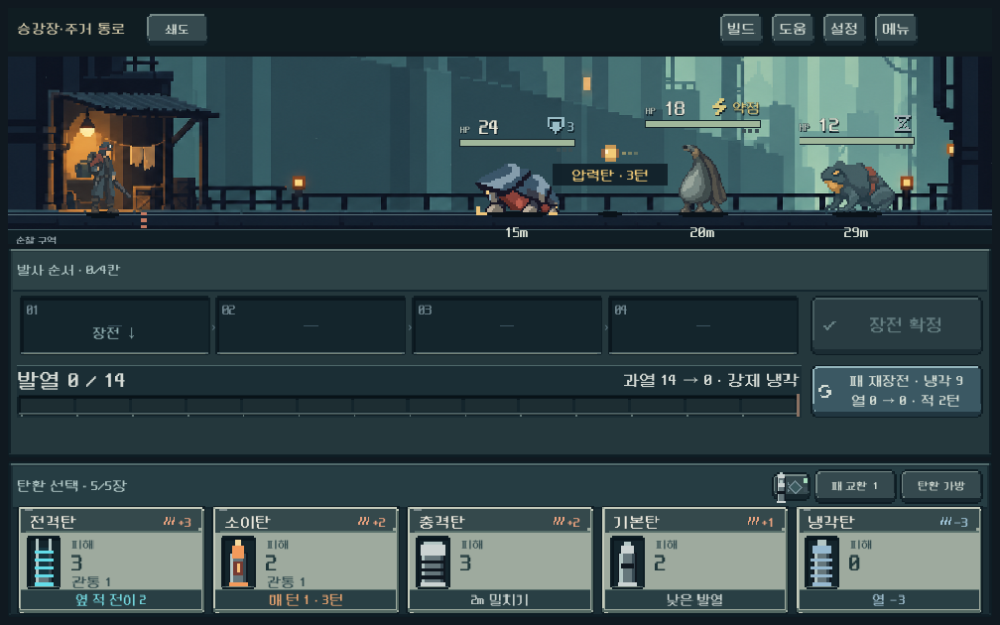
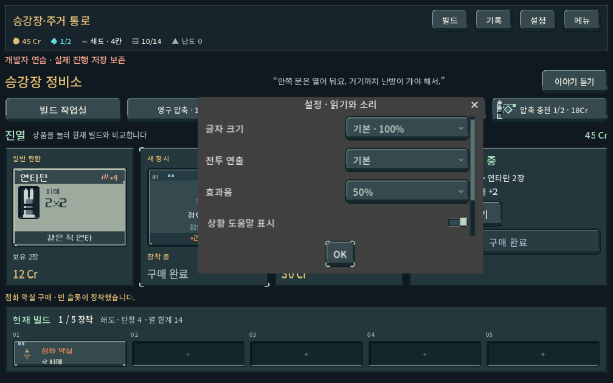
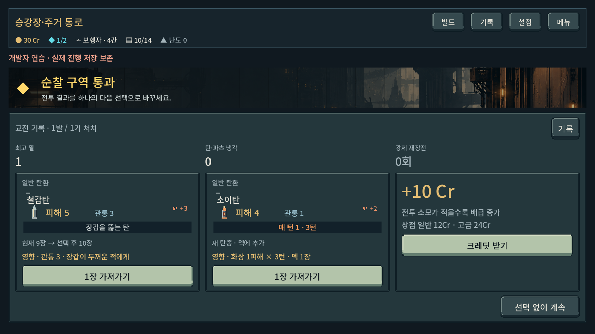

# 화면 전환·행동 효과음 검증

- 엔진: Godot4.7 / Windows / Compatibility / RTX4060Ti.
- 실행: `tools/run_presentation_feedback_checks.ps1`. APPDATA·LOCALAPPDATA·결과 모두 `qa_runtime/presentation_feedback/ui`에 격리. 본편 저장 쓰기 비활성.
- 신규258검사, 실패0. 최종 런타임 stderr 비어 있음. 가져오기 단계에는 기존 Android build-tools 안내가 있으며 이번에는 APK 생성하지 않았다.
- 최초 실행에서 빠른 페이지 왕복 후 해제된 버튼을 지연 포커스 인자로 전달하는 오류 발견. 인자 타입 변환 이전에 유효성 검사할 수 있게 수정한 뒤 같은 입력을 포함해 재검증했다.

## 확인한 범위

1. 메인→무기 선택, 빠른 메뉴 왕복, 전투→보상→맵, 상점의 실제 선택/구매. 전환 후 밝기 복귀, 반복 redraw에서 전환/보상음 중복 없음.
2. 1008×630 / 1280×900 / 1600×900에서 공개 조작으로 장전3회→확정→쇄도 발사→과열→강제 재장전. 삽입음3회, 확정1회, 과열/재장전 각각1회. 독립 Model과 최종 상태/RNG 동일. 전투 후 입력 복구.
3. 냉각탄의 실제 열 감소, 파쇄의 장갑 감소, 처치 후 보상음, 자발적 재장전 시작/완료음. 정상 구매1회와 거절/중복 구매 무음.
4. 음소거 즉시 정지, 저장 복원, 예전 설정 이행, 잘못된 값 거절/범위 보정. 설정 드롭다운에서50% 선택 시 삽입음 미리듣기.
5. 건너뛰기로 현재/이후 전투 소리 중단, 다음 행동 복구. 즉시 설정에서 전투음 생략·밝기100%. 재생 노드6개 유지.
6. 실제 Godot 믹서를 AudioEffectCapture로 캡처. 검사 중 Master만 음소거하여 작업자의 스피커로 QA음을 재생하지 않았다. 녹음은 음소거 전 전용 버스 출력이다. 최대 음량6개 동시 재생을 포함한 최대 진폭 **0.758118**(클리핑1.0 미만), 출력48kHz·1,170,432프레임. `qa_runtime/presentation_feedback/ui/actual_feedback_mix.wav` 보존.

12개 원본 WAV는44.1kHz mono16-bit, 각각45~380ms. `tools/build_feedback_audio.py`로 결정적으로 재생성하며 외부 샘플 없음. manifest에 파형 피크/해시 보존.

## 실제 화면 확인

작은 전투 화면의 기존 레일·발열·탄환 카드 위치 유지, 효과음 드롭다운 판독 및 조작 공간을 확인했다. 네이티브 대화창의 회색 외곽은 기존 잔재이며 이번 범위에서 디자인 완료 처리하지 않았다.

## 미검증

청감에 대한 사람 평가, 이어폰/Galaxy 스피커, 장시간 반복 피로도, 실기기 지연은 미검증. 파형 출력·이벤트 정합성 통과를 좋은 음질이나 재미의 증명으로 사용하지 않는다. BGM/환경음/적별 음색은 후속이다. 전체 기존 회귀검사를 재실행한 것은 아니다.

이번 변경 파일의 공백 검사 통과. 전체 작업 트리에는 이번에 수정하지 않은 `part_card_view.gd:235`의 기존 EOF 공백 경고가 남아 있다.
