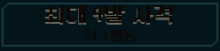

# 아트·전투 효과·UI 반응 통합 검수 1차

2026-11-06, 작업40번의 PC 통합 검수를 진행했다. 최신 본편 `redesign/main.tscn`을 네이티브 Godot4.7 Compatibility에서 실행했다. 사용자의 S26 플레이 테스트는 별도이며 이번에 APK를 다시 만들지 않았다.

## 발견한 문제와 수정

사격/장전/냉각 동안 버튼 배경은 어두운 비활성 상태로 바뀌지만, 자식 Label은 활성 상태의 글자색을 유지했다. 특히 사격 버튼의 검은 글자에 `MUTED`를 곱해 거의 보이지 않았다. `combat_hud_presenter.gd`의 입력 잠금 처리에서 기존 비활성 글자색 `56777a`를 직접 사용하고 자식의 색 곱을 해제했다. 행동이 끝나면 기존 `action()`이 활성 색으로 복구한다.

| 수정 전 실제 사격 중 | 수정 후 실제 사격 중 |
|---|---|
|  |  |

동일 시드/첫 전투의 실제 캡처에서 버튼 부분을 원래 픽셀 크기로 잘랐다. [전체 이전](before.png) · [전체 이후](after.png). 배치·버튼/카드 크기·클릭 영역·글꼴·행동 시간·전투 계산/저장은 바꾸지 않았다. 사격·냉각·탄창 교체·숨겨진 호환 확정 버튼에 같은 기존 비활성 표현을 사용한다.

## 실행한 검수

| 범위 | 결과 |
|---|---|
| 반복 생명주기 | 전류·불씨 이동·바닥 불길의 통제 상태를15회 교대로 실행. 실제 터치로 사격/메뉴/상세/즉시 설정을 거쳐 시작 화면으로 복귀.392검사 실패0 |
| 본편 전체 재생 | 기존에 획득/완주한 리액터·시드17·정예 경로의293개 입력을 재생. 전투는 실제 HUD 터치, 나머지는 본편 명령 처리.5구역·보상/상점/정비/관문을 거쳐 정상 복구 단계까지 도달.1,532검사 실패0 |
| 상태와 저장 | 끝난 캠페인/전투 전체 이력·난수/프로필이 원래 확정 기록과 정확히 같음. 격리 경로의 실제 자동 저장/다시 불러오기도 정확히 일치 |
| 실제 화면 | 1280×800,1170×540,1008×454를 지역별로 사용. 주요 HUD 경계·피해 표시 범위와 사격 중 글자의 실제 픽셀을 확인. [작은 전투 화면](narrow_impact.png), [상점](shop.png), [정비](workshop.png) |
| 기존 HUD 회귀 | `tools/run_prototype_hud.ps1 -Mode ui -Fast`:11,558검사 실패0 |

이번 전체 재생의 마지막 장면은 승리 직후 **정상 복구 연출**이다. 이후 귀환/결과창 전체 조작과 사람의 읽기 품질을 이번 재생에서 새로 검증했다고 표현하지 않는다. 기존 결과창 검수는 별도 근거로 유지한다.

## 반복 중 비용과 해석

- 같은 시작 화면으로 돌아온15회 모두 장면 노드55개, 부모 없는 노드0개, 남은 애니메이션 Tween0개였다.
- 즉시 설정으로 멈춰 있는 전장에서는 매 표본35프레임 동안 전장/숫자 레이어의 반복 재그리기가0회였다. 실제 모델/난수도 변하지 않았다.
- 워밍업 후 같은 시작 화면의 Godot 정적 메모리는91,592,135~91,630,627바이트였다. OS 전체 메모리나 기기 열 상태가 아니며, 이 표본만으로 장시간 메모리 누수가 없다고 보증하지 않는다.
- 전체 재생은 연출 속도를 검사 목적으로 줄였다. 프레임 간격 원본에는 화면 전환·자동 저장·캡처 비용이 섞여 있다. 자연 속도 플레이의 프레임 목표/입력 지연이나 S26 발열 개선 수치로 사용하지 않는다.
- GPU는PC RTX4060Ti다. Android의30분 지속 성능·백그라운드 복귀·발열과 사람의 효과 구별/반복 피로·소리 청감은 후속이다. [실기기 절차](../../protocols/mobile-sustained.md).

## 재현과 증거

`tools/run_presentation_integration.ps1 -Mode stress -Label fixed`와 `-Mode flow -Label final`을 사용한다. 테스트는 `qa_runtime/presentation_integration_20261106/`의 격리 저장에서만 실행한다. Flow는 `qa_runtime/boss_skills_20261106/heavy_elite/`의 실제 획득 상태·확정 입력·최종 저장을 재사용한다. Stress의 효과 상태는 통제 fixture이며 자연 플레이 결과가 아니다.

[반복 원본](stress_integration.json) · [본편 재생 원본](flow_integration.json) · [본편 로그](flow_stdout.log) · [HUD 로그](hud_stdout.log) · [해시/검증 범위](validation.json).

초안 검사에서 메뉴를 닫기 전에 뒤의 빌드 버튼을 누른 잘못된 터치 경로15건, 최종 기록의 장착 파츠를 전체 보유 파츠와 비교한1건을 검사기 문제로 분리해 보정했다. 최종 검사는 합법 입력 순서와 전체 캠페인/전투/프로필의 엄격한 비교를 사용하며 게임 동작을 우회하지 않는다. 원본은 `stress-before`/`flow-first`에 보존했다.

현재 결정: 입력 잠금 중 글자색 수정을 유지한다. 작업40번의 PC 통합1차를 기록하고 사람/S26 항목은 열어 둔다. 다음 독립 작업은41번 새 총기2종의 기존5종과 다른 운용·빌드 역할 비교다.
