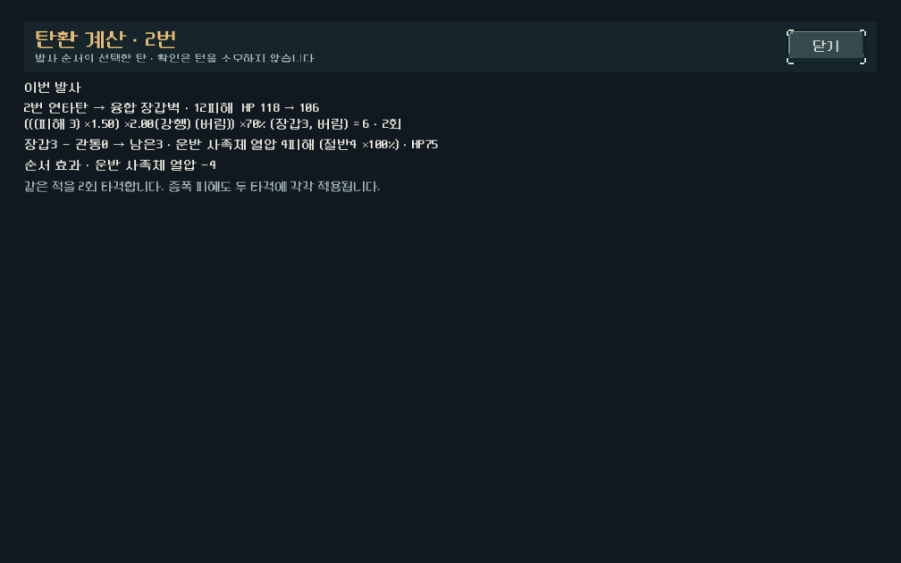

# 플레이 피드백 개편 3차 — 장갑·발열·강적 대응

2026-10-27. 사용자 “다음 작업 진행해 줘”에 따라 승인된 순차 개편을 구현했다. 적용 대상은 새 등반의 `combat_revision=2`다. 개별 수치는 디렉터 1차값이며, 사용자 난이도 체감 확정과 구분한다.

## 바뀐 선택

| 항목 | 이전 규칙1 | 새 규칙2와 목적 |
|---|---|---|
| 장갑 | 관통 후 남은 장갑만큼 고정 피해 차감 | 남은 장갑1마다 직접 피해10% 감쇠, 최대80%. 큰 피해에서도 관통·파쇄의 가치 유지 |
| 리액터 강행 | 과열 뒤 추가1장, 여전히 과열이면 기본 재장전+냉각2턴 | 추가 공격에만 직접 피해×2. 냉각탄으로 종료하는 선택과 화력 선택을 구분. 턴 비용은 유지 |
| 금형공 | 장갑1 | 장갑3 |
| 금형 파수꾼 / 주조 감독 | HP32/56, 장갑2/1, 3행동 축압 | HP28/48, 장갑3, 2행동 축압. 큰 전진 뒤1행동 정지는 유지 |
| 친위 중장병 | HP18~22, 장갑1 | HP16~20, 장갑3 |
| 친위대장 / 지배자 | 3행동마다 전진/차폐 최대치 회복 | 2행동마다 전진/차폐+1회. 빠른 지휘와 제한된 보충량을 함께 적용 |

정예·보스의 호위 수와 유한 증원, 차단·화상, 승리/엔딩 흐름은 유지한다. 1·3·4구역 고유 행동 주기는 유지하며 공통 장갑 계산만 새 규칙을 따른다. HP·장갑·속도를 한꺼번에 올리는 방식으로 처리하지 않았다.

장갑은 원피해의 배율 계산과 버림 뒤에 적용하고 다시 버린다. 주 타격/잔타는 최소1, 돌파 초과 전달/열압 충격파는 최소0이다. 화상·기폭·전이·래칫 집중의 고정 피해는 기존대로 장갑을 무시한다. 열압 충격파에는 공격탄의 관통을 전달하지 않으며 기존처럼 대상 장갑을 그대로 적용한다. 강행 배율은 추가 공격의 원피해에 한 번만 적용하고 지원탄을 공격으로 바꾸지 않는다.

## 실제 계산으로 확인한 차이

- 리액터의 위력3 기본탄+시퀀서 증폭+돌파 코어는 장갑 적용 전18피해다. 장갑3에서 기존15→새12피해, 같은 조건의 철갑탄은18피해를 유지했다.
- 원피해18로 HP10 표적을 처치한 초과8피해는 다음 표적의 장갑3을 만나5피해다. 돌파/강행 배율을 재적용하지 않는다.
- 주조 감독 거리70m, 리액터 열13에서 `[기본탄, 기본탄]`은 강행/강제 냉각까지5턴, 피해3, 종료 거리58m였다. `[기본탄, 냉각탄]`은1턴, 피해1, 거리69m였다. 두 경우 모두 예측·실제·저장 복원이 일치했다. 이는 합성 조건의 선택 비용이며 사람 체감 평가가 아니다.
- 대표3빌드162조건도 재계산했다. 성장8/장갑5/맞춤 파츠에서 선택 탄의 피해는 연쇄55→50, 돌파57→57, 열압41→38이었다. 돌파의 철갑 조합은 장갑을 뚫고, 관통이 부족한 큰 타격은 감쇠된다. 낮은 원피해에서는 비례 감쇠가 기존 고정 차감보다 약할 수 있다.

## 기능·호환·화면 검증

Godot 4.7, 격리된 `qa_runtime/` APPDATA/LOCALAPPDATA에서 실행했다. 사용자 저장에 접근하거나 APK를 생성하지 않았다.

| 검사 | 결과 |
|---|---|
| 새 장갑/강행/잔타/초과/충격파/차단/보스 주기/예측/저장/개발 미리보기 | 449검사 실패0 |
| 이전 파츠 규칙1 집중 회귀 | 290검사 실패0 |
| 이전 친위대 규칙 회귀 | 1,775검사 실패0 |
| 기존 이력·예측·저장 회귀 | 273검사 실패0 |
| 대표 빌드 새 규칙2 | 162조건/756검사 실패0 |
| 대표 빌드 이전 규칙1 | 162조건/756검사 실패0, 앞 단계 보존 결과와 모든 행 동일 |
| 실제 UI | 1008×630/1280×800, 136검사 실패0 |

UI는 실제 버튼 입력의 장전/확정/사격, 화면의 예측과 실제 적 상태, 강행/장갑 상세, 보스 행동 예고, 개발 메뉴의 실제 진입, 출발 장비 설명을 확인했다. 17장 렌더 중 대표 화면을 직접 열어 작은 화면의 줄바꿈·잘림을 확인했다. 모바일 실기기 FPS와 사람 이해도 테스트는 하지 않았다.

[출발 장비 설명](assets/pressure_revision_2026-10-27/reactor_equipment_1008.png) · [주조 감독 행동 상세](assets/pressure_revision_2026-10-27/foundry_1008_detail.png) · [지배자 행동 예고](assets/pressure_revision_2026-10-27/central_1008_intent.png)

테스트 작성 중의 예상값 오류(위력3 탄을 다른 기본 피해로 가정)와 닫기 버튼 이름 오류는 시험 코드를 수정해 재실행했다. 최종 실패0 기록을 기준으로 한다. Windows 루트 인증서 읽기 경고는 있었으나 파싱/스크립트 오류는 없었다.

기존 저장 규칙0/1과 새 규칙2를 구분한다. 미래 규칙 번호, 캠페인/전투 번호 불일치, 규칙1에 새 지도자 메타데이터를 섞은 저장은 거부한다. 지도 진입 전 적 정보도 실제 편성과 같은 규칙 번호를 사용한다. 개발 메뉴의 주조장/중앙 테스트는 보존된 획득 덱에 현재 규칙을 명시적으로 적용하는 화면 검사용이며, 그 덱을 새 규칙으로 획득했다는 증거로 쓰지 않는다.

## 실제 등반

시드731042, 운반 복장, 난도0, 정예 경로에서 다섯 무기의 새 등반→5구역 엔딩 경로를 확인했다. 모든 행동은 실제 캠페인 명령과 저장/복원을 거쳤다. 첫 보상 고정 정책, 탄종만 맞추는 정책, 소유 파츠까지 장착하는 정책을 구분한다. 탐색은 미래 손패/RNG를 참조하므로 인간 승률로 해석하지 않는다.

| 무기 / 정책 | 이전 규칙1 총 전투 턴 | 새 규칙2 총 전투 턴 | 새 최종전 턴 / 잔탄 / 최소 접근 거리 |
|---|---:|---:|---|
| 리벳 / 첫 보상 고정·초기 자동 장착 유지 | 104 | 103 | 9 / 17발 / 24m |
| 래칫 / 동일 정책 | 227 | 230 | 17 / 10발 / 17m |
| 스플린터 / 동일 정책 | 185 | 180 | 13 / 9발 / 19m |
| 스파이크 / 동일 정책 | 125 | 128 | 12 / 20발 / 16m |
| 리액터 / 이전은 탄종 맞춤, 새 경로는 탄종+소유 파츠 장착 | 271 | 284 | 21 / 8발 / 4m |

앞 네 무기의 전투 규칙은 강행 배율을 ×1.50→×2로 바꾸기 전후 동일하다. 해당 로그는 초안 리액터도 함께 실행해 총15,639검사 중 경로 실패2건이 남은 기록이며, 전체 실패0로 표기하지 않는다. 리액터의 최종 장착 경로는 **27전투, 4,905검사 실패0**다. 파츠는 `열압·후미·파쇄·장전·보급`을 최종적으로 장착했으며, 이미 획득한 재고를 지도에서 합법적으로 바꿨다. 본편에 자동 장착 최적화 기능을 추가한 것은 아니다.

리액터의 이전 최종전은20턴/잔탄1/최소거리20m였다. 새 장착 경로는 탄약 여유가 늘었지만 접근 여유가 줄었고,4구역 일반전에서 최소1m,4구역 보스에서 잔탄1발인 구간도 있었다. 장착 정책과 전투 경로가 달라 순수한 수치 변경의 효과로 단정할 수 없다. 모든 경로가 안정적이라는 결론은 내리지 않는다.

### 비교 중 확인한 한계

- 강행×1.50 초안에서 첫 보상 고정 리액터는2구역7층, 탄종 맞춤/초기 장착 유지 시드731042는 최종전에서 제한 탐색 실패했다. 같은 탄종 정책의 시드17은 엔딩/최종전 잔탄9발로 통과했다.
- 최종 강행×2에서도 탄종만 맞추고 초기 냉각·보급 파츠를 유지한 시드731042는 최종전 제한 탐색 실패였다. 배율 증가만으로 실패한 경로를 해결했다고 주장하지 않는다.
- 같은 최종×2/탄종 정책의 시드17은 엔딩, 최종전14턴/잔탄10발/최소거리18m로 통과했다. 두 시드 합산8,851검사 중 실패2건은731042의 전투 경로/전체 엔딩 조건이며, 기능 검증 실패0와 구분한다.
- 이전에 이겼던 최종전 명령을 실제 새 상태에서 다시 실행해도 적이 남았다. ×1.50/×2 비교와 소유 파츠 장착 경로를 함께 보존했다. 제한 탐색 실패는 수학적 불가능 증명이 아니다.
- 검증기의 기존 명령 재사용은 현재 상태에서 합법성과 실제 승리를 다시 확인한 경우에만 허용한다. 실패하면 새 탐색으로 돌아간다. 숫자/탄약/적 HP를 맞춰 넣지 않는다.

## 증거와 재실행

- 집중: `powershell -NoProfile -ExecutionPolicy Bypass -File tools/run_playtest_revision_checks.ps1 -Mode pressure -Tag final`
- UI: 같은 명령의 `-Mode pressure_ui -Tag final`
- 빌드 비교: `-Mode builds -Tag pressure -Revision 2`, 이전 규칙은 `-Tag pressure_legacy -Revision 1`
- 전체 경로: `tools/run_central_live_checks.ps1 -Mode balance -Seeds 731042 -Tag pressure_first -Revision 2`
- 리액터 탄종 선택 정책: 같은 명령의 `-Guns heavy -Seeds 731042,17 -Acquisition fit -Tag pressure_fit_double -Revision 2`
- 리액터 소유 파츠 장착: 같은 명령의 `-Guns heavy -Seeds 731042 -Acquisition build -Tag pressure_build -Revision 2`

`pressure_fit_heavy`는 강행×1.50 초안 실행 이력이며 현재 기본 명령은 최종×2를 실행한다. 두 후보의 로그를 섞지 않는다.

보존 자료는 [증거 폴더](assets/pressure_revision_2026-10-27/). 실행 당시 로그·JSON·대표 화면·최종 소스 해시를 함께 둔다. 현재 방향은 [피해 계산](../../direction/damage-growth.md), [무기](../../direction/weapon-design.md), [2구역](../../direction/monster-roster.md), [5구역](../../direction/central-enemies.md)에 반영했다.

## 남은 판단

전체 피드백 개편의 완료는 아니다. 획득 기회·가방/탄창 역할·탄약 고갈 대응은 다음 단계에서 선택 가치와 함께 비교한다. 거리순 배치, 도트 화면 읽기, 관문 사건 장면은 후속이다. 이번 수치는 자동 검증에 기반한 첫 적용이며 사람 체감과 Galaxy 확인은 남아 있다.
