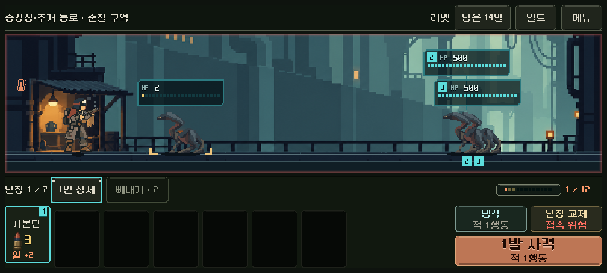
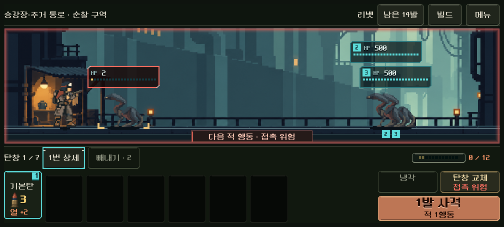
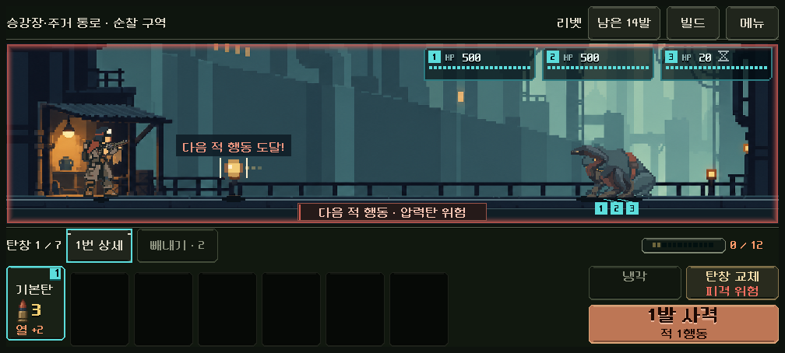

# 전투 근접 경고

행동을 선택할 때 전장 외곽에 위험을 표시한다. 추가 공격·밀치기·요격을 가정하지 않고, 현재 적과 압력탄에 실제 적 행동을 적용한 결과를 사용한다.

- 두 번째 적 행동에 도달하면 외곽에 옅은 붉은 선을 그린다.
- 다음 적 행동에 도달하면 외곽을 더 진하게 그리고 `다음 적 행동 · 접촉 위험` 또는 `다음 적 행동 · 압력탄 위험`을 표시한다.
- 사격·냉각 등 행동 연출이 끝나면 최신 전투 상태로 갱신한다. 처치 또는 요격으로 도달 위험을 제거하면 경고가 사라진다. 깜빡임과 화면 흔들림은 없다.

실제 전투 화면에서 1280×800과 1008×454의 냉각·사격·요격, 경고 강도 차이와 HP·증원 표식 분리를 확인했다. 규칙 검사는 감속, 지원 끌어당김, 보스 돌진과 회복, 화상으로 인한 접근 취소, 압력탄 비행 순서를 포함한다. 모바일 실기기 확인은 별도다.

- 접근·위협 규칙 2,045개와 본편 전투 화면 73개 통과.
- 기존 라인 테마 전투 HUD 검사 11,558개와 빌드 규칙 643개 통과.
