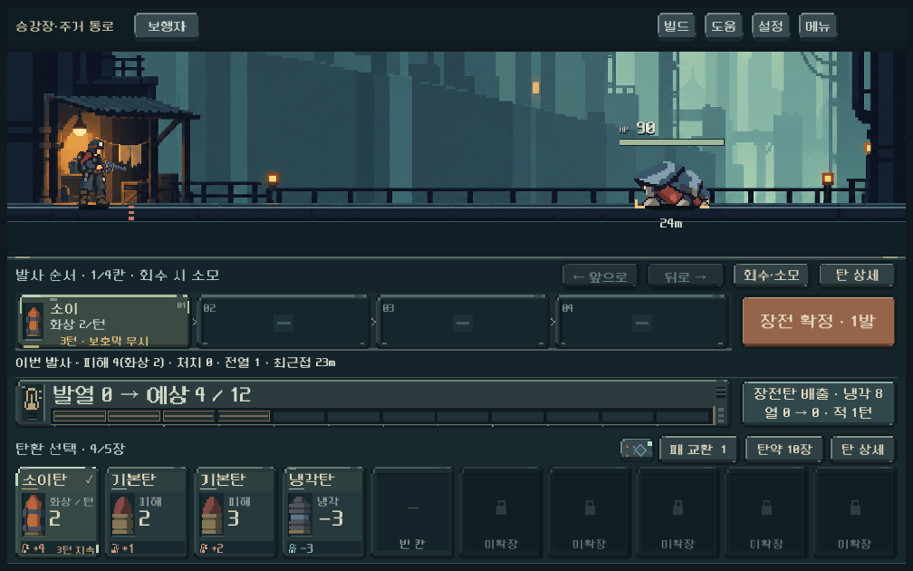
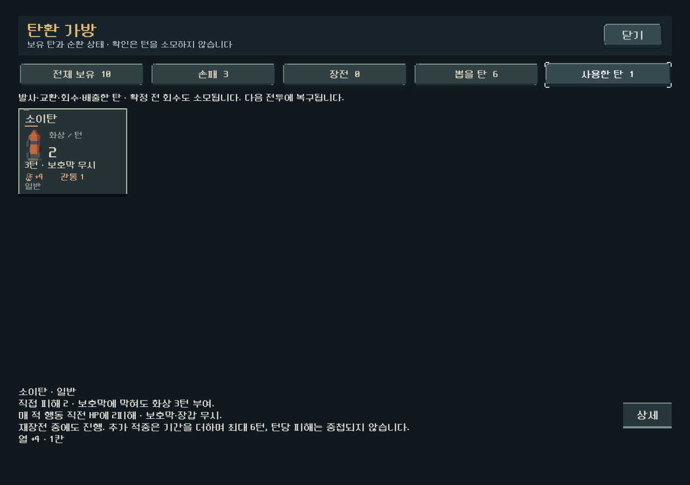
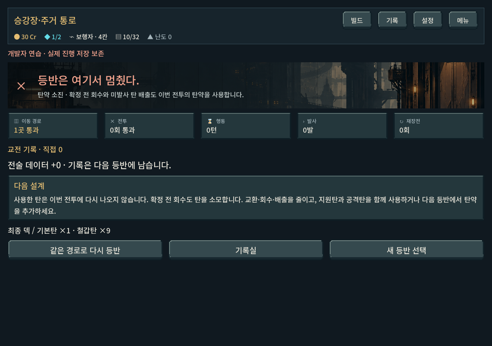

# 확정 전 회수 비용 — 2026-10-21

이 문서는 당시 개별 회수 시 소모안의 구현 기록이다. 이후 사용자가 승인한 [개별 회수 금지·전체 재장전 배출](load_commit_2026-10-21.md)로 대체되었으며 현행 규칙은 아니다.

사용자 피드백: 확정 전 취소도 잘못된 판단의 대가가 필요하다. 전날 무료 편집 결정에서 **삽입 후 회수**를 유료 행동으로 바꿨다. 활성 `prototype/core-redesign`, 기준 HEAD `197c6941`. 기존 소이탄/탄약/복장 변경이 미커밋 상태였으며 보존했다.

## 적용

- `reserve_version=1` 등반은 확정 전 회수도 선택한 카드를 이번 전투 사용함으로 보낸다. 즉시 대체 탄은 없고 다음 전투에 복구된다.
- 임시 압축탄은 원본2장을 사용함으로 보내며 압축 기회를 반환하지 않는다.
- 미확정 상태에서 재장전을 눌러도 이미 삽입한 탄을 사용함으로 보내므로 비용 우회가 없다. 장전하지 않은 손패는 보존한다.
- 순서 이동과 상세 확인은 무료다. 추가 회수 횟수/발열/적 행동 벌점은 겹치지 않았다.
- 비축 규칙으로 시작한 기존 이어하기도 적용한다. 비축 도입 전 저장과 훈련은 기존 무료 취소/압축 복원을 유지한다.
- 삽입 전부터 제목에 `회수 시 소모`, 버튼에 `회수·소모`, 미확정 재장전은 `장전탄 배출`로 표시한다. 버튼 설명에서 일반1장/압축2장을 구분하고 사용함/도움말/압축 안내/패배 설명을 갱신했다.

소모 방식과 강도는 디렉터 적용안이다. 사용자가 요청한 것은 확정 전 취소의 리스크이며 이번 구체적 방식의 재미를 승인한 것으로 보지 않는다. [현행 규칙](../../direction/ammo-reserve.md).

## 발견한 저장 결함

마지막 탄을 회수한 뒤 캠페인을 저장/복원하는 검사에서 실패했다. `Campaign.save()`가 비전투 화면의 더미를 정리하면서 탄약 소진 패배에도 손패/뽑을 더미를 다시 채웠고, 모델의 소진 상태 검사와 모순됐다.

탄약 소진 패배는 실제 마지막 전투 상태를 그대로 저장하도록 수정했다. 회수로 소진한 경우와 마지막 발 발사로 소진한 경우 모두 모델/캠페인 저장 복원을 확인했다. 다른 보상/정비 화면의 더미 정리는 유지한다.

## 검증

Godot4.7. `qa_runtime/reserve`, `qa_runtime/heat`의 APPDATA/LOCALAPPDATA를 사용한 격리 검사다. 사용자 저장을 덮어쓰지 않았다.

| 검사 | 통과 / 실패 | 확인 |
| --- | ---: | --- |
| 비축 규칙 | 658 / 0 | 동일탄 사본 보존, 반복 취소 차단, 순서 이동 무소모, 무효 입력 원자성, 일반/임시 압축 회수, 재장전 우회, 마지막 탄/남은 화상, 이전 저장, 진행 중/패배 캠페인 저장 복원 |
| 실제 UI | 603 / 0 | 1008×630/1280×900/1440×630, 터치 장전→회수→사용함, 압축2장, 버튼/배출 문구, 탄약 소진 화면과 저장 복원. 기존 비축 UI 흐름도 포함 |
| 발열 규칙 | 917 / 0 | 기존 열 한계/사격/강제 냉각 회귀 |

총2,178검사 실패0. [규칙 로그](assets/recall_cost_2026-10-21/rules.log), [UI 로그](assets/recall_cost_2026-10-21/ui.log), [발열 로그](assets/recall_cost_2026-10-21/heat_rules.log). `git diff --check` 통과.

초기 새 테스트의 GDScript 타입 추론/로컬 라벨 접근 오류는 테스트 코드에서 교정했다. 저장 회귀는 위 실제 결함으로 별도 수정했다. JSON 복원 전후 비교는 숫자 직렬화 타입을 정규화한 뒤 모든 상태 값을 대조했다.

## 실제 화면

첫 두 화면에서 작은 화면의 문구/입력 영역/사용함 표시를 육안 확인했다. 재현용 덱/적을 설정한 뒤 실제 UI로 조작한 장면이며 본편 첫 전투의 덱/적 구성 자체를 보여주는 화면은 아니다.

## 한계

규칙과 전달의 동작을 검증했다. 판단의 긴장감이 실수에 대한 불편보다 큰지, 지원탄을 시도하는 행동이 과도하게 위축되는지는 사람 플레이 확인이 필요하다. Galaxy 실기기·전체 캠페인 승률은 이번 범위에 포함하지 않았다. APK/커밋/푸시 미수행.
