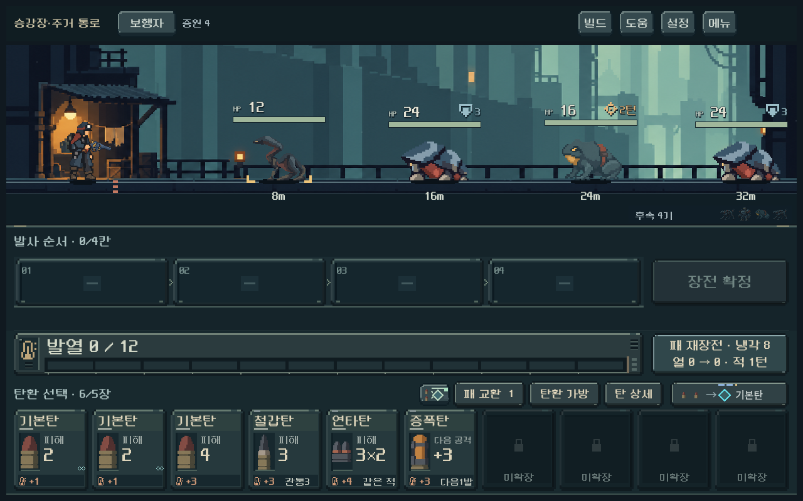

# 후속 표시를 전장 우측 하단으로 이동

- ‘후속 N기’와 대기 몬스터 아이콘을 전장 오른쪽 끝, 거리 표시 아래로 옮겼다. 상세를 여는 클릭 영역도 함께 이동했다.
- 전장 내부 마지막30px를 고정 상태 줄로 사용한다. 바닥/배우/거리 기준선을 함께 올려 겹침을 피하며, 증원4→1→0기에서도 배우·전체 전장·카드 위치는 동일하다. 전투 규칙과 전체 화면 높이는 유지한다.
- 첫 단순 수평 이동에서는 실제 몬스터와 겹치며 현재 적 상세가 열리는 문제를 확인했다. 독립된 하단 줄로 수정해 해소했다. 검수 스크립트의 닫기 경로도 기존 일반 대화창의 `DialogClose`로 바로잡았다.
- `qa_runtime/reserve_position/capture.ps1`:1008×630/1280×800/1440×630의 실제 GPU 화면·터치. 처음/마지막 대기 몬스터 상세, 거리 비중첩, 수 감소/소진 시 배치 고정 **124검사 실패0**. 사용자 저장은 격리 및 비활성.
- `tools/run_finish_zoom_checks.ps1`: **456검사 실패0**,25% 줌/약2.5초/가장자리·동시 처치·건너뜀·속도 설정·HUD 고정 유지. 이번 검증 합계580검사 실패0. 기존 적 HUD 검사의 하드코딩된 왼쪽 사각형도 현행 배치 함수로 갱신했으며 이 전체 검사는 이번에 별도 실행하지 않았다.
- 모델·탄환 콘텐츠·캠페인 해시 동일. Galaxy 실기기는 확인 전. APK·커밋·푸시 없음.

[작은 화면](reserve_position_2026-10-18/reserve_1008.png) · [넓은 화면](reserve_position_2026-10-18/reserve_1440.png) · [후속1기](reserve_position_2026-10-18/one_1280.png)
