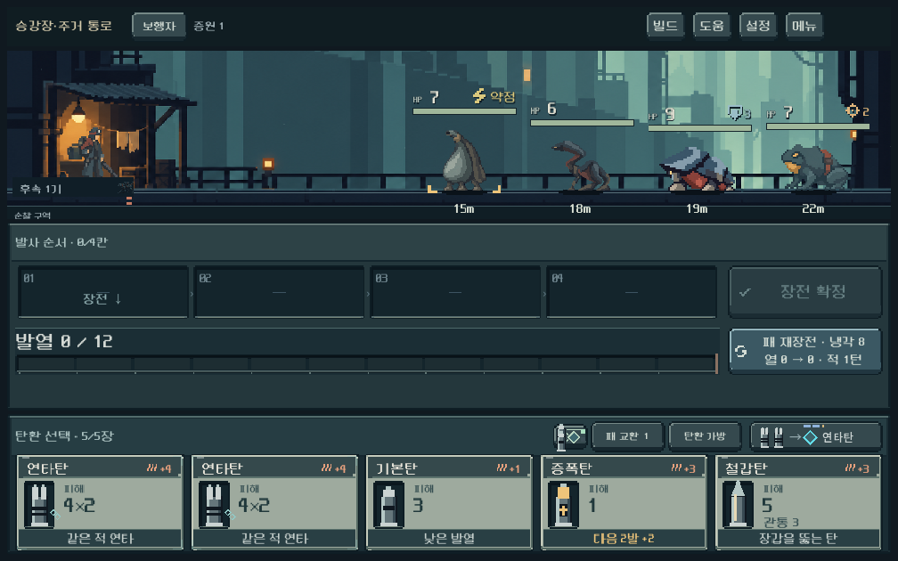
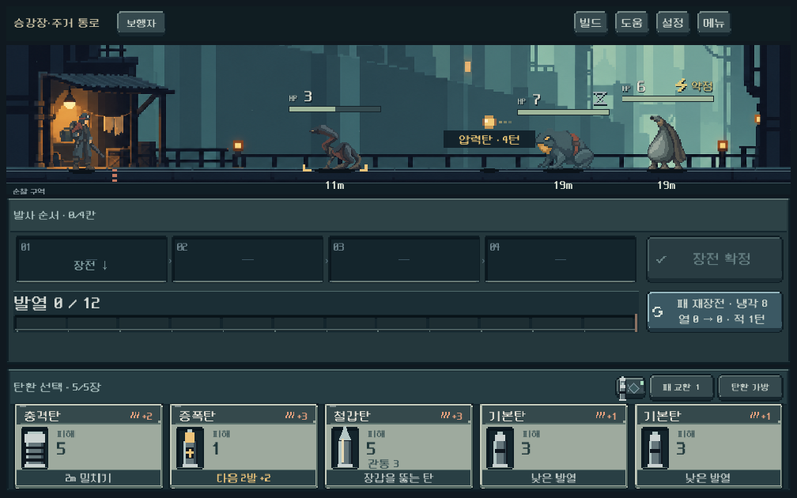

# 첫 지역 생물 본편 적용 · 2026-10-11

## 구현과 실행

`PLAY.cmd` → **새 등반** → 첫 지역 `승강장·주거 통로`. 개발 메뉴의 시안 화면이 아니라 본편 전투에서 새 생물이 나온다. 중간 저장에는 기존 편성을 유지하므로 이어하기에는 소급 적용되지 않는다.

- 새 등반 `roster_version=2`. 마커 없는 저장은1. 기존 활성 전투의 적·탄환 순서·RNG를 바꾸지 않는다. 이후 교전과 지도 상세도 같은 버전의 편성을 사용한다.
- 첫 지역은 숨접이(접근), 처마등(장갑), 빗주머니(전기 약점), 압력두꺼비(원거리) 네 생물로 한정했다. 장갑·약점·발사 준비는 기존 모델과 HUD의 실제값이다. 다른 지역의 역할·편성은 그대로다.
- 초입 접근 → 장갑 → 전기 약점 → 원거리 → 혼합/증원 → 관문. 경로에 따라 일부 전투는 우회 가능하며, 일반 전투에서 못 만난 종도 관문에서 만날 수 있다. 초반 배리어는 제거했다.
- 관문은 `둥지 처마등`과 네 역할의 혼합. **별도 보스 원화·신규 전용 패턴은 아직 없다.** 네 역할을 종합하는 첫 지역 관문이다.
- 처마등4키포즈와 두꺼비2상태를 실제 턴 이벤트에 연결. 숨접이의 접힌 몸/도약 준비·빗주머니의 무거운 집수기관에 접지된 이동·피격·접촉 반응을 적용했다. 새 두 종은 기존 원화의 절차형 동작이며, 독립 프레임 애니메이션 세트 제작 완료를 뜻하지 않는다.

## 시각 확인

Godot4.7 실제 렌더. 물리 창1008×630,1280×900,1440×630. 프로젝트의 논리 해상도/스트레치 설정 유지. 첫·장갑·약점·원거리·혼합·관문6편성을 세 크기에서 캡처했다.

작은 화면의 생물 실루엣, 발 접지, HP/장갑/전기 약점, 거리, 발사 준비와 압력탄을 확인했다. 순차 재장전 후 상태와 실제 모델 일치. 접촉 시 두 새 종도 반응하고 즉시 연출에서도 결과가 일치한다.

## 기능 검증

`tools/run_residential_checks.ps1 -Mode rules|ui|campaign`

| 범위 | 결과 | 실제 검사 내용 |
| --- | --- | --- |
| 규칙·저장·선택 비교 | 4,162 / 실패0 | 5시드의 생성 노드/위험 경로, 전열4상한·증원, 상위 지역 기존 편성 동일, 마커 없는 저장/부분 장전 저장, 예측 순수성·실전 일치 |
| 실제 UI | 475 / 실패0 | 3크기×6편성, 본편/개발 분리, 지면·머리 위 정보·거리 순서, 실제 터치 장전/발사/재장전, 생물 상세, 두꺼비 발사, 접촉/즉시 연출 |
| 캠페인 명령 재생 | 4,407 / 실패0 | 총기5종×시드731042·17, 첫 지역8지점과 관문 도달. 전투·보상·상점·경로를 실제 명령으로 진행하고 매 명령 원자 저장/복원 |

총 **9,044검사/실패0**. 실제 Galaxy/주관적 재미 검증은 별도다. 캠페인 탐색기는 미래 덱/RNG를 볼 수 있는 제한 탐색이므로 10/10은 **재현 가능한 통과 경로**의 증거이고 사람 승률이 아니다. 산개의 예측분포/모든 무작위 결과를 보장하는 주장도 아니다.

## 선택 가치 비교와 조정

[실제 계산 기록](residential_campaign_2026-10-11_assets/choices.json)

- 보행자, 장갑3 처마등: 기본탄1피해 / 철갑탄5피해.
- 보행자, 전기 약점 빗주머니: 기본탄3피해 / 전격탄 주 타격7피해. 무기 보너스가 포함된 실제값이며 모든 총기의 고정 피해가 아니다.
- 실제 후반 편성, 같은 네 장과 시작 열2: **발사 순서** `고열탄 → 연타탄 → 철갑탄 → 냉각탄`은3발 후 과열, 총3적 턴·강제 재장전1회·압력탄 발생. `고열탄 → 냉각탄 → 철갑탄 → 연타탄`은4발·1적 턴·열11·강제 재장전 없음. 두 경우2처치이나 남는 시간/위험이 다르다. 장전 입력은 이 순서의 역순이다.
- 최초 관문은 HP총42/선두 장갑3과 원거리 압력을 함께 올렸다. 산개/731042에서 탐색500→1500후에도 통과 경로를 찾지 못했다. 이는 불가능의 증명은 아니지만 첫 지역 신규 규칙 소개에 과도한 부담으로 판단했다.
- 최종 관문은 HP총35/선두 장갑2로 조정했다. 새 원거리 압력은 유지하고 원래 관문의 선두14HP/장갑2를 유지한다. 조정 후5총기2시드 전부 도달했다. 수치 원본은 `residential_roster.gd`다.

## 남은 검증

- 사람 플레이에서 종별 대응을 설명 없이 기억하는지, 탄환 선택/냉각 순서가 과도하게 정형화되는지.
- 모든 시드·위험 경로·난도·파츠 조합의 균형. 현재5시드 편성 검사는 난도0이며 통과 검사는2시드 기본 보급/안전 경로다.
- Galaxy 터치/화면·종별 독립 동작 프레임·관문 전용 외형/패턴·상위 지역 고유 몬스터.
- 이번 작업은 기존 승인 방향의 자산을 재사용했다. 새 이미지 생성·APK·커밋·푸시 없음.
