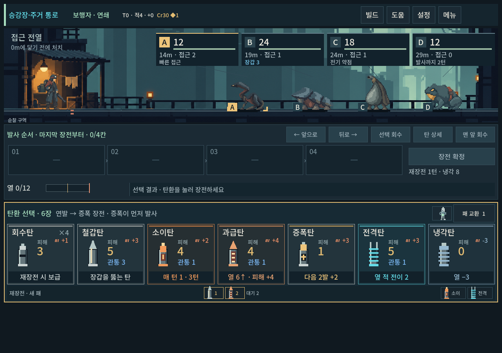
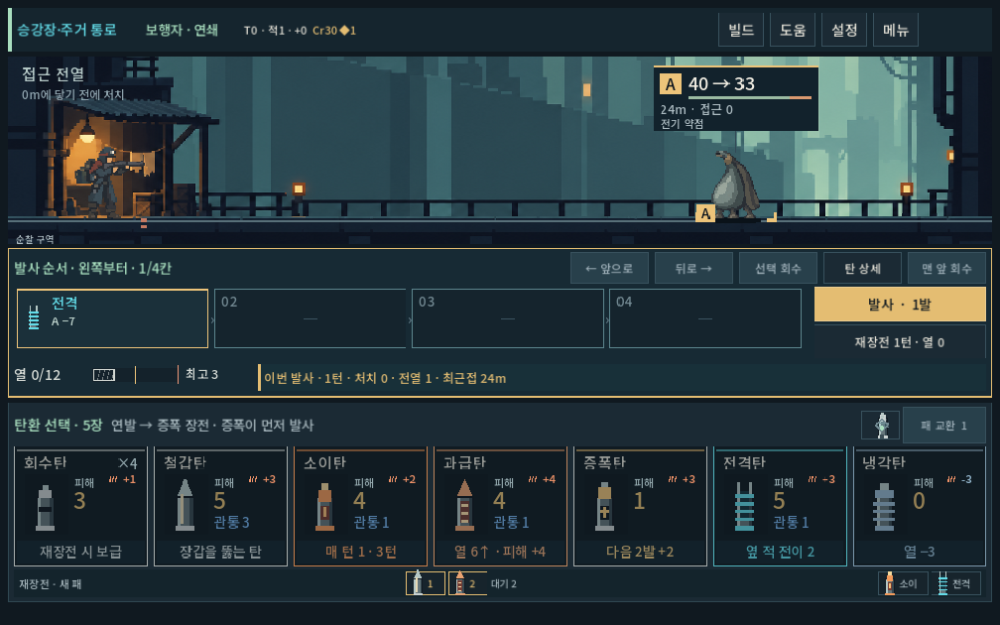

# 주거 통로 생물 시안 — 숨접이·처마등·빗주머니

2026-10-09 · 사용자 처마등 긍정 평가 후 두 역할의 후속 시안 제작. 새 이름·설정·개별 그림은 디렉터 제안이며 사용자 확인 전이다.

## 컨셉과 역할

| 가칭 | 기억할 형태와 생활 설정 후보 | 연결한 기존 역할 |
|---|---|---|
| 숨접이 | 긴 목을 접고 큰 뒷다리로 버티는 가는 몸. 따뜻한 배관 틈을 오가던 생물 | runner: 빠른 접근, 무장갑. 새 도약 공격/목 펴기 규칙은 미구현 |
| 처마등 | 낮고 넓은 겹등판, 아래에 숨은 연한 몸 | wall: 지속 장갑. 이전 승인 이미지 유지 |
| 빗주머니 | 큰 물주머니가 처진 세로형 몸통과 짧은 세 발. 집수·여과를 돕던 생물 | evader: 기존 전기 약점+2. 회피/새 물 속성 없음 |
| 압력두꺼비 | 둥근 몸과 부푸는 목 | 기존 준비·압력탄·요격. 이번에 그림을 바꾸지 않음 |

낯선 생물의 구성안을 같은 화면에서 비교하려는 단계다. 첫 구역의 최종4종·정예·보스 편성이나 캠페인 출현 목록을 확정한 작업이 아니다. 처마등의 사용자 긍정 평가는 그림의 기준으로 기록하며 숫자/설정까지 승인으로 확대하지 않는다.

## 플레이

`PLAY.cmd → 개발 → 몬스터 시안 · 주거 통로`. 개발 메뉴를 아래로 스크롤하면 나온다. 기본 배치는 숨접이12HP/접근2, 처마등24HP/장갑3/접근1, 빗주머니18HP/전기약점/접근1, 압력두꺼비12HP다. 기존 탄환으로 장전·사격·재장전할 수 있다. 수치와 시작 거리는 그림/조작 검토용이며 새 밸런스로 확정하지 않았다.

기존 `몬스터 시안 · 처마등`도 유지한다. 시안은 개발 캠페인 메타데이터로만 선택하며 본편 공통 아트·저장·편성은 변경하지 않는다.

## 실제 화면

작은 화면에서 숨접이의 목 아래 빈 공간/가는 다리, 처마등의 수평 겹판, 빗주머니의 밝은 세로 몸통을 구분할 수 있다. 배경과 승인 주인공의 큰 색면을 유지했고 외부 광륜이나 명찰 겹침은 보이지 않았다. 새 두 이미지의 생물다운 매력/낯섦과 형태 선호는 사용자 확인이 남는다. 새 프레임 애니메이션 없이 기존 절차형 접근/피격을 사용한다.

## 제작과 검증

내장 image_gen에 승인 주인공·처마등·배경3장을 실제 참조로 넣고 자산별1회씩 생성했다. 이번 두 자산은 추가 재생성 없이 적용했다. 이는 한 묶음의 관찰이며 앞으로 모든 생성이 한 번에 성공한다는 보장은 아니다.

[선택 PNG·입력·전체 프롬프트·해시](../../../새-게임-프로젝트/assets/art/monster_concept_20261009/family-provenance.json). 두 PNG는1254×1254 RGBA이며 원본과 바이트 일치. Godot에서 내용 영역과 발 기준을 맞춰 숨접이84×72, 빗주머니62×88 논리 크기로 표시한다. 고정 논리 격자나 엄격한 색 개수를 보장하는 자산은 아니다.

`tools/run_eavesback_checks.ps1 -Mode family`: **221검사/0실패**, stderr 비어 있음. 실제1280×900·1008×630·1440×630, 공개 개발 메뉴 터치 진입·장전/발사/재장전·네 적 클릭 영역/접지/명찰 간격·기존 원거리 공격체 확인. 전기 약점 유무만 바꾼 대조 모델보다 빗주머니가 정확히2 추가 피해를 받으며 실제 표시 상태와 결과가 일치한다. 기존 단독 시안/일반 본편으로 전환 시 새 시안이 남지 않는 것도 확인했다.

[검사 로그](residential_creatures_2026-10-09_assets/stdout.log) · [오류 로그](residential_creatures_2026-10-09_assets/stderr.log). 격리 저장과 save_enabled=false를 사용했다. 자동 검사는 재미·새 몬스터 설정 승인·모바일 기기 검증을 대신하지 않는다. APK·커밋·푸시 없음.
