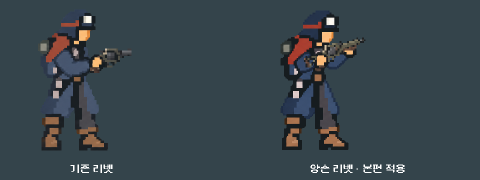

# 리벳 양손형과 화풍 대표 비교

2026-11-06. 사용자 요청의33번 대표 화풍 비교와42번 리벳 양손형을 진행했다. **양손 리벳은 본편 장비 선택/전투에 적용했다.** 다른 자산 전체의 화풍 통일이나 전투 VFX 완료를 뜻하지 않는다. 외형의 사용자 미감·Android 실기기 확인은 남는다.

## 선택한 결과

기존 리벳의 올리브 프레임·회전 약실·상아색 수리판을 유지하고 짧은 개머리판과 앞손 파지부를 붙인 카빈으로 제작했다. 기존7복장의 장총 자세를 재사용하고 새 이미지에서 뒷손/앞손·총구·열 표면·인출 약실을 등록했다. 본편의 `single` ID, 능력/발수·발열/경제/저장 계산은 유지한다.

[본편 실제 전투](battle_production.png) · [작은 창1008×454](preview_1008x454.png) · [장비 선택](equipment_work_single.png) · [7복장/6자세 비교](poses/)

## PixelOE 비교의 판단

새 리벳·작업복 장총 아틀라스/대기 원화·승인 배경에 약한/강한2처리를 적용해8후보를 만들었다. PixelOE는 고정 버전1.0.1 CPU를 사용했다. RGB의 투명 여백을 가장 가까운 불투명 색으로 채워 검정 오염을 줄이고, 처리 후 **원본 캔버스와 알파를 그대로 복구**했다. 8출력의 크기/알파 바이트가 원본과 같고 소스도 변경되지 않았음을 대조했다. 이 경로가 모든 투명 애니메이션의 색/연결감을 보장하는 것은 아니다.

| 안 | 실제 크기에서 관찰 | 채택 |
|---|---|---|
| 원화/기존 몸체·배경 | 이미 큰 색면이 있으며 작은 총의 내부 묘사만 조금 조밀함 | 몸체/배경 유지 |
| 약한 처리 전체 | 배경의 완만한 색면에 얼룩/점 무늬와 계단 경계가 생김 | 전체 적용 제외 |
| 강한 처리 전체 | 얼굴/손·바지의 색 덩어리가 거칠어지고 건축/등불 형태도 약해짐 | 제외 |
| 총기만 약한 처리 | 리벳의 작은 반짝임을 줄이면서 약실/그립·개머리판이 남음 | 리벳에만 적용 |

선택한 리벳은96×32/40색/윤곽 확장0 후보를 원본2172×724 캔버스로 내보낸 것이다. 기존 알파/손 등록을 유지하며 실제 무기 레이어의 축소 표시도 함께 검수했다. 이 숫자를 프로젝트 전체의 영구 해상도/팔레트 규칙으로 쓰지 않는다. 다른 총기/적/배경에 같은 처리를 일괄 적용하지 않는다. [전체 처리·해시](../../../../새-게임-프로젝트/assets/art/style_pilot_20261106/provenance.json).

[원래 배경/몸체를 유지한 선택안](battle_production.png) · [약한 전체 처리](whole_scene_quiet.png) · [강한 전체 처리](whole_scene_coarse.png)

## 구현과 원본

- 새 원화는 내장 `image_gen`에 실제 리벳·래칫·승인 주인공·전투 배경4입력을 전달해 제작했다. [전체 프롬프트/입력 역할·해시·파일](../../../../새-게임-프로젝트/assets/art/rivet_twohand_20261106/provenance.json).
- 본편은 `weapon_art.gd`의 리벳 프로필만 장총 계열/새 원화/접점으로 교체했다. 배우·복장 원화는 유지한다. [단계 전후 핵심 소스 해시](production_source_audit.json): `weapon_actor/outfit_art/model/campaign/content/campaign_content/forecast.gd` 동일.
- 이전 원화는 보존했다. 기존10월24일 무기 비교판은 동결한 `art_source/rivet_twohand_20261106/legacy_weapon_{actor,art}.gd`를 참조해 본편 변경이 과거 한손 비교판을 바꾸지 않게 했다.
- PixelOE는 제작 때만 실행한다. 본편에 PixelOE/Python이나 새 후처리 런타임을 넣지 않았다. 기존 무기 합성/nearest/요청 시 갱신 경로를 사용한다.

## 기능과 시각 검증

격리 APPDATA/LOCALAPPDATA, Godot4.7 Compatibility/NVIDIA4060Ti에서 실행했다. 기능 통과와 사람의 동작/미감 판단을 구분한다.

| 검사 | 결과 |
|---|---|
| `tools/run_rivet_art.ps1 -Mode import` | 리소스 가져오기 완료 |
| `-Mode poses` | 882검사 실패0.7복장×6자세, 본편42조합이 선택 시안과 픽셀 단위로 동일 |
| `-Mode ui` | 340검사 실패0/관찰322상태.7복장×기존/원화/선택안/본편의 같은 사격→교체→냉각84입력,28실제 저장의 캠페인/전투/프로필 동일·본편7복원 정확 일치. 비교판 F1~F6와1280×800/1008×454도 확인. [원문](ui/stdout.log) |
| `-Mode preview` | 27검사 실패0. 비교판 F1/F5를 다른4총기로 전환해도 그 총기 외형/모델을 유지 |
| 기존 복장 본편 통합 | 1,396검사 실패0. 장비 선택/전투 동일 합성, 손/총구/실내 복장 |
| 전체 무기/복장 카탈로그 | 210검사 실패0 |
| 기존 `run_prototype_hud.ps1 -Mode ui -Fast` | 11,558검사 실패0 |
| 총 표면 발열·냉각·돌출 회귀 | 100검사 실패0. 기존 막대 결함을 고의로 넣었을 때 검출하는 검사도 유지 |
| 스파이크 접점 회귀 | 623검사 실패0 |

7복장 전후 매트릭스를 실제 원본 해상도로 확인했다. 작업복의 원화/전체2처리/선택안을 같은 실제 전장 크기로 비교했으며1008×454에서는 HUD의 주요 행동/카드 터치 영역도 검사했다. 장시간 성능/발열·Android·사용자 미감은 이번 PC 검사로 대체하지 않는다.

[현재 여정 리소스 선택](resource_selection.json)은355개 중 선택한 리벳 PNG를 포함하고, 미선택 처리본/비교판/동결 과거 배우는 포함하지 않는다. APK는 생성하지 않았다. [현재 증거 해시](evidence_sha256.json).

## 실패를 통과로 처리하지 않은 항목

- 구형 전투 화면용 `run_actor_motion_checks.ps1`: 450검사 중53실패. 변경 전 한손/옛 총기 등록을 동결해 같은 검사를 다시 실행해도 **같은53개 실패 항목**이었다. [신/구 비교](legacy_motion_comparison.json), [현재 원문](legacy_motion_current/stdout.log), [기존 외형 대조 원문](legacy_motion_control/stdout.log). 작은 구형 화면의 넘침과 예전 confirm/fire 입력 경로에서 시작되는 실패이며, 현행 HUD 통과와 구분한다. 현행 전투 입력으로 옮기는 작업은 후속이다.
- 발열 이미지 검사는 첫100검사에서2실패했다. 화면 전환 페이드가 끝나기 전에 배경 픽셀을 비교해 주변 색도1단계씩 달라지는 것을 확인했다. 검사에서 전환 종료를 기다리도록 교정했다. 원래14×1 총구 아래 영역과 고의 막대 검출을 그대로 유지한 최종100검사는 실패0이다. 제품 발열 코드를 바꾸거나 판정을 완화하지 않았다. [최초 원문](legacy_heat_original_probe/stdout.log), [최종 원문](heat_after/stdout.log).
- 비교 전용 `Image.load_from_file` 경고는 개발용 원화 비교 경로다. 본편은 가져온 PNG를 정상 리소스로 참조한다. 비교판을 배포 빌드의 기능으로 간주하지 않는다.

## 실행

비교 후보 재생성은 저장소 루트에서 `D:/ProjectLoB/.tools/pixeloe/venv/Scripts/python.exe tools/art_pixel_pilot.py`로 수행한다. 일반 Python 대신 고정 PixelOE 환경을 사용한다.

저장소 루트 `RIVET_ART_PREVIEW.cmd`를 실행하면 격리된 실제 전투 HUD에서 비교한다. F1 기존 한손, F2 새 원화, F3 전체 약한 처리, F4 전체 강한 처리, F5 선택안(총만 처리), F6 다음 복장/새 전투. 사격/교체/냉각은 본편 입력과 계산을 사용한다. 일반 플레이 저장을 덮어쓰지 않는다.

일반 본편 실행에도 양손 리벳이 적용된다. 다음 품질 단계는35~37번의 실제 총구/타격 위치에 연결한 VFX 보강이다. 다른 자산 화풍 통일·신규2총기·UI 반응·모바일 후속은 남는다. APK·커밋·푸시·외부 게시 없음.
