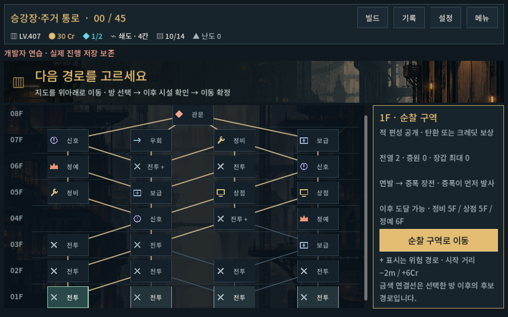
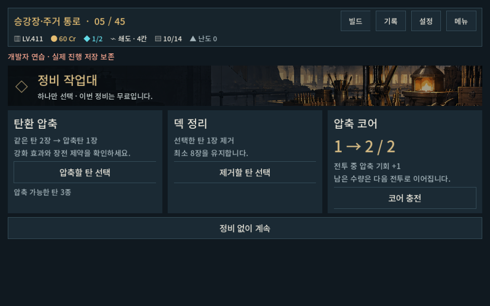
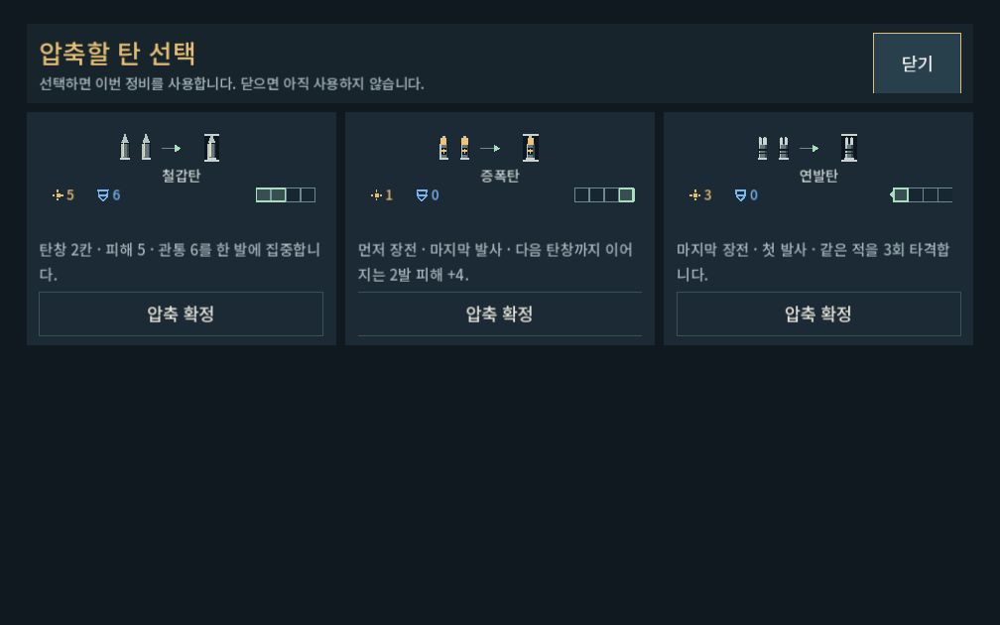
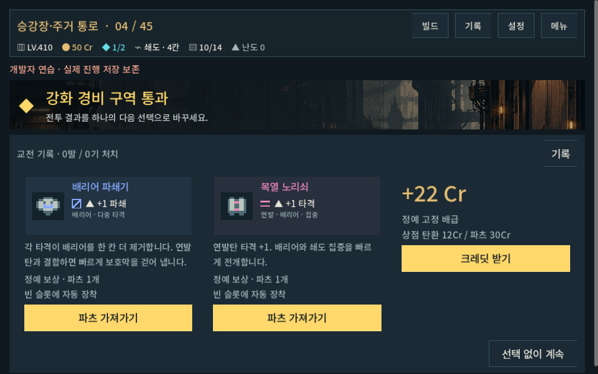

# 생성형 맵·정비·정예 검증

2026-10-09 · `prototype/core-redesign`의 미커밋 작업 트리 · Godot4.7 stable · 전투 저장v12 / 캠페인v4+맵v2.

## 구현

[현행 설계](../../direction/route-map.md). 새 등반은 출발4곳, 시드별 연결/시설,5지역45방이다. 정비1회(압축·제거·충전)와 정예 파츠 선택을 추가했다. 지도/진입/방문 이력 검증은 같은 연결 데이터를 쓴다. 맵 버전이 없는 기존 저장은 이전35방 구조를 유지한다. 고정 주소의 과거 개발 연습/QA fixture는 명시적으로 맵v1을 사용한다.

저장 이후 같은 지역의 보급소에서 기록을 다시 얻으면 숫자형 차이로 동일 기록 ID가 중복될 수 있던 결함도 수정했다. 정비 후 저장은 탄환 소유 영역과 이전 교전의 예약 상태를 정리한다. 실제 사용자 저장에는 접근하거나 덮어쓰지 않았다.

## 기능 검사

모두 `qa_runtime/` 아래 독립 APPDATA/LOCALAPPDATA로 실행했다.

| 검사 | 결과 | 확인 범위 |
|---|---:|---|
| `run_map_checks.ps1 -Mode rules -Label final` | 214,934 / 0실패 | 100시드×5지역, 고립/막힘/교차 없음,4출발, 같은 시드 재현,45방9경로 fixture 및 구35방1경로, 매 상태 저장/복원, 정비 중복/한도, 불법 경로/버전 거절 |
| `run_map_checks.ps1 -Mode ui -Label reveal_final` | 310 / 0실패 | 3해상도 실제 터치 입력,4번째 시작점, 미래 방 확인/진입 금지, 정비 충전/압축/제거/취소, 정예 파츠 획득, 스크롤 진입 위치, 저장 |
| `run_map_checks.ps1 -Mode combat -Label first` | 18,657 / 0실패 | 아래5무기45방 실제 명령·매 명령 저장/복원 |
| `run_progression_checks.ps1 -Mode rules -Label map_final` | 4,949 / 0실패 | 시작 패·성장·파츠·기존 경제. 고정2갈래/환기구 fixture는v1 명시 |
| `run_story_checks.ps1 -Label maps` | 727 / 0실패 | 도입·상점 이야기·기록·최종 복구·귀환. 새45방 승리는 전투 생략 fixture |
| `run_director_ui_checks.ps1 -Mode navigation` | 418 / 0실패 | 기존 메뉴/이동/작업 화면 회귀 |
| `run_director_ui_checks.ps1 -Mode city -CampaignSource qa_runtime/progression/campaign_synergy_final/city_campaign_report.json` | 947 / 0실패 | 기존 개발 화면과 과거 입력의 성장/탄창 레이아웃 |

검사 횟수는 반복되는 그래프/저장 불변식의 합이며 재미 점수가 아니다. 생성 검사의 완주는 전투를 생략하므로 별도 실제 전투 검사와 구별한다.

### 경로 다양성

각 지역100시드에서 **연결 구조100종, 시설 배치100종**을 각각 확인했다. 아래 경로 수는 출발부터 지역 보스까지의 완전한 경로 수다. 모든 후보 방을 방문하는 것은 아니다.

| 지역 | 방문 방 수 | 가능한 경로 범위 | 보스 포함 전투 수 범위 |
|---|---:|---:|---:|
| 승강장·주거 통로 | 8 | 41–186 | 3–6 |
| 축열 주조장 | 9 | 87–366 | 2–7 |
| 우수 정원 | 9 | 51–371 | 2–7 |
| 송전 회랑 | 9 | 62–312 | 2–7 |
| 관측대·제어실 | 10 | 129–632 | 3–8 |

변경 전에는 지역당 경로8/12/12/12/16개, 같은100시드에서 연결과 시설 배치가 각각1종이었다. [변경 전 조사](../../history/design/map-structure-review-2026-10-09.md).

### 실제 전투 완주

시드731042·난이도0. 실제 모델의 장전/확정/발사/재장전과 캠페인 명령을 실행했다. bounded solver는 미래 난수/패를 읽으므로 사람 플레이나 보편적 승률을 뜻하지 않는다. 자동 경로 정책도 시설 전망 전체를 최적화하지 않는다.

| 무기 | 방 | 전투 | 실제 명령 | 최종 보유 파츠 | 남은Cr |
|---|---:|---:|---:|---:|---:|
| 보행자 | 45 | 25 | 577 | 11 | 167 |
| 쇄도 | 45 | 27 | 672 | 13 | 156 |
| 산개 | 45 | 25 | 529 | 11 | 164 |
| 압쇄 | 45 | 27 | 669 | 13 | 157 |
| 증강 | 45 | 25 | 601 | 11 | 169 |

총3,048명령.5런 모두 정상 복구 직전 승리 상태 도달, 덱9~12장, 장착 슬롯/탄창 성장 제약 보존. 이 정책은 상점3회에서 파츠6개를 사고 코어 구매/반복 리롤은 거의 사용하지 않아 재화가 남았다. 새 길이에서의 재화 소비와 정예 보상 편향은 사람 플레이로 확인한다.

## 이전35방 실제 기록 호환

현재 전투v12로 만든 기존5무기×2경로 기록을 실제로 다시 실행했다.10런 모두35방 완주,4,394명령의 입력/결과 단계/노드/크레딧/턴이 원본과 일치했다. 초기 전체 비교는30,779검사 중10개가 실패했으며, 전부 앞선 세계관 작업의 최종 관문 명칭 `코어`→`중앙 제어실 관문`과 해당 명칭을 포함한 피격 문구 차이였다.

모든 차이 경로를 조사한 뒤 그 이름과 문구만 명시적으로 변환하는 검사 보정 함수를 추가했다. **이미 실행한 원본/결과 JSON 전체를 같은 보정 함수로 비교해122검사/0실패**를 확인했다(`tests/route_map_legacy_evidence_runner.gd`). 전투 수치·RNG·타이밍·표적·모든 명령·최종 덱/장착/경제를 그대로 비교하며, 수치를 임의로 바꾸면 실패하는 것도 확인했다. 이름을 제외한 전투 기록은 완전히 일치한다. 동일 명령을 보정 이후 다시 실행했다고 주장하지 않는다.

초기 실패 로그, 실제 재생 결과 압축본, 비교 결과와 원본 SHA256을 증거 폴더에 함께 보존했다. 원본은 `qa_runtime/progression/campaign_synergy_final/city_campaign_report.json`이며 기존 `build_synergy_2026-10-05_assets`에도 보존되어 있다.

## 화면 확인

1280×900,1008×630(글자1.1배),1440×630에서 캡처했다. 줄어든 헤더 높이로 설명이 잘리던 문제와 압축 미리보기 잘림을 수정했다. 노드를56논리픽셀 높이로 키우고 초기 스크롤을 배치가 끝난 뒤 적용하여 선택 가능한 첫 방을 온전히 보이게 했다. 지도 뒤의 배경을 어둡게 하고 불투명 노드로 연결선이 글자를 가로지르지 않게 했다.

전체 지역 지도는 스크롤될 수 있으며 오른쪽 선택 패널은 유지된다. 캡처·로그·생성 지표·소스 해시는 [증거 폴더](route_map_2026-10-09_assets/)에 보존한다.

## 남은 검증

- 새45방의 실제 플레이 시간·피로도, 정비/정예의 선택 편향, 재화 소비와 성장 속도.
- 여러 시드/고난도에서의 실제 전투 완주와 장기 빌드 다양성.500지도 생성 검사는500런의 실제 전투 검사가 아니다.
- Galaxy 실기기 터치·성능과 게임패드 전체 조작. PC의 터치 이벤트 검사를 실기기 검증으로 표현하지 않는다.
- 새로운 세계관 몬스터 자산은 후속. 이번 정예는 기존 적의 기능 변형이다.

APK·커밋·푸시는 이번 요청 범위에 없어 수행하지 않았다. [PLAY.cmd](../../../PLAY.cmd) → 새 등반에서 확인한다. 기존 이어하기는 이전 맵을 유지한다.
